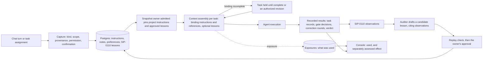

# SIP-0110: Cross-Cycle Memory

> **Placement and delivery (2026-10-04: the owner's rulings on the SIP-portfolio audit, `sips/PORTFOLIO.md`).** **The 2.2 headline, and 2.2's only change to squad behaviour**, beside #1708's auto tier and escalation queue, which change the control plane, not the squad. #557, #949 and #950 follow Outcome Evaluation's scenarios (2.4 or later). **Its 2.1 part** (the inert recall port, its call site, and the Phase-1 re-read) is **#1964**. **It owns** memory's scopes, lifecycle and payload; Capability-Backed Agents (3.x) defers to it. **A constraint from 3.x:** memory stays addressable as a service, the Embodiment Runtime's invariant 2. **Accepted with revision 4 (2026-10-06, §5b):** the re-read moves Phase 1's proving workload to the campaign's proposal gate. **Revision 6 (2026-10-07, §5d) restores the cycle as Phase 1's unit:** every eligible cycle is observed, inside a campaign or not, and the proposal gate is where Phase 1 is measured first, not its scope.


## Status
Accepted (2026-10-06), with revision 4, on the 2.2 plan's PR. The owner reviews both together, and
the merge is the acceptance (CLAUDE.md, SIP workflow step 3). Phase 1 is the 2.2 headline
(`docs/plans/2-2-0-plan.md`, a draft in the same PR).

**Author:** Jason Ladd
**Created:** 2026-08-03
**Extended 2026-10-09 (§5g):** the Memory Entry Points proposal, accepted, is Appendix A: chat and task assignment as
memory's entry points, placed in 2.3, 2.4 and 2.5.
**Revision:** 6 (2026-10-07). It restores the cycle as Phase 1's unit, which revision 5 had narrowed to the
campaign, and records the change in §5d. Revision 5 (2026-10-06) adopts an external design review as §0, the
normative Phase-1 contract, and records the change in §5c. Revision 4 (2026-10-06) re-reads Phase 1's value hypothesis against the evidence of 2.1's
line (§5b, #1964) and moves Phase 1's proving workload from the plan gate to the campaign's proposal
gate, where the recurrence is live. Revision 3 (2026-10-01) folds in the new elements of the owner's v4 draft (2026-08-29,
recorded in `docs/ideas/cross-cycle-memory-v4-draft.md`) as §5a, corrects references that went stale,
and states how Campaign (2.0) and this SIP meet. Revision 2 (2026-08-03) incorporated design-review
round 1: the typed Phase-1 primitive, governed encoding templates, the lifecycle `status` dimension,
deterministic Phase-1 retrieval, the recall-vs-outcome metric split, and Phase-1 decay.
**Builds on:** SIP-042 (LanceDB semantic memory — the storage mechanics until revision 6, which stores Phase 1's
records in Postgres, §0.8), SIP-0088/0089
(persistent agent identity), #669 (framing re-roll rejection context — the within-cycle
rung and the injection seam this SIP reuses), SIP-0101 (Cycle Replay Harness — the
measurement instrument), Campaign Orchestration (proposed, **v2.0's headline**, revision 2; see §7
and §5a).
**Absorbs:** the "Hierarchical Cognitive Memory Architecture" idea doc (J. Ladd, 2026-08)
as the long-term vision (§10); this SIP normatively specifies only Phase 1.
**Placement amended 2026-09-12 (owner's ruling, `docs/plans/1-8-0-plan.md` §8 decision 2):** **v2.2**, after Campaign headlines v2.0 — not a 1.8 rider and not a 2.0 rider. The evidence: the B1 baseline's inputs (`src/squadops/cycles/rejection_baseline.py`) hold thirteen rejection records, all 2026-08-10 to 2026-08-23, and none since 1.6.2's success-status single-sourcing; every counted set since 1.6.3 reports zero framing re-rolls, so Phase 1's seed corpus at the plan gate is empty on this workload — a zero that says the original proving workload is dormant, not that the mechanism has no value — and the recurrence that remains is in the correction loop (this SIP's own §13 question 3, "Phase 1.5"). **What 1.8 does for this SIP:** emits the B1 baseline as a document; ships the one lineage seam and the one failure-attribution registry (intentions 1 and 2) for the scorecard's sake. **What ships in v2.1, not in 1.8:** the recall port, an inert NoOp that answers *empty* (not `NoOpMemoryPort`, which raises), the root injecting it explicitly (a factory with a required selector arrives with the first real adapter), and the call site through `plan_rejection_context` — declared on six task types on main, not the three counted below. **2.1 also re-reads this SIP's Phase-1 value hypothesis against the recurrence evidence available at its cut**, so 2.2 activates the mechanism against a proving workload that is actually live. The paragraph below is the superseded 2026-08-07 placement, kept as the record.

**Placement amended 2026-08-07** (`docs/plans/post-1-5-roadmap-reconciliation.md`):
Phase 1 is no longer a committed 1.8 rider. It is a **decision point taken at 1.8 plan
time** — thin Phase 1 in 1.8, or pushed whole to 2.0 beside Phase 2 — because 1.8's two
co-headliners (Cycle Evaluation Scorecard + Campaign) are already substantial surface.
**The rails ship in 1.8 either way**, per the standing rails-before-mechanism rule
(SIP-0101 Slice 1, SIP-0096 Phase 1 inert core): the recall port is defined, a NoOp is
injected per the always-inject pattern, and the call site is wired, so whichever way the
decision goes it is an adapter swap and not a redesign. Four design intentions in that
record protect this SIP's seams inside 1.8 — one cycle-lineage identity (Campaign's
envelope, not a private concept), one failure-class vocabulary (not a parallel taxonomy
in the scorecard), recall through the existing `plan_rejection_context` contract rather
than a handler branch, and the inert port above. **A fifth intention lands in 1.6, not
1.8, and is the only one that cannot be retrofitted:** the pre-memory rejection-class
recurrence baseline must be recorded during the authored-mode window, since once memory
is live that baseline is unrecoverable and this SIP's value claim becomes unmeasurable.
**External reference:** CrewAI, "How we built cognitive memory for agentic systems"
(blog.crewai.com) — adopted for its failure catalog and recall design; deliberately
diverged from on agent-discretionary memory tools (§6).

---

## Delivery ledger (current as of 2026-10-24)

Kept by the rule in CLAUDE.md ("SIP System"): one row per part, updated in the PR that ships or
re-places it.

| part | status | where |
|---|---|---|
| the recall port, inert (answers empty), injected explicitly by the root, and its call site through `plan_rejection_context` | **shipped** | 2.1.0, PR #2058, issue #1964 |
| the re-read of the Phase-1 value hypothesis against 2.1's recurrence evidence, as an amendment here | **shipped** | PR #2097, issue #1964: the evidence up to the final deploy is §5b (revision 4), and the cut's readings are §5b's last part |
| Phase 1, slice 1: capture each consuming seam's inputs before authoring (proposal writing first, then plan writing, build authoring and repair), and the source-case inspection (§0.11, §0.4) | **shipped** | 2.2.0, PRs #2116, #2119 and #2123, issue #2105: every seam's envelope reconstructs byte for byte on a live cycle (posted on #2105); the inspection is §5e. The three plan proposers (`development.propose_plan_tasks`, `qa.propose_plan_tasks`, `strategy.propose_plan_guidance`), which no proof's framing had run, rendered a random id and did not reconstruct until PR #2142, issue #2141 |
| Phase 1, slice 2: the authoring replay, three arms, validated first on proposals (§0.11–§0.12) | **shipped** | 2.2.0, PRs #2137, #2139 and #2140, issue #2106: on a live deploy every captured envelope at every seam is valid (30 of 30: proposal, plan writing, build authoring and both repairs), and the exploratory proposal run authored all three arms (posted on #2106) |
| Phase 1, slice 3: the mechanism, observing every eligible cycle and supplying four seams, inert until approved, with the app-build indicators beside each exposure, the failure-shape sorter and the repeat report (§0.2–§0.10) | **shipped** | 2.2.0, PRs #2120, #2121, #2122, #2124, #2125, #2126, #2127, #2129, #2130, #2132 and #2134, issue #2096: inert and observed live on the regression pair (memory disabled) and on the campaign proof `cmp_dae2cd6b0e3c` (memory enabled, nothing approved), with the repeat report's first read (posted on #2096). A re-dispatched authoring (a correction round's re-take, an emission retry) recorded no exposure of its own, against §0.2, until PR #2163, issue #2162: the rebuild 5 and 6 Next.js regression cycles each had one more envelope than exposures. The exposures table still held one row per task of a run, and refused that exposure on the deploy, until issue #2165 (the rebuild 7 Next.js cycle's qa.test, authored three times, kept only the first attempt's) |
| the reviewed annotation by which a return classified only in prose enters (§0.4): beside its observation, adding no occurrence, classifying only once the owner reviews it; and a lesson cites only classified observations | **shipped** | 2.2.0, PR #2186, issue #2160 |
| Phase 1, slice 4: the first lesson, drafted by the auditor, and the measurement window, read before 2.2.0's cut (§0.4, §0.12–§0.13) | **shipped** | 2.2.0, PRs #2207 and #2209, issue #2107: the window ran on rebuild 12 and its finding is no demonstrated useful benefit (§5h). The owner disabled the lesson at the cut, and its approval is revoked |
| Phase 1, the next build-side experiment: broader multi-increment campaigns with memory on, the repeat report and the auditor's reading, a build or repair lesson only for a substantiated target, its replay check and approval, and the comparison within that target (§5h) | **unplaced** | the owner's ruling at the 2.2 cut (§5h): the 2.3 plan places it, beside Outcome Evaluation's instruments |
| Phase 1.5: the correction lane (§13 question 3) | **dropped** | by revision 6 (§5d), which folds it into Phase 1: its observation is slice 3's, its repair seam is wired inert in slice 3, and its capture is slice 1's. A correction-round template waits for a recurring target behavior (§0.4) |
| Phase 2: consolidation and promotion (§8) | **unplaced** | gated on Phase 1's measurement (§8). The owner ruled at the 2.2 cut that it stays gated (§5h) |
| entry points: the legacy agent store made dormant, its failures visible (Appendix A, §A.4.3) | **shipped** | 2.3.0, PR #2246, issue #2174: the agents hold a dormant port that refuses at WARNING, chat neither recalls nor stores, and no embedder is built on a default; the eight stores re-inventoried empty (posted on #2174) |
| entry points: chat's conversation history reaching the agent, with session ownership checked (SIP-0085 §4, §9; §A.3.3) | **shipped** | 2.3.0, PR #2247, issue #2175: resuming or reading a session checks its owner and agent first, refused as a missing session; each turn carries its bounded history, the drop counted |
| entry points: the context-assembly port, inert, at the four seams (§A.3.6) | **shipped** | 2.3.0, #2257 (closes #2176; §5j records where it departs from §A.3.6's text) |
| entry points: the typed records (notes, preferences, project and task instructions), permissions by kind, provenance (§A.3.2–§A.3.4) | **shipped** (§5l) | 2.4.0, PR #2508, issue #2177 |
| entry points: task instructions, with the work target, retries, references bound with the cycle, binding holds and emergency withdrawal (§A.3.5–§A.3.8) | **shipped** | 2.4.0, closes #2178: stage 1 (the records reach the tasks they name, binding, the task held when incomplete) shipped in PR #2513 (§5m), stage 2's interventions after admission with `squadops instructions` in PR #2549 (§5w), and `carries_into: continuations` with the increment gate's structured `task_instructions` field in PR #2556 (§5aa), and a task instruction's `@current` bound with its cycle (T16's task part) in PR #2559 (§5ab), the hold and its release in PR #2636 (§5ag), and emergency withdrawal after dispatch (T13) in the PR that wrote this row (§5ah) |
| entry points: project instructions in the snapshot with references bound, re-binding, the effective lesson budget, the comparison arms and disclosure (§A.3.6, §A.3.7) | **shipped** | 2.4.0, #2179: stage 1 (pinned at admission, binding on the tasks they apply to, the lesson budget after them) shipped in PR #2515 (§5n), stage 2's effective lesson budget (T17) in PR #2526 (§5r), the `memory_context: none` arm with the lesson-text diagnostic in PR #2528 (§5s), a counted roll's pinned instruction set in PR #2533 (§5t), and a project instruction's emergency withdrawal in PR #2544 (§5u), re-binding a running unit's project instruction in PR #2546 (§5v), and `@current` bound at admission, the project part of T16, in PR #2555 (§5z), with the write-time refusal of a reference no unit of its project can bind in PR #2567 (§5ac); a campaign's repository references, bound per cycle against the campaign's snapshot (the owner's ruling of 2026-10-20, §5ad), in PR #2570 (§5ae), reading a reference's content at dispatch in PR #2668 (§5ai), and re-binding a reference's revision in the PR that wrote this row (§5aj, closes #2179); re-binding the unit's total budget waits for a budget the snapshot holds (§5v, §5aj) |
| entry points: chat on the substrate, with capture confirmed, chat exposures, server-side project binding and provenance authorized (§A.3.5) | **shipped** | 2.4.0, issue #2180: stage A (the binding, each turn's context and exposure, confirmed capture of notes and preferences, authorized provenance, Q29's deletion) in PR #2517, stage B's project-instruction capture in PR #2525 (§5o), and its task-instruction capture in PR #2550 (§5x) |
| entry points: lesson inspection from chat; a conversational claim never becomes a lesson (§A.3.5) | **shipped** | 2.4.0, PR #2518, issue #2181 (§5p) |
| entry points: the console's memory record view (§A.3.11) | **shipped** | 2.4.0, PR #2524 (§5q), closes #2182: its capture was taken live with #2183's T11 on the Mac (issuecomment-6355208484): a record's source, scope, status, revisions, consuming tasks and results, beside an accepted build, with "no effect measured" apart; the list's layout the owner found there was fixed in PR #2695 (#2692) |
| entry points: the acceptance matrix, T1–T17, live on a deploy (§A.5) | **shipped** | 2.4.0, #2183: every case passed, each with its evidence on the issue (the summary is issuecomment-6376996254). T1–T11 and T13–T17 ran on the Mac's deploys of main from `dc7f3324` to `b3acbc82` with `lite-14b` (T17's re-run on #2693's branch before it merged), and T12 with T6's campaign half ran on the Spark's cut deploy (`dep_d7ff50b9b39c`, `full-38-tf`, issuecomment-6376598961). Five sub-cases are held by unit tests instead, each named with why in the summary: T8's failing records store and its two optional failures, which would fail the run's own Postgres reads; T14's session used with another agent, since only Joi has messaging enabled; and T12's continuation without `carries_into`, which the campaign didn't make. What it found was fixed before it closed: a `qa.test` that showed no instructions (#2674, PR #2675), a task composed and measured at the run's start rather than at its own dispatch (#2681 and #2684, PR #2693), a pair whose arms nothing read (PR #2702, §5al), and a calibration stopped at its plan gate promoted as an empty accepted tree (#2704, PR #2705, SIP-0109 §24cb) |
| entry points: the legacy agent store retired (§A.4.3), on the owner's OK for its compose change | **shipped** | 2.5.0, PR #2735, issue #2184 (§5am): the eight stores re-inventoried empty first; `MemoryPort`, the LanceDB adapter, the agents' store construction, `lancedb` and the eight volumes removed, on D4 of the 2.5 plan; the volumes kept on the box until the cut |
| a unit pinned while a revocation or a withdrawal is answered, missed by its answer (§0.7, §A.3.8) | **shipped** | 2.4.0, PRs #2603 (the dispatch half, §5af) and #2551 (the pin half, §5y), issue #2545: found by the second reader on PR #2544 (§5u) |

**What closes this SIP:** Phase 1's four slices shipped in 2.2.0 with the window's finding recorded (§0.13), Phase 2's
gate ruled by the owner on that finding (both done, §5h), the next build-side experiment shipped or dropped, and the
entry points' eleven rows (§5g, Appendix A) shipped or dropped, and #2545's two windows closed.

## 0. The Phase-1 contract (normative, revision 6)

**This section governs Phase 1.** Revision 6 (2026-10-07) restores the cycle as Phase 1's unit. Revision 5 had
narrowed it to the campaign: it observed only proposal returns, pinned memory only at a campaign's admission, and
supplied it only to proposal writing. §5d records the change, its evidence and who ruled it, and this section is
edited in place so that it stays the one current contract.

Revision 5 (2026-10-06) adopts an external design review of revision 4 and of the 2.2 plan. The review found that earlier sections still read as active requirements and contradict each other:
- the observation seam (§5) against the proposal ruling (§5b);
- the consumer;
- the instrument (§5a, §9);
- the experiment;
- deterministic retrieval against §6's composite scoring;
- admission (`validated` against §5a's `candidate`);
- feedback (§5) against §7's campaign-close update;
- the Phase-2 gate (§8).

Where an earlier section disagrees with this one, this one holds, and the earlier text is marked as superseded where it stands. Who ruled it is §5c, and for revision 6 §5d.

**In one paragraph:**
- **Phase 1 observes every eligible cycle,** a standalone cycle or one inside a campaign. It reads three committed
  records: plan-review rejections, failed correction rounds, and proposal returns. Each is recorded whether or not a
  lesson exists for it (§0.3).
- **It encodes** reflective guidance in project scope. A frontier-model auditor drafts each lesson from the recorded
  evidence, between units, and each is frozen, replay-checked and approved by the owner before any task is given it
  (§0.4, §0.6). Correction rounds are sorted by the failure shape the test runner reported, and a repeat report
  separates repeated shapes from recurring mistakes the auditor has substantiated (§0.4).
- **It supplies approved, applicable pattern revisions at four authoring seams:** plan writing (#2058's call site),
  build authoring (`development.develop`, `qa.test`, `builder.assemble`), repair, and proposal writing
  (`strategy.propose_increment`) (§0.9).
- **Retrieval is deterministic,** from a memory snapshot pinned when the unit of execution is admitted: a standalone
  cycle when it is created, a campaign when it is admitted (§0.7). So a lesson learned inside a campaign reaches later
  units, never a later cycle of the same campaign (§0.1).
- **Counted regression rolls declare memory disabled,** so the regression yardstick does not move (§0.7).
- **Authoring replay is the proving instrument.** The first measured target is a proposal behavior, because the
  proposal gate is the only seam with a recurring target behavior in the record so far (§5b, §0.12).
- **App-build indicators are recorded beside each exposure** (correction rounds, rounds to green, acceptance). They are
  observed, never gating, and **Phase 1 claims no improvement in the built application** (§0.10, §0.13, §9).
- **These stay deferred:** semantic ranking, autonomous promotion and any other payload (§0.14).

### 0.1 What Phase 1 tests

Phase 1 tests whether **retaining and selectively applying reviewed lessons from earlier cycles improves later authoring** under controlled conditions. A frontier-model auditor drafts the lessons from the recorded evidence, between units, and the owner approves each after a replay check (§0.4, §0.6). Observed experience decides which are kept and supplied. Its first measured target is a proposal behavior (§0.4). That is where it is measured first, not what it is (§5d).

**It is cross-cycle learning.**
- Observations are recorded from every eligible cycle while it runs, whether the cycle stands alone or runs inside a
  campaign.
- New guidance never activates within the unit that is running. The unit is a standalone cycle, or a campaign together
  with its cycles and proposals.
- Owner-approved changes apply to cycles and campaigns admitted afterwards.
- **A campaign is provenance and one consumer, not memory's scope** (§7). A lesson learned in a standalone cycle
  reaches a later campaign's matching seam, and one learned in a campaign reaches a later standalone cycle, wherever
  its approved applicability holds.
- Correcting the same output stays with the rungs that already exist:
  - a framing re-roll's rejection context (#669);
  - the failure evidence a repair is handed;
  - a proposal revision's note (SIP-0109 §9.2).
- Unattended learning (evidence-gated activation at a declared boundary, with rollback and measurement) would need its own authorization. It must not emerge from feedback updates.

**When a lesson takes effect, exactly:**
- every eligible cycle contributes observations, standalone or inside a campaign (§0.3);
- what is learned is project-scoped (§0.6);
- a lesson takes effect at the next admission of a unit: a standalone cycle's creation, or a campaign's admission
  (§0.7);
- **within a campaign, a lesson learned from one of its cycles cannot reach a later cycle of the same campaign,**
  because the campaign's snapshot is fixed when it is admitted. Within a campaign, the existing carriers still apply:
  a retry's prior-cycle brief (#1692) and a returned proposal's note (SIP-0109 §9.2);
- this holds in Phase 1. **Activation within a running campaign is deferred** (§0.14): it would need an approval during
  an unattended run, and it would break the comparison of whole campaigns (§0.12).

### 0.2 The domain model

These six are domain concepts, not services or databases:

| concept | what it is | identity |
|---|---|---|
| **observation** | one immutable occurrence from one of §0.3's three sources: a rejected plan, a failed correction round, or a returned proposal, with its classification disposition and evidence | the committed record it projects: the gate decision, the correction round, or the ruling's control-log entry |
| **pattern** | the stable identity of one behavioral lesson | project scope, target behavior (§0.4), task type |
| **pattern revision** | immutable guidance text, applicability and template version, with its drafter (the auditor's model and version) and the observations it cites | pattern and revision number |
| **approval** | the owner's authorization of one revision for a stated applicability | revision and applicability |
| **exposure** | the exact revisions supplied to one authoring invocation at a consuming seam (§0.9), with what was omitted and why | the invocation |
| **assessment** | what was observed for that exposure's targets (§0.10) | the exposure |

They are stored as four records: observations, pattern revisions, approvals, and exposures that carry their assessment.

**The invariant:** a new occurrence adds evidence. It never resets a lesson's history, restores deprecated guidance, or inherits approval for changed content. Re-encoding a historical observation through a new template keeps the observation's identity, so one failure never becomes two pieces of evidence.

### 0.3 Observe

**What is read.** Three committed records, from every eligible cycle, whether it stands alone or runs inside a
campaign. Each is read as a projection from the record that stays authoritative:

| source | the observation | its authoritative record |
|---|---|---|
| **plan review** | a plan-review gate decision that rejects a plan, by a validator or by a person, with its reasons | the cycle's gate decisions (`cycle_gate_decisions`), with the `rejection_record` that names the validators and proofs it refused on (#809) |
| **correction round** | a failed correction round: the failed check, its attribution, and the round's own account of why (`failed_detail`, #2028, #2086) | the run's loop summary (`run_loop_summaries`) |
| **proposal ruling** | a ruling at the increment gate (SIP-0109 §9.4) that returns a proposal | the campaign control log |

**Eligibility.** Some failures say nothing about authoring, and these never become observations:
- a failure in a cycle that declares an injected fault: such a cycle is a diagnostic by construction
  (`capabilities/handlers/fault_injection.py`);
- a failure attributed to the environment (`environment_or_infrastructure_failure`, `cycles/failure_attribution.py`);
- a replay's outputs.

A counted regression roll is observed like any other cycle. Its plan rejections and failed rounds are real.

**The projection's guarantees:**
- only committed, eligible records produce memory;
- a duplicate delivery adds no evidence, pattern or feedback;
- a crash between the record's commit and the projection is recovered by reconciliation;
- a retraction or reclassification keeps the history and marks the guidance that depended on it;
- replay experiments never write to the production corpus;
- **the projection runs beside execution:** its failure never fails, holds or changes a cycle, and reconciliation
  recovers it.

Each projection uses its source's existing durable record. It is not a new service or a distributed transaction.

### 0.4 Classify and encode

**Every observation carries a classification disposition** in its source's own vocabulary, or an explicit
`unclassified` with its rationale and evidence:

| source | its vocabulary |
|---|---|
| plan review | the plan validator that refused the plan, or the manifest gate's proof class: the B1 baseline's vocabulary (`RejectionClassifier`, `cycles/rejection_baseline.py`). A person's rejection carries a class only when its decider records one |
| correction round | the failure's attribution (`AttributionClass`, `cycles/failure_attribution.py`) and the failed check, and beneath them the **failure shape** the sorter matches in the test runner's own message, and the target behavior the auditor substantiates from it (below). An `unattributed` failure is recorded as `unclassified` |
| proposal ruling | a `ProposalClassification` class |

An `unclassified` observation:
- is valid, and for a ruling a valid gate action;
- produces no pattern;
- is counted in coverage reporting;
- enters a taxonomy backlog.

**A rail on proposal returns only.** A proposal return carrying neither a class nor `unclassified` is refused (SIP-0109's
rail, 2.2 plan decision D2). Plan reviews and correction rounds gain no new rail in Phase 1: a person's plan rejection
with no recorded class enters as `unclassified`, and a correction round always carries its attribution. A historical
return whose class is only in prose enters through a reviewed annotation, which keeps both the original ruling and the
annotation's provenance.

**Target behaviors sit beneath each vocabulary.** Each source's vocabulary stays its gate's or its registry's. Where one
class holds different corrections, a reviewed **target behavior** beneath it names one. *Criteria not checkable* holds at
least two:
- a new criterion already satisfied by the accepted application;
- a criterion stating a rule the request does not.

**Phase 1 starts with one supported target behavior:** **a proposed new acceptance criterion is already satisfied by the
accepted application.** Plan reviews and correction rounds have none yet. The 2.0 and 2.1 windows show no recurring
target behavior at either: no plan was rejected, and the four failed rounds at the 2.1 cut were four different defects
(§5b). **A lesson for a plan-review or correction-round target is drafted when the auditor has substantiated one
target behavior recurring across independent cycles,** starting from the repeat report's repeated shapes (below). The
report is read at slice 4's pre-registration and again at the 2.2 cut, and the owner approves what is drafted from it
(§0.6). A class or behavior claimed as supported must have its template, and an unsupported one is disclosed backlog
that never blocks a legitimate return.

**The failure-shape sorter** (the 2.2 plan's D14). A correction round's attribution and check are too coarse to show a
repeat: every failed round in the 2.0 and 2.1 windows failed `tests_pass`, and what went wrong is only in the text of
`failed_detail`. So:
- **a failure shape is an observed signature: what the runner reported, never why.** The sorter establishes no cause,
  as the attribution registry's classes name evidence, never a cause (SIP-0108 §4.2);
- **each runner has a table** of its own failure messages and the failure shape each one identifies. It extends the
  tables the test runner already keeps per runner (`capabilities/handlers/test_runner.py`): the messages that mean a
  suite could not run (`_VITEST_SUITE_BROKEN_MARKERS`, #626) and the shapes a suite raises in its own frame
  (`_OWN_FRAME_SHAPES`, #1130, #1270). It does not start a second table. For example, vitest's
  `Failed to resolve import "…". Does the file exist?` identifies an unresolved import;
- **the correction-round projection applies the table of the runner that ran the suite** to each `failed_detail`
  entry, and records the shape it matches with the table's version. No model sorts. A message no row matches is
  `unclassified` and enters the backlog;
- **a shape sits beneath the attribution, never beside it.** It never maps to an attribution class, so the attribution
  registry (`cycles/failure_attribution.py`) stays the only home of attribution (SIP-0108 §4.2), and the sorter is not
  the parallel taxonomy SIP-0109 rules out for memory. It is coarser than the correction loop's own signature
  (`cycles/correction_signature.py`), which compares one run's rounds by check, file and test: a shape drops the file
  and the test, so the same mistake in another cycle's application still matches;
- the four rounds recorded with `failed_detail` so far (the 2.1 cut, §5b) each carry such a message: an unresolved
  import, an element not found, a mocked function that is not a function, and a spy called with other arguments.

**The auditor establishes the target behavior.** A shape is evidence. The auditor proposes a target behavior and a
corrective lesson only where the failed round's artifacts substantiate them: the suite, the subject files, the repair
it was handed and its result. The same shape can be different mistakes. `is not a function` is the suite's mistake or
the application's depending on whether the application defines the name, which is why the runner's own table carries
`ambiguous_when_app_defines`. A case the artifacts do not settle stays `unclassified`.

**The repeat report.** It counts, by the independent cycles they occurred in, two things kept apart: **repeated
shapes**, which the sorter found, and **recurring target behaviors**, which the auditor substantiated in each case. A
retry and the cycle it retries count once, and a campaign's cycles are named with their campaign. A repeated shape is a
candidate, not a finding. The report is the auditor's input (below), and it is read at slice 4's pre-registration and
at the 2.2 cut.

**Each lesson fills its target behavior's template:**
- the observable defect;
- the corrective action;
- the evidence needed to take it;
- its applicability and exceptions;
- the rubric that assesses recurrence.

For this target, the corrective rule leads to evidence of the intended before-and-after difference against the accepted application. It is not an admonition to write checkable criteria, which already failed (#1947).

**Who drafts a lesson, and what it may use** (the 2.2 plan's D15).
- **A frontier-model auditor drafts each lesson** from the observations and their evidence: the outer loop's model (the
  supervisor in 2.2, the crew once it is commissioned), never the squad's own model judging its own output. This is the
  owner's direction of 2026-09-28: frontier models improve the framework from the evidence of how cycles perform. The
  auditor cites the observations a lesson rests on, and fills its template.
- **It drafts between units, never inside a running one.** No model in a running cycle or campaign writes or changes a
  lesson, and recall and injection stay deterministic (§0.8).
- **A draft is frozen when it is drafted,** as a pattern revision (§0.2): its text, its drafter's model and version, and
  the observations it cites. No task is given it until it is replay-checked and approved (§0.6).
- **The auditor also reads the backlog.** It may propose a new target behavior, or a new row in a runner's table. A new
  row is a code change, reviewed as one.
- Free text stays evidence. It becomes guidance only through a frozen, approved revision.
- The v4 draft's precedence rule (compilation, then security, then function, then performance; §5a) is not applied to any source's classes. Every observed defect is kept as evidence.

**`validated` means admissible, not effective:** the observation has an admissible source, recorded evidence, a supported classification and a valid governed encoding. It says nothing about whether the guidance helps. Source admissibility, the owner's authorization and measured benefit stay distinct.

### 0.5 Provenance

The source is typed, one of three: §5's `gate_decision` for a plan review, a **correction round**, and a **proposal
ruling**.

**Every source carries:**
- the project, and the campaign when there is one;
- the record's identity, and any record that supersedes it;
- the authoring invocation it judged (cycle, run and task), where one exists;
- the criterion and evidence references;
- the classification and template versions.

**And each carries its own:**

| source | it also carries |
|---|---|
| plan review | the gate decision; the decider's identity and type (a validator or a person); the rejected plan, by reference |
| correction round | the round's index; the failed check and its attribution; `failed_detail`, the failure shape with the sorter table's version, and the target behavior with the auditor's substantiation, where one was established; the repair's task, when one was dispatched |
| proposal ruling | the proposal's id and version; the ruling's control-log entry; the decider's identity and type; the accepted application's identity it was judged against |

**What is optional, and what the model fields mean.**
- **The campaign is optional on every source.** A standalone cycle's observations carry none.
- **The cycle id is optional on a proposal ruling only,** because a returned proposal may never create a cycle.
- `origin_mode = cycle` names the execution posture, not a cycle's existence.
- **The origin model is the author's:** the planner's, the build author's, the repairer's or the proposer's. A model
  used in classifying, if any, is recorded separately.

### 0.6 Approval and activation

**What an approval binds.** An approval binds one pattern revision to a stated applicability: project, task type, role, stack and model families. A new approval is needed to:
- change the content;
- widen the applicability;
- add a model family.

**Before approval, a draft is replay-checked:** at its seam, on development cases (§0.11), with and without it, under
§0.12's guardrails. **It is checked together with the approved lessons that would be supplied beside it** under the same
applicability, since a task receives up to three (§0.8): the auditor checks the set for overlap and conflict first, and
the replay runs the combined set. A conflicting set is not approved as it stands: a lesson is revised, narrowed or
withdrawn. The result goes to the owner with the draft, and the approval records it. A draft whose seam has no
captured case waits for one. A lesson can be wrong whoever drafts it: #1947's prompt rule was written once the proposal
mistake had been recognized, and the mistake recurred twice after it (§5b).

**The statuses.**
- Approval to influence execution is distinct from promotion to a broader scope, which is Phase 2's.
- In Phase 1, `status = promoted` (§5) is read as *approved for its stated applicability*, and no other promotion exists.
- A revision approved for model family A is not recalled for family B.

### 0.7 The snapshot, pinned per unit of execution

When a unit of execution is admitted, it pins a memory snapshot, an immutable manifest of:
- the available pattern revisions and their approvals;
- the template versions;
- the retrieval policy and thresholds;
- the applicability rules;
- the ordering and the budgets.

**The unit is one of two:**
- **a standalone cycle,** pinned when the cycle is created;
- **a campaign,** pinned when it is admitted. Its proposals and all its cycles use the campaign's snapshot, so guidance
  never changes between its increments.

**What can change, and when.**
- Every consuming task (§0.9) selects from its unit's snapshot and records its exposure.
- Feedback accrues at once.
- Approval, deprecation, confidence and template changes reach cycles and campaigns admitted later.
- Concurrent units keep their own snapshots.
- A restart reproduces the original selection from the same snapshot and task inputs.

**Memory disabled, declared.** A unit may declare memory disabled when it is admitted: a standalone cycle when it is
created, a campaign when it is admitted, and the campaign's proposals and cycles then follow it. The unit pins a
disabled snapshot that carries no lessons (§5i), every consuming task records a `disabled` exposure, and its prompts are
rendered as if memory did not exist.
A whole campaign declaring it is the memory-off arm of a live confirmation (§0.12). **Its observations are still
recorded** (§0.3). **Every counted regression roll declares it,** written by the
verification-set driver, until the owner rules otherwise on a finding of supported benefit (2.2 plan D12). The regression
set is the framework's yardstick, and an approved lesson must not move it unannounced.

**Emergency revocation** of demonstrably harmful guidance halts or restarts the affected work under a new snapshot, and the affected measurements are explicitly invalidated or set apart. A counted intervention is never changed silently halfway through.

### 0.8 Recall

**Who owns what.**
- **Phase 1's four records are stored in Postgres, beside the cycle registry** (the 2.2 plan's D13). They sit behind
  their own port, with an in-memory adapter for tests and a Postgres adapter in a deploy, selected as the cycle
  registry is (`adapters/cycles/factory.py`). The reasons:
  - recall in Phase 1 is exact filtering (below), so it needs no embedding;
  - each projection must be idempotent and reconciled against its source (§0.3), and the sources
    (`cycle_gate_decisions`, `run_loop_summaries`, the campaign control log) are in the same database;
  - the store stays addressable as a service, the Embodiment Runtime's invariant 2;
  - the nightly verified backup covers Postgres only (`scripts/dev/ops/backup_db.sh`).
- **SIP-042's `MemoryPort` is not Phase 1's store.** Its LanceDB adapter is each agent's own store, embedded in the
  agent's container (`agents/entrypoint.py`), and used today only by console chat. The runtime API, where recall and
  the plan composer run, has none. Phase 2 chooses a similarity index when it adds ranking (§8).
  > **2026-10-09 (§5f):** that store holds no record on the deploy and cannot write one (#2171), and its only reader,
  > console chat, reaches only joi. The memory entry-points proposal makes it dormant (2.3) and retires it in the
  > stabilization release after its replacement passes acceptance;
  > a similarity index, if one is ever added, is derived from Postgres records and owns none of them.
  > **2026-10-24 (§5am):** retired in 2.5 (#2184). No agent holds a store.
- The recall policy behind `FailurePatternRecallPort` owns eligibility, authorization, snapshot selection, ordering and disclosure.
- The executor is a consumer. Duty and ambient callers will reuse the policy rather than reimplement its trust rules.

**The algorithm:**
1. The authorized project scope, taken from trusted execution context, never from an agent-supplied namespace or replay flag.
2. The pinned snapshot.
3. Eligibility: payload, task type, role, stack, model family, approval. Unknown applicability never means "everywhere"; stack-independent guidance says so explicitly.
4. Deduplication: one revision per pattern, the latest approved in the snapshot.
5. A total order: approval time, then pattern id.
6. Budgets: at most three patterns, and a token budget. A pattern over budget is omitted whole, never truncated.
7. The exposure records what was selected and what was omitted, with reasons.

**Five outcomes stay distinct:** memory disabled, nothing eligible, eligible but omitted by budget, an invalid or incompatible record, and recall failed. Retries are bounded. A failure marks the measurement invalid, and never reads as an empty corpus or a memory-on trial.

**The continuation decision never queries mutable memory** (§7's purity boundary). It may consume ordinary evidence from memory-informed proposals.

### 0.9 Inject

**The recall reaches four authoring seams.** At each it arrives through a managed fragment in its own slot, never in a
within-cycle rung's slot:

| seam | the consuming task types | kept separate from |
|---|---|---|
| **plan writing** | the six plan-authoring types that declare `plan_rejection_context` (#2058's call site, `cycles/task_plan.py`) | a framing re-roll's rejection context (#669) |
| **build authoring** | `development.develop`, `qa.test`, `builder.assemble`, through the same plan-time composer as plan writing (`cycles/task_plan.py`) | a retry's prior-cycle brief (#1692, SIP-0109 §10a) and the manifest's surfaces |
| **repair** | `development.repair`, `development.correction_repair`, `qa.test_repair`, `builder.assemble_repair` | the failure evidence the repair is handed |
| **proposal writing** | `strategy.propose_increment` | a proposal revision's note (SIP-0109 §9.2) |

**Build authoring is where a correction-round lesson is front-loaded.** A lesson learned from failed correction rounds
reaches a later cycle's first authoring of the output, before its check can fail, and not only the repair after the
check has failed. That is §2's correction-lane thesis: about ten prompt lines spent to save one or two correction
attempts. Without this seam, a correction-round lesson could only arrive at a later cycle's second attempt.

**Which task types consume is declared,** on each type's context-assembly contract (`capabilities/context_assembly.py`),
as `plan_rejection_context` is today, never by a branch on the type.

**Current requirements outrank history.** The slot's fragment states that the task's own requirements and the
application's authoritative contracts (the manifest, the accepted application) take precedence over any lesson. A lesson
never overrides them.

**With an empty, unapproved or disabled snapshot, every seam's rendered prompt is byte-identical** to one rendered
without memory.

### 0.10 Assessment and feedback

**What an assessment attaches to.** It attaches to the exact authored output (a plan, a build output, a repair, or a
proposal revision) and its exposure, not to the next gate event or check. A gate's or a check's silence about a target
is not evidence the target is absent:
- the output may be refused for another defect;
- it may carry several defects and record one;
- it may be approved without the target being checked;
- it may avoid the defect by omitting meaningful work.

Each target is assessed by its template's rubric as **present**, **absent after assessment**, **not applicable**, or **unassessed**. Retrieval, injection, assessment and outcome are recorded separately.

**The statistic is `target_absence_rate`,** over applicable, assessed exposures. It replaces §5's `success_rate`. It is observational, not a causal estimate of memory's benefit. Unassessed and inapplicable exposures earn no credit. Aggregation at a cycle's or a campaign's close summarizes assessments, and never overwrites them with cycle success (§7).

**What a recurrence means:**
- Repeated recurrence is a diagnostic trigger, not proof the rule is false. The model may lack the evidence, misread the instruction, or fail to follow valid guidance.
- Invalid guidance and ineffective delivery are told apart.
- Harm is attributed only on explicit evidence.

**Phase 1 has no automatic decay.** Deprecation is the owner's decision on assessed evidence, and takes effect at the next admission of a cycle or campaign. A small, precise policy is preferred to an unsupported confidence formula.

**App-build indicators, observed beside each exposure.** Every exposure, `disabled` ones included, is joined to the
build that its output fed, and the cycle records that build's indicators:
- the implementation run's correction rounds, failed and refunded (`run_loop_summaries`);
- the rounds it took to reach green, or that it did not;
- its acceptance: the run's verdict, and in a campaign the increment's ruling.

**Counted once per build, with its state.** One run feeds many exposures (its plan writing, its build authoring, its
repairs), so the indicators are reported once per distinct build run, never once per exposure. An exposure's build is
in one of four states: built, with its indicators; no downstream build (a returned proposal); pending (an increment not
yet run); or evidence missing. None of the last three reads as a build failure.

These are §9's outcome tier: observed in Phase 1, never gating it. They never enter an exposure's assessment or the
`target_absence_rate`, since a green build says nothing about whether the target was present. Disabled exposures (the
counted regression rolls, §0.7) give a series without memory beside the series with it. The two run different
workloads, so a difference between them is descriptive, never a causal estimate.

### 0.11 The instrument: authoring replay

**What is captured.** An `AuthoringReplayEnvelope` is captured immediately before each consuming seam's authoring task
(§0.9). Revision 5's `ProposalReplayEnvelope` is this envelope at the proposal seam. It contains, or immutably
references:
- the seam and the task;
- the objective or PRD, and the policy;
- the revisions of the accepted application, PRD, manifest and evidence, where they exist;
- the task's actual inputs;
- the within-cycle rung it carries, if any: a re-roll's rejection context, a repair's failure evidence, a retry's
  prior-cycle brief, or a revision's prior proposal and note;
- the complete assembled prompt and its fragment versions;
- the model's identity, version and sampling settings;
- the memory snapshot and the exact intervention;
- the hashes of inputs and artifacts.

The capture is complete, independent of the stored prompt's 10,000-character cut (#1756), or its reconstruction is proven lossless. A historical case whose inputs cannot be verified is diagnostic only.

**Temporal validity.**
- **Every observation and evidence item a lesson rests on predates the target's pre-authoring cutoff,** the moment its
  envelope was captured. An earlier admission of the source unit is not enough: two units run at once, and the one
  admitted first may produce its failure after the other has authored.
- Replaying an output with a lesson derived from its own failure tests assisted repair, not transfer, and is reported
  as that.
- **Two kinds of claim stay apart.** A retrospective replay asks what would have happened had a lesson existed at the
  cutoff: a counterfactual. A prospective claim is about lessons actually approved and in the unit's snapshot when it
  ran. A counterfactual result never reads as a prospective one.

**The cases.**
- Development cases, used to draft the lessons and replay-check them, are separated from held-out evaluation cases
  before any tuning.
- **At each seam, the first authoring of its kind in a later unit is the primary test:**
  - a campaign's first proposal;
  - a cycle's first plan;
  - a cycle's first build authoring of the output the target concerns;
  - a cycle's first repair of the target.
- Revisions, re-rolls and repeat repairs are reported separately, since they already receive a within-cycle rung.

### 0.12 The experiment and its pre-registration

| arm | purpose |
|---|---|
| current baseline | today's prompt at the seam, with its within-cycle rung (a re-roll's rejection context, a repair's failure evidence, a retry's prior-cycle brief, a revision note) and #1947 where it applies, and no cross-cycle memory |
| scoped memory | identical ordinary inputs, plus the eligible historical guidance |
| static guidance (secondary) | the same reviewed guidance under a fixed prompt policy. With one target behavior it differs from scoped memory only where the lesson does not apply, so it measures selectivity, unnecessary injection and token cost |

**What is deferred, and how the runs are controlled.**
- The v4 draft's raw-trace and factual-memory arms (§5a) are deferred.
- The corpus, templates, model settings, policies and rubric are frozen before scored runs, and recorded in an
  **experiment manifest**, each by version or hash: the deployed artifact, the prompts and fragments, the configuration
  (the squad and request profiles), the model settings, the policies, the evaluator (the replay tool and the rubric),
  the PRDs and referenced evidence, and the store's lessons and approvals. Some of these live in the database, not in
  the repository. A change inside the manifest restarts the window under a new one, or is recorded as an intervention
  that sets the affected measurements apart (§0.7). A change outside it is free.
- Arm order is randomized or balanced. Inputs are paired.
- Repeated generations of one case are reported apart from independent cases.
- Any live confirmation assigns treatment at unit boundaries: a standalone cycle, or a whole campaign, because alternating within an evolving campaign carries over through the accepted application.
- Calibration cycles are operational checks, not the comparison.
- An improvement in ordinary inputs (the evidence the author sees, §0.4) is a separately identified change, held identical across arms.

**The pre-registration fixes, before scored runs:**
- the primary target, its seam, and what counts as an eligible opportunity (never defined after seeing an output). The
  target is chosen from the seam whose development corpus holds the most independent cases of one target behavior. On
  the evidence to the 2.1 cut, that is §0.4's proposal behavior. A recurring plan-review or correction-round target found
  by then is a secondary or exploratory comparison;
- the development and test split;
- unique cases, cycles, campaigns and repeated generations, counted separately;
- the unit of analysis and the treatment of campaign and lineage dependence;
- confirmatory and exploratory comparisons;
- the minimum worthwhile effect, and the uncertainty reporting suited to the design;
- the handling of missing assessments and invalid replays;
- the budget cap and the stopping rule;
- the versions of prompts, templates, models, policies and the evaluator, in the experiment manifest;
- the local guardrails:
  - the output still advances the objective;
  - required scope and meaningful criteria remain;
  - other serious defects do not materially increase;
  - context cost stays within budget;
  - memory cannot earn a win with an empty output or by avoiding the requested work.

All outputs, approvals and other returns included, are assessed by one fixed rubric, with evaluators blind to the arm where practical and adjudication recorded. Injected tokens are reported as measured.

### 0.13 Findings and what follows

**The instrument's validity is read first.** An invalid instrument supports no conclusion about memory. A valid one reads one of four findings:
1. **Supported benefit:** a meaningful targeted improvement, adequate evidence, and the guardrails held.
2. **No demonstrated useful benefit:** an informative experiment below the practical threshold.
3. **Harm:** unacceptable regressions caused by the guidance or the system.
4. **Inconclusive:** too few independent opportunities, too much uncertainty, or incomplete assessment.

**The record states eight things separately:**
- the mechanism's correctness;
- the experiment's validity and result;
- the activated patterns, their applicability, and each one's disposition (below);
- the app-build indicators beside the exposures (§0.10), as observation;
- the repeat report: repeated shapes and substantiated recurring target behaviors (§0.4);
- **the next build-side experiment:** its owner, the evidence that triggers it, its comparison, its quality checks and
  its release placement. If no build-side target recurred, the record says so and names when the question is read
  again;
- the auto-gate scope enabled;
- the owner's disposition for the next phase.

**Three results stay distinct:**
- **authoring improvement:** a target behavior's absence in authored output at a seam (§0.10). Phase 1 measures this;
- **delivery reliability:** correction rounds, rounds to green and acceptance (the app-build indicators). Phase 1
  observes this;
- **application quality:** what the built application does, read by Outcome Evaluation's independent scenarios. Phase 1
  does not read this.

**Every activated lesson gets a disposition** when the window closes, recorded with the finding:
- retained, within its tested applicability;
- disabled;
- revised, and sent back for retesting;
- continued in an explicitly bounded experiment: its applicability, its end point, and what ends it.

A harm finding invokes emergency revocation (§0.7). An inconclusive finding may ship the mechanism, but never makes a
lesson's activation permanent by default: a lesson continues only by an explicit disposition. A demonstrated benefit is
still not required to cut.

**What Phase 1 does not claim.** Phase 1 claims no improvement in the built application. Its finding is about one
target behavior's recurrence in authoring.
- **A delivery-reliability claim** (fewer repeated build failures, less repair effort, lower delivery cost) needs a
  recurring build-side target with an approved lesson (§0.4), and a comparison with memory on and off at the build
  seams, read from the replay and the app-build indicators. The counted rolls do not give that comparison while they
  declare memory disabled (§0.7). It does not wait for any later feature.
- **An application-quality claim** needs Outcome Evaluation's independent outcome scenarios: its instruments are placed
  in 2.3 (reporting only) and its feature half in 2.4 (`SIP-Outcome-Evaluation`).
- #557, #949 and #950 are later judgment and decision-record features (the post-retest review, feedback-scoped framing
  revision, the plan-gate review packet). They follow Outcome Evaluation, and no build-side experiment depends on them.

**What a finding does and does not license.**
- A negative result for one class, template, model and workload does not disprove decision, correction, procedural or organizational memory.
- A successful replay does not by itself authorize Phase 2.
- **Phase 2 begins only on the owner's ruling after a valid finding** (§8, amended).

**The corpus is small.**
- **The proposal behavior** has one clean historical case under today's prompt: counted campaign 1's increment 2,
  version 1, with the rule (#1947) stated and the evidence on screen. The source-case inspection (§5e) read the other
  three returns as a missing instruction (the two shakeouts, before #1947) and a missing fact since supplied (version
  2, before #2013). They stay diagnostic. None was captured before authoring.
- **Plan reviews and correction rounds** show no recurring target behavior in the 2.0 and 2.1 windows (§5b).
- **Every eligible cycle after slice 3's deploy adds observations,** the regression rolls included. Only campaigns add
  proposal cases.

So the test corpus is built by the 2.2 line's own cycles and campaigns, and **"inconclusive" is a likely and legitimate
finding** for 2.2.

### 0.14 Deferred, and who owns what

**Deferred:**
- lessons for plan-review and correction-round targets, until the repeat report shows one recurring (§0.4);
- semantic ranking;
- a built-in auditor that drafts lessons inside the product after each cycle (in Phase 1 the outer loop's model
  drafts them, §0.4);
- autonomous promotion;
- organization-wide transfer;
- procedural-success learning;
- duty and ambient write tools;
- generic consolidation;
- activation within a running campaign (§0.1).

Decision records belong to the Design Decision Register and #950 (§5b).

| document or interface | owns |
|---|---|
| SIP-0110 | memory payloads, lifecycle, applicability, approvals, exposure and effectiveness semantics |
| SIP-0109 | ruling events, a campaign's admission point (where its snapshot is pinned), gate authority, escalation and continuation |
| the cycle registry (SIP-0064, SIP-0067) and the correction loop (SIP-0086) | a standalone cycle's creation (where its snapshot is pinned), its gate decisions, and its correction rounds' records |
| this SIP's store, in Postgres beside the cycle registry (§0.8, the 2.2 plan's D13) | the four records, their idempotency keys and their reconciliation |
| SIP-042 | each agent's own semantic store, which Phase 1 does not use. **2026-10-09 (§5f):** it holds no record and is proposed for retirement. **2026-10-24 (§5am):** retired in 2.5 (#2184): no agent holds a store, and its port, adapter, volumes and dependency are removed |
| the test runner (`capabilities/handlers/test_runner.py`) | each runner's failure-shape table, beside its suite-health markers and its own-frame shapes (§0.4) |
| the replay specification (slices 1 and 2: #2105, #2106) | the pre-authoring envelope, temporal isolation, arm execution and scoring |
| SIP-0088/0089 | persistent identity and mode compatibility |
| the Design Decision Register, #950 | the authoritative decision payload and its lifecycle |

### 0.15 Acceptance matrix

Synthetic fixtures establish the mechanism's behavior. They are never evidence of cross-cycle improvement.

| area | required scenario |
|---|---|
| sources | a standalone cycle and a campaign's cycle each record their rejected plans and failed correction rounds as observations, exactly once each |
| eligibility | a fault-injected diagnostic's failures, an environment-attributed failure and a replay's outputs produce no observation |
| execution isolation | a projection that fails leaves the cycle's outcome unchanged, and is reconciled |
| provenance | a returned proposal with no cycle id, a rejected plan in a standalone cycle with no campaign, and a failed correction round are each encoded and traced correctly |
| idempotency | a duplicate delivery of any source's record does not double-count evidence or feedback |
| recovery | a crash after the record's commit and before the projection is recovered |
| corrections | a reclassification or retraction keeps history and updates dependents explicitly |
| classification | a novel `unclassified` defect is returned without creating a pattern |
| failure shapes | a round's `failed_detail` is sorted by the table of the runner that ran it; the same message gives the same shape on every run; a message no row matches is `unclassified`; no shape maps to an attribution class or records a cause |
| repeat report | a shape in two independent cycles is reported as a repeated shape, and as a recurring target behavior only where the auditor substantiated it in each; a case the artifacts do not settle stays `unclassified`; a retry and the cycle it retries count once |
| lesson provenance | a revision records its drafter's model and version and the observations it cites; an approval records the replay check it was given; nothing in a running unit writes a revision |
| combined guidance | two approved lessons under different pattern ids that conflict under one applicability are caught by the overlap check before approval; the replay runs the set that would be supplied together; the rendered slot states that the task's requirements and the manifest take precedence |
| pattern identity | a repeat occurrence cannot reset or resurrect deprecated guidance |
| approval | new template content or widened applicability requires its own approval |
| model scope | approval for one model family does not apply to another |
| isolation | wrong-project, incompatible-stack and unapproved records are excluded before the budgets |
| determinism | tied timestamps and more than three eligible patterns give a stable selection |
| budget | oversized guidance is omitted explicitly, never truncated |
| unit freeze | feedback, approval or deprecation cannot alter a running cycle's or campaign's snapshot, and a campaign's cycles use the campaign's snapshot |
| transfer | an approved lesson learned in a standalone cycle reaches a later campaign's matching seam, and one learned in a campaign reaches a later standalone cycle, under the same applicability |
| restart | the original exposure is reconstructed after a restart |
| failure disclosure | disabled, empty, filtered and failed recall remain distinguishable |
| inert behavior | at every consuming seam (plan writing, build authoring, repair, proposal writing), an empty or unapproved snapshot leaves the rendered prompt unchanged |
| slot separation | at build authoring, a lesson and a retry's prior-cycle brief render in separate slots, and either one alone renders the other's slot empty |
| memory disabled | a standalone cycle or a campaign declaring memory disabled pins a disabled snapshot that carries no lessons (§5i), renders byte-identical prompts at every seam (a campaign's proposals and cycles included), records `disabled` exposures, and still records its observations |
| storage | the four records are in the deploy's Postgres, read by the runtime API, and survive every container's recreation |
| feedback | unassessed or partly classified outputs earn no credit |
| app-build indicators | an exposure, a `disabled` one included, records its build's correction rounds, rounds to green and acceptance; a green build leaves the exposure's assessment unchanged |
| indicator aggregation | a run that fed several exposures is reported once; an exposure with no downstream build, a pending build or missing evidence is reported as that, never as a build failure |
| replay fidelity | both arms have identical ordinary pre-authoring inputs, at each seam captured |
| temporal validity | a target cannot learn from its own later failure or from a later unit's evidence; with two units running at once, evidence the earlier-admitted unit produced after the target's cutoff is excluded |
| claim kinds | a replay result is reported as a counterfactual; only an exposure from a live snapshot supports a prospective claim |
| identity | a record carries `agent_id` apart from its role, and a role reassignment leaves `agent_id` unchanged (§6) |
| non-cycle provenance | a record with no cycle (a proposal ruling, a future duty or ambient origin) is valid without a fabricated cycle id (§0.5, §6) |
| recall outside the executor | the recall policy, called through `FailurePatternRecallPort` without the cycle executor, gives the same selection for the same snapshot and inputs (§6) |
| experiment manifest | a change to an input the manifest lists is detected, and restarts the window or is recorded as an intervention; a change outside it does neither |
| experiment isolation | test runs cannot modify production memory or learn from their outputs |
| quality | a target reduction cannot be achieved by omitting meaningful required work |

The identity, non-cycle provenance and recall rows check that the substrate stays open to §6's modes. They implement
no duty, ambient or organization memory.

The auto-review and escalation-queue scenarios are #1708's (2.2 plan §2.2).

---

## 1. Summary

SquadOps ships memory mechanics that nothing uses: `MemoryPort` + LanceDB (SIP-042) is
wired into `BaseAgent` via DI and consumed by no execution path. Meanwhile the 1.4 arc
demonstrated, four separate times, that injecting a known failure class into an authoring
prompt converts a recurring loss into a pass — and every one of those injections was a
hand-built framework patch shipped after a human recognized the recurrence:

| Hand-built injection | What recurred until it shipped |
|---|---|
| `api_behavior_contract` lines (#629) | five authored suite versions asserted 200 where the probe pinned 201 |
| `dom_testid_surface` inventory (#659) | suites invented DOM roles/text the view never promised (fay-6/fay-12) |
| error-contract block in repair prompts (pf-34) | repairs guessed `ApiError(status_code=, detail=)` and 500'd every error path |
| framing rejection context (#669) | re-rolls re-emitted the exact rejected shape (fay-10: same class, all three framings) |

This SIP mechanizes that pattern for failures that recur **across cycles**: observe
rejections and validated failures at deterministic seams, encode them as class-labeled
*behavioral* memories through the existing `MemoryPort`, and recall them into
plan-authoring inputs through the appendix-slot machinery #669 already built — so the
squad stops needing a framework patch per recurring mistake class.

Rung ladder: **#669 = within-cycle** (a re-roll sees this cycle's rejection; shipped in
1.4.1) → **this SIP = cross-cycle** (a new cycle sees prior cycles' rejection classes) →
**organization scope** (Phase 2 promotion, evidence-gated).

The substrate is **mode-neutral by design** (§6): Phase 1 implements the cycle-mode
loop, but the schema, identity model, and port are specified so duty- and ambient-mode
memory utilization (SIP-0089 postures, SIP-0091 duty durability) extends the system
rather than reworking it.

**The thesis, stated once:** this SIP does not build a generic AI memory system. It
builds a *validated organizational learning system* — the value is not that an agent
remembers things; it is that SquadOps can **prove** a learned behavior improved future
execution.

## 2. Justification — the specific cycle-success value

Cycle success today is bounded by two scarce budgets, and recurring known-class failures
tax both:

**The framing lane.** A framing pass on the full squad costs ~45 minutes wall-clock
(shk-1, 2026-08-03: framing-1 ran 16:17→17:04 UTC) — ~25% of the 3-hour cycle budget.
`framing_max_rerolls=2`, so a third rejection is a hard cycle failure. The rejection
classes that consume this budget demonstrably recur across independent cycles with fresh
dice:

- qa-claims-dev-slots: fay-2, fay-10, fay-11, fay-13
- dev-claims-frozen: fay-12 (pre-registered), fay-15 (live)
- doomed command checks: fay-2, fay-4, fay-5
- dual-claimed expected artifact: fay-18 (latent, rode to green), **shk-1 framing-1
  (2026-08-03 — the first roll on the 1.4.1 deploy tripped the same class again and paid
  a full re-roll for it)**

Every one of these rejections after the first is a *known* class re-authored by a squad
with no memory of it. A recalled one-line behavioral warning at framing-1 authoring time
("prior plans in this project dual-claimed a dev test file from the QA validation task;
verification-only tasks declare `expected_artifacts: []` + `criteria_refs`") targets the
rejection before it is authored. Value per prevented recurrence: ~45 minutes of budget
returned, one re-roll of headroom preserved, and the tail risk of re-roll exhaustion —
which is a 0% cycle, not a degraded one — removed for that class.

**The correction lane.** `max_correction_attempts=5` is the scarcest implementation
resource. Recurring emission classes (the ApiError signature guess burned repair chains
across pf-33 *and* pf-34; status-code mismatches burned five suite versions in the #629
loop) consume attempts that novel, genuinely-informative failures then don't get. The
banked 1.4 baseline is 3/5 green (60%) with zero machinery defects — the residual losses
are exactly this category: model emission classes (#627/#628/#629) that recur. Front-
loading a recalled class into first authoring spends ~10 prompt lines to save 1–2
correction attempts; attempts saved on known classes are attempts available for unknown
ones.

**The measurable claim** (hypothesis, not forecast): with rejection memory on, the
recurrence rate of already-labeled rejection classes drops measurably vs. the memory-off
baseline, and saved framing/correction budget converts to a Functional App Yield delta.
§9 defines the measurement; the SIP's phase-1 gate is the recurrence-rate number, scored
against stored plans via the SIP-0101 replay harness plus live rolls.

## 3. Problem

1. **Learning is trapped in artifacts nobody reads.** Plan-validation rejections are
   deterministic, class-labeled, repair-precise teaching text (#658's message names the
   file, the rule, and the consequence) — persisted in `gate_decisions` and, before #669,
   read by nobody. #669 fixed this within a cycle. Across cycles the blindness is intact:
   shk-1 re-tripped fay-18's class on a fresh deploy today.
2. **The alternative to memory is a patch per class.** The four hand-built injections in
   §1 each took a human noticing a recurrence, filing an issue, and shipping a prompt/
   framework change. That loop does not scale with project count and is exactly the
   "collection of independent agents" failure the vision doc names.
3. **Naive memory would make things worse.** CrewAI's reported failure modes — context
   bloat, stale facts poisoning later executions, contradiction accumulation — are what a
   store-everything/retrieve-by-similarity v1 produces. The design below adopts their
   countermeasures (atomic memories, composite scoring, confidence-gated recall,
   consolidation as a first-class operation) and scopes Phase 1 to a seed corpus that is
   deterministic and class-labeled by construction, so encoding quality is not dependent
   on model judgment on day one.

### 3a. Exhibits — the 1.5 shakedown's recurrence evidence (added 2026-08-07)

Two work-product reds from the Gate-2 exit shakedown (shk-6, 2026-08-05/06) are this
SIP's failure classes recurring on a fresh deploy, with the enforcement machinery
verified clean both times:

- **Shadow-store class** (roll-4, the A4 termination's true positive): dev re-implemented
  an in-memory store parallel to the scaffold-owned one, and the correction chain burned
  its budget against a defect class prior cycles had already exhibited — the
  zero-progress chain terminated honestly (`plan_defect`), but nothing *taught* the next
  cycle's dev what the prior one learned.
- **Import class** (wrap-up roll-1): the moving failure chain (collection failure →
  CORS assertion) reprised the unresolved-import family that the #591 pre-gate and #689
  exist for — caught in-cycle, invisible across cycles.

Both are Phase-1 seed-corpus material by construction (deterministic, class-labeled
evidence already persisted in gate decisions and failure analyses). Recorded here so the
acceptance decision weighs live recurrence, not hypotheticals.

## 4. Design principles

- **Behavioral, not factual.** "The `location` field is required" helps only on re-runs
  of one manifest. "You tend to rename interface identifiers — check the manifest before
  emitting" generalizes. Phase-1 encodings state the *tendency and the corrective rule*,
  not the instance data.
- **Mode-neutral substrate, mode-appropriate access.** Agents operate in three postures
  (`mode: ambient | cycle | duty`, SIP-0089), and the memory substrate — schema, store,
  port — must serve all three. What varies by mode is the *access discipline*, not the
  memory model. Nothing in the schema or port may assume a cycle exists (§6).
- **Deterministic seams in cycle mode, not model discretion.** Within cycle execution,
  memory writes happen at fixed pipeline points (gate rejection recorded, cycle
  finalized) and reads at fixed input-construction points (plan authoring, repair
  envelopes later). No agent-invoked `remember()`/`recall()` tools *in cycle-mode task
  execution* — this diverges from CrewAI's design and matches the 1.4-arc lesson that
  every win came from moving judgment out of the dice. It is a cycle-mode discipline,
  not a property of the substrate: ambient- and duty-mode access is agent-initiated by
  nature (§6).
- **Data-only inputs; prose in managed assets** (#448, CLAUDE.md). Recalled memories ride
  task inputs as data keys; the "here is what past cycles got rejected for — revise
  accordingly" prose lives in `src/squadops/prompts/fragments/` assets rendered through
  a template slot, exactly as `rejection_context_section` does today.
- **Memory is cognition, not storage** (CrewAI's core claim, adopted): retrieval is
  confidence-gated and budget-capped, consolidation resolves contradictions rather than
  accumulating them, and forgetting is a scheduled operation, not an accident.

## 5. Phase 1 (normative): cross-cycle rejection memory

One loop, end-to-end, one memory type, one consumer. Phase 1 does **not** implement
generic memory — it implements *recurring failure classes transformed into validated
behavioral guidance*, and the pipeline is typed to make that the only thing that can
flow through it.

**The Phase-1 primitive: `ReflectiveFailurePattern`.** A typed domain model — not a
convention over generic entries — that *serializes into* SIP-042's `MemoryEntry` for
storage (the storage substrate is unchanged; the type lives at the domain layer, per
the constants-not-strings discipline). Generic `MemoryEntry` becomes the future
umbrella: later phases add sibling types (`ProceduralSkill`, `EpisodicEvent`,
`SemanticKnowledge`, `HandoffMemory` — vision §10); Phase 1's encode, recall, and
inject paths accept `ReflectiveFailurePattern` only, so future contributors cannot
assume arbitrary memories flow through the proving loop.

> **Superseded by §0 (revision 5), and restored in §0's form by revision 6 (§5d):** Phase 1 observes rejected plans, failed correction rounds and returned proposals from every eligible cycle (§0.3), each with its source's classification or an explicit `unclassified` (§0.4). The details below are historical: where they differ from §0, §0 holds.

**Observe.** On a plan-validation rejection (gate auto-reject or human gate rejection
with reasons), and on cycle finalize for correction-loop failure classes that carry a
deterministic label (validator-emitted classes only in Phase 1).

**Encode — through a governed template registry, never invented.** The flow is
*validator rejection class → deterministic encoding template → behavioral entry*, with
an explicit abstraction layer in the middle: a per-class template (pattern statement +
corrective rule) that lives beside the prompt fragment assets (#448 discipline) and is
reviewed like any prompt content. Example: class `artifact_claim_conflict` → pattern
"plans tend to assign ownership of produced artifacts to validation roles" + correction
"verification-only tasks declare `expected_artifacts: []`; check ownership against the
producer/consumer split before authoring." The validator supplies the evidence; the
template supplies the generalization; **the memory system invents no patterns in
Phase 1** — a rejection class with no registered template is not encoded (and the gap
is disclosed, not silently skipped). No LLM anywhere in the encode path.

One `ReflectiveFailurePattern` per rejection class occurrence (atomic — one class, one
entry; never a blob of the whole gate decision):

- `namespace`: `project:<project_id>` (Phase 1 *writes* only this scope; the schema
  admits the full ladder from day one)
- `content`: the template-rendered behavioral statement + corrective rule
- `tags`: `rejection_class:<class>`, `task_type:<authoring task>`, `sip:cross-cycle-memory`
- metadata: `owner_role` (role id, never an agent name in source), `agent_id` (nullable —
  the persistent identity per SIP-0088/0089, for agent-scoped entries; null for
  squad-attributed ones), `scope` (`agent | role | project | organization` — the full
  ladder is schema-legal from day one even though Phase 1 writes only `project`),
  `origin_mode` (`cycle | duty | ambient` — Phase 1 writes only `cycle`), `status`
  (`candidate | validated | promoted | deprecated` — **lifecycle trust state,
  orthogonal to origin**: `origin_mode` says where a memory came from, `status` says
  whether it may influence execution; origin does not equal trust. Phase-1 rule:
  validator-sourced, template-encoded entries enter as `validated` — their evidence is
  a deterministic validator firing through a reviewed template, and requiring a
  further validation pass would deadlock the first proving loop; every other source,
  including all duty/ambient-born entries, enters as `candidate`. **Injection, by
  revision 3 (§5a):** only `promoted` entries, approved by the owner, inject into counted
  cycles. `validated` entries inject only in replay experiments, where the proving loop
  runs, so entering as `validated` still does not deadlock it. Decay demotes to
  `deprecated`, which never injects again), `type`
  (`reflective`), `confidence`, `importance`, `reuse_count`, `success_rate`,
  `created_cycle` (**optional** — duty- and ambient-born memories have no cycle),
  `created_campaign` (**optional** — carried when the origin cycle ran under a Campaign,
  per §7; a campaign is provenance and a recall-scoring signal, never a scope),
  `source` (a discriminated provenance union: `gate_decision:<ref>` in Phase 1;
  extensible to duty-handoff, observation, and conversation origins), `summary`.
  (SIP-042's `MemoryEntry` already carries namespace/tags/importance/cycle_id; the delta
  is the scoring/provenance/identity fields.)

> **Superseded by §0.8 (revision 6, the 2.2 plan's D13):** Phase 1's records are stored in Postgres beside the cycle
> registry, behind their own port, not through `MemoryPort`. There is still no new service.

**Store.** Existing `MemoryPort` → LanceDB adapter. No new storage service.

> **Superseded by §0 (revision 5):** the recall algorithm, the snapshot it reads and its disclosure are §0.7–§0.8. The `status` reading here is §0.6's.

**Recall — deterministic filters first; semantic ranking is Phase 2.** Phase 1's
retrieval question is narrow — *has this project previously failed with this class?* —
and class-labeled entries answer it exactly, so Phase 1 recall is a deterministic
filter chain, not a ranking system: project namespace match → task-type tag match →
`status = promoted` in counted cycles, `status ∈ {validated, promoted}` in replay
experiments (§5a) → confidence ≥ threshold → most-recent-per-class →
hard cap on total injected lines (all thresholds config-driven via
`SQUADOPS__MEMORY__*`). This keeps retrieval variance out of the measured lane
entirely — two identical cycles recall identical memories. Embeddings are still
*stored* (the schema keeps `embedding`), so Phase 2 can add composite semantic scoring
(similarity·recency·importance, the CrewAI formula) retroactively over the corpus when
exact class labels stop being sufficient. Zero matches → zero keys → templates render
without the section (presence-keyed, the #639/#643 pattern).

> **Superseded by §0 (revision 5):** the one consumer is `strategy.propose_increment` (§0.9). The plan-authoring call sites stay inert.

**Inject.** New data keys on the four plan-authoring task types (#657's set, merger
excluded — deterministic path stays dry), rendered through a new managed appendix asset
family and a template slot alongside `rejection_context_section`. Within-cycle #669
context and cross-cycle memory context stay *separate slots*: one is "this plan just
died," the other is "plans in this project tend to die this way."

> **Superseded by §0 (revision 5):** feedback attaches to the exact exposure and its assessment, never to the next gate event; the statistic is `target_absence_rate` (§0.10).

**Feedback.** On the next gate decision, update `reuse_count` (recalled entries) and
`success_rate` — defined strictly as **recall effectiveness**: was the *targeted class*
absent from the authored plan? It deliberately does not measure whether the plan or
cycle was good overall (a memory can suppress its class while the resulting strategy is
still poor) — that is **outcome effectiveness**, a later-phase metric (§9). This
telemetry is what Phase 2's promotion gates on — collected from day one, acted on later.

> **Superseded by §0 (revision 5):** Phase 1 has no automatic decay. Deprecation is the owner's decision on assessed evidence, at the next campaign admission (§0.10).

**Decay — the Phase-1 bad-memory protection.** Full consolidation is Phase 2, but bad
lessons must not accumulate in the proving loop: if a recalled entry's targeted class
recurs anyway on K consecutive recalls (config, default small), or its guidance is
implicated in a false-positive rejection, its `confidence` is decremented; below the
recall threshold it stops being injected, and past a floor its `status` moves to
`deprecated` (never injected again, retained for the audit trail). Computed entirely
from the same per-gate feedback above — no new machinery.

## 5a. Revision 3 additions (2026-10-01, from the v4 draft)

The v4 draft (`docs/ideas/cross-cycle-memory-v4-draft.md`) restates most of §5: a typed behavioral
pattern, the governed template registry, the trust lifecycle, deterministic seams and mode neutrality.
Its `VerifiedBehavioralPattern` is this SIP's `ReflectiveFailurePattern`. Revision 3 adopts what is new
in it:
- **A hard applicability gate.** A pattern is eligible only when project, role, task type and stack
  all match. In Phase 1 the eligible are ordered by §5's deterministic chain. Similarity ranking, when
  Phase 2 adds it, ranks only the eligible.
- **A density cap.** At most three recalled patterns per task: the first three in §5's deterministic
  order in Phase 1, and by weighted confidence in Phase 2.
> **Superseded by §0.4 (revision 5):** the precedence rule below is not applied to proposal classes, and every observed defect is kept as evidence.
- **Rejection precedence.** When validators conflict on one run, only the highest-precedence class
  (compilation, then security boundary, then function, then performance) writes a candidate.
- **Origin-model provenance.** Each pattern records the model family it was learned on. In Phase 1, a
  pattern learned on a different family than the cycle's model is not recalled into a counted cycle
  until it is promoted again for that family. Weighting by family is Phase 2's.
- **The context-efficiency measure,** beside recurrence suppression: the tokens injected for a pattern
  against the tokens of the raw trace it replaces.
> **Superseded by §0.11–§0.12 (revision 5):** proposal replay is the instrument, with three arms. The raw-trace and factual-memory arms are deferred, and #1765's convergence replay is not this instrument.
- **The four-arm experiment** as the proving design: no memory, raw trace, factual memory, distilled
  pattern. Its instrument is the **convergence replay harness** (#1765), which already replays stored
  failing rounds per arm. SIP-0101, which v4 named, replays a cycle from a boundary and does not run
  arms.

**Corrected by revision 3:**
- **#571 is closed.** The LanceDB filter-before-limit and similarity defects in §12 are fixed, so the
  prerequisite is met. Phase 1 still verifies recall against the adapter on its own corpus first.
- **The read seam is `plan_rejection_context`** on the live, dispatched execution path. It is not
  `InProcessFlowExecutor`, which v4 named.
- **The corpus.** v4 asks for at least 30 historical failure plans. The plan-gate corpus holds 13,
  none after 2026-08-23 (the placement note above). Phase 1's target is the correction lane (§13
  question 3), where recurrence is live. The jsdom pitfalls behind 1.9's two rejections (#1785) are
  this SIP's motivating class in its current form. **Campaigns are the corpus's source:** the evidence
  package records every failure under the failure-attribution registry's vocabulary, with campaign,
  cycle and increment (`SIP-0109-Campaign-Orchestration.md` revision 2, §14).

**Governance (normative in revision 3; §5's injection rule and recall chain carry it).** Under 2.0's rules, anything that changes how the squad
behaves lands between campaigns, with the owner's approval. That is how the calibration cycle can
still say whether a framework change helped. So:
- **only `promoted` patterns** (owner-approved) inject into counted cycles;
- `validated` patterns inject only in replay experiments, and `candidate` patterns never inject (§5);
- no pattern changes within a running campaign.

v4's case for automation (its §10.3: unattended campaigns must not stall on repeated errors) is answered
in 2.0 by the prior-cycle brief and the crew's outer loop. This SIP's later contribution is to **scope**
those approved corrective rules (the applicability gate) and to **measure** them (recurrence
suppression). Without it, every approved rule goes into every prompt, the bloat v4's §3.1 describes.

## 5b. Revision 4: the Phase-1 re-read against 2.1's evidence (2026-10-06, #1964)

The 2026-09-12 placement asked 2.1 to re-read Phase 1's value hypothesis against the recurrence
evidence of its day, so that 2.2 builds the mechanism against a proving workload that is live. This is
that re-read, on the evidence up to the 2.1 line's final deploy. The cut's own set adds its readings
when it closes (the delivery ledger's row).

**The window:** every cycle created from 2026-10-04 00:00 UTC to 2026-10-06 12:12 UTC, 45 in all:
- 31 on the 2.0 set's deploys: the shakeouts and the counted campaigns of #1908, recorded as framework
  1.9.0 because the version moved at the cut;
- 14 on the 2.1 line's deploys: rebuilds 1 to 4, the final deploy and its diagnostics, recorded as 2.0.1.

Read from the registry (`cycle_runs`, `cycle_gate_decisions`, `run_loop_summaries`,
`campaign_control_log`) and from each framing's `interface_manifest.yaml` in the vault.

| reading | 2.0 set's deploys | 2.1 line's deploys |
|---|---|---|
| framings completed | 24 | 12 |
| cycles with a framing re-roll | 0 | 0 |
| plan reviews approved, of all decided | 24 of 24 | 12 of 12 |
| implementation runs with a failed round | 2 of 24 | 2 of 12 |
| what those rounds failed | `qa.test` `tests_pass`, both | `qa.test` `tests_pass`, both |
| framings whose manifest carried an unresolved design question, of those that authored one | 5 of 9 | 3 of 10 |
| of those, about the runs list's order or pagination | 4 | 3 |
| increment rulings returned for revision, of all decided | 6 of 20 | 0 of 2 |

**What it shows:**

1. **The plan-gate workload is still dormant.** 36 framings, no re-roll, every plan review approved.
   B1's thirteen records (2026-08-10 to 08-23) are still the whole corpus.
2. **The correction lane is not a proving workload yet either.** 4 failed rounds in 36 implementation
   runs, one per run, all the qa suite's `tests_pass`. That is the name of a check, not a class a
   template could generalize: what failed differs per run, and until 2.1 nothing recorded which cases
   failed. #2028 and #2086 record them now (`failed_detail`), so the cut set's rounds are the first
   that could seed a class. Revision 3 named this lane as Phase 1's target (§5a, "the corpus"), and
   the window does not support it yet.
3. **The recurrence that is live is at the campaign's proposal gate.** 6 of 22 increment rulings were
   returned, all on the 2.0 set's deploys, all by the supervisor (#1908 §3a):
   - five were *criteria not checkable* (SIP-0109 §9.4). In four of them a new criterion named
     behaviour the accepted application already had, so its test could not fail before the change
     (§8.2). Shakeout 8's return of that class is what filed #1946. Its fix (#1947) tells the proposer
     the rule, and the class recurred after it in counted campaign 1, at version 1 and again at version
     2. That is §1's pattern: a prompt rule written after a person recognized the recurrence, and the
     class recurring anyway;
   - the fifth stated a rule the request did not, and the sixth was a PRD delta stating more than the
     request carried (#1995's class, classified *ambiguous manifest delta*).

   **The class label is already typed.** The supervisor's reading is a `ProposalClassification`
   (§9.4's five classes), recorded as a `classify` operation in the campaign control log. The two
   counted campaigns' three returns carry one. The three shakeout returns carry the class only in the
   ruling's prose.

   **The within-cycle rung exists, and the cross-cycle rung does not.** A revision of a returned
   proposal is shown the supervisor's note and the version it revises (SIP-0109 §9.2), as a framing
   re-roll is shown its rejection (#669). A new proposal, in the next increment or the next campaign, is
   shown nothing of earlier returns.

   **And the within-cycle rung did not convert this class.** Counted campaign 1's version 2 was shown
   version 1's return, which named the criterion, and it was returned for the same class, on two other
   criteria. So neither a prompt rule nor the returned note converted it. That is evidence against an
   easy win, and it is why the measurement decides Phase 1's value, not this re-read.
4. **Also recurring, and not Phase 1's.** 7 of the 8 unresolved design questions asked how the runs
   list is ordered or paged, on the same PRD. The plan gate answered each time, and the next roll asked
   again. These are decisions about the app under build:
   - §11 excludes them from Phase 1;
   - the Design Decision Register proposes decision records as memory's first payload (its §5), and the
     portfolio folds that register into #950 (Q12, 2.4 or later);
   - in the regression rolls they come from the fixed PRD, which is the yardstick and does not change.

   The boundary: this SIP owns the substrate (the portfolio's Q4), and a decision-record payload arrives
   with the register's home.

**Proposed in this revision, and accepted with it:**
- **Phase 1's proving workload is the proposal gate.**
  - Observe: an increment ruling returned with a `ProposalClassification`.
  - Encode: one governed template per class, so no LLM and no invented pattern (§5's rules,
    unchanged).
  - Recall into: `strategy.propose_increment`, the one task that authors a change request. That is one
    consumer, as §5 requires.
  - Scope: `project`, with `created_campaign` provenance (§7), so a class returned in one campaign
    reaches the next campaign's proposer.
- **A classified return enters as `validated`,** as a validator's firing does (§5). Its class comes
  from a closed vocabulary, recorded by the gate's decider, and is encoded through a reviewed template.
  Entering as `candidate` would deadlock the proving loop, which is §5's reason for the validator rule.
  It still injects into a counted cycle only once the owner promotes it (revision 3).
- **The plan-gate path stays specified and wired.** #2058's call site on the six plan-authoring task
  types stays. Its corpus is empty, so it injects nothing. It is not the proving workload.
- **§13 question 1 is answered for classified rulings.** A return by the supervisor or the owner that
  carries a `ProposalClassification` is class-labeled at its source, so it enters Phase 1's corpus
  through its template. A reason with no class still waits for Phase 2's encode.
- **The correction lane stays Phase 1.5** (§13 question 3). It is read again when `failed_detail` holds
  failures of more than one shape.
- **Revision 3's governance is unchanged.** Only promoted patterns, approved by the owner, inject into
  counted cycles, and nothing changes within a running campaign.

**What the re-read does not settle:**
- **The instrument.** §9's primary metric is the recurrence rate, memory-on against memory-off. The
  increment replay (#1959) starts from an approved increment's seeds, after the gate, so it does not
  replay a proposal run. Either a proposal-run replay, with and without a pattern, is Phase 1's first
  slice, or the measurement is live only. The 2.2 plan decides which.
- **The sample.** Six returns in one window is a small corpus, and two of them came before #1947. The
  measurement window's N is declared before rolling (§9).
- **The interaction with #1708's auto tier,** which lands in the same release and reads the same
  ledger. A proposal the auto tier approves is never classified, so a class the supervisor would have
  returned goes unobserved. The 2.2 plan sequences the two.

**The cut's readings (2026-10-07, #1964 at the 2.1 cut).** These are the 12 cycles on the 2.1 final deploy (`fcc7ce04`):
the diagnostics' campaigns, the cut's shakeout campaign and the four counted rolls.
- **The plan gate:** no framing re-roll, and all 11 plan reviews approved. Eight were approved by the system with no
  open question. Three answered how the runs list is ordered, the §5b item 4 class again.
- **The correction lane:** 4 of 11 implementation runs had one failed round, all `qa.test` `tests_pass`. Each recorded
  its reason (`failed_detail`, #2028, #2086), and the four are four shapes, all in the React frontend suites:
  - a mock asserted with the wrong arguments;
  - an unresolved relative import;
  - a test id not found;
  - a misused mock.

  None recurred, and each was repaired in one round. Phase 1.5's condition, failures of more than one shape, is now
  met, and nothing in this window recurs.
- **The proposal gate:** 4 increment rulings, all approved at version 1. **The whole 2.1 line returned no proposal.**
  The recurrence §5b measures is the 2.0 window's six returns, so the corpus note in §0.13 stands: the test corpus is
  built by 2.2's own campaigns.

**The re-read's conclusion stands:** Phase 1's proving workload is the proposal gate, and its value is measured, not
assumed.

> **Revision 5 settles all three, and narrows one rule above.** The instrument is proposal replay (§0.11). The sample is
> pre-registered, with "inconclusive" a legitimate finding (§0.12, §0.13). The auto tier stays off increment rulings through
> the measurement window (the 2.2 plan, D3). And templates are written per **target behavior** beneath a class, not per
> class (§0.4).

> **Revision 6 (§5d) reads this conclusion as where Phase 1 is measured first, not what Phase 1 is.** The proposal gate
> stays the first measured target. Every eligible cycle is observed, and plan writing, build authoring and repair are
> consuming seams beside proposal writing. The cut's readings above also met Phase 1.5's condition, so the correction
> lane joins Phase 1. "No LLM" in the encode step above is replaced: a frontier-model auditor drafts each lesson,
> frozen, replay-checked and approved before use (§0.4, §0.6).

## 5c. Revision 5: the external design review adopted (2026-10-06)

**What changed.** §0 is new and normative. Each passage it contradicts is marked as superseded where it stands. The
substance:
- **one current contract**, replacing implicit override by the latest amendment;
- **the activation boundary**: Phase 1 is cross-campaign learning, and guidance never changes within a running campaign;
- **six domain concepts**, with the invariant that a new occurrence adds evidence and never resets or resurrects a
  lesson;
- **`validated` as admissibility only**, with an explicit `unclassified` disposition;
- **target behaviors beneath `ProposalClassification`**, one supported in Phase 1;
- **a campaign snapshot** pinned at admission;
- **typed proposal-ruling provenance**, with approval bound to a revision and its applicability, model families
  included;
- **a complete recall algorithm**: a token budget, five distinct dispositions, and scope taken only from trusted
  context;
- **an idempotent projection** from the campaign control log;
- **assessment per exposure** in place of next-ruling success, with no automatic decay;
- **replay from a capture taken immediately before authoring**, with temporal validity and a development/test split;
- **three arms**, a pre-registered decision rule with local guardrails, and **four findings**;
- **the cross-SIP responsibilities** and an acceptance matrix.

**The evidence.**
- The review read revision 4 and the 2.2 plan and named each contradiction. Each was confirmed against this text
  before adoption:
  - §6's "composite-scored" against §5's deterministic chain;
  - §5a's precedence `candidate` against §5b's `validated`;
  - §5a's four arms against §5b's on/off;
  - §5's decay against §5a's no-change rule;
  - §8's "in hand" against the plan's "lowers recurrence".
- The review also caught that the plan's D1 set the replay's boundary at the ruling rather than before authoring.
- The corpus note in §0.13 is the supervisor's addition: three independent historical cases of the target behavior.

**Who ruled it.** The owner supplied the review on 2026-10-06 and asked which points were worth incorporating. The
supervisor recommended adopting them as specification, with four additions to the build (the snapshot, exposure
records, pre-proposal capture and the replay), and proposed writing them into this PR with the release shape the
owner chose. The owner chose shape B ("go with B"): 2.2.0's cut waits for the bounded measurement window's finding
(the 2.2 plan §3). This revision is reviewed with the plan in the same PR, and its merge is the acceptance.

> **Amended by revision 6 (§5d):** the activation boundary is the unit of execution, a standalone cycle or a campaign,
> and the snapshot is pinned at that unit's admission. "Cross-campaign learning" above is revision 5's wording, and the
> owner had not ruled on it.

## 5d. Revision 6: the cycle restored as Phase 1's unit (2026-10-07)

**What changed.** Revision 5 made the campaign Phase 1's unit:
- it called Phase 1 "cross-campaign learning";
- it pinned the snapshot only at a campaign's admission;
- it observed only proposal returns, and marked the plan-review and correction-round observations historical;
- it supplied memory only to proposal writing.

A SIP named and argued as cross-cycle memory became campaign memory. §1 states the problem as "failures that recur
**across cycles**", and its rung ladder runs within-cycle (#669), then cross-cycle, then organization. Under revision 5
a standalone cycle recorded nothing and received nothing.

**Revision 6 restores the cycle as the unit, in §0's form:**
- **observation from every eligible cycle,** standalone or inside a campaign, from three committed records:
  - rejected plans;
  - failed correction rounds;
  - returned proposals.

  Each carries its source's classification or an explicit `unclassified` (§0.4) and typed provenance (§0.5). The
  projection runs beside execution and never changes a cycle (§0.3);
- **eligibility:** fault-injected diagnostics, environment-attributed failures and replays produce no observation (§0.3);
- **the snapshot pinned per unit of execution:** a standalone cycle when it is created, a campaign when it is admitted
  (§0.7);
- **memory disabled, declared:** counted regression rolls declare it, pin a disabled snapshot with no lessons (§5i), and still record their
  observations (§0.7);
- **four consuming seams:** plan writing (#2058's call site), build authoring, repair, and proposal writing, each in
  its own slot and each byte-identical while nothing is approved (§0.9);
- **app-build indicators beside each exposure,** observed and never gating, and a statement that Phase 1 claims no
  improvement in the built application (§0.10, §0.13);
- **authoring replay:** one envelope type, captured before each consuming seam (§0.11). The first measured target stays
  the proposal behavior, and the pre-registration fixes it (§0.12);
- **the correction lane joins Phase 1:** its observation and its repair seam are Phase 1's, and its template waits for
  a recurring target behavior (§0.4). The ledger's Phase 1.5 row is dropped by this revision;
- **storage in Postgres, beside the cycle registry** (§0.8, the 2.2 plan's D13), in place of SIP-042's `MemoryPort`;
- **a campaign may declare memory disabled,** as a standalone cycle may, so that a live confirmation can assign the
  memory-off arm to a whole campaign as §0.12 requires (§0.7);
- **a frontier-model auditor drafts the lessons** (§0.4, the 2.2 plan's D15), in place of "people write the templates"
  and "no LLM in the encode path". Each draft cites its evidence, is frozen, is replay-checked on development cases and
  is approved by the owner (§0.6). Nothing in a running unit writes a lesson. A built-in auditor stays deferred (§0.14);
- **the failure-shape sorter and the repeat report** (§0.4, the 2.2 plan's D14): each runner's table of its
  own messages, extending the test runner's existing per-runner tables, sorts a correction round's `failed_detail`
  into a target behavior beneath its attribution, and the report counts each target behavior by independent cycles;
- **nine changes from review feedback the owner supplied before adoption:**
  1. the record names the next build-side experiment, or records that no build-side target recurred and when that is
     read again, and keeps three results apart: authoring improvement, delivery reliability and application quality
     (§0.13);
  2. the application-quality dependency is Outcome Evaluation's independent scenarios (instruments 2.3, feature half
     2.4), and a delivery-reliability claim waits for no later feature (§0.13);
  3. temporal validity is read by evidence time, not admission time, with a test for two units running at once, and
     counterfactual replays stay apart from prospective claims (§0.11);
  4. every activated lesson gets a disposition when the window closes, and an inconclusive finding never makes an
     activation permanent by default (§0.13);
  5. a draft is checked with the lessons that would be supplied beside it, and the task's requirements and the manifest
     take precedence over any lesson (§0.6, §0.9);
  6. a failure shape is an observed signature, never a cause; the auditor substantiates the target behavior from the
     round's artifacts, and the repeat report keeps repeated shapes apart from recurring target behaviors (§0.4);
  7. when a lesson takes effect is stated exactly, including that a lesson learned in a campaign cannot reach a later
     cycle of the same campaign; activation within a running campaign is deferred (§0.1, §0.14);
  8. the window's freeze is an experiment manifest of every input, some of them in the database, not a rule about which
     directories may change (§0.12);
  9. acceptance rows for identity, non-cycle provenance, recall outside the executor, indicator aggregation and the
     indicator states (§0.10, §0.15);
- **the acceptance matrix** gains rows for sources, eligibility, execution isolation, unit freeze, transfer, memory
  disabled, slot separation, the app-build indicators, storage, failure shapes, the repeat report, lesson provenance,
  combined guidance, indicator aggregation, claim kinds, identity, non-cycle provenance, recall outside the executor
  and the experiment manifest (§0.15).

**What did not change:**
- **governance:** the owner approves each revision for a stated applicability, and nothing changes within a running
  unit. Who drafts a lesson changed (above);
- deterministic recall and its budgets;
- per-exposure assessment, with no automatic decay;
- the three arms and the four findings;
- the purity boundary (§7);
- release shape B (the 2.2 plan §3).

**The evidence.**
- **The narrowing confused where Phase 1 is measured first with what Phase 1 is.** §5b chose the proposal gate as the
  proving workload, because it was the only seam with a recurring target behavior: 6 of 22 increment rulings returned,
  all on the 2.0 set's deploys. Revision 5 then wrote that workload into the contract's unit, its snapshot and its
  sources. Nothing in the evidence called for that:
  - §7 had already ruled "campaign is provenance, not scope";
  - §6's first constraint keeps the schema free of a cycle assumption so that memory is not tied to one mode.
- **The reason for the narrowing weakened at the 2.1 cut.** The whole 2.1 line returned no proposal, and the cut's
  correction rounds met Phase 1.5's condition, failures of more than one shape (§5b, the cut's readings).
- **Campaign-only memory leaves cycles out.** The regression rolls, the diagnostics and any operator's standalone cycle
  run outside a campaign. Under revision 5 none of them recorded anything.
- **One property revision 5 had by accident is kept on purpose.** Counted regression rolls received no memory only
  because they run no proposals. Revision 6 makes this a declaration, memory disabled, so the regression yardstick does
  not move when the first lesson is approved.
- **Build authoring was missing from the first draft of this revision.** The owner asked what cross-cycle memory
  produces in the quality of the application the squad builds. Read against that question, the draft supplied memory
  everywhere except the tasks that write the application:
  - plan writing shapes the plan, and proposal writing shapes what is built next;
  - repair arrives only after a check has failed.

  §2's correction-lane thesis is front-loading into first authoring, and the draft had no seam for it. The same reading
  found that nothing in Phase 1 would record what happened to the build: §9 keeps outcome effectiveness out of Phase 1's
  gate, and the counted rolls run with memory disabled. Hence the build-authoring seam, the indicators beside each
  exposure, and the explicit statement of what Phase 1 does not claim (§0.13). On the evidence to the 2.1 cut, none of
  this is likely to show an effect in 2.2: the counted set passed 4 of 4 with one correction round across the set, and
  the cut's four failed rounds were four different defects (§5b).
- **The store revision 5 named could not serve Phase 1.** §0.8 said `MemoryPort` owns storage, and the plan's slice 3
  named its LanceDB adapter. Reading the code for the owner's question about agent and squad memory found that the
  adapter is created inside each agent's container (`agents/entrypoint.py`, at `/app/data/memory_db`) and used only by
  console chat (`adapters/comms/chat_executor.py`). Recall runs in the runtime API (`api/runtime/main.py`,
  `adapters/cycles/run_provisioning.py`), which has no such store. Placing it in one agent's container would break the
  Embodiment Runtime's invariant 2, and a new store in the runtime API would need a compose change and sit outside the
  nightly backup, which covers Postgres only. The same reading found three agents with no volume for their own store
  (#2112).
- **A review of this revision's text,** asked for by the owner before kickoff, found four places still written for one
  seam or one unit: the exposure's definition (§0.2, "one proposal invocation"), the origin model (§0.5), what an
  assessment attaches to (§0.10), and the memory-disabled declaration, open to a cycle only while §0.12 assigns live
  treatment to whole campaigns (§0.7). Each is corrected in place.
- **Correction rounds could not show a repeat.** Their vocabulary is the attribution (ten classes) and the failed
  check, and every failed round in the 2.0 and 2.1 windows failed `tests_pass` (§5b). What went wrong is only in the
  text of `failed_detail`, so "one target behavior recurring across independent cycles" (§0.4) could only be read by
  hand, and the build-authoring and repair seams would stay inert by construction. The four rounds recorded with
  `failed_detail` each carry one test-runner message that names its defect, and two of the four are families the
  framework once fixed by hand: an import the suite cannot resolve (the frozen surface,
  `capabilities/context_assembly.py`, roll 9) and an element the page never renders (#659).
- **The sorter was first placed with each stack's declarations** (`capabilities/stack_*.py`). Surveying the other SIPs
  for their effect on memory found that the test runner already keeps per-runner message tables, and SIP-0105 names
  per-runner output signatures as a stack declaration. So the sorter extends the runner's tables, and stays beneath the
  attribution registry (SIP-0108 §4.2) (§0.4).
- **"People write the templates" did not describe how the project works.** The supervisor, which would draft them, is
  a frontier model, and the owner's direction of 2026-09-28 has frontier models improve the framework from evidence,
  while the squad's own model does not yet. What the rule protected is kept: a lesson is fixed before it is used,
  tested before any task is given it, and approved. A lesson can be wrong whoever writes it (§0.6, #1947).
- **Two passages this revision carried were wrong, and the feedback found both.**
  - §0.13 called #557, #949 and #950 "Outcome Evaluation's measures". They are the post-retest review (#557),
    feedback-scoped framing revision (#949) and the plan-gate review packet (#950), which follow Outcome Evaluation
    (the portfolio's Q2). Outcome Evaluation's own target is instruments in 2.3 and its feature half in 2.4.
  - The plan held prose merges harmless during the window "because the drift check reads only `src/` and `adapters/`"
    (`scripts/dev/verification_set_driver.py`, `framework_drift_problems`). The experiment also depends on the PRDs
    (`examples/`), `config/`, the deploy's model settings and the replay tool (`scripts/dev/`). The squad profile and,
    under D13, the lessons and approvals live in the database, where no merge rule reaches.
- **§0.11's admission rule let a replay use the future.** Two units admitted in order can fail out of order, so a lesson
  from the earlier unit could rest on evidence produced after the later unit authored.

**Who ruled it.** The owner, 2026-10-07, on the supervisor's overview of the 2.2 plan:
- "are memories captured after each cycle of a campaign as well; and also outside the scope of a campaign. I just want
  to ensure that campaigns are not the only mechanism to persist cycle memories";
- then "but this is cross cycle memory; not cross campaign memory. Just not clear why this turned into a campaign memory
  system".

Revision 5's campaign framing was the supervisor's recommendation in adopting the external review (§5c), not a ruling of
the owner's. The supervisor proposed this revision's shape. The owner asked for it to be drafted ("yes, draft revision 6
and the plan re-scoping"). The owner then asked "what does cross cycle memory produce in terms of output quality of the
target app build", and on the supervisor's answer asked for the build-authoring seam, the indicators and the statement
of what is not claimed to be added ("yes, add those three"). On the supervisor's account of how agent and squad memory
work, the owner asked for the storage decision to be added ("yes, add the Postgres decision to 2111"), and for a full
review of the PR before kickoff. On the review, the owner asked what "people write the lessons" meant, answered "who
better to determine the lesson than the AI auditing everything", and asked for the auditor and the sorter with its
report ("yes, make both changes in 2111"). The owner then supplied review feedback of nine points and asked "are these
worth considering?". The supervisor recommended all nine, and named point 7 as the owner's choice, since it states a
limit of campaigns. The owner asked for all nine ("yes, add all nine to 2111"), with point 7 as presented: lessons are
frozen within a campaign in 2.2, and activation within a running campaign is deferred. It is reviewed with the plan's
re-scoping in one PR, and its merge is the
ruling.

## 5e. The source-case inspection (2026-10-08, slice 1, #2105)

**What changed.** §0.13's corpus note. "About three independent historical cases" becomes **one clean case under
today's prompt**. The full inspection is posted on #2105. For each of the four returns it read the proposal, the
ruling, the proposal block the proposer was given (which carries the accepted manifest verbatim), and the deploy's
templates at its commit:

| case | deploy | the evidence on screen | what failed |
|---|---|---|---|
| shakeout 7, v1 (T2) | rebuild 19, before #1947 | partly: the criterion held only because the FastAPI stack's frozen request models ignore an undeclared field, which no convention said | a missing instruction, and one missing stack fact |
| shakeout 8, v1 (T3) | rebuild 20, before #1947 | yes: the manifest says the app excludes capacity limits | a missing instruction |
| counted campaign 1, increment 2, v1 (T2) | rebuild 22, with #1947 | yes, in full: the manifest declares `capacity` and `capacity_reached` | faulty reasoning. The proposal's empty `manifest_delta` and tests-only footprint show it registered the declaration |
| counted campaign 1, increment 2, v2 (T3, T4) | rebuild 22, without #2013 | no: trimming is the frozen models' `NonBlankStr` | missing information, since supplied by #2013 (#1962) |

**What follows.**
- The lesson targets reasoning, not access and not the rule. In the clean case the rule was stated and the evidence
  was on screen, so restating either repeats #1947. The corrective action is a comparison step: for each new
  criterion, name the element of the accepted manifest that makes it fail before the change.
- §5b's reading that the class "recurred after [#1947] in counted campaign 1, at version 1 and again at version 2" holds
  for version 1 only. Version 2 was a missing fact.
- One evidence-access gap remains: the FastAPI stack's undeclared-field convention. It is #2114, fixed as a separately
  identified change before the window (§0.4).
- "Inconclusive" is more likely than §0.13 first said. The window's corpus comes from 2.2's own campaigns.

**Who ruled it.** No ruling changes. The inspection is slice 1's first deliverable, built under the 2.2 standing
authority (the 2.2 plan §5). It corrects a count and records evidence.


## 5f. Chat and task assignment as entry points, and the legacy agent store (2026-10-09)

**What changed.** Nothing in Phase 1, and nothing in 2.2. The owner directed an explicit design for one memory
architecture serving both direct chat and project task assignment, with execution as its driver and without carrying
forward obsolete chat assumptions:

> "The current distinction between per-agent LanceDB chat memory and SIP-0110's shared Postgres cross-cycle lessons is
> confusing. I want an explicit design that reconciles these paths without carrying forward obsolete chat assumptions."

It was proposed as `SIP-Memory-Entry-Points` (epic #2173). **It was accepted on 2026-10-09 and landed here (§5g), as
Appendix A and ledger rows,** because this SIP owns memory's scopes, lifecycle and payload (`sips/PORTFOLIO.md` Q4). It
is not a second memory system:
- **lessons are unchanged:** §0.4–§0.7's evidence, the auditor's draft, the replay check, the owner's approval and the
  pinned snapshot;
- **it adds non-lesson record kinds,** each with its own lifecycle: notes, preferences, project instructions and task
  instructions. A person's instruction is in force by its author's authority, a lesson by evidence and approval, and a
  conversational claim never becomes a lesson;
- **it adds a context-assembly port** whose consumer is a task invocation or a chat turn, so chat never fabricates a
  cycle id. The lesson section is §0.8's recall with one input added: an effective budget, the smaller of the
  snapshot's lesson budget and what the binding instructions leave after the lesson slot's framing. Recall applies it
  in its one selection pass, and nothing is trimmed after it. It equals the snapshot's budget whenever the binding
  instructions leave room, and so always in 2.2, which has none. That is the one change to §0.8 (step 6) the proposal
  makes;
- **a reference an instruction requires is bound to a concrete revision when the instruction is bound to a unit,**
  never at dispatch. A running unit's bindings change only by a recorded **re-binding**, which is an intervention
  (§0.12): it sets the unit's measurements apart, and a counted roll refuses it;
- **instructions are binding:** a task whose instructions, or the references they require, cannot be loaded,
  resolved or fitted into its prompt is held, not run without them. Lessons stay optional context, omitted whole and
  disclosed as now;
- **the unit snapshot (§0.7) would pin the in-force project instructions beside the approved lessons,** as two sets;
- **the comparison arms would be separated.** `lessons: disabled` is the lesson-effectiveness control: today's "memory
  disabled", keeping every instruction identical across the arms. Withholding instructions too is a separately named
  experiment, never read as a lesson's effect. **2.2's experiment is unchanged:** no instruction exists in 2.2, so its
  arms already differ only in lessons;
- **a task instruction's work target (a cycle and its tasks) is kept apart from the snapshot owner** (the cycle or its
  campaign), so one cycle's instruction never reaches another cycle that shares its campaign's snapshot.

**The evidence** (read on the deploy `dep_34b4117e7ede`, 2026-10-09):
- **SIP-042's store holds no record in any of the eight agents** (seven empty directories; joi's one empty table, never
  written).
- **It cannot write one (#2171).** The embedder is built at `localhost:11434`, its model is not installed, and the
  failure is logged at DEBUG.
- **Its only reader, console chat, reaches only joi,** the one agent with `a2a_messaging_enabled`.
- **Chat sends the agent only the current message** (#2175). The session's history is stored and never passed.
- **An operator's instruction reaches a task only through the PRD, the request profile or a gate.** An increment
  approval's notes reached no prompt in `cmp_45729166756f` (2026-10-08).
- **This SIP's store** holds 88 observations, 1 revision, 0 approvals, 14 snapshots and 174 exposures.

**Text superseded, marked where it stands:**
- §0.8's description of SIP-042's store as the one console chat uses;
- §0.14's SIP-042 row;
- §6 items 3 and 4's "behind `MemoryPort`" and "the same port";
- §12's #571 prerequisite (#571 is closed).

The points those passages make (recall as a port policy; discretionary access per mode; the quarantine rule) stand.

**Who ruled it.** The owner's direction of 2026-10-09, quoted above, and the owner's review of the proposal's first
revision the same day (binding instructions, the separated arms, the work target, emergency withdrawal, session ownership).
The facts were read by the implementer. The design, its placement (Q25) and #2171's disposition (Q26) waited for the
owner's acceptance, given on 2026-10-09 (§5g).

## 5g. Memory Entry Points, accepted (2026-10-09)

**What changed.** The owner accepted the Memory Entry Points proposal (PR #2185, at revision 3, `2b4b89ea`): "accept
2185 with Q25–Q29 as drafted". Its design is this SIP's **Appendix A**, and §5f's direction is now this SIP's design.
Memory keeps one SIP (`sips/PORTFOLIO.md` Q4), and the proposal is retired to `sips/deprecated/` with a pointer here.
What is now normative here:
- **record kinds beside lessons,** each with its own lifecycle: notes, preferences, project instructions and task
  instructions (§A.3.2–§A.3.4, §A.3.8). A person's instruction is in force by its author's authority, and a lesson by
  evidence and the owner's approval. A conversational claim never becomes a lesson;
- **two entry points, chat and task assignment, through one context-assembly port** whose consumer is a task
  invocation or a chat turn (§A.3.5, §A.3.6);
- **binding instructions hold dispatch,** and lessons stay optional context, omitted whole and disclosed (§A.3.6);
- **a reference is bound once, with its instruction,** and a running unit changes only by a recorded **re-binding**, an
  intervention under §0.12 (§A.3.7);
- **the effective lesson budget:** one input added to §0.8 step 6, the smaller of the snapshot's lesson budget and what
  the binding sections leave after the lesson slot's framing, applied in recall's one selection pass. Recall gains it
  with #2179. Until then, and through 2.2, recall is as §0.8 states it (§A.3.6);
- **the comparison arms separated:** `lessons: disabled`, today's "memory disabled", is the lesson-effectiveness
  control and keeps every instruction identical across the arms. `memory_context: none` is a separately named
  experiment (§A.3.7);
- **SIP-042's per-agent store** made dormant in 2.3 and retired in 2.5 (§A.4).

**The rulings, all as drafted** (§A.8):
- **Q25:** 2.4, beside Outcome Evaluation's feature half; the relationship is one-way;
- **Q26:** #2171 closed as not planned, and its silent failure moved to #2174;
- **Q27:** admins only hold `memory:note` and `memory:instruct` until a membership model exists;
- **Q28:** chat beyond joi is not required, and stays a config flag;
- **Q29:** conversation-history retention, set before #2180 ships, and ruled 2026-10-17 (§A.8).

Q25 and Q26 were the proposal's two conflicts, so both are resolved.

**What it does not change.** Phase 1's contract (§0) and 2.2's measurement window, with its arms and its records. No
instruction exists before 2.4, so the window's arms differ only in lessons, as pre-registered.

**The ledger.** It gains eleven rows, each placed with its open issue: 2.3.0 (#2174, #2175, #2176), 2.4.0
(#2177–#2183) and 2.5.0 (#2184). Each issue carries `sip:0110`. The epic, #2173, tracks them and is not a row.

**The proposal's revisions.**
- Revision 1 (`107d23e`) was the owner's direction.
- Revision 2 (`53902bda`) took the owner's review: binding holds, the separated arms, the work target, emergency
  withdrawal, and session ownership.
- Revision 3 (`2b4b89ea`) took the owner's second review: references bound once, re-binding as the release of a pinned
  hold, and the effective budget applied inside recall.

PR #2185's comments map each review point to its change.

**Who ruled it.** The owner, 2026-10-09, accepting the design and its five questions as drafted.

## 5h. The 2.2 window's finding (2026-10-10)

**What changed.** Phase 1's measurement window (§0.12, §0.13) ran and was read. The readout, with its tables, its
adjudication and its sensitivity, is the pre-registration's §12 (`docs/plans/2-2-0-slice4-preregistration.md`). Here is
the finding, in §0.13's order.

**Instrument validity first: valid.**
- 5 of 5 cases reconstructed byte for byte, and each memory arm differs from its baseline by the lesson's section
  alone. All five cases are prospective.
- The window ran on one deploy (rebuild 12, `ed540e1b`) with no rebuild, and its manifest held.
- It closed at the budget cap's fifth campaign, after 8.6 of 48 hours.

**The finding: no demonstrated useful benefit.**
- `pat_0b4aef8aea974e06@2`, on proposal writing, at `criterion_already_satisfied`: 1 improvement, 0 worsenings and
  4 ties. Already-satisfied criteria fell from 3 outputs to 2, out of 15 per arm.
- The pre-registered bar needs three improvements and a halving, and neither is met.
- Where the baseline made the mistake most (name normalization, 2 of 3), the memory arm made it as often, although the
  lesson names that family.

**One guardrail signal.** One memory-arm output in the sorting case left its objective. It read the manifest's declared
ordering as built, which the delivered code is not (#2202), and proposed capacity instead.
- It is not a `harm` finding under §0.13's definition, which needs a worsening or a counterfactual breach.
- It is evidence that the lesson's comparison, applied to a manifest that misdescribes its code, can push a proposer
  off its objective.

**Sensitivity.**
- Read from the prompt's sources alone, without the delivered code, two cases become partly assessed, and the finding
  reads **inconclusive**.
- Neither reading shows a benefit or a worsening.

**Why so little headroom.** The proposal prompt already carries the lesson's teaching as static text:
- the rule that each new criterion must fail on the accepted application (#1947, 2.0.0);
- the frozen conventions (#2013, 2.1.0).

Across all five cases the baseline made the mistake in 3 of 15 outputs.

**Beside the finding.**
- **The recurring targets at plan review and the correction round:** the repeat report (D14, read again 2026-10-10)
  substantiates none. `correction_round vitest:element_not_found` repeats in 3 independent cycles, in 3 campaigns. It
  is a candidate for the auditor, not yet read.
- **The app-build indicators:** the window's ten builds were all accepted and promoted, with 0 or 1 failed correction
  rounds each. They are observed only.

**For the owner, at the cut (the 2.2 plan, §3 step 9).** Each item is the owner's to decide, and each recommendation is
the supervisor's:
- **The lesson's disposition.** Recommended: **disabled** at the cut, the mechanism kept. It showed no benefit on the
  five cases, and it costs 265 words of every proposal prompt. Its one guardrail signal ties to a manifest defect
  (#2202) that the lesson cannot correct.
  - Revising it would retest a target the static prompt already covers.
  - A bounded continuation would add cases with the same low headroom.
- **The next build-side experiment.** Recommended: the owner's direction of 2026-10-09:
  1. broader, multi-increment campaigns on both stacks, with memory on and no build-side lesson approved;
  2. the repeat report, then the auditor's reading of `vitest:element_not_found` and of whatever else repeats;
  3. a build-authoring or repair lesson, drafted only for a substantiated target;
  4. its replay check on captured failed rounds, then the owner's approval;
  5. a comparison within that target: failed correction rounds and rounds to green, with the lesson on and off,
     counted in independent cycles.

  It is placed by the 2.3 plan, beside Outcome Evaluation's instruments, which give the yardstick.
- **Phase 2.** Recommended: **stays unplaced and gated** (§8). Nothing in Phase 1's finding yet supports consolidating
  or promoting lessons.

**Who ruled it.** The finding is the evaluator's, under the pre-registration the owner adopted on 2026-10-09. The
dispositions above are the owner's.

**The owner's rulings (2026-10-10, at the cut's pre-registration, `docs/plans/2-2-0-cut-preregistration.md` §9).** The
owner wrote "approve §9 as recommended, lesson disabled", and chose each recommendation above as written:
- **The lesson is disabled, and the mechanism is kept.** Its approval, `apr_7999ec25e1b8f229` on
  `pat_0b4aef8aea974e06@2`, was revoked on that ruling at 13:11:05Z. Units admitted afterwards pin without it, and no
  approval is in force. The revocation named the window's five campaigns, all closed, as still holding it. That is a
  display defect, #2210, and no running work held the lesson.
- **The next build-side experiment** is the owner's direction of 2026-10-09, as listed above. The 2.3 plan places it.
- **Phase 2 stays unplaced and gated** (§8).

## 5i. The memory-disabled pin, as built (2026-10-10, #2217)

**What changed.** A unit that declares memory disabled pins **a disabled snapshot that carries no lessons**. It does not
pin "no snapshot". §0.7, the §0.15 matrix's "memory disabled" row and the slice list's "memory disabled, declared" line
now say so.
- **The code since #2126 (slice 3c):**
  - `squadops.memory.lessons.pin` returns a `Snapshot` with `disabled: true` and no entries for a disabled unit ("a unit
    that declares memory disabled pins nothing");
  - `squadops.memory.pinning.pin_unit` records it;
  - the unit's exposures cite its id.
- **The text before this amendment** said the unit "pins no snapshot". So did the 2.2 cut's pre-registration in P1,
  whose falsifier was "a pinned snapshot".
- **The row records the declaration, not guidance.** Nothing a lesson could reach is pinned. Recording it keeps the
  declaration itself reconstructible beside the exposures that cite it. So the text follows the code, and the code
  does not change.

**The evidence.**
- Every memory-disabled unit since #2126 has exactly one such row, and no memory-disabled cycle lacks one:
  - the 2.2 rebuild rolls of 2026-10-09 (`cyc_4f8c78ff0cec`, `cyc_6211353dc39d`, `cyc_dd6f459c40d8`, `cyc_9b57a88dfff2`);
  - the 2.2 cut set's counted rolls (React roll 1, `cyc_0009e2942a6c` → `snp_db8232f4250e491c`).
- On that roll:
  - all 10 consuming tasks recorded `memory_disabled`;
  - all 10 authoring envelopes reconstruct byte for byte (`scripts/dev/verify_authoring_envelopes.py`), each with its
    own exposure.

**Who ruled it.** The owner, 2026-10-10, about 22:55 ET, on the cut set's first P1 reading: "the row doesn't count
against P1, amend the SIP". The 2.2 cut's P1 is read accordingly. A disabled snapshot with no entries is not the
falsifier's "pinned snapshot", and the cut record says so.

## 5j. The context-assembly port, as built (2026-10-12, #2176)

**What changed.** §A.3.6's port shipped inert in #2257, with two departures from its text and two values it leaves to
later work:
- **`ContextBundle` carries the lesson section's answer** (`recalled`, as recall returned it). §A.3.6 says the section
  rendered is exactly the set recall returned. A `Section`'s `RecordRef`s name the records but hold no text, so the
  bundle carries the answer the task is handed and its exposure records. It is `None` for a consumer recall does not
  answer.
- **`Disposition.DISABLED` is `"memory_disabled"`,** where §A.3.6 writes `"disabled"`. It is recall's own word
  (`RecallDisposition.DISABLED`), so a section and the exposure it is disclosed as read the same. A bare `"disabled"`
  would shadow eight unrelated configuration comparisons under the enum-shadow guard (#380).
- **The lesson section's `effective_budget` is the snapshot's own** (`RecallPolicy`, 600 tokens), as §A.3.6 says it is
  while no binding section exists. Recall's effective-budget input stays #2179's.
- **`TaskInvocation.prompt_budget`'s completion reserve is the model registry's default.** Nothing reads it in 2.3. #2179,
  which adds the binding sections that do, refines it to the agent's configured cap.

**The evidence.**
- Every existing recall and memory test passes unchanged, including the per-seam wiring tests (#2257's Evidence).
- A new wiring test shows every consuming task asking the port with its cycle as target and its unit as snapshot owner.

**Who ruled it.** Proposed in #2257. The owner's review of that PR rules it, before it merges with the first fix batch
(the 2.3 plan's phase 8).

## 5k. The boundary with Project Lifecycle Management (2026-10-17, Q31)

**Ruled by the owner, 2026-10-17,** in the design review of Project Lifecycle Management (SIP-0112, accepted 2026-10-17; PR #2401;
`sips/PORTFOLIO.md` §4, Q31). This SIP owns project-instruction records, their versioning, their applicability and
their snapshot binding. Project Lifecycle Management owns the external product's authority, the discovery of
instructions in its repository, the project's development configuration and the detection of drift. There is one
instruction store, this SIP's (`memory_instructions`, §A.3.2).

**What it means here:**
- An instruction found in a product's repository reaches a task only as this SIP's record: a project instruction,
  confirmed under `memory:instruct` with its applicability, pinned in the snapshot owner's snapshot at admission.
  Project Lifecycle may propose a record's text and applicability. It never writes a binding record of its own.
- Where an instruction cites the repository's text, that text is a required reference, bound at admission to the
  commit the unit's source context pins (§A.3.7: `@current` is the revision current at binding).
- A changed upstream instruction therefore reaches units admitted afterwards. A running cycle or campaign keeps what
  it bound, and changes only by re-binding (§A.3.7). Project Lifecycle records the change as a drift finding on the
  running unit.

**Unchanged by this ruling:** §0.7 and §A.3.6–§A.3.8 as written, and #2179's scope. The repository reference is a new
reference target. It lands as a numbered amendment here, in the PR that builds it, after #2179.

**The evidence.** The overlap was found at Project Lifecycle Management's intake check (revision 4's §B.5.1 and
FR-21 pinned development instructions per cycle, with their own precedence and drift rules) and recorded as Q31.
Project Lifecycle Management's revision 5 (§B.5.1) applies the ruling.

## 5l. The typed records, as built (2026-10-19, #2177; the supervisor, under the owner's grant of 2026-10-19)

**What shipped:** §A.3.2–§A.3.4 and §A.3.8's records.
- **The domain:** `squadops.memory.records`, pure: the kinds and the scopes each takes; the permission table; the
  T4 visibility rule; provenance display; revisions and withdrawal; references.
- **The store:** `MemoryRecordsPort`, with in-memory and Postgres adapters, selected as the cycle registry is
  (`adapters/memory/records.py`, migration `1780_memory_records.sql`). It also gives `chat_sessions` its
  `project_id`.
- **The routes:** `/api/v1/memory-records`, to create, list (bound or unbound), read by id, revise and withdraw.
- **Two new scopes:** `memory:note` and `memory:instruct`, held by `admin` until Q27's membership model.

**Where the build departs from §A.3.2's text, and why:**
- **One table, not three.** §A.3.2 named `memory_notes`, `memory_preferences` and `memory_instructions`. They share
  identity, revisions, provenance and withdrawal, and differ only in a revision's fields. Three tables would carry
  three copies of the revision and status machinery. So there is one `memory_records`, with `kind` and `scope`
  columns, and one revisions table, which keeps each revision's whole document.
- **"Restates an authoritative fact is stored as a reference; one that would change it is refused."**
  - §A.3.2 says contradiction can't be detected in general, so the rule is enforced on the record's shape. A
    reference is `<family>:<kind>:<id>@<revision>`, kept with whether it's required.
  - A reference that carries the target's content (`content`, `value`) is refused, naming where that fact is
    changed: the manifest's operator edit (SIP-0103 §5c.5), or a decision record (#950).
  - The confirming person's review of the applicable authoritative records is chat's capture card (#2180).
- **An instruction written through the API is confirmed by its writer,** who holds the scope its kind needs.
  Chat's capture-then-confirm is #2180's.
- **A record a caller may not read answers 404 by id,** as a session does (§A.3.3): it never says whether the
  record exists.

**Not built here:**
- task instructions reaching dispatch (#2178);
- project instructions in the snapshot (#2179);
- chat's capture and its turns' binding (#2180);
- the console view (#2182).

## 5m. Task instructions, stage 1, as built (2026-10-19, #2178; the supervisor, under the owner's grant of 2026-10-19)

**What shipped:** §A.3.5's task assignment at cycle creation, and §A.3.6–§A.3.7's binding section, through the
context-assembly port.
- **Admission:** a cycle is created with `--instruction`/`--for` (`task_instructions` on the API). Each one is stored
  as a task instruction, a typed record (§5l) whose target is that cycle, confirmed by its creator, before the run is
  enqueued.
- **Supply:** at plan composition and at every re-dispatch, the snapshot recall reads the cycle's task instructions.
  The composer hands those whose selector reaches the dispatch on `TASK_INSTRUCTIONS_INPUT`, and the exposure records
  each revision handed.
  - **What a selector reaches:** a selected task type, or a repair that revises its output
    (`task_plan.repairs_revising`, read from the repair tables).
  - **Never reached:** a selected type's behavioural repair, which revises the application, not that type's output.
  - **Each dispatch reads the records again,** so a withdrawal stops the next one.
- **Rendering:** every authoring seam renders the section from one managed fragment
  (`request.task_instructions_section`), before the lessons, stating the precedence. A task with no instruction
  renders byte-identically.

**Where stage 1 narrows the design, and why:**
- **A held task fails its run's provisioning,** with which instruction and why, rather than waiting held. §A.3.6
  holds the task undispatched and releases it when the store answers, or when the instruction is revised. That needs
  the executor to hold one task while the rest of the run waits, and to escalate in a campaign. It's stage 2. Until
  then, no task is dispatched without its binding, and the failure says so.
- **A reference names a concrete revision.** `@current` is refused for now: binding it at admission (§A.3.7, T16) needs
  a resolver per reference family. That's stage 2.
- **An instruction for a task type that authors nothing is refused at admission,** through the API and the memory
  records' route. No seam supplies such a type, so it would bind nothing.

**Stage 2 (#2178, still open):**
- the hold and its release;
- interventions after admission, recorded on the cycle (`squadops instructions add`): shipped, §5w;
- emergency withdrawal after dispatch (§A.3.8);
- `@current` bound at admission: shipped, a task instruction's bound with its cycle when it is written, §5ab;
- `carries_into: continuations`: shipped, §5aa;
- the gate's structured `instructions` field: shipped as the increment gate's `task_instructions`, §5aa.

## 5n. Project instructions, stage 1, as built (2026-10-19, #2179; the supervisor, under the owner's grant of 2026-10-19)

**What shipped:** §A.3.7's pin of project instructions, and §A.3.6's binding section for them.
- **Confirmed through the records' route.** A project instruction is created with `memory:instruct` (§5l), confirmed by
  its writer.
- **Pinned at admission:** a unit's snapshot pins the project instructions in force when it's admitted, beside the
  lessons, as self-contained revisions: text, applicability and references (`Snapshot.instructions`). A standalone cycle
  pins at creation, a campaign at admission.
  - A unit keeps the revision it pinned, however the record changes after it.
  - A unit admitted later gets the record's current revision.
  - A withdrawn or unconfirmed instruction is never pinned.
- **The memory-disabled unit:** a unit that declares memory disabled pins no lesson, and still pins the instructions.
  §A.3.7 makes today's "memory disabled" the `lessons: disabled` arm, so its arms differ only in the lessons. No
  instruction existed before this, so no stored or counted unit changes.
- **Supply:** the composer hands each dispatch the pinned instructions whose applicability covers it, on
  `PROJECT_INSTRUCTIONS_INPUT`.
  - The section is binding, after the task instructions, and takes the prompt budget they leave.
  - An unreadable snapshot holds the task, after the reads lessons get. An unreadable snapshot can't say none were
    pinned.
  - The exposure records the revisions handed.
- **Rendering:** every authoring seam shows the section from its managed fragment, between the task instructions and
  the lessons.
- **Storage:** a snapshot that pins none is stored as it was.

**Where stage 1 narrows the design, as #2178's stage 1 does (§5m):**
- **A hold fails the run's provisioning,** rather than waiting.
- **A reference names a concrete revision.**
- **The lesson budget is unchanged (stage 2, T17).** The lessons keep the snapshot's own budget. §A.3.6 has them take
  what the binding sections leave, which changes recall's input, so that waits for the hold that makes an overrun
  recoverable.

**What the second read changed (2026-10-19, a fresh reader on PR #2515, ruled by the supervisor under the owner's grant
of 2026-10-19):**
- **A pin that can't read the records keeps its lessons and says so.** It pinned nothing and admitted the unit with no
  snapshot, so its tasks read "no instruction" and dispatched without the one in force, and the lessons were lost with
  it. Now the snapshot pins the lessons and records why it has no instructions (`instructions_unread`).
- **An unknown pin holds the task only when an instruction could have been pinned.** What a unit pinned is unknown when
  its snapshot is unreadable or absent, or its pin couldn't read the records. The records are append-only, withdrawn
  ones kept, so a project that holds no project instruction now held none at any admission: its tasks run, the lessons
  failing soft as in 2.3. A project that holds one, or records that can't be read either, holds the task, naming why.
- **`@current` is refused on a project instruction too.** The narrowing above was enforced for task instructions only,
  and a pin would have kept `@current` unresolved, where nothing could bind it later.
- **A hold says whether the budget was unknown or spent.** `prompt_budget_of` gives `-1` for a model the registry doesn't
  know, apart from a known window the inputs fill (`0`). Task instructions that spent a known budget had held the project
  section as "the model's prompt budget is unknown".
- **A re-dispatch is no longer charged for what its attempt was handed.** The attempt before's sections counted as the
  task's own input and again as its section, so a binding that fit attempt 1 could hold attempt 2. This was #2178's too.
- **A held re-dispatch fails the run as the first dispatch's hold does,** naming why, rather than as an unexpected error.
- **An applicability naming what no dispatch carries is refused at write:** a task type that authors nothing, a role no
  squad has (`development` for `dev`), a stack no profile builds. It would never match, and nothing would say so.
- **Left for stage 2, a design question:** a task instruction reaches the repairs that revise its targeted output
  (`task_plan.repairs_revising`, §5m); a project instruction matches by applicability only, so one for
  `development.develop` doesn't reach that output's repairs unless it names them.

**Stage 2 (#2179, still open):**
- the effective lesson budget (T17): shipped, §5r;
- `@current` bound at admission (T16): its project part shipped, §5z;
- the `memory_context: none` arm, with its declaration and the lesson-text diagnostic (T9's rest): shipped, §5s;
- a counted roll's pinned instruction set, recorded in its record and flagged when it differs from the previous roll's
  (§A.3.7; the verification-set driver): shipped, §5t;
- re-binding a running unit: its project instruction's revision shipped, §5v;
- emergency withdrawal of a project instruction: shipped, §5u.

## 5o. Chat on the substrate, stage A, as built (2026-10-19, #2180; the supervisor, under the owner's grant of 2026-10-19)

**What shipped:** §A.3.5's chat entry point and §A.3.6's chat consumer, with §A.3.3's binding, §A.3.4's provenance
and §A.8 Q29's deletion.
- **A session is bound to a project when it opens, server-side.** The request names the project; the runtime API checks
  that it exists (422 otherwise) and that the person holds `memory:read` (403 otherwise). Every later turn reads the
  stored binding, and a project the client claims on an existing session is ignored and logged (T14). An unbound
  session sees only its owner's private records (T4).
- **The runtime API assembles each turn's context** (`ChatContextAssembly`, the context-assembly port for a chat turn).
  The rules that choose and bound it are the memory domain's (`squadops.memory.chat`). The agent renders it through a
  managed template (`request.chat_memory_context`) and owns no memory.
  - **The sections:** the project instructions in force, then the task instructions of the cycles the turn names by id,
    then the person's preferences, then the notes. A lesson's section is `not_applicable`.
  - **Every section is optional:** a chat turn executes no work. A record that doesn't fit is omitted whole and listed
    with its limit (`budget`, or `count` for notes). A read that fails is `failed`, and the turn runs.
  - **The chat budget:** history first (#2175's bounds), then the records under their own caps (`comms.chat`'s
    `memory_max_tokens`, `memory_max_notes`).
  - **Notes** are filtered by scope and status in Postgres, then ranked by `ts_rank` over the current revision's text,
    then by recency (§A.3.10). The whole filtered set is read and bounded in the domain, so every omission is listed.
- **A failure is visible.** A section that couldn't be read is named in the reply's first line, shown in the console,
  logged at WARNING, and recorded as `failed` in the turn's exposure (T8's chat part).
- **One exposure per turn,** in `chat_exposures`, keyed by session and message, with no cycle, run or task: each
  section's disposition, its supplied records and every omission with its limit.
- **Capture is explicit and confirmed.**
  - The agent proposes at most one capture per reply, as a `<memory-capture>` block. The runtime API takes it off the
    stored reply and offers it as a card.
  - The card's choices are the person's permissions in that session (`capture_choices`): a private note or a
    preference always, and a project note when the session is bound and the person holds `memory:note`.
  - Only the confirmation stores (`POST /api/v1/chat/sessions/{id}/captures`). A kind or scope the session doesn't
    offer is refused (403), whoever asks.
  - The console can also keep any stored message through the same card.
  - The reply says what was saved, its id, its scope and when it takes effect. A failed save is said in a stored
    reply, answered as `MEMORY_SAVE_FAILED`, and logged at WARNING.
- **Provenance is authorized** (T15).
  - A captured record's source is the chat turn, recorded server-side. The records API refuses a client-claimed chat
    source.
  - Another reader sees "converted from a private chat turn by <author>, <time>".
  - `GET /api/v1/memory-records/{id}/revisions/{n}/source` opens the one turn, for the session's owner only. Anyone else
    is refused (403).
- **Q29:** `DELETE /api/v1/chat/sessions/{id}` (204) removes the session's messages. The session's row stays, marked
  (`deleted_at`), and reads as no session. A record confirmed from it stays, marked `session_deleted`, and its link
  answers that the session was deleted.
- **The trigger phrases** were already gone (#2174).

**Where stage A narrows the design:**
- **References are not read in chat.** No reader exists yet for a manifest or decision reference, so an instruction's
  references aren't resolved for a chat turn, and the chat context has no references section. That arrives with the
  reference readers (#2178's and #2179's second stages).
- **A turn names a cycle by its id** (`cyc_` and twelve hex characters). A cycle named in other words selects no task
  instruction.
- **The agent's proposal is parsed from its reply,** not from a structured tool call. A malformed block proposes nothing
  and is dropped from the reply.
- **A failed save's reply is stored best-effort:** the store that failed the save may fail the reply too, and the error
  answer still says it.

- **The reply names the records it used** (§A.3.11): a closing line, `Memory used: <id>@<revision>, …`, when the turn's
  context supplied any.

**What the second read changed (2026-10-19, a fresh reader on PR #2517, ruled by the supervisor under the owner's grant
of 2026-10-19).** The reader found no authorization hole on any path: the turn's context, the stream, the capture
routes, the records routes, the provenance link and the deleted-session marks.
- **A failed save answers with the request id, never the exception's text** (#1976), and its stored reply says only what
  failed. It had carried the store's error, which can name a connection string, into the 503 and the transcript.
- **A deleted session takes no message.** A reply that finished streaming after its session was deleted was stored
  beside the messages the delete removed. The insert is now conditional on the session not being deleted.
- **A context the agent couldn't render is said in the reply.** The runtime's exposure records what it handed. When
  the agent can't show it, its reply opens by saying so.
- **One unreadable record fails the context, not the turn.** Its sections are `failed` and the reply says so, where it
  had been a 500 after the person's message was stored.
- **The console** keeps a reply that failed partway on screen with its notice. It shows the selected session's own
  binding, drops a card when the conversation changes, and never quietly turns a proposal into another kind or scope.

**Stage B, its project-instruction half, as built (2026-10-19, #2180; the supervisor, under the owner's grant of
2026-10-19).**
- **The card offers a project instruction** on a bound session to a person who holds `memory:instruct`.
- **The agent proposes one** (`"kind": "instruction"`, with an `applicability`). Any field it leaves out reads `*`, which
  the card shows as "any" and the person narrows.
- **The capture requires the applicability:** every field explicit, checked against what dispatches carry. It's the
  records API's own check, moved to one helper (`squadops.api.routes.memory.applicability`) so the two can't drift.
- **The record:** an instruction, confirmed by its writer, with the chat turn as its source. It binds through #2179's
  path: pinned by the units admitted after it, on the tasks its applicability covers. The reply says so.
- **Evidence:** T1 through chat. An instruction proposed and confirmed on the card reaches the next admitted cycle's
  design plan, and no other of its tasks.
- **From the second read (a fresh reader on PR #2525):**
  - **The capture's applicability is the records API's own model** (`InstructionApplicabilityDTO`, extras refused). It
    had silently dropped an unknown key that the records API refuses.
  - **A field the agent leaves out, or gives malformed, stays blank:** the person fills it, and `*` is theirs to
    choose. It had read as `*`, so a malformed proposal became "applies to every task" (§A.3.2: an unknown never means
    everywhere).
  - **A proposal whose kind or scope isn't a string proposes nothing.** A list there had ended the reply's stream.
- **Not built:** §A.3.2 has the confirming person shown the authoritative records applicable beside the instruction.
  The card doesn't show them: chat reads no references yet (stage A's narrowing), and the reference readers that would
  supply them are #2178's and #2179's second stages.

**Stage B's other half:** a task instruction captured from chat. Shipped, §5x.

## 5p. Chat inspects lessons, as built (2026-10-19, #2181; the supervisor, under the owner's grant of 2026-10-19)

**What shipped:** §A.3.5's "lessons are inspected, not applied" and its conversational claim.
- **A bound turn that asks about lessons inspects the approved ones.** It asks by saying "lesson", or by naming one
  (`pat_…` or `pat_…@n`). Its person must hold `memory:read`, which the lessons API requires.
  - The context gains an `inspected_lessons` section: each approval in force (not revoked), with its revision's
    text, target behavior and cited observations, what it is approved for, who approved it and when, the ruling,
    the replay check, and how many dispatches were supplied it. A lesson the turn names comes first.
  - It is optional and comes last, from what the chat budget leaves. A lesson that doesn't fit is omitted whole and
    listed, and a read that fails is `failed`.
  - The template tells the agent to explain them and cite the revision, never to follow them in the conversation,
    and that only the owner approves a lesson.
  - The reply's closing line names each lesson shown by its revision id, beside the records used.
- **The lesson section a task holds stays `not_applicable` on every chat turn.** Inspection is its own section, so a
  chat exposure never reads as a lesson supplied.
- **A conversational claim is a suggestion note** (T5).
  - The agent proposes one as `"suggestion": true`, and the card offers it on a note.
  - `draft_revision` refuses it as a citation (it cites only recorded, classified observations).
  - A snapshot never carries it, since a note is never pinned.
  - No chat route reaches the lessons' draft, approval, revocation or annotation review. A test lists chat's routes
    and holds them to the three that write: the turn, the capture and the delete.

**Where it narrows the design:** a turn asks about lessons by the word or an id. A question that names neither, such as
"what did the squad learn?", inspects nothing.

## 5q. The console's memory record view, as built (2026-10-19, #2182; the supervisor, under the owner's grant of 2026-10-19)

**What shipped:** §A.3.11's view, and the route its uses are read from.
- **A record's uses** (`GET /api/v1/memory-records/{id}/uses`, read like the record itself):
  - each dispatch whose binding section handed it, or that it held, with the cycle, run, task, attempt, section,
    revision and disposition, and why it held;
  - the reader's own chat turns that held it, and a count of other people's, never opened (§3.4);
  - each build its dispatches fed, once, with §0.10's indicators (verdict, failed rounds, rounds to green, the
    increment's promotion), and the dispatches with no build to report, by state, none of them a failure;
  - **its effect, apart:** "no effect measured", with why a green build beside an exposure isn't evidence the record
    helped. "Used" and "improved the outcome" never share a column.
- **The builds are read once** (`squadops.memory.build_report.exposure_builds`), shared by the exposure report script
  and the view, so the two can't disagree.
- **The list filters** by kind, scope and status. A retrieval still answers with active records only; the view can ask
  for withdrawn ones or all, since every revision is kept (§3.8).
- **The console's Memory perspective** (`squadops.memory`): a project's records (or your own, unbound), and one page per
  record with the header, the source (its chat turn opened only for the session's owner, marked when the session was
  deleted), the revisions and status changes, the references, the uses, the builds and the effect.

**Where it narrows §A.3.11 and #2182's acceptance:**
- **The page's capture test against a seeded record** needs a running console and API, so it is taken live with #2183's
  acceptance matrix, not in the console's unit suite. The unit suite holds what can be checked without a browser: the
  perspective's registration, and that the page calls only routes the API serves.
- **A superseded or emergency-withdrawn revision's restart** is listed once restarts exist (#2178's second stage).
  Until then a revision's uses show every dispatch and turn that held it.
- **A lesson's effect** (its assessments and the window's finding) stays the lessons API's (`/api/v1/projects/{id}/lessons`,
  `/exposures`): a lesson is not a memory record, and this view is the records'.

## 5r. The effective lesson budget, as built (2026-10-19, #2179 stage 2, T17; the supervisor, under the owner's grant of 2026-10-19)

**What shipped:** §A.3.6's budgets, applied once, where the lessons are chosen.
- **Each binding section is measured with its slot's fixed framing,** its heading and precedence statement, read from
  its managed template. Sizes are counted by recall's estimator. A section with nothing to show measures zero.
- **The lessons' effective budget** is the smaller of the snapshot's lesson budget and what the binding sections leave
  after the lesson slot's framing.
  - The composer computes the second figure and hands it to recall on the query (`available_lesson_tokens`).
  - Recall applies it in its one selection pass. A lesson that doesn't fit is omitted whole, and nothing is trimmed
    after.
  - Each omission names its limit against today's recall, the snapshot's budget alone: `budget` when today's
    would omit the lesson too, `remaining` when only the binding sections' leftover did. The second read of
    PR #2526 found the labels first decided inside the bounded pass, which blamed the instructions for a
    lesson today's recall omits, and reported a displaced one as the snapshot's cap.
  - When not even the framing fits, every eligible lesson is omitted `remaining`, and the task runs.
- **Recorded:** the exposure's memory block gains `lesson_budget` (`effective`, `snapshot`, `remaining`) whenever a
  binding section was supplied, so a reader sees what the lessons could spend beside the instructions. The lesson
  section's `effective_budget` is the effective figure.
- **The framing is measured from the packaged template,** not through the deploy's asset source. A deploy serving a
  differently worded slot from a registry would be measured slightly off. Recall's estimator is an estimate either
  way, and the sizes are a few hundred tokens.
- **Unchanged without an instruction:** when no binding section was supplied, or the model's budget is unknown, the
  query carries `None`. The snapshot's budget then stands, the recall is today's exactly, and the memory block is
  byte-identical (§0.11's envelopes reconstruct as they did).

**Evidence:** T17 as §A.5 states it, at recall: 300 tokens left, a 600-token snapshot budget, and lessons of 260 and
280. The 260 is supplied and the 280 omitted `remaining`. With 600 or more left, both are supplied, as today. With less
than the framing left, the section is omitted whole. The wiring test enters at `supply_lessons` with a pinned project
instruction. The design plan's recall is asked with the budget less both binding sections and the lesson framing, and
every other task, and every task of a project with no instruction, is asked with `None`. A mutant without the
`remaining` limit fails two cases.

## 5s. The `memory_context: none` arm and the lesson-text diagnostic, as built (2026-10-19, #2179 stage 2, T9; the supervisor, under the owner's grant of 2026-10-19)

**What shipped:** §A.3.7's second experiment, named apart from the lesson comparison, and T9's diagnostic.
- **The declaration:** a cycle declares `memory_context: none` in its execution config, as it declares
  `memory: disabled`, an override or a request profile's default.
  - Create refuses any other value, and refuses `memory: enabled` beside it, since it withholds the lessons too. Read
    either way, a typo would run one experiment and record it as the other.
  - `memory: disabled` beside it is consistent, and allowed.
  - **A campaign's cycle that declares either is refused at its launch** (`memory_declaration_unapplied`). It selects
    from its campaign's snapshot, so the declaration would be recorded and never applied. That was already true of
    `memory: disabled`.
  - **A counted roll refuses it too:** a counted roll declares `lessons: disabled` alone (the verification-set
    driver's D12 check).
- **The pin:** the cycle's snapshot pins no lesson and no project instruction, and reads neither the project's
  records nor its lessons. It records the declaration (`memory_context: none` in its stored form, only when declared,
  so every other snapshot is stored as it was). A memory-disabled pin no longer reads the lessons either, so a lesson
  store that can't be read doesn't cost either unit its snapshot.
- **The dispatch:** the task keeps its own task instructions and its ordinary inputs, and is handed no lesson and no
  project instruction.
- **The record:** recall answers `memory_context_none`, apart from `memory_disabled`, and the exposure's project
  section says the same. So a stored exposure says which experiment ran.
- **Reported apart:**
  - An assessment of such an exposure is refused (422). The absence rate's two series are the lesson's effect, and
    this experiment changed the task's requirements too.
  - The exposure report names each build's arm: `memory_context: none`, `lessons: disabled` or `lessons on`. It
    reads the arm from the cycle's own declaration, never from what recall answered, so a cycle whose every recall
    failed still reports the arm it was created under.
- **The diagnostic (T9):** in a cycle that declared the lessons withheld (either declaration), a prompt that holds an
  approved lesson's text, whitespace normalized, is flagged. It's a signal, reported beside the arms by the exposure report,
  and never fails anything.
  - The prompts read are the authoring envelopes' messages: the four seams memory reaches, the only prompts captured
    whole.
  - A lesson counts only while its approval was in force at the envelope's capture. One approved later could not have
    reached the prompt, and its text matching would only say it quotes the prompt it was drafted from.

**Not built, and why:**
- **A task instruction whose provenance cites a lesson revision, refused for a lessons-disabled unit:** shipped with
  chat's capture of a task instruction, §5x.
- **A campaign's own declaration.** A campaign pins with memory on (`pin_campaign`), as it did before this. Its
  memory-disabled declaration is SIP-0110's slice 4, and `memory_context: none` would join it there. Until then a
  campaign's cycle can't declare either (above).
- **The counted roll's pinned instruction set,** recorded and compared roll to roll. It's the driver's, and stays on
  §5n's stage-2 list.

**What the second read changed (2026-10-19, a fresh reader on PR #2528, ruled by the supervisor under the owner's
grant of 2026-10-19).** It found no path where a pinned `none` cycle receives a lesson or a project instruction, and
raised these:
- **A `none` pin still read the lessons,** only to discard them. A lesson store that couldn't be read left the cycle
  with no snapshot, and its tasks held whenever the project held a project instruction. Neither withholding pin
  reads the lessons now.
- **The arm was read from the exposures' dispositions,** so a withholding cycle whose every recall failed was reported
  as lessons on, and the diagnostic never read it. The arm is now read from the cycle's declaration.
- **A campaign's cycle could declare either and run with full context:** it uses its campaign's snapshot. Its launch
  now refuses the declaration.
- **The driver counted a roll that declared `memory_context`.** It now refuses it.
- **Smaller:**
  - the assessment's flag is required, not defaulted;
  - the declaration key's constant is renamed, apart from chat's metadata key of the same value;
  - T9 enters at `supply_for_cycle`, run provisioning's call.

**Evidence:**
- **T9's three arms,** entering where a cycle is admitted (`pin_standalone_cycle`) and where a run's plan is supplied
  (`supply_for_cycle`). There is a lesson approved, a project instruction in force, and a task instruction for each
  cycle. The design plan is handed:
  - all three, with lessons on;
  - the two instructions, with `memory: disabled`;
  - the task instruction alone, with `memory_context: none`.
- **The exposures:** they record `supplied`, `memory_disabled` and `memory_context_none`, with the project section
  `supplied`, `supplied` and `memory_context_none`.
- **Storage and the routes:**
  - A withheld snapshot round-trips through its stored form and still recalls `memory_context_none`.
  - A memory-disabled snapshot's stored form is unchanged.
  - The assessment route refuses a withheld exposure and stores nothing.
- **Four mutants are each caught:** the project section left as none-eligible, the declaration not stored, the
  assessment not refused, and the cycle's pin ignoring the declaration.
- **The second read's fixes, each with a mutant caught:**
  - a withholding pin with an unreadable lesson store still pins;
  - a campaign's cycle that withholds either is refused at `prepare_cycle` with the campaign named, and a standalone
    one is admitted;
  - a counted roll refuses `memory_context`;
  - the arms are read from the declarations, a cycle the registry no longer holds getting none.
- **The diagnostic:**
  - It flags a lesson reflowed across lines in the prompt.
  - It doesn't flag a lesson approved after the capture or revoked before it.
  - It reads only the runs of withholding cycles, a cycle whose recalls all failed among them. A lessons-on run,
    whose prompt holds the lesson because it was supplied, is not read.
  - Three mutants are each caught: no normalization, the approval's timing ignored, and the `none` arm not read.


## 5t. A counted roll's pinned instruction set, as built (2026-10-19, #2179 stage 2; the supervisor, under the owner's grant of 2026-10-19)

**What shipped:** §A.3.7's "the instruction set each roll pins is recorded in its record", and the flag on a set that
moved.
- **Recorded:** every cycle the verification-set driver runs records the project instructions its snapshot pinned, each
  by record and revision (`pinned_instructions`). A snapshot that couldn't read the records, or a cycle with no
  snapshot, records the set as unknown (`null`), never as empty. The record's header shows it.
- **Flagged:** a counted roll (`roll-*`) whose set differs from the set's previous counted roll's records the change
  (`instruction_set_change`: the previous record, its set and this one's). The driver logs it, and the record's headline
  says the roll is not comparable with that one as is. A shakeout or a pair is never the comparison.
- **Why a flag, not a refusal:** §A.3.7 asks for a change to a listed input to be named (§0.12), and a counted roll
  already refuses memory on (D12) and `memory_context` (§5s). An instruction set is the project's, and the owner's to
  change between rolls.

**Evidence:** `TestACountedRollRecordsTheInstructionsItPinned`.
- The set is read sorted. A pin that couldn't read the records, and a cycle with no snapshot, read as unknown.
- The wiring test enters at `_run_cycle`. A counted roll whose set moved is flagged against the latest earlier counted
  roll, not an older roll and not a later shakeout.
- No flag is raised with no earlier roll, or with the same set.
- Two mutants are each caught: the comparison removed, and the comparison reading every record.

## 5u. A project instruction's emergency withdrawal, as built (2026-10-20, #2179 stage 2; the supervisor, under the owner's grant of 2026-10-19)

**What shipped:** §A.3.8's emergency withdrawal of a project instruction, following §0.7 as lesson revocation does
(#2210), and the mark on the exposures that used it.
- **The withdrawal names the units holding it.** Withdrawing a project instruction
  (`POST /api/v1/memory-records/{id}/withdrawal`, `memory:instruct`) answers with every unit whose snapshot pinned a
  revision of it. The running units (`units_holding_it`) are the work to halt or restart. The finished ones
  (`finished_units_holding_it`) are kept apart, with their measurements set apart. A unit that can't be read counts as
  running, as a revocation's does.
- **Units admitted afterwards pin without it.** This was already so (§5n): a withdrawn instruction is never pinned.
- **A holder that can't be read is named unknown.** When the snapshots can't be read, both lists are `null` and the next
  step says the holders are unknown. The withdrawal stands, and the store's error stays in the log.
- **The exposures that used it are marked, not rewritten.** A run's exposures
  (`GET /api/v1/projects/{p}/exposures`) carry `withdrawn_instructions`: each instruction the dispatch was handed whose
  record is withdrawn now, with who withdrew it, when and why. The exposure's own fields are as recorded. The rule is
  §A.3.8's for both kinds of instruction, so a withdrawn task instruction is marked the same way. A held task's
  exposure is marked with nothing: its bundle couldn't be completed, so no instruction reached the model. When the
  records can't be read, an exposure that was handed one reads `null`, never "none withdrawn".
- **One helper serves both answers.** Lesson revocation's split between running and finished units moved to a shared
  route module (`held_units`), and its answer is unchanged apart from the sentence below.

**Where it narrows §A.3.8, and why:**
- **The answer names the work, and halting it is the operator's.** §A.3.8 has the affected work "halted or restarted
  under a new snapshot without it". As with §0.7's revocation, the route names the units, and the operator halts them
  with the existing cycle and campaign controls. An automatic halt needs the executor to stop one unit at its next task
  boundary, which is the restart path #2178's stage 2 builds for a task instruction.
- **A restart under a new snapshot is a new unit.** A unit pins once (§0.7: a restart reproduces the original), and
  recall serves what the unit pinned. So a new run of a standalone cycle, or a new cycle of a campaign, is handed the
  withdrawn instruction again. The next step now says so, for a revoked lesson too: the restart is a new standalone
  cycle or a new campaign. Replacing a running unit's pinned revision in place is re-binding (§A.3.7), still to come
  in stage 2.
- **A unit pinned while the answer is read can be missed.** The pin reads the records, then stores the snapshot two
  reads later. A withdrawal answered in between doesn't name that unit, which pinned the withdrawn instruction. A
  lesson's revocation has had the same window since 2.2. Found by the second reader, by reading; placed as #2545.

**Evidence:** `tests/unit/api/test_instruction_withdrawal.py`.
- The wiring tests enter where admission pins (`pin_unit`) and where the composer records an exposure
  (`supply_lessons`).
- Named: a running campaign. Kept apart: a finished cycle. Not named: a unit admitted before the instruction was
  confirmed. A unit admitted afterwards pins nothing.
- An absent or failing snapshot store reads as unknown, and the error's text isn't returned.
- The one exposure handed the instruction is marked. The others aren't, and every other field is unchanged. When the
  records can't be read, the handed exposure reads `null`.
- The Postgres query (`list_snapshots_pinning`) is tested against the table. A unit whose own instruction quotes the
  withdrawn record's id isn't named.
- Each section's withdrawn instruction is marked, an active one isn't, and a held task's exposure is marked with
  nothing (`tests/unit/memory/test_withdrawn_uses.py`). A note's withdrawal reads no snapshot.
- Six mutants are each caught:
  - every snapshot named;
  - an unread records store read as "none withdrawn";
  - an unread snapshot store read as "none holds it";
  - only the project section marked;
  - a held exposure marked;
  - every kind's withdrawal reading the snapshots.

  A second reader found the last three surviving, and the tests were added in this PR.

## 5v. Re-binding a running unit, as built (2026-10-20, #2179 stage 2; the supervisor, under the owner's grant of 2026-10-19)

**What shipped:** §A.3.7's re-binding of a project instruction's pinned revision, on its forward path.
- **The route.** `POST /api/v1/projects/{p}/snapshots/{cycle|campaign}/{id}/rebindings` (`record_id`, `why`). The
  CLI is `squadops snapshots rebind`, and `GET …/snapshots/{kind}/{id}` (`squadops snapshots show`) reads what the unit
  binds now.
- **What it replaces.** The unit's bound revision of the record gives way to the record's current revision. When the
  record is withdrawn, the revision is removed.
- **Forward only.** A re-binding goes forward when no dispatch of the unit was handed the replaced revision, so nothing
  the unit builds on was made under it. When one was, running or ended, the route refuses (`RESTART_REQUIRED`) and
  names the runs.
- **What else it refuses:**
  - an instruction the unit didn't pin (one confirmed after admission reaches the units admitted after it);
  - the revision the unit already binds;
  - a campaign's cycle, which binds its campaign's snapshot, so the campaign is named instead;
  - a unit that has ended: a completed or cancelled cycle, or a completed campaign;
  - a pin that withheld its instructions (`memory_context: none`) or couldn't read them.
- **Who.** Both `memory:instruct` and the unit's authority are needed: `cycles:write` for a standalone cycle,
  `campaigns:supervise` for a campaign. Either alone is refused.
- **The snapshot keeps the history.** `instructions` is what the unit binds now, and `rebindings` lists each
  re-binding: the revision replaced, its replacement, who, when and why. Recall, the withdrawal's holder query (§5u) and
  the driver's pinned set (§5t) read the current binding with no change of their own. The store's write is a
  compare-and-swap on the snapshot's id and its number of re-bindings, so two re-bindings read from one snapshot can't
  both land.
- **Recorded:**
  - A campaign's re-binding is a control-log row (`rebind`, record-only; migration `1790`). The intervention ledger
    reads it as an intervention (SIP-0113 §4.3), so a window reports it.
  - When the row can't be written, the answer says so and names the ledger's declared entry
    (`POST /api/v1/intervention-ledgers/{campaign_id}/declared`), the path for an intervention no row records.
  - The verification-set driver records a cycle's re-bindings, and headlines a roll re-bound while it ran as not
    counted. A re-bound roll is never the baseline a later roll's instruction set is compared with.

**Where it narrows §A.3.7, and why:**
- **The restart path isn't built, so it is refused.** §A.3.7's restart is: halt at the next task boundary, re-bind,
  restart from the earliest affected task, and keep the history without reusing it. A first draft let a unit whose
  runs had ended go forward, and the second reader found that its later work would build on theirs. One example is an
  implementation run fed a framing plan designed under the old revision. Until the restart path exists, such a unit's
  work restarts as a new standalone cycle or campaign (§5u), which binds the record's current revision.
- **A project instruction's revision only.** Re-binding a reference's bound revision waits for references to be bound
  (T16, after #2484). Re-binding the unit's total budget, which is the owner's, waits for a budget the snapshot holds.
- **A held task's release is a new run.** A hold still fails the run's provisioning (§5n). So the release §A.3.7
  describes is: re-bind the unit, then start a new run. That goes forward when the held revision reached no earlier
  dispatch, which is the case when it applies only to the task it held.
- **Measurement.** For a campaign, the control-log row is what sets the measurement apart. For a standalone cycle,
  only the driver reads `rebindings`, so the answer tells the operator to set the cycle's measurements apart from the
  first task the re-binding affects.
- **What the check can't see:**
  - **A dispatch whose exposure wasn't recorded.** `disclose` logs a failed write and the task still dispatches.
  - **A dispatch that lands between the route's read of the exposures and its write.** This is the same kind of window
    as #2545's, and is added to it.

  Both were named by the second reader, by reading.
- **The driver can't refuse a re-binding made through the API.** It can't know in advance that a cycle is a counted
  roll, so it records the re-binding, headlines the roll as not counted, and leaves it out of the baseline.

**Evidence:**
- **The route tests** (`tests/unit/api/test_rebinding.py`) are wired from `pin_standalone_cycle`, `pin_campaign` and
  `supply_lessons`:
  - the next dispatch is handed the new revision and another unit keeps the old;
  - each of the two permissions is required;
  - a unit whose running or failed run was handed the revision is refused and keeps it;
  - a withdrawn record is re-bound off;
  - a campaign's row is read as an intervention;
  - five refusals store nothing.
- **The domain tests** (`tests/unit/memory/test_rebinding.py`) cover the order kept on replacement, the round-trip and
  compare-and-swap, and that only the unit's own dispatches of the bound revision decide the path.
- **The Postgres test** checks the compare-and-swap against the table.
- **The driver tests** enter at `_run_cycle`, and check the baseline that skips a re-bound roll.
- **The second reader** (a fresh agent) read the first draft and found:
  - the restart path's reuse;
  - the unseen dispatches;
  - the baseline;
  - the missing ledger path;
  - the measurement claim;
  - the in-memory store not checking the snapshot's id.

  Each is fixed or named above.
- **Mutants of the first draft, each caught (ten):**
  - the store's write dropped;
  - the unit's authority unchecked;
  - a handed run ignored;
  - no control-log row;
  - an ended unit re-bound;
  - the ledger ignoring `rebind`;
  - re-bindings dropped on read;
  - no compare-and-swap;
  - other units deciding the path;
  - a withheld pin re-bound.

## 5w. Task instructions added after admission, as built (2026-10-20, #2178 stage 2; the supervisor, under the owner's grant of 2026-10-19)

**What shipped:** §A.3.5's "an addition after admission is an intervention".
- **Admitted, or added after.** A task instruction given in the cycle's create request (`source: cycle_request`, #2513)
  is an admitted input. One written through `POST /api/v1/memory-records`, or revised there, is an intervention. A
  revision of an admitted one counts as an intervention too. That route refuses a body claiming `cycle_request` or
  `gate_decision` as its source: only their own routes write those. Otherwise a client's instruction would read as
  admitted and reach its task unmarked.
- **A task instruction's cycle is fixed.** A revision naming another cycle is refused. It would withdraw the
  instruction from one cycle and add it to another, recorded on neither. The instruction is withdrawn, and the other
  cycle gets its own.
- **Refused once its task has dispatched** (`409 TASK_DISPATCHED`): an addition or a revision for a cycle any of whose
  runs dispatched a task type it selects. Otherwise the task's re-takes, its repairs and the work built on its output
  would mix in a binding its first dispatch never had. A revision is checked on the types it drops as well as those
  it names, since dropping a dispatched type withdraws it from that task after the fact. The answer says where it can
  go: a new cycle's create request, or a campaign's next cycle. Exposures that can't be read refuse it too (`503`),
  never read as "nothing dispatched". Another cycle's dispatch of the same task type doesn't count.
- **"Dispatched" means provisioned.** A run supplies every authoring task's inputs when it is provisioned, and records
  each one's exposure then. So once a run starts, all its tasks count as dispatched, even queued ones. The usable window
  is before the run that holds the task starts: in practice a later workload, after the gate between workloads. This is
  the safe direction.
- **Marked where it lands.** Each dispatch that receives an intervention carries `"intervention": true` on that
  instruction in its envelope's `task_instructions` input. Its exposure's task-instruction section lists them
  (`interventions`). An admitted instruction's envelope and exposure are as they were.
- **Recorded:**
  - For a campaign's cycle, the addition, the revision and the withdrawal are each an `instruct` control-log row
    (record-only; migration `1791`), and the intervention ledger reads each as an intervention. The answer carries the
    row's id (`control_log_entry_id`).
  - For a standalone cycle, the record is the record: its target cycle, author, time and revision.
  - The verification-set driver records a cycle's after-admission revisions and the withdrawals of its task
    instructions, and headlines the roll as not counted, since a counted roll refuses every intervention.
- **The CLI.** `squadops instructions add <project> "<text>" --cycle <id> --for <task type>…` gives one, and
  `squadops instructions list <project> --cycle <id>` shows a cycle's instructions, each marked admitted or added after.

**Where it narrows §A.3.5, and why:**
- **"A task not yet dispatched" is read across every run of the cycle.** §A.3.7's restart path isn't built (§5v), so
  a cycle whose run dispatched the task can't take the instruction for a later run of the same cycle. It goes to a
  new cycle instead.
- **The CLI names the project** (`squadops instructions add <project> …`), as every other memory command does. The
  route needs it, and a cycle id alone doesn't give it without a lookup across projects.
- **What the check can't see** is what re-binding's can't (§5v):
  - a dispatch whose exposure wasn't recorded;
  - a dispatch that lands between the check and the write (#2545).
- **Withdrawal is unchanged.** Each dispatch reads the records again, so a withdrawal stops the next one. A
  withdrawal after dispatch, with its halt and restart, is still §A.3.8's emergency path, which stage 2 has not built.

**Evidence:**
- **The route tests** (`tests/unit/api/test_task_instruction_interventions.py`) are wired through `supply_lessons`:
  - an instruction added before dispatch reaches the task marked, and the admitted one isn't;
  - adding or revising after dispatch is refused and stores nothing;
  - a claimed `cycle_request` or `gate_decision` source is refused;
  - a revision naming another cycle is refused, and so is one dropping a dispatched type;
  - an absent exposure store refuses;
  - a campaign cycle's addition and withdrawal are control-log rows read as interventions;
  - another cycle's dispatch doesn't block.
- **The CLI tests:** `add` sends the cycle and every task type and exits on a refusal; `list` shows only the cycle's
  instructions, each marked.
- **The driver:** the wiring test at `_run_cycle` and the headline.
- **The second reader** (a fresh agent) found, each fixed above:
  - a client claiming `cycle_request` to read as admitted;
  - a revision moving an instruction to another cycle, which also passed an operator around the campaign's
    permission;
  - a revision dropping a dispatched type;
  - "dispatched" meaning provisioned, unstated;
  - the driver missing withdrawals.

  The source refusal, the fixed cycle, the dropped types and the driver's withdrawals are each tested.
- **Ten mutants, each caught:**
  - the dispatch check removed;
  - the envelope unmarked;
  - the exposure unmarked;
  - the admitted instruction marked;
  - no control-log row;
  - an absent store read as none;
  - other cycles counted;
  - a spoofed source accepted;
  - a retarget allowed;
  - the dropped types unchecked.

## 5x. A task instruction captured from chat, as built (2026-10-20, #2180 stage B; the supervisor, under the owner's grant of 2026-10-19)

**What shipped:** §A.3.5's chat capture of a task instruction, and §A.3.7's refusal of one that applies a lesson to the
lesson-effectiveness control.
- **The agent proposes one** (`"kind": "instruction", "scope": "task"`), with a `target`: the cycle by its id, and the
  task types.
  - The card keeps the cycle only when the person's own message named it. Otherwise it stays blank for the person to
    fill. The agent may repeat a cycle, never pick one: an instruction for the wrong cycle would bind that cycle's work.
  - A proposal scoped to a task stays a task instruction, and is never widened into a project one.
  - The managed fragment `request.chat_memory_context` (version 4) shows the shape.
- **The card offers it** on a bound session to a person holding `cycles:write` or `campaigns:supervise`, with the cycle
  and the task types to confirm or change.
- **Confirming it applies the records API's rules,** shared in one module (`api/routes/memory/interventions.py`), so
  chat and the API can't drift:
  - the cycle must be the project's;
  - the selected types must be authoring tasks;
  - the cycle's authority is checked: an operator can't direct a campaign's cycle;
  - it is refused once a selected task has dispatched (`409`, said as itself and never swallowed into "not saved");
  - a campaign's cycle gets an `instruct` control-log row, and the capture answers with its id
    (`control_log_entry_id`), as the records API does. When the row couldn't be written, the reply says to declare it.

  Its source is the chat turn, and it reaches its tasks marked as an intervention (§5w).
- **"Apply lesson X to this task":**
  - The proposal may name the lesson revision (`"lesson": "pat_…@n"`). The capture keeps it as the record's provenance
    (`source.ids.lesson_revision`).
  - A citation the agent gave malformed, such as a pattern with no revision, is kept on the card and refused at confirm
    (`422`). Dropping it would drop the check it carries.
  - A project instruction never carries one (`422`, in the records rules). A lesson reaches a project's tasks through
    the owner's approval (§0.6). A standing instruction is pinned by every unit, the lessons-disabled control included.
  - It is refused for a cycle whose unit declares lessons disabled, the lesson-effectiveness control (§3.7's
    structural guarantee). It is refused too when the unit's snapshot can't be read, since whether it is the control is
    then unknown.
  - The records API applies the same rule to a task instruction whose source ids name a lesson.

**Where it narrows §A.3.5, and why:**
- **The guarantee reads the provenance, not the text.** An instruction that quotes a lesson without naming its revision
  isn't refused. The text check stays §5s's diagnostic, which flags and never fails.
- **The card names the cycle by id** (`cyc_…`). A cycle named in other words selects nothing, as §5o's turn context
  already does.
- **What the check can't see** is §5w's: a dispatch whose exposure wasn't recorded, and the window of #2545.

**Evidence:**
- **Wiring tests** (`tests/unit/api/test_chat_task_capture.py`) enter at the chat turn with the agent's proposal, then
  the capture route, then `supply_lessons`:
  - the captured instruction reaches its task marked;
  - after dispatch it is refused as `409` with no "not saved" reply;
  - for a lessons-disabled unit it is refused, and for a lessons-on unit its provenance keeps the lesson;
  - an operator is refused a campaign's cycle and the supervisor's capture is a control-log row;
  - a missing target, and a cycle the card left blank, are refused `422`.

  The blank cycle had been an unhandled refusal, a 500, caught by the test's first draft.
- The two tests that held the staging ("a task instruction waits for #2178") now hold the rule that replaced it.
- The console card builds clean (vite, the plugin's lock file). It has no test harness of its own: the API side
  carries the tests.
- **The fragment** grows from 564 to 817 tokens by recall's estimator (`_tokens`). It has two shown examples: the
  task instruction, and the one applying a lesson.
- **The second reader** (a fresh agent) found, each fixed above:
  - three lesson rules with no test, whose mutants survived: the records API's rule, an unreadable snapshot, and a
    campaign's cycle judged by its campaign's snapshot;
  - chat dropping the control-log row's id;
  - the agent's cycle pre-filled though the person never named it;
  - a malformed citation dropped with its check;
  - a project instruction able to carry a lesson.

  Six mutants are now each caught: those three, the agent's cycle kept, the row's id dropped, and a project
  instruction carrying a lesson.

## 5y. A pin settled against a removal made while it was taken, as built (2026-10-22, #2545's pin half; the supervisor, under the owner's grant of 2026-10-19)

**What shipped:** the pin's half of #2545. The dispatch's half shipped first, as §5af. A first build of this section
(2026-10-20) was found incomplete by a second reader in four places. Each is answered below, and the first build's
claim that nothing could have dispatched before a campaign's pin is corrected.

- **The race.** `pin_unit` reads the project's instructions and approvals, then stores the snapshot. A withdrawal
  (§5u) or a revocation (§0.7) answered in between found no snapshot to name, and told the operator that units
  admitted from then pin without it. The unit being admitted pinned it anyway, unnamed.
- **The settle.** Once a fresh pin is stored, it reads the records and approvals again (`_settled`).
  - It drops any instruction withdrawn, and any lesson whose approval was revoked, since its first read
    (`removed_since_read`), and writes the correction with the store's compare-and-swap.
  - So the answer's "units admitted from now pin without it" holds for the unit being admitted.
  - A pin that another pin of the unit beat to the store returns that pin as it stands, and never settles.
  - A unit that declares `memory_context: none` pinned neither lessons nor instructions, and reads neither.
- **The compare-and-swap key is the snapshot's version** (the second reader's first finding).
  - `Snapshot.version` is one more for every write after the pin, a re-binding's (§5v) or the settle's, and both
    adapters compare it. It is stored in the snapshot's JSON body, so no migration: a snapshot stored before it reads
    as version 0.
  - The key used to be the snapshot id and the re-binding count. The settle changes neither, so a re-binding that
    read the unsettled pin could land after the settle and restore the withdrawn instruction.
  - The re-binding route reads the snapshot before it takes the unit's dispatch turn (§5af), so the turn alone
    doesn't order the two. Now the later write is refused (`SnapshotMoved`, 409), and the re-binding can be sent
    again.
  - `rebind_snapshot` takes the successor alone: a caller still passing a count fails loudly.
- **A campaign pins under the launch lock** (the second reader's second finding).
  - The start's row writes the calibration's launch intent, and the pin came after it outside any lock. So a drain
    (the sweep's, another campaign's, a route's) could launch the calibration while the pin was being taken, before
    the snapshot its cycles select from existed.
  - The start transition and the pin now run under the launch service's lock, which every drain launches under
    (§5ad). No drain launches until the pin is stored.
  - A refused start pins nothing. A pin that fails is logged and the campaign launches, as before.
  - A standalone cycle pins before its run is queued, as the first build said.
- **Why the settle isn't a re-binding.** Nothing has dispatched: a standalone cycle pins before its run is queued, and
  a campaign pins under the launch lock with its calibration's intent pending. So the snapshot is corrected as part of
  admission, its `rebindings` stay empty, and the unit's measurements aren't set apart.
- **When the answer names one too many.** A removal answered after the store but before the settle names the unit,
  which then no longer holds the record. Naming one unit too many is the direction §0.7's revocation already takes
  with a unit it can't read.
- **A settle read that fails** keeps the snapshot as stored and logs it (`memory_snapshot_not_settled`). The window
  stays open in that case only.

**Evidence:**
- **`tests/unit/memory/test_pinning.py`,** through `pin_unit`:
  - an instruction withdrawn between the pin's read and its write is held by neither the returned nor the stored
    snapshot, and the holder query finds no unit; a revoked lesson likewise;
  - a re-binding built from the unsettled pin is refused after the settle, and the stored snapshot still lacks the
    withdrawn instruction;
  - a pin another pin beat to the store is returned at version 0, with the records read once;
  - a `memory_context: none` unit reads neither the records nor the approvals;
  - a pin with no removal is written once, and a settle read that fails keeps the snapshot.
- **`tests/unit/api/test_campaign_start.py`,** through the start route: the pin is stored with the launch lock held
  and the calibration's intent pending, and a refused start pins nothing.
- **Mutants, each caught:**
  - the key back to the re-binding count;
  - the pin outside the launch lock;
  - a withheld unit settling;
  - the settle not bumping the version;
  - the first build's three: no settle, revocations ignored, and withdrawals ignored.

## 5z. A project instruction's `@current` reference, bound at admission, as built (2026-10-20, #2179 T16; the supervisor, under the owner's grant of 2026-10-19, with the MacBook lane's agreement on the port)

**What shipped:** the project part of T16, and the port SIP-0112's contract 6 builds against.
- **The port** is `squadops.ports.memory.references`: `ReferenceResolverPort` per family, with
  `bind(ref, ctx) -> BoundReference(ref, revision, digest)` and `read(bound, ctx)`, plus `BindingContext` and
  `ReferenceUnresolved`.
  - `BindingContext` is the unit and its `source_commit`: the commit the unit's source context pins, `None` for a
    project with none.
  - The composition root registers resolvers by family (`reference_resolvers`). None is registered on main.
  - Project Lifecycle Management supplies the repository family (`repo:file:<path>@current`, bound at
    `source_context.development_baseline_commit`). It raises this port's `ReferenceUnresolved`, and refuses a project
    with no source context rather than binding to a default (agreed with the MacBook lane, 2026-10-20).
  - **`Cycle.source_context` isn't on main yet.** It arrives with #2484, so on main every unit binds with
    `source_commit=None`. The pin reads the field through `getattr` until then.
- **Written:**
  - A project instruction may name `@current`, but only for a family a resolver binds. Any other family is refused at
    write (`unbindable`), since nothing could ever bind it.
  - A task instruction's `@current` stays refused, because its binding with the cycle's inputs is T16's task part.
- **Bound at admission:** the pin binds each pinned instruction's `@current` reference (`bound_instruction`). It
  rewrites the reference to the revision and keeps the content's digest. Every task of the unit, every re-dispatch,
  and both arms of a comparison admitted together carry that revision, however the target moves after. A unit admitted
  later binds the revision current then. It is never resolved at dispatch.
- **Unbound:** a reference that won't bind is kept on the pin with why (`unbound`). That covers a resolver that
  raises anything, not only `ReferenceUnresolved`: one failing family never makes the unit's instructions unread.
  - A required one leaves the instruction's binding section incomplete, so the task it applies to is held, naming the
    reference (§3.6).
  - An optional one is omitted from what the task is handed and disclosed: in the handed input's `unbound`, and the
    exposure's `omitted_references`. Its task runs.
- **Re-binding (§5v) binds too.** The new revision's `@current` references are bound for the unit before it replaces
  the old one, so a re-binding never stores `@current` verbatim. Nor does it release a hold by dropping an unbound
  reference: one still unbound keeps holding.
- **Disclosed:**
  - The handed input carries each bound reference with its digest.
  - The exposure lists them (`bound_references`).
  - A counted roll's pinned set includes them (§5t), so two rolls bound to different revisions read as changed.

**Where it narrows §A.3.6 and §A.3.7, and why:**
- **Reading a reference's content into the prompt at dispatch** isn't built. It belongs to the composer and the hold,
  and the MacBook lane builds it with #2178's hold. T16 itself needs only the binding and the bound revision in the
  snapshot and the exposure.
- **A campaign's repository references can't bind yet, and this conflicts with SIP-0112 §B.5.1.** That section binds a
  Campaign's repository reference "when it is admitted … at the commit the unit's source context pins". A campaign
  pins its snapshot at admission, before any of its cycles exists, and it has no source context of its own: each
  cycle pins one when it is prepared (the MacBook lane, 2026-10-20). So the campaign's pin has no commit, the
  repository family refuses, and a required reference holds its tasks.
  - The ways out are a campaign-level source pin, or binding per cycle, which conflicts with one shared snapshot.
  - The conflict is named here and in `sips/PORTFOLIO.md`'s intake log. SIP-0112 names it in #2484, which edits that
    section. It awaits the owner's ruling and is not decided here.
- **Re-binding a reference's bound revision** (§3.7) still waits. §5v's re-binding replaces an instruction's revision
  only.
- **T16's task part:** binding a task instruction's `@current` with its cycle's inputs.

**The second reader** (a fresh agent) found five things, each fixed or named above:
- re-binding stored `@current` verbatim and silently released a hold (verified by running);
- any resolver exception other than `ReferenceUnresolved` held the whole unit for good;
- an optional unbound reference was handed unmarked;
- the routes' resolver wiring had no test (a dropped keyword passed 1,468 tests);
- §5z overstated `source_context` on main, and didn't name the conflict with SIP-0112.

**Evidence:**
- `tests/unit/memory/test_reference_binding.py` enters through `pin_unit`, `pin_standalone_cycle`, `pin_campaign` and
  `supply_lessons`:
  - a unit keeps the revision bound at admission after the target moves, and its handed input and exposure name it;
  - two arms admitted together carry the same revision;
  - a unit admitted after the move binds the new one;
  - a required reference that won't bind holds its task, and an optional one runs;
  - the resolver is given the cycle's source commit, and a campaign none;
  - with no resolver for the family, the reference is kept unbound.
- **Records route:** `@current` is refused for a family no resolver binds and on a task instruction, and accepted
  where a resolver binds it.
- **Driver:** a bound reference is part of the pinned set.
- **The test that held stage 1's staging rule** (`@current` refused outright) now holds the rule that replaced it:
  never pinned verbatim.
- **The fixes' tests:**
  - a resolver that times out leaves one reference unbound, not the unit unread;
  - an optional unbound reference is omitted and disclosed;
  - the stored snapshot keeps digest and `unbound`;
  - a re-binding to a revision naming `@current` binds it, `@r2` with its digest, and `rebound` refuses one with no
    binding given;
  - the create route and the campaign start each hand the pin its resolvers.
- **Eight mutants, each caught:**
  - the pin not binding;
  - an unbound required reference ignored;
  - the source commit dropped;
  - the exposure not naming the bound reference;
  - the re-binding route not binding;
  - the create route dropping its resolvers;
  - the campaign start dropping its resolvers;
  - an optional unbound reference handed.

## 5aa. A task instruction carried into a continuation, and given at the increment gate, as built (2026-10-20, #2178 stage 2; the supervisor, under the owner's grant of 2026-10-19)

**What shipped:** §A.3.7's exception for continuations, and §A.3.5's structured field at a gate.
- **`carries_into: continuations`.** A task instruction's target may say it (`TaskTarget.carries_into`; any other value
  is refused at write). It can be given:
  - in a cycle's create request;
  - through `POST /api/v1/memory-records`;
  - in a confirmed chat capture;
  - at the gate (below);
  - with `squadops instructions add … --carry`.

  It is stored only when set, so every other revision's document is as it was.
- **Carried by the campaign launcher.** A repair's or a retry's request names the cycle it continues
  (`campaign_proposal.continues`). It is set where the continuation is built (`_bound_launch`), whichever row decided it:
  a decision names the cycle, and the owner's word (a `resume` row) does not. The launcher copies into the new cycle each
  active task instruction of that cycle given with `carries_into: continuations`:
  - **Its own record,** as an admitted input of the new cycle (`source: cycle_request`), linked to the original by
    `carried_from` in its source. So withdrawing one leaves the other, and each can be told apart.
  - **The same text, task types and references,** with the original's author and confirmer, and the lesson it applies
    if it cites one. It keeps `carries_into`, so a repair of the repair carries it on. The continuation is the same
    campaign's, under the snapshot the original was checked against.
  - **A withdrawn original is not carried,** nor another cycle's. One given without `carries_into` never reaches a new
    cycle, as before.
  - **An intent written before the request named the cycle** is read from its log. Its deciding row names the cycle.
    For the owner's word, which names none, the cycle is the one in the latest decision before it, as `owner_action`
    read it.
  - **A continuation that names no cycle anywhere** is refused, so the campaign escalates. Treated as a fault instead,
    every drain would repeat it, holding every intent queued behind it.
- **The increment gate's `task_instructions`.** An approval of `progress_increment_ruling` (approved, or approved with
  refinements) may carry task instructions as a structured field beside its free notes, which reach no prompt.
  - They are for the ruled cycle, whose framing and build follow the gate. They are stored as its admitted inputs
    (`source: gate_decision`, naming the cycle, the run and the gate).
  - The CLI's `squadops runs gate … --task-instructions <yaml>` sends a YAML list of
    `{text, task_types, carries_into?}`, and refuses anything else before the ruling is sent.
  - **Checked before the ruling's row is written:** each of these is refused, and nothing is stored or ruled:
    - a return;
    - a task type that authors nothing;
    - a records store that isn't there;
    - a task type the cycle has dispatched (`409 TASK_DISPATCHED`, as §5w).
  - **The `rule` row names them** by record id (`task_instructions` in its binding), only when there are any, so every
    other ruling's row is as it was.
  - **Their ids come from the cycle, the ruling's retry key and what each says.** A repeated ruling replays its row
    and stores nothing twice, even after the framing it instructed has dispatched: an instruction this ruling already
    stored isn't checked as dispatched again. One repeating the key with other instructions is a
    `conflicting_idempotency_key` refusal, and the first are kept. Two campaigns ruled with one key and one instruction
    get a record each.
  - **Any other gate refuses the field,** as it refuses a binding and a classification.
- **Admitted, not interventions.** `is_intervention` reads a `gate_decision` source as admitted, beside
  `cycle_request`. The verification-set driver's count of after-admission revisions leaves both out. The records route
  still refuses a client body claiming either source (§5w).

**Where it narrows §A.3.5 and §A.3.7, and why:**
- **"A gate" is the increment gate.** It is the gate whose free notes §2.3 found reaching no prompt, and its approval
  launches the work an instruction would direct. A plan review's or a workload gate's ruling takes none:
  - no case has needed one;
  - the dispatched check would refuse most of them, since the run they follow has dispatched.
- **"Continuations" are a campaign's repair and retry.** SIP-0109 has no fork kind on main. A cycle created by hand
  from another is no continuation, and doesn't carry.
- **A launch repeated by its launch id** carries into the cycle it builds that time, as its own instructions do
  (#2554). The copies of a build that was never persisted target a cycle id that was never stored, which nothing
  matches.

**The second reader** (a fresh agent) found six things, each fixed and tested:
- **High:** carrying read the cycle from the deciding row. An owner-resumed repair's row (a `resume`) names none, so
  that launch faulted on every drain and held every intent queued behind it, in any campaign. This was verified by
  running the service and launcher. The request now names the cycle, and naming none is refused.
- The gate's record ids weren't scoped to the cycle, so two campaigns ruled with one key and one instruction shared a
  record, and the second cycle's was dropped.
- Chat capture's target took `carries_into` and dropped it.
- A repeated ruling was refused as dispatched once its framing had run.
- A carried copy lost the lesson its original cites.
- Gaps in the tests, each a surviving mutant:
  - the checks moved after the `rule` row;
  - the dispatched check removed;
  - the no-store refusal removed;
  - another cycle's instruction carried.

**The third reader** (a fresh agent, on the fixes) confirmed the high finding closed for every intent written after the
deploy, and found four smaller things:
- **An owner-resumed retry pending across the deploy was refused for good.** It had no `continues`, its `resume` row
  names no cycle, and only an abort cleared it. It now reads the decision before the resume.
- **The `repair_of` fallback named the wrong cycle** for a retry of a repair, which inherits its repair's `repair_of`.
  It is no longer read for this. The same inheritance makes such a retry start from the original increment's failed
  candidate. That defect is older than this PR: it is filed as #2558, placed after the window.
- **The record id's cycle was tested at the helper only.** It is now asserted through the route.
- **This section overclaimed twice,** and both claims are corrected here. The carry test builds its `resume` row and
  its request by hand: `owner_action`'s half is tested separately, and no single test runs from the owner's word
  through the stored intent. And an intent from before the deploy is now read, not refused.

**Evidence:**
- **The gate** (`tests/unit/api/test_ruling_instructions.py`) enters at `POST …/gates/progress_increment_ruling`, with
  the gate's own test world and a records store:
  - an approval's instructions are the ruled cycle's admitted records, with the gate as their source, and the `rule`
    row names them;
  - the same ruling repeated stores them once, and replays after its framing dispatched;
  - repeated with other instructions, it is refused and the first are kept;
  - the stored record's id is drawn with the ruled cycle;
  - a return, a task type that authors nothing, a dispatched task and a missing store are each refused, with nothing
    stored and no `rule` row;
  - another gate refuses the field;
  - two cycles ruled with one key get distinct ids.
- **The launcher** (`tests/unit/api/test_carried_instructions.py`) enters at `CampaignLaunchService._build_cycle`. It
  uses the repair the owner's word launches: its request names the continued cycle, and its deciding row is a hand-built
  `resume` that names none:
  - only the active instruction of that cycle given to carry reaches the repair, as its own admitted record, linked to
    the original, keeping its cited lesson, and not an intervention;
  - an intent with no `continues` reads the decision before its `resume`;
  - a launch that isn't a continuation carries nothing;
  - one that names no cycle anywhere is refused (`LaunchRefused`).
- **The continuation names its cycle** (`tests/unit/campaigns/test_progress.py`): a decided repair, and an owner's
  retry entered at `owner_action`.
- **Chat:** a capture given to carry is stored to carry, and one naming another value is a `422` that stores nothing.
- **The CLI:** the gate sends a well-formed instructions file and exits 2 on anything else; `instructions add --carry`
  sends `carries_into`.
- **Twenty-one mutants, each caught:**
  - the carry dropped from the launcher;
  - the log's fallback for an intent from before the deploy removed;
  - the route drawing the id without the cycle;
  - a withdrawn original carried;
  - another cycle's carried;
  - `carries_into` ignored;
  - the cited lesson dropped;
  - `continues` not set;
  - the launcher ignoring it;
  - the refusal turned back into a fault;
  - the gate's instructions not stored;
  - the gate's source read as an intervention;
  - the checks moved after the row;
  - the dispatched check removed;
  - the no-store refusal removed;
  - the replay checked as dispatched;
  - the record id drawn from the retry key alone;
  - the record id without the cycle;
  - chat dropping `carries_into`;
  - `--carry` not sent;
  - the instructions file read and not sent.

## 5ab. A task instruction's `@current` reference, bound with its cycle, as built (2026-10-20, #2178, T16's task part; the supervisor, under the owner's grant of 2026-10-19)

**What shipped:** §A.3.7's binding for a task instruction: "when it is admitted with its cycle, or added later by a
recorded intervention", with the revision "recorded … in the cycle's inputs". It replaces §5z's "a task instruction's
`@current` stays refused".
- **Bound when it is written.** A task instruction is its cycle's binding, so each `@current` reference is resolved
  then, through the same resolver port as a project instruction's (§5z). The record keeps the result as `ref`
  (`…@<revision>`), `digest`, and `written` (`…@current`, what was given). That happens at each place a task
  instruction is written:
  - with the cycle's create request (`prepare_cycle`, so the route's and a campaign launch's alike);
  - at the increment gate's approval (§5aa);
  - by an intervention through the records route, a creation or a revision (§5w);
  - carried into a continuation (§5aa): the copy binds `written` again for the new cycle, which is "the new cycle's
    admission records its own binding" (§A.3.7).
- **The unit is the cycle,** at the commit its own source context pins (`cycle_binding`). A campaign's cycle pins its
  own, so a task instruction's repository reference can bind there, unlike a campaign's project instruction (§5z).
  `Cycle.source_context` arrives with #2484, so until then the commit is `None` for every cycle.
- **Never stored as `@current`.** The record model refuses a task instruction whose reference still names `@current`,
  so a write path that forgot to bind can't store one. A revision document keeps `digest` and `written`.
- **Bound after the refusals that read no reference.** The records route refuses a lesson for the control and a
  dispatched task first, and so does the gate, so neither answer depends on a resolver.
- **A repeated ruling binds nothing again.** The gate's record ids come from what was written (§5aa), so the ones its
  applied attempt stored are found first and replayed as they stand. Only the rest are checked and bound.
- **A reference echoed from a read is bound again.** One submitted with `written` (as a read returns it) binds what
  was written, where it is written now. The submitted `digest` is never taken, and a `written` that isn't the same
  record at `@current` is refused.
- **Every dispatch reads the bound revision:**
  - the first, a re-dispatched attempt, a re-take and a repair;
  - the handed input carries the bound `ref` with its `digest`;
  - the exposure's task-instruction section lists them (`bound_references`), as a project instruction's does.

  A target revised after binding reaches the cycle only by revising the instruction before its task dispatches.
  That revision binds again, and is an intervention (§5w).
- **The launcher's ports.** A campaign's launches are given the resolvers (`CreationPorts.reference_resolvers`), as
  the route is. A guard (`test_launcher_creation_ports.py`) now holds the composition root to passing every port
  `CreationPorts` declares.

**Where it narrows §A.3.6 and §A.3.7, and why:**
- **A reference that won't bind is refused at write, required or optional,** naming each one and why (`422`). Its
  writer is there to name the revision or drop it, which is earlier and plainer than §3.6's hold at dispatch.
  - For a create request, that refusal leaves no cycle. For a campaign's launch, its own request's or a carried
    instruction's, it is `LaunchRefused`, so the campaign escalates and the supervisor withdraws or revises the
    instruction.
  - An optional reference is not omitted and disclosed, as a project instruction's is (§5z). A project instruction's
    pin admits a unit under every instruction in force, which no one writing it can fix at that moment. A task
    instruction is written for one cycle by someone who can.
- **A resolver that fails otherwise is a fault, not a refusal.** It propagates, so the write is answered as a server
  failure and nothing is stored, never as the writer's mistake.
- **No resolver is registered on main** (§5z), so on main every task instruction's `@current` is refused for want of
  one. The create route and the gate say "no resolver binds the … family". The records route says "no resolver binds
  @current for …", from its earlier check for any instruction (§5z). The repository family arrives with #2484.
- **Reading the content at dispatch, and the hold,** remain the MacBook lane's, with #2178's hold (§5z).

**The second reader** (a fresh agent) found four things, each fixed and tested:
- **A repeated ruling bound its instructions again before seeing they were stored.** A resolver that had since
  refused answered the repeat 422, and one that was down answered 500, so a ruling whose first attempt stopped after
  its row could never record its gate decision.
- **A revision echoing a read's references stored them unbound,** losing the digest and what was written.
- **Binding ran before the refusals,** so a dispatched task's `409` could become a server error or a 422 about the
  reference.
- **Gaps:**
  - the record model's own check had no test of its own;
  - the composition-root guard read keyword names only, so `reference_resolvers={}` passed;
  - a launch with its own `@current` was untested;
  - this section didn't say the commit is `None` until #2484, gave one route's refusal text for all three, and gave
    a rationale that contradicted the continuation's refusal.

**Evidence:**
- **The create route** (`tests/unit/cycles/test_api_cycles.py`):
  - a `@current` reference is stored bound, with its digest and what was written;
  - the resolver is given the created cycle;
  - with no resolver, a required one refused or an optional one refused, the request is a `422` naming it, and no
    cycle is created and nothing stored.
- **The dispatch** (`tests/unit/memory/test_task_reference_binding.py`, written through the records route, composed by
  `supply_lessons`):
  - two dispatches either side of the target's revision both read the revision bound at write, and the exposure lists
    it;
  - a revision before dispatch binds again;
  - a resolver that times out raises, and nothing is stored;
  - a revision echoing a read's references binds them again, and a mismatched `written` is refused;
  - an instruction for a dispatched task is `409 TASK_DISPATCHED` with the resolver down;
  - a revision document keeps the digest and what was written.
- **The record model** (`tests/unit/memory/test_task_instructions.py`): `@current` is refused unbound, both through
  `admitted` and by `new_record` itself.
- **The records route:** the stage-1 test that held `@current` refused on a task instruction
  (`test_at_current_is_written_only_where_a_resolver_will_bind_it`) now holds the rule that replaced it: bound with
  its cycle when a resolver binds the family, refused when none does.
- **The gate:** an approval's `@current` is bound for the ruled cycle, and a repeat replays with its resolver
  refusing or down.
- **A campaign's launch** (`tests/unit/api/test_launch_instructions.py`): its own request's `@current` is bound with
  its cycle, or the launch refused with nothing stored.
- **The composition root** (`tests/unit/api/test_launcher_creation_ports.py`): every port is passed, and none as a
  literal.
- **The carry:** the copy binds again for the continuation, with the new revision and what was written, and is
  `LaunchRefused` when it won't bind.
- **Seventeen mutants, each caught:**
  - the gate binding the instructions its first attempt stored;
  - a submitted `written` ignored;
  - the record model's check removed;
  - the composition root passing `{}`;
  - a launch ignoring its resolvers;
  - the refusals moved after binding;
  - the route not binding;
  - the create path given no resolvers;
  - `of_request` dropping them;
  - the composition root dropping them;
  - the digest not handed;
  - the exposure not listing the bound references;
  - the carry keeping the old binding;
  - the carry binding for the continued cycle instead of its own;
  - the gate not binding;
  - the document dropping `written`;
  - a resolver's crash read as a refusal.

## 5ac. A reference no unit of its project can bind, refused at write, as built (2026-10-20, #2179 T16; the supervisor, under the owner's grant of 2026-10-19; contract 6, the MacBook lane's G4)

**Why.** The resolver port (§5z) refuses an `@current` reference at write only when no resolver binds its family. The
repository family (SIP-0112 contract 6, the MacBook lane's #2565) binds at the commit a unit's source context pins.
That gave a gap, found in the Spark lane's G4 review of #2565:
- A Project with no source repository, such as a sample application, pins no commit.
- So a project instruction naming `repo:file:…@current` there was accepted, and then pinned unbound by every unit. A
  required one would hold every task it applies to (§3.6).
- A task instruction met no such gap: it is bound as it is written (§5ab), which refuses it there.

**What shipped:**
- **The port gains an optional method,** `binds_nothing_for(project_id) -> str | None`: why the family can bind no
  reference for any unit of the project, or `None` when it may. It isn't abstract, so a resolver without it answers
  `None`, and every existing resolver is unchanged.
  - **The repository family's adapter answers from the Project registry,** not from whether a clone exists yet. That
    is the MacBook lane's, in #2565, agreed in the G4 exchange (2026-10-20):
    - "it is a sample application, with no source repository" for a Project with no source;
    - "no Project <id> is registered" for an unknown one.

    A registered external Project that hasn't been validated yet has a repository, so its references may bind.
- **The records route asks it at write,** for every `@current` reference whose family has a resolver, on a creation
  and a revision. A family that binds nothing for the record's project is refused (`422`). The refusal names the
  reference and why, and says the reference can't apply to this project: no revision of it would bind either.
  - **An answer that can't be read is logged and doesn't refuse.** This is an early refusal only: a unit's admission
    still binds the reference, or keeps it unbound with why (§5z).
- **`CHANGE_PATHS` gains the repository family.** A reference sent with its content is refused naming "a commit to the
  product's repository", not "the record's own owner".

**Evidence** (`tests/unit/api/test_memory_record_routes.py`):
- **A creation:**
  - for a project the family binds nothing for, it is refused, naming why;
  - for a project it may bind for, it is accepted;
  - with an answer that can't be read, it is accepted.
- **A revision** adding such a reference to a plain instruction is refused.
- **Four mutants, each caught:**
  - the family's answer ignored;
  - an unread answer refusing;
  - the create path unchecked;
  - the revise path unchecked.

  A fifth, which checked only project instructions, survived. It was redundant, since a task instruction is bound at
  write anyway, so the check now covers every record and the condition is gone.

## 5ad. A campaign's repository references, bound per cycle against its snapshot: the owner's ruling (2026-10-20, #2179 T16; resolves §5z's conflict with SIP-0112 §B.5.1)

**The owner, 2026-10-20: "Approve your recommendations."** That answered the supervisor's recommendation, given the same
day, on the conflict §5z names. **Ruled, not yet built.**

**The conflict (§5z).**
- SIP-0112 §B.5.1 binds a Campaign's repository reference "when it is admitted … at the commit the unit's source
  context pins".
- A Campaign has no source context of its own. Each of its cycles pins one when `prepare_cycle` builds it, after the
  campaign's snapshot was taken at its start.
- So a campaign's `repo:` references were left unbound, and a required one would hold every task it applies to.

The two ways out §5z named both fail:
- **A campaign-level source pin** binds every cycle's instructions to the campaign's starting commit, while each
  increment's code moves on. The instructions and the code they describe drift apart.
- **Plain per-cycle binding** gives up the shared snapshot, which is what keeps a campaign's cycles comparable.

**The ruling: per cycle, against the shared snapshot.**
- **The campaign's snapshot keeps fixing which instruction revisions are in force,** shared by every cycle, as today
  (§0.7, §5t).
- **Each cycle binds those instructions' `@current` references at its own pinned source commit** (`cycle_binding`, its
  `source_context`), when the campaign launches it. That binding is recorded with the cycle, and every dispatch of the
  cycle reads it. It is never bound at dispatch.
- **So the instruction set is comparable across the campaign,** and the files it points at are the ones the cycle's
  code comes from. Each binding names its commit, so two cycles bound at different commits read as such, which is §5t's
  rule for a counted roll.
- **A reference a cycle can't bind** is handled as at admission (§5z): a required one holds the tasks it applies to, and
  an optional one is omitted and disclosed.
- **A standalone cycle is unchanged.** It is its own unit, and its pin already binds at its source commit (§5z).

**Who does what:**
- **The binding side** (the launcher's per-cycle binding, its record, and the composer reading it) is the supervisor's,
  on #2179.
- **SIP-0112 §B.5.1 records the same ruling,** in the MacBook lane's #2484, which edits that section.

**When it matters:** only once a campaign runs over a Project with a source repository, starting with the shared
demonstration (D13). A sample application has no repository, so §5ac refuses its `repo:` references at write.

## 5ae. A campaign's repository references, bound per cycle, as built (2026-10-20, #2179 T16; the supervisor, building the owner's ruling of the same day, §5ad)

**What shipped:** §5ad's ruling.
- **A cycle's bindings are one entry per record and revision, each written once,** in the memory store (migration
  `1792`, one row per cycle, record and revision).
  - An entry for a revision the cycle already holds is left as it is.
  - So a launch, a re-binding and the sweep each write their entries without reading the others'. A stale write adds
    its own revision's entry and changes no other, and an entry a dispatch may have been handed never changes.
  - A re-binding writes its revision's entries before its snapshot names that revision, so a dispatch reading either
    revision finds its own.
- **At a campaign cycle's launch** (`CampaignLaunchService._build_cycle`), the cycle binds its campaign's pinned
  instructions' `@current` references at its own pinned source commit (`cycle_binding`), and records the entries.
  - Only the references the campaign's pin left written `@current` are bound, which are those its family couldn't
    bind for the campaign, as the repository family can't (§5z). A reference the campaign bound stays the
    campaign's, shared by every cycle.
  - A store that can't be read or written, or a resolver that fails other than by refusing, is a fault the next drain
    repeats. A resolver's refusal is kept unbound with why, as at admission. A fault anywhere in an intent's launch
    holds only its own campaign: the drain launches every other campaign's intents first, then raises it, and the
    faulted campaign's later intents wait behind it (`CampaignLauncher.drain`).
  - A campaign snapshot this code can't read refuses the launch (`LaunchRefused`), so the campaign escalates. As a
    fault, every drain would repeat it, holding every launch behind it.
  - **No launch falls inside a re-binding.** Every drain launches under one lock, and a campaign's re-binding holds
    it from listing its cycles until its snapshot names the new revision (`CampaignLaunchService.launches_held`). A
    cycle launched before is listed and bound; one launched after binds at the committed snapshot.
  - **Before its first run starts,** under that lock, the cycle that starts has its missing entries filled. It is
    the cycle stored under its launch id, which a repeated launch finds rather than creates: that launch bound the
    cycle it built and threw away, and a re-binding committed between the two attempts listed no launched cycle to
    reach it. One that can't be filled is logged, and the run starts, so a required reference holds it loudly.
- **Every dispatch of a campaign cycle reads them.** `pinned_instructions(…, cycle_id=)` applies the cycle's entries
  over the campaign's pin.
  - Each instruction is matched by record and revision, so an entry of a revision the pin no longer holds is never
    handed for the one it holds.
  - The entries are read only where an instruction names `@current`, so no other campaign touches the store.
  - Entries that can't be read hold the task. An instruction the cycle has no entry for is read as the campaign's
    pin, and a required reference holds as before.
- **A re-binding of the campaign (§5v) reaches its running cycles before its snapshot names the new revision,**
  under the launch lock. The campaign's own binding of the replacement reads no cycle, and is made before the lock.
  - **First,** each running cycle binds the replacement at its own commit, and its entry is stored. A cycle is running
    until it completes or is cancelled, by its runs, so a paused one, which can resume, is bound too. If the cycles
    can't be listed, a resolver fails, or an entry can't be stored, the re-binding is refused (`503 CYCLES_UNBOUND`)
    with the snapshot unchanged, and it can be sent again. An entry already stored then names a revision no snapshot
    names, and is never read.
  - **Then** the snapshot is re-bound, and its control-log row is written.
  - A withdrawal writes nothing: the pin no longer holds the record, so its entries aren't read.
- **The runtime's sweep fills what a running cycle lacks,** every interval (`main._sweep_campaigns` →
  `reconcile_bindings`).
  - It fills a pinned instruction naming `@current` whose record and revision the cycle has no entry for. A launch and
    a re-binding write their own entries, so this is the safety net: a cycle launched before its campaign's bindings
    were recorded (the deploy that brings them), or an entry a store lost.
  - It writes only the missing entries. A stale fill adds its own revision's entry and changes no other.
  - Each project, campaign and cycle is apart: one that can't be read is logged, and the rest are filled. It isn't
    under the drain's lock, nor on a launch's path.
- **Wiring:** a launch is given the memory store (`CreationPorts.memory_store`). The composition root's guard holds
  every port it declares.

**Where it narrows §5ad, and why:**
- **`Cycle.source_context` arrives with #2484,** so on main every cycle binds with no commit, and the repository family
  refuses it (§5z). The entry is recorded with that reason, and a required reference holds as before. Once #2484 lands,
  the same path binds at each cycle's commit.
- **The cycle's entries are what its dispatches read, not a second snapshot.** The campaign's snapshot stays the one
  §5t's comparison and the exposure read. Each exposure names the bound references it was handed
  (`bound_references`), so two cycles bound at different commits read as such.
- **No running cycle's dispatch finds the snapshot naming a revision it holds no entry for,** by construction: no
  launch falls inside a re-binding, and the re-binding's entries precede its commit. What the construction doesn't
  cover is the sweep's: a cycle launched before the bindings existed, or a write a store lost. Until the next pass
  (every 60 s, after the sweep's other steps), a dispatch with a required reference fails its run, as any hold does.
  An optional one is omitted, and disclosed as such.
- **One hung resolver stalls every campaign's launches** (#2575). A cycle's launch, its fill and a campaign's
  re-binding each call the resolver under the launcher's single lock, and the port states no time bound. It is
  latent: no resolver is registered on a deploy. The bound belongs at the port, applied once, and is shared with the
  repository resolver's lane (#2484, #2565).

**Evidence** (`tests/unit/memory/test_campaign_cycle_bindings.py`, entered at `_build_cycle`, `supply_lessons`, the
re-binding route and the runtime's sweep loop, with a resolver that binds nothing for the campaign and each cycle at its
own revision):
- each of two cycles launched by the campaign is handed the reference bound for itself, with its digest, and no
  `unbound` entry;
- a cycle with no entry holds a required reference, and entries that can't be read hold the task;
- a campaign naming no `@current` reference writes and reads nothing;
- a re-binding reaches a running cycle and a paused one, each bound for itself, leaves a cancelled cycle's alone, and
  keeps another record's entry;
- a re-binding whose cycles can't be listed, or whose resolver fails for a running cycle, is refused with nothing
  written: no re-binding, no control-log row, no entry;
- the sweep fills a cycle a re-binding couldn't reach, and the cycle then dispatches with it;
- the sweep fills each project, campaign and cycle apart, and never a cancelled cycle;
- a stale write adds its own revision's entry and changes no other, and a same-revision write never rewrites an entry;
- a re-binding lists its cycles and commits under the launch lock, and at its commit a running cycle holds both
  revisions' entries; a drain launches nothing while the lock is held;
- one campaign's launch fault holds only its own launch, a fault before the launch (its campaign unreadable) holds
  only that campaign, and its later intent waits behind it (`tests/unit/campaigns/test_campaign_launcher.py`);
- a launch repeated by its launch id after a re-binding fills the stored cycle before its first run, and its first
  task is handed the new revision bound for it;
- a withdrawal, or a replacement naming no `@current`, reads no cycle and is answered 201;
- a resolver fault at launch raises, and an unreadable snapshot refuses the launch;
- an entry of an earlier revision is never handed for the pinned one.

The Postgres store's rows, one per record and revision and each written once, and its read of no entries as none,
are `tests/integration/memory/test_postgres_cycle_bindings_integration.py`, which runs in CI.

**The readers** (six fresh agents) found the following, each fixed and tested:
- **Second read:**
  - a re-binding that failed after the snapshot was committed answered 500 with no control-log row;
  - no repair path for a stale or missing entry;
  - a paused cycle counted as ended;
  - a resolver fault at launch kept as unbound for the cycle's life;
  - an unreadable snapshot holding every launch behind it;
  - two surviving mutants (the campaign's `unbound` kept; a re-binding rebuilding a cycle's binding from nothing).
- **Third read**, of that fix:
  - one unreadable snapshot stopped the fill for every campaign after it;
  - the fill ran in the drain, which nothing triggers while a cycle runs;
  - the drain, holding a stale snapshot, could replace a newer entry, and two writers' whole-row writes could lose each
    other's.

  The redesign answers all three: entries per record with the newer-revision rule; the two-phase re-binding; the fill
  in the sweep, isolated per campaign and cycle.
- **Fourth read**, of the redesign:
  - a launch racing a re-binding missed it and failed its first run, before any sweep;
  - "at most one sweep interval" overclaimed;
  - a test of "writes nothing" was vacuous (it counted a removed method);
  - a withdrawal was untested;
  - a same-revision write could rewrite an entry;
  - one project's campaigns that couldn't be listed skipped every project after it;
  - a re-binding with nothing to bind still read every cycle.

  Each is fixed: the fill before a first run (replaced in the fifth read); the wording above; the counting test; the
  withdrawal and no-`@current` tests; the strictly-newer rule (replaced in the fifth read); per-project isolation;
  phase 1 reading no cycle when nothing names `@current`.
- **Fifth read**, of that fix:
  - a launch racing a re-binding could still start without an entry: the fill before its first run read the snapshot
    before the re-binding committed it, and nothing bound the new revision for that cycle;
  - the fill's branch for a cycle with no run yet had no test;
  - per-project isolation and the Postgres same-revision rule were claimed as tested, and weren't;
  - one project's resolver fault at a launch raised out of the drain, holding every other campaign's launches behind
    it;
  - between the snapshot's commit and the cycles' entries, a dispatch read the new revision with no entry.

  The redesign answers the race and the gap at once: the launch lock, held by a campaign's re-binding; entries per
  revision, written before the commit. The fill before a first run was removed as having nothing left to find, and
  the sixth read showed otherwise. The drain isolates a fault per campaign, and the two claims have their tests.
- **Sixth read**, of the fifth read's redesign:
  - a repeated launch binds the cycle it builds and throws away, not the stored one it finds, so the stored cycle
    starts without a revision a re-binding committed between the attempts (reproduced by the reader's test);
  - a fault before the launch itself (the campaign unreadable, the box, a refusal's escalation) still held every
    campaign, and the faulted campaign's skip of its later intents was untested;
  - resolver calls run under the one launch lock, so a hung resolver stalls every campaign (#2575, above);
  - migration `1792`'s key changed in place, which only matters to a database that applied the earlier one. None
    did: `1792` is on no deploy and not on main.

  Each is answered: the fill before a first run, reinstated at one call site under the lock and named for the
  repeated launch; the drain's isolation widened to the whole of an intent's launch, with a test of the skip; the
  campaign's own binding moved outside the lock, and the time bound filed as #2575.

**Mutants, each caught** (single-process runs):
- **The launch:**
  - not binding;
  - binding as the campaign;
  - not strict;
  - an unreadable snapshot a fault.
- **The read:**
  - the recall ignoring the entries;
  - reading them with no `@current`;
  - an unread entry read as none;
  - the composer passing no cycle;
  - the entries matched by record alone;
  - the campaign's `unbound` kept.
- **The re-binding:**
  - binding no cycle up front;
  - its refusal unmapped;
  - binding ended cycles;
  - reading a recorded ending as ended.
- **The sweep:**
  - the sweep not reconciling;
  - no per-campaign isolation;
  - no per-cycle isolation;
  - filling an ended cycle.
- **The store and the wiring:**
  - an older revision overwriting;
  - a same-revision write rewriting;
  - the composition root dropping the store.
- **The fourth read's:**
  - phase 1 reading cycles for a replacement naming no `@current`;
  - a launch writing entries where no `@current` is named.
- **The fifth read's:**
  - the route listing its cycles outside the launch lock;
  - the cycles' entries stored after the commit;
  - an entry keyed by record alone, so a revision replaces another;
  - the launch lock not the one drains take;
  - no fault isolation per campaign in the drain;
  - no per-project isolation in the sweep.
- **The sixth read's:**
  - no fill before a first run;
  - the campaign read before the drain's isolation;
  - no skip of a faulted campaign's later intents.

  The Postgres store's `ON CONFLICT … DO NOTHING` is held by the integration test, in CI only while the 2.4 window is
  open.

## 5af. A unit's dispatches and the changes to what they're handed, ordered, as built (2026-10-21, #2545's dispatch half; the MacBook lane, under the owner's delegation of 2026-10-18, with the lanes' agreement that the executor's half of #2545 is the MacBook lane's)

**What shipped:** the window §5v and §5w each named, "a dispatch that lands between the check and the write", closed
for every change that checks a unit's dispatches.
- **The turn.** Each unit (a standalone cycle, or a campaign with all its cycles) has a dispatch turn
  (`squadops.memory.dispatch_turns`). It is the store's (`CrossCycleMemoryStorePort.dispatch_turn`), and the recall
  port hands it to the composer (`FailurePatternRecallPort.dispatch_turn`).
- **A dispatch** holds it from reading what it's handed to recording its exposure (`_ask_and_disclose`). That covers
  every authoring dispatch: a run's provisioning, a retry's re-dispatch and a repair alike.
- **A change** holds it from its check of the unit's exposures to its write:
  - a re-binding (§5v), inside the campaign's launch hold (§5ad);
  - a task instruction added or revised through the records API (§5w), captured in chat (§5x), or given at the
    increment gate's approval (§5aa).
- **So a change lands either before a dispatch's read or after its exposure.** In the first case the dispatch is handed
  the change. In the second the change's check sees the dispatch and refuses (`RESTART_REQUIRED`, `TASK_DISPATCHED`).
- **A turn not given in time:**
  - a dispatch waits 300 s. Its task is then held, and its run fails naming it, as an unreadable binding section
    does (§3.6). A change holds the turn longest through its reference bindings, each bounded by its resolver
    (#2579).
  - a change waits 20 s, under the CLI's own 30 s request timeout, and is then refused (503
    `DISPATCH_TURN_UNAVAILABLE`), with nothing written. So the operator reads "send it again", not a timeout that
    can't say whether it was written (#2605).
- **A ruling with no task instructions takes no turn:** it has nothing to check.
- **One process, one store.** The turns are in memory, in the runtime API, which composes every dispatch and serves
  every change in one server process. Two guards hold it:
  - one reads its image's command and every compose file that starts it;
  - one reads the composition root: one store, with the executor's recall built over it.

  A second process would need the store to order them instead, with a Postgres advisory lock for one. The loaded
  check `2545-dispatch-turn` reads it on a deploy.

**Where it narrows §5v and §5w:**
- **A re-binding's dispatch check now comes after its replacement is bound.** A request both refuse is answered with the
  binding's refusal (422) rather than `RESTART_REQUIRED`.
- **Still unseen:** a dispatch whose exposure wasn't recorded (`disclose` logs a failed write, and the task dispatches),
  as §5v names it.
- **#2545's pin half** (an admission's pin against a revocation or a withdrawal) is the Spark lane's, on #2551.

**Evidence:**
- **`tests/unit/api/test_dispatch_turns.py`** enters at each change's route, over HTTP on the test's own event loop, and
  at the live composer (`supply_lessons` through `SnapshotRecall`), over one store. It covers a re-binding, an added
  instruction and a revised one:
  - a dispatch between its read and its disclosure holds the change off, and the change then refuses;
  - a change between its check and its write holds the dispatch off, and the dispatch is then handed the change;
  - a turn not given refuses the change within a change's bound (503, nothing stored), and holds the dispatch.
- **The chat capture** (`test_chat_task_capture.py`) and **the increment gate's approval** (`test_ruling_instructions.py`)
  are each held off by a dispatch in its turn, then refused. An approval with no instructions answers while the turn is
  held.
- **`tests/unit/memory/test_dispatch_turns.py`:** the turn's order, another unit's independence, a holder that raises,
  no turn kept once idle, a change's bound under the CLI's, and the guard on the one process.
  `tests/unit/architecture/test_dispatch_turns_share_one_store.py` guards the one store.
- **Twelve mutants, each caught:**
  - the composer holding no turn;
  - its turn around the disclosure only;
  - a re-binding holding no turn;
  - its check outside its turn;
  - an added instruction holding no turn;
  - a revision holding no turn;
  - a chat capture holding no turn;
  - a ruling holding no turn;
  - a turn not given, waited on forever;
  - a change waiting the dispatch's bound;
  - every ruling taking the turn;
  - a change's bound past the CLI's.

## 5ag. A run held on its binding sections, and its release, as built (2026-10-21, #2178; the MacBook lane, under the owner's delegation of 2026-10-18, with the Spark lane's G4 of the same day on the Campaign half, SIP-0109 §24bw)

**What shipped:** §A.3.6's hold and its release, replacing §5m's narrowing, where a held task failed its run.
- **Held, not failed.** A run is held where a task's binding sections are incomplete
  (`squadops.execution.binding_holds`). Each of a run's supply sites goes through it: provisioning, which supplies
  every authoring task before the first dispatch (§5w), a re-dispatch, a correction repair and a pulse repair.
  - The run goes `PAUSED`, and `RUN_PAUSED` carries the hold. The run's response carries its holds
    (`binding_holds`), and `squadops runs show` lists them with what holds each and why.
  - The hold is recorded on the run (`Run.binding_holds`, migration 1793): the task, each record it couldn't bind as
    `(ref, reason, kind)`, the sections that held, `held_at`, and later `released_at` and `cause`.
  - **A record's kind is `store` or `input`.** `store` means the records, the unit's snapshot or its pin couldn't be
    read, or the dispatch turn wasn't given (`Section.store_failed`). `input` means an operator's input can't be
    bound: an instruction over its budget, or a required reference its cycle couldn't bind. SIP-0109 §24bw ends an
    expired Campaign hold by it.
- **Released by re-supply alone.** The held step composes again every 5 s, as a gate polls. When the binding is
  complete, the hold is released and the run goes `RUNNING` (`RUN_RESUMED` carries the cause), and the step carries on
  with what the re-supply composed. The cause is read from what held it:
  - `store_answered`, when the store failed any record;
  - `rebound`, when only project instructions held (a §5v re-binding, or the campaign cycle's own binding filled,
    §5ad);
  - `instruction_changed` otherwise (a §5w revision, narrowing or withdrawal).
- **One ending per hold.** The release is the registry's compare-and-set (`release_binding_hold`). A cancel releases
  it `cancelled`. The Campaign's ruling bound releases it `expired`, then cancels the run (SIP-0109 §24bw). A re-supply
  that loses the race to an expiry doesn't resume the run.
- **A held task's exposure is no dispatch.** It is recorded alone, marked by its sections (`Exposure.held`), under its
  attempt's id with `:held` appended, so the dispatch after the release records its own.
  - §5w's dispatched check (`task_instructions.dispatched`) and §5v's handed check (`rebinding.runs_handed`) leave it
    out, so they allow the revision or re-binding that releases it.
  - A run's composition takes one dispatch turn for all its tasks (`_composed`, which replaces §5af's
    `_ask_and_disclose`). Its tasks are disclosed only when all are complete: disclosed beside a held one, they would
    read as dispatched and refuse the change that releases it.
- **A Campaign cycle's hold** opens SIP-0109 §24bw's `binding_hold` escalation (`open_binding_hold`), so the owner sees
  it and the ruling bound ends it. Each re-supply first fills the cycle's missing bindings through the launcher's own
  fill, under the launch lock (`CampaignLaunchService.fill_held`), so a release never waits on the sweep. The fill is
  required at the flow-executor factory (`binding_fill`), as the box verdict is.
- **The box.** A held run holds no lease: it is `PAUSED`, so it isn't in flight (`runs_in_flight`), and a supervisor
  may take the box while it waits. Its release is its start, so it waits on the box as a run start does
  (`await_box`) before it dispatches anything. This answers the G4's question about renewing a lease: there is none to
  renew.
- **A run resumed while held** re-enters its hold. A supply that now completes releases it, the same records holding
  the same task reuse it, and different ones release it and record a new one, with its own escalation.

**Where it narrows §A.3.6, §5m and §5af:**
- **A hold at provisioning holds the whole run before its first task,** as the design proposed (the 2026-10-21
  comment on #2178). Earlier tasks don't run first.
- **§5af's "a turn not given in time ... its run fails"** now holds the run, as a `store` record.
- **The cause is read from what held it, not from what changed.** A project-only hold released by withdrawing a task
  instruction that crowded it out of the budget reads `rebound`.
- **A re-supply that loses the release to an expiry** has already recorded its tasks' exposures. They then read as
  dispatches of a cancelled run. The window is from the poll's read of the hold to the release.
- **A run held when its process stops is left `PAUSED`:** the startup re-attach takes up no paused run (SIP-0109
  §12a). A Campaign's ruling bound ends it. A standalone cycle's is resumed (`runs resume`) or cancelled.
- **Emergency withdrawal after dispatch (§A.3.8, T13) remains,** designed on #2178 with the Spark lane's G4.

**Evidence:**
- **`tests/unit/cycles/test_binding_hold.py`:**
  - entered at `execute_run` over the memory registry, with the snapshot recall over the typed records: a framing run
    whose design-plan instruction is too big for the prompt is held before any dispatch, its held exposure leaves
    §5w's check empty, and the instruction's withdrawal releases it (`instruction_changed`) and completes the run;
  - each other supply site, through the caller the executor composes, with the records store down until the poll
    brings it back: a re-dispatch mid-run (`execute_run`), a correction repair (`run_correction_protocol`) and a
    pulse repair (`_verify_with_repair`), each held, then dispatched, the hold released `store_answered`;
  - entered at `BindingHolds.supplied`: the store answering, a cancel, an expiry winning the race, and a resumed run
    whose supply now completes, each one ending with the box read only on a resume;
  - a held exposure is neither a dispatch nor a handing;
  - a Campaign cycle's hold opens its escalation, fills through the launcher's binder, and releases `rebound`.
- **`tests/unit/memory/test_task_instructions.py`:** the hold's kinds at the supply. An oversized instruction is
  `input`, and the records store down is `store` in both sections.
- **`tests/unit/cli/test_commands_runs.py`:** a run with a released hold and a standing one, mapped to the API's
  response and shown by `runs show`, lists both with their records, kinds and causes.
- **The Postgres registry's batch read** carries each run's holds (`test_postgres_cycle_registry.py`), and the DDL
  guard reads the table against `BindingHold`.
- **Live on the Mac** (`dep_ed93cc5fafaa`, this branch at 3a361659), `play_game` framing on `lite-14b`, its
  design-plan instruction given at create at 39,853 tokens against a prompt of 27,413 (`cyc_f8e11de8b47f` /
  `run_ec453fabe40c`):
  - the run held at provisioning, `PAUSED`, with nothing dispatched and one exposure, `exp_7c0ac329bc0fecde:held`,
    naming revision 1 and why;
  - a revision to one line was accepted while it was held (§5w's check left the held exposure out);
  - the poll released the hold `instruction_changed` within 5 s, and the run went `RUNNING`, its design task's
    exposure `exp_7c0ac329bc0fecde` supplied revision 2, marked an intervention;
  - the run was then cancelled, its check done.
- **Sixteen mutants, each caught:**
  - a held run failing;
  - the re-dispatch, the correction repair or the pulse repair composed without the hold (three);
  - its exposure counted as dispatched;
  - its exposure counted as handed;
  - its exposure under the attempt's id;
  - every task disclosed while one is held;
  - the release ignoring the compare-and-set;
  - every release read as an instruction change;
  - a cancel leaving the hold open;
  - a resumed run keeping its hold;
  - no escalation for a Campaign cycle;
  - the re-supply skipping the launcher's fill;
  - a resume before the box is read;
  - a store failure read as input.

## 5ah. A task instruction's emergency withdrawal, as built (2026-10-22, #2178, T13; the MacBook lane, under the owner's delegation of 2026-10-18, with the Spark lane's G4 of 2026-10-21 on the design)

**What shipped:** §A.3.8's emergency withdrawal of a task instruction that has reached its tasks.
- **The request:** `POST /api/v1/memory-records/{id}/withdrawal` with `emergency: true`. It needs a task instruction's
  authority (`cycles:write` for a standalone cycle, `campaigns:supervise` for a campaign's). It may carry a
  `replacement`, the corrected instruction.
- **What it reads, in the unit's dispatch turn (§5af):**
  - which runs of the cycle received it (`squadops.memory.emergency.tasks_received`): every exposure whose task
    section was supplied it, apart from a held one;
  - the cycle's runs.

  When those can't be read, the request is refused (503) with nothing written, never read as "nothing received it".
- **What it halts (`halts_for`):** once some run of the cycle received it, every run of the cycle still in flight
  (queued, running or paused).
  - A run that received it restarts from the first of its tasks that did.
  - A run that only built on an earlier run's work under it is halted, and nothing in it restarts.
- **The halt.** It is recorded on the run first (`Run.halt`, migration 1794). Then the run is cancelled by the existing
  path (`cancel_run_by_the_existing_path`, which the run cancel route now calls too): its status, its Prefect flow run,
  its leases and its cycle's activities, telling its agents first. The executor stops it at its next task boundary, or
  in the wait of the task it has out (#1699).
- **The restart is the cycle's own.** When a run ends cancelled with a halt that names a task, `execute_cycle`:
  - creates a run in its place, at the same workload position, as #811's framing revision does;
  - records it on the halt once (`record_restart`), so a run is restarted at most once;
  - runs it from the halted run's latest checkpoint before that task (`_resolve_restart_checkpoint`, translated as a
    replay's is).

  The restart reads its bindings again at provisioning, so the withdrawn instruction is absent and the replacement, if
  any, is present. The unit's pinned snapshot is unchanged.
- **Nothing restarts on a cancelled cycle** (the Spark lane's G4 on #2639, 2026-10-22; SIP-0109 §12a: nothing runs
  after an abort). The cycle's `cancelled` flag is read before the restart is created, and a run the registry refuses
  on a cancelled cycle creates nothing. It is read again after the restart is recorded: a cycle's cancel sets its flag
  before it lists the runs to cancel, so a cancel that listed them before the restart existed is read there, and the
  restart is cancelled unstarted.
- **The replacement is a new task instruction** for the same tasks of the same cycle. It carries the references its
  cycle bound, has the source `corrects: <record>`, and was given after admission, so it is an intervention, marked in
  the restart's envelope and exposure. It isn't refused by §5w's dispatched check, because the emergency is the
  authority that check defers to.
- **History is kept and never reused.** The halted run and its exposures stay, and the exposures that used the
  instruction read it withdrawn (§5u's mark). The restart takes nothing from the halted run beyond the checkpoint
  before the affected task.
- **Measurements set apart:**
  - **A Campaign cycle's emergency** is its `instruct` row (`action: emergency_withdraw`), naming each run halted and
    where it restarts. It's an intervention the ledger counts (SIP-0113 §10d). Its class, reason and severity, is the
    supervisor's classification, as every row's is. The Spark lane ruled it so in its G4: a default class on the row
    would meet prediction 5 by construction and read as a judgement nobody made, so it reads `unclassified` until the
    supervisor classifies it. It ruled the restart staying inside its cycle right for SIP-0109 too: no Campaign limit
    counts runs, and `continuation` reads the cycle's last run, the restart.
  - **A standalone cycle's** is read from the withdrawn record, as §5w's is.
- **Shown:** the run's response carries `halt`, and `squadops runs show` says who halted it, why, and the run it
  restarted as.

**Where it narrows §A.3.8 and the design on #2178:**
- **The restart stays within the run that received the instruction.** Suppose the instruction reached a framing run
  that has finished, and the cycle's implementation run is now in flight. The implementation run is halted and
  nothing restarts: the restart is a new cycle. Rewinding a cycle to an earlier workload isn't built.
- **A halt is a cancellation with a record, not a separate flag.** The executor already stops a cancelled run at its
  next boundary and in the wait of its task out, and the record is what tells the cycle to restart it.
- **The restart is always a new run.** "New attempts where the correction loop already re-dispatches" isn't built.
- **It is conservative.** A run in flight is halted even when the only run that received the instruction was one its
  cycle discarded, such as a superseded framing run.
- **A task out when the halt lands** may still return and be stored in the halted run. The restart's checkpoint is
  from before that task, so nothing built on it is kept.
- **A run that ends between the read and the halt** isn't halted. Its halt record may stand on a finished run, which
  no restart reads.
- **The restart needs the cycle loop that saw the halt.** If the process stops between the cancel and the restart,
  the run is left halted with no `restart_run_id`. The re-attach takes up no cancelled run (SIP-0109 §12a).

**Evidence:**
- **`tests/unit/cycles/test_emergency_restart.py`:**
  - entered at `execute_cycle` over the memory registry, with the snapshot recall over the typed records: a framing
    cycle whose design instruction is withdrawn in an emergency while its task is out. Its run is halted, and the run
    it restarts as is never handed the instruction, runs nothing from before the design task again, and completes;
  - the multi-workload loop restarts the halted run in its own place, before the next workload, and tells the
    restart what it restarts from;
  - a halt with nothing to restart ends the cycle;
  - a run is restarted once;
  - a cycle cancelled after the halt creates no restart, and one cancelled after the restart is recorded cancels it
    unstarted.
- **`tests/unit/api/test_emergency_withdrawal.py`,** at the route:
  - the run that received it is halted (its halt recorded before its cancel), and the restart's dispatch is handed
    the replacement, marked an intervention;
  - which runs are halted: a later run that built on it is, a finished run and a cycle that never received it aren't;
  - a refusal writes nothing: unreadable dispatches, a project instruction, a replacement with no emergency, a blank
    replacement;
  - a Campaign cycle's row names what it halted, and the ledger counts it.
- **`tests/unit/memory/test_emergency.py`,** the rules: receipts in the order handed, a held exposure, another cycle
  and another record left out, what is halted, and the checkpoint kept.
- **`tests/unit/cli/test_commands_runs.py`:** a halted run's response and `runs show`.
- **Live on the Mac** (`dep_7b4dd14d0a62`, this branch at 13133765), `play_game` framing on `lite-14b`, its design
  task instructed at create (`cyc_a98657ad89f0`):
  - the emergency with a replacement was sent once the run (`run_9e4c01c6cbbd`) had checkpointed its research and its
    objective frame. It answered with that run halted, restarting from its design task, and the replacement's record;
  - the cycle restarted it as `run_223802098961` in its place, resumed from checkpoint 2 (two tasks completed), and
    dispatched the design task first;
  - that design task's exposure (`exp_63d9e56cd2316476`) was supplied the replacement alone, marked an intervention;
  - `runs show` on the halted run named the withdrawal and the run it restarted as. The restart was then cancelled,
    its check done.
- **Seventeen mutants, each caught:**
  - the cycle's flag not read again after the restart is recorded;
  - not read before, with the registry's refusal not caught;
  - an emergency halting nothing;
  - the halt recorded after the cancel;
  - a restart from the last task received;
  - a held exposure read as received;
  - finished runs halted;
  - the earliest checkpoint kept;
  - the checkpoint holding the task kept;
  - the restart not told where it restarts;
  - the loop never restarting;
  - the fast path never restarting;
  - a run restarted twice;
  - a replacement stored without an emergency;
  - unreadable dispatches read as none;
  - the Campaign row without its halts;
  - the restart handed nothing new.

## 5ai. A bound reference's content, read at a dispatch, as built (2026-10-22, #2179; the MacBook lane, under the owner's delegation of 2026-10-18, with #2178's hold, as §5z and §5ab placed it)

**What shipped:** §A.3.6's binding section now includes what its instructions reference.
- **Each reference is read at each dispatch, at the revision bound.** The composer reads every reference the dispatch
  would be handed, once per reference, through its family's resolver: a task instruction's (bound with its cycle, or
  written with its revision), and each that a project instruction's admission bound. The read goes through the recall
  (`FailurePatternRecallPort.read_reference`), built with the runtime's resolvers. The resolver refuses content that
  no longer matches the digest bound (§3.7). A reference written with its revision carries no digest, and is read at
  that revision, since a commit's content can't change.
- **The content is handed and shown.** The task is handed each reference's content beside it (`content`). Its author
  shows it under the instruction that names it, in a fence longer than any in the content
  (`request.instruction_reference`, a new managed asset). An instruction with no reference renders as it did.
- **It is measured.** A binding section's size includes each reference's content and framing. So an instruction that
  fits, beside a reference that doesn't, holds rather than being cut (§3.6).
- **A required reference that can't be read holds its task** (§5ag):
  - a refusal is the operator's input (`input`), released by a re-binding or a revision;
  - a resolver that failed is the store's (`store`).
- **An optional one is omitted whole and disclosed,** as one admission couldn't bind is: `unread` on the instruction,
  `omitted_references` in the exposure.
- **A required reference no resolver can read is refused at write,** when it's written with its revision, since every
  task its instruction applies to would hold. An optional one is stored.
- **The exposure keeps the reference and its digest** (`bound_references`), never its content.

**Where it narrows §A.3.6:**
- **The content is read for each dispatch,** and nothing is kept between dispatches. A re-dispatch reads again, under
  the family's time bound (#2575).
- **The repository family reads through the managed clone.** A commit or path that isn't one is a refusal. A clone
  that can't answer is a fault, so its task holds as `store` until it does.
- **Re-binding a reference's bound revision (§3.7) remains** #2179's last piece.
- **A deploy uploads the new asset to Langfuse** before its agents start, as any new prompt asset needs.

**Evidence:**
- **`tests/unit/memory/test_reference_content.py`,** entered at the live composer (`supply_lessons` through
  `SnapshotRecall`) and at the design author's real `handle()` on the shipped assets:
  - a project instruction's bound reference and a task instruction's are each read at their revision and shown under
    their instruction, in a fence the file's own block doesn't close;
  - a required reference refused, or with its resolver failing, holds the task, as `input` or `store`. An optional one
    is omitted, named on the instruction and in the exposure;
  - a reference's content counts toward its section's budget;
  - a required reference no resolver reads is refused at write, and an optional one is stored.
- **Live on the Mac** (`dep_7484c23af539`, this branch at 38181510; 166 of 166 loaded):
  - a project instruction on `prj-shelfnote` ("Follow the repository's CONTRIBUTING.md.", for
    `development.develop`) names `repo:file:CONTRIBUTING.md@current`, required;
  - the implementation cycle `cyc_ac5f8c297843` / `run_73754277ac4a`, at baseline `433f6c51`, bound it at that
    commit with digest `sha256:63694a755eaa…`, which is the file's own sha256 there;
  - the develop task was supplied, not held, and its authoring envelope's prompt shows the instruction, then "Instruction
    1 names repo:file:CONTRIBUTING.md@433f6c51…. At that revision it reads:" with the file's content verbatim in a
    fence;
  - the run was then cancelled and the instruction withdrawn.
- **The binding tests** (`test_reference_binding.py`, `test_task_reference_binding.py`,
  `test_campaign_cycle_bindings.py`) now compose with the resolvers, and read each reference's content at the
  revision their unit or cycle bound.
- **Ten mutants, each caught:**
  - the composer reading nothing;
  - the content not handed;
  - a required unread reference not holding;
  - a resolver's failure read as the operator's input;
  - the content not measured;
  - a fixed fence;
  - an optional unread reference not disclosed;
  - no write refusal;
  - a read at the current revision;
  - the content shown before its instruction.

## 5aj. A reference's bound revision, re-bound, as built (2026-10-22, #2179; the MacBook lane, under the owner's delegation of 2026-10-18)

**What shipped:** §3.7's re-binding of a reference's bound revision, through §5v's route.
- **A re-binding may keep the instruction's revision** and replace only how its references bind
  (`rebinding.rebound`). The unit's pinned instruction is bound again for the unit (`bound_instruction`, as §5v's
  replacement is). When a reference binds differently now, the re-binding is recorded, with the same revision on both
  sides. The main case is a reference its admission couldn't bind.
- **That is the release §3.6 names for a pinned project instruction held on a reference.** A task held on a required
  reference that admission left unbound (§5z) is released by re-binding the unit once the reference binds, with no
  revision of an instruction nothing was wrong with. The held dispatch handed nothing (§5ag), so the re-binding goes
  forward. The hold releases as `rebound`.
- **A re-binding that would change nothing is refused** (422): the unit already binds the revision and every
  reference as they bind now.
- **A read of a reference never bound** says so (the Spark lane's note on #2668). It no longer reads as the resolver's
  "not a commit".

**Where it narrows §3.7:**
- **A standalone cycle only.** A campaign's references are bound by each of its cycles at the cycle's own commit,
  and a cycle keeps its binding for its life (§5ad, the owner's ruling of 2026-10-20). So a campaign's reference is
  re-bound by a revision of its instruction, and §5v's re-binding binds that revision for its running cycles. A
  re-binding of the same revision for a campaign is refused, naming why.
- **A repository reference binds at the unit's pinned commit** (SIP-0112 §B.5.1). Re-binding one at the same commit
  changes it only where admission couldn't bind it.
- **Re-binding the unit's total budget still waits** for a budget the snapshot holds (§5v). It's the owner's, and no
  snapshot holds one in 2.4.
- **The restart path is §5v's:** a unit a dispatch was handed the binding is refused (`RESTART_REQUIRED`).

**Evidence:**
- **`tests/unit/api/test_reference_rebinding.py`,** entered at the re-binding route and the live composer:
  - a task held on a reference its admission couldn't bind is released by re-binding the unit, with the same revision
    recorded on both sides, the reference bound, and the next dispatch handed it;
  - a re-binding that would change nothing is refused, with the snapshot unchanged;
  - a campaign's same-revision re-binding is refused, naming §5ad.
- **Three mutants, each caught:**
  - the same revision always refused;
  - an unchanged binding re-bound;
  - a campaign's reference re-bound in place.

## 5ak. A task composed at its own dispatch, its prompt measured as its handler renders it (2026-10-22, #2681, #2684; the MacBook lane, under the owner's delegation of 2026-10-18, with the Spark lane's G4 of the same day)

**What was wrong**, found by #2183's T17 and T12 on the Mac:
- **The budget missed most of the prompt.** §5r's measure counted a task's inputs as JSON when the run's plan was
  composed. But the executor adds a task's upstream outputs, the accepted tree and the product's repository at
  dispatch (`_enrich_envelope`), and the agent renders a system prompt and templates around them. On a develop task the
  composer counted 1,094 tokens outside memory's sections, and the agent rendered 2,338. So a binding the composer
  admitted could be refused at the agent's guard instead of held. T17's case A left 300 tokens of lesson text by the
  composer's count, and the guard refused the prompt at 29,877 tokens against 28,672.
- **The two reserves differed.** The composer reserved the model's default completion. The guard adds the thinking a
  reasoning level buys: 6,144 on a toggle model.
- **Every task read as dispatched from the run's start (#2684).** Each authoring task's exposure was recorded when the
  plan was, and §5w reads exposures as dispatches. So §3.5's instruction added after admission was refused for every
  task, including one in a run that had never dispatched anything.

**What changed:**
- **Each task is composed at its own dispatch.** The executor composes a task after `_enrich_envelope`
  (`supply_the_dispatch`, at the first dispatch and every later one), measured on the copy it sends, under
  `BindingHolds`. A binding that can't be read, bound or fitted holds the run at the task's boundary, as a re-dispatch's
  already did (§5ag).
- **The plan is only checked before the first dispatch** (`check_the_plan`). A binding that can't be read, bound or
  fitted even on the plan envelope holds the run there, and its held answer is disclosed. The plan envelope lacks what
  enrichment adds, so its budget is at least the dispatch's: a task held at provisioning is one its dispatch would hold
  too. Nothing else is disclosed or handed there.
- **The prompt is measured as rendered** (`capabilities/prompt_budget.py`). The budget is the window less the
  completion reserve and the prompt outside memory's sections, each part at an upper bound:
  - the system prompt from the shipped fragments: the largest identity, the global constraints, the `agent_start`
    lifecycle, the task's own fragment and the seam's supplement at its largest;
  - every template the seam's handler may render, as the seam's contract declares them
    (`ContextAssemblyContract.prompt_templates`), alternatives at their largest, and the development profile's
    fill-only appendix at the largest shipped;
  - the raw text of each input the task carries, except memory's sections and those the contract declares unrendered.
- **One reserve.** `completion_reserve` is the guard's own computation (`_resolve_model_budget` calls it), and the
  composer calls it with no capability ceiling: equal to the guard's wherever a capability's ceiling is at least its
  model's default, and larger where it isn't. Neither can change without the other.
- **An exposure is a dispatch.** §5w refuses only a task that has actually been dispatched, which is what §5w meant, so
  #2684 is a fix, not a change. #2545's one recording turn per run is one per task. Each exposure names the snapshot it
  read and the revisions it was handed, so a re-binding between two tasks of a run shows in that run's exposures.

**How conservative it is.** Each part is an upper bound, so a binding the composer admits always fits the guard.
`tests/unit/memory/test_prompt_budget_parity.py` renders each seam through its own handler and holds the composer's
count at or above the rendered prompt. The over-count runs from about 300 tokens (the increment proposal) to about
9,400 (a correction repair, which declares many appendices and carries the whole accepted tree it shows files from).
Against the Spark's models (65,536 to 262,144 tokens) that is at most 14%. Against the Mac's 32,768-token models it
is up to about 29%, so a task within that of the window that carries binding sections may be held where its guard
would have passed it. If such a hold is seen, the next step is rendering each seam exactly.

**What stays:** the lesson selection (§5r), the hold and its release causes (§5ag), the exposure's form, and repairs,
which were already composed at their own dispatch.

**Evidence:**
- **`test_prompt_budget_parity.py`:** twelve cases through each seam's own handler (develop on both paths, `qa.test`
  on both paths, the builder, a plan writer, each plan proposer, the increment proposal, a correction repair and the
  manifest author), with the shipped fragments and templates.
- **`tests/unit/capabilities/test_prompt_budget.py`:**
  - the composer's reserve equals the guard's on a toggle model at every reasoning level, and the thinking is
    reserved;
  - the budget's arithmetic, with an unregistered model at `-1`;
  - every authoring seam declares its templates.
- **`tests/unit/cycles/test_failure_recall.py`:**
  - provisioning, entered at `RunProvisioning.prepare`, hands and discloses nothing;
  - a dispatch, entered at `execute_run`, carries the lessons its own exposure names;
  - a binding that fits the plan envelope but not the enriched one holds at the dispatch.
- **The execute-task characterization golden** gains one `supply_the_dispatch(envelope, enriched)` call per case,
  before the dispatch.
- **Mutants, each caught:**
  - no supply at the first dispatch;
  - the budget measured on the plan envelope;
  - provisioning disclosing every answer;
  - the budget counting inputs alone;
  - the thinking dropped from the reserve.

## 5al. A paired comparison's arms, read as one, as built (2026-10-23, #2183 T16; the MacBook lane, under the owner's delegation of 2026-10-18)

**What was missing.** §3.7 reads "a pair whose arms carry different bound revisions is invalid", and T16's last read
is "a pair built with different bound revisions is reported invalid". Nothing read a pair. The verification-set
driver records each roll's pinned instruction set and compares a counted roll with the one before it (§5t), never the
two arms of a pair, and no unit records which unit it is paired with.

**What shipped:** the reading, from what each arm's unit pinned and bound (`squadops.memory.pairs`).
- **An arm's bindings** are its pinned project instructions by record and revision, the task instructions its cycle
  was given by text and task types, and every reference either binds, by what it names, at the revision and digest it
  was bound to. A campaign's cycle reads its campaign's snapshot with its own bindings of the `@current` references
  (§5ad). An arm whose unit pinned no snapshot is refused, never read as one that pinned nothing.
- **A pair is valid only when both arms were handed the same bindings.** Every difference is named.
- **It's read by the exposure report:** `memory_exposure_report.py --project P --pair CYCLE_A CYCLE_B` prints the pair
  as valid or invalid, with each difference, and an invalid pair exits 1. It's maintainers' tooling, read-only against
  the deploy's Postgres, and nothing in a cycle reads it.

**Where it narrows §3.7.** Which units form a pair is still the caller's to name. No unit records its pairing, so a
pair the caller doesn't name is never read.

**Evidence:**
- **`tests/unit/memory/test_pairs.py`,** entered at `read_arm` over the in-memory store and records:
  - the same bindings read valid; another revision of a project instruction, a project reference bound to another
    revision, and a task instruction's reference bound to another revision each read invalid;
  - every difference is named, not only the first;
  - a campaign's cycles are read by their own bindings;
  - an arm with no snapshot is refused.
- **Four mutants, each caught:** references not compared; a campaign cycle's own binding ignored; an arm with no
  snapshot read as pinning nothing; task instructions not compared.
- **Live on the Mac** (#2183):
  - T16's U1 (`cyc_167c3d287ea7`, admitted before z_shelfnote's CONTRIBUTING.md changed) and U2 (`cyc_4091c14f7a56`,
    admitted after) read **invalid**, naming the guide bound at `433f6c51` with one digest and at `0abef4ea` with
    another.
  - T9's lessons-on and lessons-disabled arms (`cyc_8a3aece426d3`, `cyc_7cb718e789f8`) read **valid**.

## 5am. The legacy agent store retired, as built (2026-10-24, #2184; the Spark lane, on the owner's D4 of the 2.5 plan)

**What changed.** §A.4.3's second half, as written, in 2.5: SIP-042's per-agent store is gone. §0.14's SIP-042 row,
§0.8's note on it and §6 item 4's note are marked where they stand.
- **The re-inventory ran first** (2026-10-24 05:43 UTC, the Spark's deploy, read-only). Every one of the eight volumes
  was mounted by its running agent at `/app/data/memory_db`, so each store was read through its own container: the
  directory listed, then opened with lancedb 0.38.0 and each table's rows counted.

  | volume | table | rows |
  |---|---|---|
  | `squad-ops_bob_memory_data` | none | 0 |
  | `squad-ops_data_memory_data` | none | 0 |
  | `squad-ops_eve_memory_data` | none | 0 |
  | `squad-ops_han_memory_data` | none | 0 |
  | `squad-ops_joi_memory_data` | `memories` (version 1) | 0 |
  | `squad-ops_max_memory_data` | none | 0 |
  | `squad-ops_nat_memory_data` | none | 0 |
  | `squad-ops_neo_memory_data` | none | 0 |

  No record, so nothing was converted to a note. Joi's table is the one §A.2.1 found on 2026-10-09: created at version
  1 and never written.
- **Removed:** `MemoryPort` and its models and exceptions (`MemoryEntry`, `MemoryQuery`, `MemoryResult`); the LanceDB
  adapter; #2174's dormant port and the factory that built both; `NoOpMemoryPort`; the `memory` slot of `PortsBundle`,
  `BaseAgent` and `create_system`; the agent root's store construction; and the `lancedb` dependency, with the eight
  packages only it pulled into `requirements/agent.lock` and the 46 that CI's install set no longer resolves to.
  Chat's executor no longer logs the dormancy at start, since nothing is dormant.
- **The eight volumes leave `docker-compose.yml`,** their mounts and their declarations. The agent image no longer
  creates the store's directory.
- **The volumes stay on the box until the cut,** as D4 ruled. Nothing removes them, and a compose file that no longer
  declares them can't remove them with `down -v`. Nothing mounts them once the agents are recreated, though, so a
  `docker volume prune` would delete them.

**What it does not change.** No memory semantics: every record this SIP defines is in Postgres, and no agent read the
legacy store after #2174 made it dormant. The embeddings port and its Ollama adapter stay. Nothing builds them now, and
§A.3.10's semantic index, if one is ever added, is derived from Postgres records.

**Evidence:**
- **The guard** `tests/unit/architecture/test_agent_memory_volumes.py` asserts that no agent mounts a store: no named
  or anonymous volume on an agent service, nothing at the retired store path, no `MEMORY_DB_PATH`, and no
  `*_memory_data` volume declared. Read against main's compose file before this change, it names all eight mounts and
  all eight declarations that the change removes.
- **Chat's test** builds its bundle as a `PortsBundle`, which has no memory port. A mutant executor that reaches for
  `ports.memory` fails both its cases.
- **Loaded check `2184`** prints, on a rebuilt agent, that `PortsBundle` has no memory slot, that the image's lock has
  no lancedb, that the adapter file is gone and that nothing is mounted at the old path. Row `2174`'s code imported
  what this removes, and the 2.3 and 2.4 verification sets track that id, so the row stays and now reads #2174's first
  part, which still holds: chat's executor neither recalls from nor stores to an agent store.

**Who ruled it.** The design is §A.4.3, accepted by the owner on 2026-10-09 (§5g), and its placement is Q25. The owner's
OK for the compose change is D4 of the adopted 2.5 plan (`docs/plans/2-5-0-plan.md`): "yes, in 2.5: its prerequisites
are met (#2180 shipped, #2183 passed). The re-inventory runs first, and the volumes are kept as a backup until the cut."

## 5an. A task's `artifact_contents` counted as its handler shows it, as built (2026-10-29, #2805; the Spark lane)

**What was wrong.** §5ak counts "the raw text of each input the task carries". `qa.test`'s contract hands it the
whole accepted tree as `artifact_contents` (`ACCEPTANCE_WORKSPACE_FILTER`), and its handler shows a part of it:
- **the focused prompt** (a plan's subtask) shows the top-level packages the task's expected artifacts live in, or every
  file when none is expected or none matches (pf-33);
- **the monolithic prompt** shows the validation plan and the stack's source and support files, never a test or a
  document.

So the composer counted the whole tree. The 2.5 main demonstration met it (Campaign `cmp_e9485af88196`, run
`run_1c403ee5c23e`, 2026-10-29 13:45 UTC). On a 65,536-token model, a 12,288-token reserve, a 2,024-token system prompt
and 5,142 tokens of templates leave about 46,000 for the inputs, and the product's tree was about 104,761. The budget
read 0, and the 1,330-token binding project instruction held the first increment's `qa.test` (escalated as a binding
hold, SIP-0109 §24bw). The development task before it bound the same instruction and dispatched. §5ak named this
outcome: "If such a hold is seen, the next step is rendering each seam exactly."

**What changed.**
- **One function shows the files and counts them.** `capabilities/qa_prompt_contents.py`'s `qa_test_prompt_contents`
  returns the files a `qa.test` prompt shows, on the path its inputs select. The focused prompt renders through it. The
  monolithic prompt and the suite's tree take its `source_files`, and the composer counts through the function.
- **The contract names how a handler shows the input.** `ContextAssemblyContract.artifact_contents_rendering` names the
  rendering on `qa.test` (`CONTENTS_QA_TEST_PROMPT`), and is empty, so counted whole, on every other contract.
  `prompt_budget` maps the name to its function. A name with no function fails, so it is never read as the whole tree or
  as nothing.
- **§5ak's third part now reads:** the raw text of each input the task carries, except memory's sections and the inputs
  the contract declares unrendered. Where the contract names how its handler shows `artifact_contents`, the
  composer counts the files shown.

**What it doesn't change.**
- **No prompt.** The handler's rendering is byte-identical, pinned on inputs captured before the change.
- **No filter and no input.** No contract's filter, `ACCEPTANCE_WORKSPACE_FILTER` and what any task is handed stay as
  they were.
- **No other seam's count.** Each seam that carries `artifact_contents` is below. Only `qa.test`'s count changes, and
  every other count stays as it was, an upper bound of what its handler shows:

  | task type | what its handler shows of `artifact_contents` | counted, before and after |
  |---|---|---|
  | `qa.test`, focused | its expected artifacts' top-level packages; every file when none matches | the whole tree; now the files shown |
  | `qa.test`, monolithic | the validation plan, and the source and support files | the whole tree; now the files shown, with every file whose name names the plan |
  | `development.develop`, focused | every file | whole, unchanged |
  | `development.develop`, monolithic | the implementation plan and the strategy analysis | whole, unchanged |
  | `builder.assemble` | the files of fourteen extensions, nearly every source and config file | whole, unchanged |
  | the plan writers and proposers | their documents, on `prior_outputs` | `prior_outputs` whole, unchanged |
  | every repair, `qa.test_repair` among them | none (`REPAIR_CONTEXT_CONTRACT`) | not counted, unchanged |

**What it leaves open: SIP-0112 E.4.3's bounded view** (#2805, its second point). A source-backed `qa.test` whose
suite sits in `tests/` is still shown the product's whole `tests/` package. On the demonstration's product that is about
24,000 tokens. E.4.3 says "never the whole tree". Whether a source-backed `qa.test` takes `artifact_contents` from the
product tree at all, rather than from the squad's changes and the repository view, is a question for E.4.3's owner.
This amendment doesn't decide it.

**Evidence:**
- **`tests/unit/cycles/test_qa_test_budget_at_dispatch.py`, the wiring test.** It is entered at the executor's
  `_enrich_envelope`, which resolves the tree through the contract's filter, and `_supply_the_dispatch`, with the
  snapshot recall over a pinned instruction.
  - The product is an invented tree of 110,823 tokens on the 65,536-token model, with the same 12,288-token reserve.
    The suite's package is 25,044 tokens of it.
  - The budget taken is the window less what the handler shows, computed through the shared function: 20,677 on that
    envelope, where the whole tree left 0. The 1,330-token instruction is handed and disclosed as supplied.
  - The control: a suite in a package that alone is larger than the window is still held, with "the project
    instructions take 1330 tokens and the prompt has 0".
- **`tests/unit/memory/test_prompt_budget_parity.py`:** three cases through each handler's `handle`, on a product of
  three packages. `qa.test`'s count is within the margin of its rendered prompt on both paths, and develop's count is
  never below its prompt.
- **`tests/unit/capabilities/test_qa_prompt_contents.py`:**
  - the handler's rendering on both paths, pinned;
  - the count for one package, no expected artifact, no match, an empty tree, the monolithic path, develop's whole
    tree and a repair;
  - every rendering a contract declares, counted through its function.
- **Mutants, each caught:**
  - the composer ignoring the rendering;
  - the rendering applied to every task type;
  - the no-match fallback dropped;
  - the no-expected-artifact fallback dropped;
  - the monolithic path counted whole;
  - the composer counting none of the input;
  - the handler rendering apart from the shared function.
- **Loaded checks:** `2805-composer` (runtime-api) and `2805-qa-handler` (eve).

**Who ruled it.** No new design ruling: §5ak names exact rendering as the next step once such a hold is seen.

## 5ao. A repair's tree counted as its prompt shows it, and every task of a product's increment audited, as built (2026-10-29, #2810; the Spark lane)

**What was wrong.** §5an fixed `qa.test` and left every repair counted as §5ak counts it. A correction repair carries
the whole accepted tree its failed task was evaluated on (`acceptance_workspace_files`, forwarded for its own
evaluation, #1229) and the failed task's own files (`failed_task_artifacts`, #1264). `REPAIR_CONTEXT_CONTRACT` counted
that tree whole, "an upper bound", because the repair shows the failed task's named files from it. The 2.5 main
demonstration's round 2 met it (Campaign `cmp_1399cc189ef5`, run `run_4e63aa5b8208`, 2026-10-29 15:17 UTC). Its
develop task bound the 1,330-token project instruction and dispatched. Its acceptance failed, and the correction loop's
`development.correction_repair` was held, "the project instructions take 1330 tokens and the prompt has 0", on a tree
of about 105,000 tokens against a 65,536-token window.

**What changed.**
- **One module shows a repair's tree and counts it.** `capabilities/repair_prompt_contents.py` holds the base the
  repair's edits resolve against (`repair_base_files`: the workspace with the failed task's own files over it) and the
  files it may revise (`anchorable_files`), both moved from `_RepairPromptMixin`. It also holds the three sections the
  prompt shows of that base:
  - the current files, verbatim (`current_files`);
  - the edit form's file list, each file with its entities (`edit_form`);
  - a qa repair's failing-case frames (`failing_case_frames`, with `failing_line_excerpts` moved from the handler
    module).

  The repair handlers render each section through it, and their `handle()` is byte-identical to `origin/main`'s.
  `repair_prompt_contents` returns the three, by the template variable each fills, and the composer counts that.
- **The contract field is general.** §5an's `artifact_contents_rendering` becomes
  `ContextAssemblyContract.scoped_rendering`, the rendering a handler shows a part of some inputs through.
  `prompt_budget._RENDERINGS` names the inputs each rendering covers:
  - `qa.test`'s (`CONTENTS_QA_TEST_PROMPT`) covers `artifact_contents`;
  - a repair's (`CONTENTS_REPAIR_PROMPT`, on `REPAIR_CONTEXT_CONTRACT`) covers `acceptance_workspace_files` and
    `failed_task_artifacts`.

  Each covered input is counted once, through its rendering, when the task carries any of them. A name with no
  rendering still fails.
- **§5ak's third part now reads:** the raw text of each input the task carries, except memory's sections and the
  inputs the contract declares unrendered. Where the contract names how its handler shows a part of some inputs, the
  composer counts what the handler shows of them.

**The audit.** Every task type a `campaign-increment-source` cycle dispatches, with each input above about 2,000
tokens it carries on a large product. Measured on the guard's invented product of about 93,500 tokens, 65,536-token
window, 14,336-token reserve:

| task type | input over ~2k on a product | its handler shows | counted before | counted after | budget |
|---|---|---|---|---|---|
| `strategy.propose_increment` | `product_proposal`; `source_repository` | the proposal whole but its profile's `test_files`; the map and instruction files | whole | whole (an upper bound) | 43,752 |
| plan writers: `development.design_plan`, `governance.prepare_plan_authoring_brief`, the three proposers | `prior_outputs` (the run's documents); `source_repository` | the documents whole and each role's summary; the repository whole | whole | whole (an upper bound) | 33,448 to 47,911 |
| `qa.define_test_strategy`, `governance.merge_plan`, `governance.review_plan`, `governance.define_done` | none counted | no authoring seam | no budget | no budget | none |
| `development.develop` | `acceptance_workspace_files` (the product) | nothing | not counted | not counted | 42,912 |
| `development.develop` | `artifact_contents` (the run's own develop output); `source_repository` | each whole, on the focused path | whole | whole | |
| `qa.test`, and its re-take | `artifact_contents` (the product) | its suite's top-level packages, or the validation plan and sources (§5an) | the files shown | the files shown, unchanged | 40,241 |
| `qa.test`, and its re-take | `acceptance_workspace_files` | nothing | not counted | not counted | |
| `qa.test`, and its re-take | `source_repository`; `retake_current_files` | each whole | whole | whole | |
| `qa.test`'s retest | the failed task's tree | it runs the repaired suite and generates nothing | not supplied | not supplied | none |
| `data.analyze_failure`, `governance.correction_decision` | `failure_evidence` | no authoring seam | no budget | no budget | none |
| `development.correction_repair`, `qa.test_repair` | `acceptance_workspace_files` (the product); `failed_task_artifacts` | the named files of them, their edit form, a qa repair's failing-case frames | **whole: the hold** | **the three sections** | 41,961 to 44,283 |
| `development.correction_repair`, `qa.test_repair` | `failure_evidence`; `prior_outputs` | in part (the summary and its blocks; each role's summary) | whole | whole (an upper bound) | |

**What isn't counted exactly, and is said so:**
- **The frames are a qa repair's alone.** A dev or builder repair's count includes them too, an over-count of a few
  lines around each failing case.
- **A repair's anchored-edit retry** is a second call inside the repair, after a refused response. It adds the
  refusal lines, which name the first response's edits and can't be computed from the envelope. Its template is
  counted and its lines aren't, before or after this amendment. Before it, the whole tree's count covered them only
  where the tree was larger than the files shown. No prompt guard checks a repair's call agent-side (SIP-0073's guard
  is develop's and `qa.test`'s), so this is named for a follow-up.
- **Not dispatched on this profile:**
  - `builder.assemble` and its repair: a product builds itself (SIP-0112 E.4.3);
  - `qa.evaluate_increment`: a repository-backed increment is evaluated at its delivery (SIP-0109 §24cd point 6);
  - the pulse-check chain: the profile declares no pulse checks.

  The guard reads each of them from the profile and the tables, and checks it the day the profile dispatches it.

**What it doesn't change.** No prompt, no input any task is handed, no contract's filter, `qa.test`'s count, and SIP-0112
E.4.3's open question (§5an).

**Evidence:**
- **The guard, `tests/unit/cycles/test_product_cycle_budgets.py`.**
  - It reads every task type the cycle can dispatch from the profile and the executor's tables: each workload's steps
    and plan task types, the correction steps, every repair route, and the pulse chain where pulse checks are
    declared.
  - It composes each as the live path does, on an invented product larger than the window whose named files are
    small. Each run is seeded by `seed_checkout_artifacts`, planned by `generate_task_plan` and the provisioning
    composers, enriched by `_enrich_envelope` and supplied by `_supply_the_dispatch`. Each correction round is the
    executor's own `_dispatch_correction_protocol`, for every failing task at every locus.
  - Every task at an authoring seam binds the 1,330-token instruction, and every other takes no budget.
  - The qa task's re-take binds, and its retest is never supplied.
  - A type the profile adds later, as a workload or as pulse checks, is enumerated, so it fails until its estimate is
    right or it is named as held, with why.
- **The wiring test, `tests/unit/cycles/test_repair_budget_at_dispatch.py`.** It is entered at the executor's
  `_enrich_envelope` and `_dispatch_correction_protocol`, whose repair is supplied under its `BindingHolds`.
  - The repair of a failed develop task that wrote one 2,000-token file takes 42,189, the window less what it shows,
    where the whole tree left less than 0. The instruction is handed and disclosed as supplied.
  - The control: a repair shown sixteen files of about 4,000 tokens each is still held, with the instruction and the
    reason named.
- **`tests/unit/capabilities/handlers/test_repair_prompt_characterization.py`:** six cases through the dev and qa
  repairs' `handle()`, pinned on `origin/main` (`cf1fbe23`). They cover a named file in the workspace, the failed
  task's own file and a new one, none existing, a file whose backticks lengthen its fence, a refused whole-file
  re-emission retried, and a qa repair's frames.
- **`tests/unit/capabilities/test_repair_prompt_contents.py`:** the three sections exactly, the base's edges, and the
  count through the rendering.
- **`tests/unit/memory/test_prompt_budget_parity.py`:** a dev and a qa repair on a product of three packages, each
  within the margin of its rendered prompt.
- **Mutants, each caught:**
  - the composer ignoring the repair's scoping;
  - the repair's scoping applied to every task type, those that show their inputs whole among them;
  - the guard's task types written down rather than read;
  - the handler rendering its current files apart from the shared function;
  - the frames left out of the count;
  - the composer counting none of the tree.
- **Loaded checks:** `2810-composer` (runtime-api) and `2810-repair-handler` (neo and eve). `2805-composer` reads the
  renamed field.

**Who ruled it.** No new design ruling: §5ak names exact rendering as the next step once such a hold is seen, and §5an
did it for one seam.

## 6. Mode neutrality: cycle, duty, and ambient utilization

Phase 1 implements the cycle-mode loop, but the substrate is designed so duty- and
ambient-mode utilization is an *extension*, never a *migration*. (Revision 5 reads this as a promise of versioned
evolution through reusable interfaces, not a guarantee that no stored record ever migrates.) Binding constraints on
Phase 1's implementation (normative), with the utilization sketch they exist to permit:

**Constraints Phase 1 must honor:**

1. **No cycle assumption in schema or port.** `created_cycle` is optional, `origin_mode`
   is first-class, and provenance is a discriminated union — a memory formed during a
   duty window or ambient observation is schema-legal without a fake cycle ref.
2. **Identity is carried, not inferred.** `agent_id` (persistent identity, SIP-0088/0089)
   travels on every entry alongside `owner_role`. An agent-scoped memory survives role
   reassignment and squad recomposition; collapsing agent into role in the storage key
   would corner exactly the identity-memory future this section protects.
> **Revision 5:** Phase 1's recall is deterministic (§0.8), not composite-scored. Item 3's point, recall as a port-owned policy any mode can call, stands.

3. **Recall is a port operation, not an executor feature.** The composite-scored,
   confidence-gated recall of §5 lives behind `MemoryPort`, callable from any mode. The
   executor's plan-authoring seam is Phase 1's *consumer*, not the recall API's owner.
   > **2026-10-09 (§5f):** superseded as to *where*. Recall is the policy behind `FailurePatternRecallPort`, not
   > `MemoryPort`; the entry-points proposal adds a context-assembly port that any consumer, a chat turn included,
   > calls with no fabricated cycle. The point, recall as a port policy, stands.
4. **Access discipline is a per-mode policy, not a substrate property.** Cycle mode:
   seam-mediated only (§4). Duty and ambient modes: agent-initiated recall/remember
   through the same port is the intended shape — there is no deterministic pipeline seam
   in a duty window waiting on events (SIP-0091) or in ambient presence, so discretionary
   access is not a compromise there; it is the only coherent design.
   > **2026-10-09 (§5f):** "the same port" is not SIP-042's `MemoryPort`, which is proposed for retirement. It is the
   > recall policy, and, if the entry-points proposal is accepted, its capture and context-assembly interfaces. The
   > quarantine rule below is unchanged.
   > **2026-10-24 (§5am):** `MemoryPort` is removed (#2184).

**Utilization sketch (non-normative, later phases):**

- **Duty mode:** a duty agent recalls its own agent-scoped and project-scoped memories at
  window start; duty handoff (the Duty-Continuity/Handoff-Ledger draft) is a natural
  encode/recall pair — the outgoing agent's handoff summary is an encode, the incoming
  agent's context load is a recall. Temporal owns duty durability (SIP-0091); memory owns
  what the duty *learned*.
- **Ambient mode:** ambient agents accumulate observations as agent-scoped candidate
  memories via agent-initiated `remember()`.
- **The quarantine rule (design stance, review-confirmable), generalized by the
  lifecycle `status` dimension (§5):** what may influence execution is governed by
  `status`, not by origin — **origin does not equal trust** (a cycle-generated memory
  can be wrong too). Duty/ambient-born memories enter as `candidate` and do **not**
  reach cycle-mode recall until promoted through Phase 2's evidence gates;
  validator-sourced cycle-born entries enter as `validated` (their evidence is a
  deterministic validator firing through a reviewed template); decay can demote any
  entry to `deprecated` regardless of where it came from. Cycle execution is the dice
  we measure; letting unvetted observations into authoring prompts would reintroduce
  the nondeterminism the 1.4 arc spent a release removing. Ambient/duty agents may
  freely recall *validated* project memories; the gate is on what flows *into* the
  measured lane, not out of it.

## 7. Campaign interaction

Campaign Orchestration (v2.0's headline since 2026-09-12; revision 2 makes a campaign evolve one app;
this SIP's Phase 1 follows in v2.2) is the sharpest consumer of cross-cycle memory: `repair`/`retry`/`fork` continuations create
back-to-back cycles pursuing one objective, where the prior cycle's failure classes are
maximally relevant and the recurrence metric takes its tightest form (did the class
recur *within the campaign*?).

Design decisions this implies:

- **Campaign is provenance, not scope.** Memories born in a campaign must outlive it —
  organizational learning would be defeated by campaign-lifetime memories. `created_campaign`
  rides the metadata; recall scoring may boost same-campaign provenance (the "this
  objective's own history" signal); the scope ladder (§5) is unchanged.
> **Revision 5:** campaign-close aggregation summarizes assessments and never overwrites them with cycle success (§0.10). Campaign close is one mode's consolidation trigger; duty and ambient memory will need their own.
> **Revision 6:** this bullet is now §0.1's rule. A campaign is provenance and one consumer, and Phase 1's unit is the cycle (§5d). A standalone cycle's close is a consolidation trigger too.
- **Campaign close is Phase 2's consolidation clock.** Consolidation and success-rate
  updates need a deterministic trigger; cycle-end is too frequent and wall-clock is
  arbitrary. Campaign disposition — the final continuation decision — is the natural
  batch point: reflect over the campaign's accumulated evidence (SIP-0096
  `CycleOutcome` roll-ups), consolidate per-class entries, update `success_rate` from
  the outcome trajectory. This instantiates the idea doc's reflection pipeline
  (Execution → Audit → Reflection → Extraction → Consolidation) at a real runtime seam.
- **The purity boundary (binding constraint):** memory is **never** an input to the
  campaign continuation decision. The Campaign SIP specifies that decision as a pure
  function of (objective, policy, accumulated evidence, latest outcome) — the
  reserve-buffer-guard pattern. Memory improves *how the next cycle authors*; the
  campaign decides *whether and what to launch*. Coupling them would make the
  continuation decision non-replayable and structurally entangle the two SIPs — and it
  would open a self-reinforcing loop: past failures bias the continuation decision,
  biased continuation reduces new experiments, and reduced experimentation reinforces
  the original belief. Keeping campaign control deterministic preserves replayability
  and measurement integrity.

## 8. Phase 2 (design-sketch, separately gated): consolidation and promotion

- **Consolidation** — CrewAI's genuine differentiator: on encode, similarity-search for
  related entries; on contradiction, update-or-delete with provenance preserved (never
  two competing facts). Scheduled forgetting/summarization for entries with low
  reuse_count past a config horizon.
- **Promotion** agent→project→organization, gated on observed `reuse_count`,
  `success_rate`, and audit validation — using Phase 1's telemetry, not judgment.
- LLM-assisted encoding for failure classes that lack a validator label (correction-loop
  behavioral classes), behind the same schema.

> **Revision 6:** Phase 1's lessons are drafted by a frontier-model auditor, between units (§0.4). Phase 2's part is a
> built-in auditor that drafts inside the product, and approval on measured evidence (promotion).

Phase 2 does not begin until Phase 1's recurrence-rate measurement is in hand. **Amended by revision 5 (§0.13):** it begins only on the owner's ruling after a valid finding, which may be any of the four. Later consolidation keeps disputed, superseded and differently scoped claims with their evidence, never deletes history to resolve a contradiction, and does not equate low reuse with low value.

## 9. Success metrics (measured, not aspirational)

Two tiers, deliberately separated — a memory can suppress its targeted class while the
overall result stays poor, so conflating them would let recall wins masquerade as
outcome wins:

> **Revision 5:** the metric's statistic is `target_absence_rate` over assessed exposures (§0.10); the instrument, arms and pre-registration are §0.11–§0.12; and Phase 1 keeps local non-regression guardrails, so "never gates Phase 1" below holds for Functional App Yield, not for the guardrails (§0.12).
>
> **Revision 6:** the outcome tier is observed through the app-build indicators recorded beside each exposure (§0.10): correction rounds, rounds to green and acceptance. Phase 1 claims no improvement in the built application (§0.13).

**Recall effectiveness (Phase 1 measures this; gates the phase):**
1. **Primary:** recurrence rate of labeled rejection classes, memory-on vs. memory-off
   (revision 4: on the proposal gate the classes are `ProposalClassification`'s, and the 2.2 plan
   chooses the instrument, §5b)
   — scored against stored plans via the SIP-0101 replay harness and over a
   pre-registered set of live rolls (FAY methodology; N declared before rolling).
2. Injection cost: prompt lines added per authoring task (must stay under the cap;
   context bloat is a regression, not a side effect).
3. Retrieval usefulness: `reuse_count`/`success_rate` distributions, decay/deprecation
   counts (Phase 2's promotion evidence).

**Outcome effectiveness (observed in Phase 1, measured later — never gates Phase 1):**
4. Framing re-rolls consumed per cycle (memory-on vs. baseline window).
5. Correction attempts consumed by already-labeled classes.
6. Functional App Yield delta (the §2 hypothesis; a later-phase measurement once
   recall effectiveness is established).

## 10. Long-term vision (from the idea doc; non-normative here)

> **Revision 5:** cycle and campaign are provenance, not scopes (§7), so the hierarchy below reads as the scope ladder (agent, role, project, organization) with cycle and campaign carried as provenance. Attribution, applicability and authorization stay distinct.

The destination is an engineering organization that learns from every execution cycle:
a memory hierarchy (Agent → Cycle → Project → Organization), four cognitive memory types
(episodic/semantic/procedural/reflective), role-tuned retrieval profiles
(developer procedural-heavy, qa episodic-heavy, strategy semantic-heavy, audit
reflective-heavy), a full Observe→Evaluate→Score→Encode→Consolidate→Store→Retrieve→
Promote→Forget lifecycle, and evidence-gated promotion into validated institutional
knowledge. Phase 1 deliberately instantiates the smallest slice of this that can prove
value on a number: one memory type (reflective), one scope (project), one consumer
(plan authoring), one metric (rejection recurrence).

## 11. Non-goals (Phase 1)

- Organization-scope memory and cross-project promotion (Phase 2, evidence-gated).
- Role cognitive profiles and per-role retrieval tuning (vision).
- Memory analytics services, governance service, "Memory Consolidation Engine" as a
  standalone service — Phase 1 adds **zero new services**; it is a pipeline through
  existing ports.
- Agent-discretionary remember/recall tools **in cycle-mode task execution** (deliberate
  divergence from CrewAI, §4). Duty- and ambient-mode discretionary access is explicitly
  designed *for* (§6) — deferred, not excluded.
- A Memory Librarian role — the Campaign-Self-Improvement draft's §12.7 should defer to
  this SIP rather than grow a parallel memory surface.
- Memories of *facts about the app under build* (manifest fields, endpoint shapes) — the
  contract/manifest seams already carry those deterministically; duplicating them in
  memory recreates the stale-fact poisoning CrewAI warns about.

## 12. Placement in the dev arc

> **Superseded as placement.** The placement is the Status block's note of 2026-09-12: **v2.2**, with the
> recall port's empty rail in v2.1. The text below is the 2026-08-03 record, kept for its reasoning: the
> #571 prerequisite (since fixed) and the confound argument.

Per the ratified post-1.4 reshuffle (`docs/plans/post-1-4-roadmap-reconciliation.md`,
2026-08-03):

- **Phase 1 → v1.8, riding as a thin non-headline feature** beside the release's
  headliners (Campaign mechanic, Lane M; scorecard/benchmark registry). Phase 1 adds
  zero services — the 1.2.0 precedent (three feature SIPs, one release) covers a thin
  rider. Deliberately **not** v1.6: injecting memory into authoring during the release
  that measures the authored-manifest baseline would confound that baseline; and not
  earlier, because by 1.8 Phase 1 inherits **two** seed corpora (plan-validation classes
  + the manifest-authoring rejection classes v1.6 creates) and measures recurrence
  against the banked 1.6 authored-mode FAY baseline.
- **Phase 2 → v2.0, inside the Capability-Backed Agents arc.** The 2.0 umbrella names
  scoped memory as a component of what an agent is and its problem statement demands
  exactly Phase 2's content — "memory needs scope, provenance, promotion, and
  disclosure." Phase 2 (consolidation, promotion, duty/ambient utilization, §6–§8) is
  that substrate, delivered with a Phase-1 measured result behind it rather than
  specified cold from inside an umbrella. Framed at the 2.0 altitude, this SIP is the
  *learned-experience* leg of the capability-backed agent equation — **agent = identity
  (SIP-0088/0089) + capability (packs) + memory (this SIP) + policy + evidence
  history** — which is why it precedes the umbrella rather than riding inside it.
- **(2026-10-09, §5f: #571 is closed, and the LanceDB recall path it fixed is proposed for retirement.)**
- **Hard prerequisite — #571 (added 2026-08-04, verified against the code):** the
  SIP-042 LanceDB adapter's recall path has two defects that Phase 1 would build
  directly on top of. `adapters/memory/lancedb.py:130` applies `.limit()` *before*
  namespace and tag filtering (done in Python at 138–147), so a query whose nearest
  neighbours all sit in another namespace returns nothing while matching entries exist
  — and namespace-scoped recall is exactly what §5's filter chain does. Line 136 scores
  `1.0 - _distance` against LanceDB's default **L2** metric, which is not a `[0, 1]`
  similarity, so the confidence threshold in that same chain does not mean what it says.
  Neither is live today (nothing leverages memory yet), which is why they must be fixed
  BEFORE this SIP rather than beside it: §9's gate is a *measured recurrence-rate drop*,
  and a starving recall path would report "memory doesn't help" when the truth is
  "recall never returned the memory." Fix #571 first; it is small and independent.
- **Sequencing (readiness, not dates):** implementation can begin once design review
  accepts and #571 is fixed; the other hard dependencies are already shipped (SIP-042
  mechanics, the #669 injection seam, `gate_decisions` persistence). SIP-0101's replay
  harness must be usable before
  the Phase-1 *measurement* is scored, not before implementation starts. Campaign
  landing in the same release supplies `created_campaign` provenance and the
  within-campaign consumer from day one (§7); nothing in Phase 1 hard-requires it.
- **File ownership:** planning/authoring surfaces (task_plan, planning handlers,
  prompt assets) — Macbook-lane per the #281 ownership split; the LanceDB adapter and
  any config plumbing are shared surfaces.

## 13. Open questions for design review

> **Revision 5 answers:** question 2 (§0.2: the pattern's identity), 4 (§0.12: the pre-registration), 6 (§0.6 and §0.4: approval is the owner's, per revision and applicability), 7 (§0.10: no automatic decay in Phase 1) and 8 (§0.4: a supported behavior's missing template blocks its support claim, and an unsupported one is disclosed backlog). Questions 3 and 5 stay open for Phase 1.5 and Phase 2.
>
> **Revision 6 answers question 3** (§0.9): repair is one of Phase 1's four consuming seams, beside build authoring, and both are inert until a correction-round lesson is approved. **It extends the answer to question 1** (§0.4): a person's plan rejection with no recorded class is recorded as `unclassified` and produces no pattern, and the auditor reads it in the backlog and may propose a target behavior from it. Question 5 stays open for Phase 2.

1. Should human gate rejections (free-text reasons) enter Phase 1's corpus, or only
   validator-emitted classes? (Draft position: validator-only — deterministic encode; the
   human-reason path needs the Phase-2 LLM encode.) **Answered by revision 4 for classified
   rulings (§5b):** a return carrying a `ProposalClassification` enters; an unclassified reason does not.
2. Per-class deduplication key: rejection class alone, or class × task_type?
3. Does recall also belong on repair envelopes in Phase 1 (the correction lane of §2), or
   is that scope creep past "one consumer"? (Draft position: plan authoring only; repair
   recall is the first Phase-1.5 extension once the metric exists.) **Revision 4 keeps repair
   recall in Phase 1.5, and Phase 1's one consumer is the proposal task (§5b).**
4. Retention horizon and the memory-off control protocol for the measurement window.
5. Role-scoped expertise memory (procedural — "how this role solves problems well",
   keyed to persistent identity per SIP-0088/0089): does it enter as a Phase 1.5 with
   its own seed corpus, or wait for Phase 2's LLM-assisted encode?
6. The `candidate → validated` transition (§5/§6): what validation evidence promotes a
   duty- or ambient-born memory into cycle-mode recall — reuse under observation, audit
   sign-off, or a replay-scored trial? (Draft position: Phase 2's promotion gates are
   the single mechanism; no side door. The lifecycle `status` field now carries the
   answer's machinery; this question is about the *evidence bar*.)
7. Decay calibration (§5): the consecutive-ineffective threshold K and the confidence
   floor — fixed defaults, or derived from the measurement window's base rates?
8. Encoding-template governance: who reviews new per-class templates (they are prompt
   content under #448 — same review path as fragments?), and is a missing template a
   release-blocking gap for a newly shipped validator or a disclosed backlog item?

---

## Appendix A. Memory Entry Points: the accepted design (2026-10-09)

Accepted by the owner on 2026-10-09 (§5g), at the proposal's revision 3 (PR #2185, `2b4b89ea`). It was proposed as
`SIP-Memory-Entry-Points`, which is retired to `sips/deprecated/` with a pointer here. This appendix is that document's
design, sections 1 to 8, as accepted. Its rulings replace the open questions (§A.8).

**References inside this appendix.** A bare section number (§3.6, §5) means this appendix's own section (§A.3.6, §A.5),
and T1–T17 are its acceptance tests. A reference to the rest of this SIP is written "SIP-0110 §…", as the proposal
wrote it.

### A.1 Summary

Today SquadOps has two memory paths that do not meet, and neither serves an operator.
- **Each agent has its own LanceDB store** (SIP-042). Only console chat uses it, and only one agent, joi, has chat
  enabled. On the deploy it cannot write a record (#2171), and every failure is logged at DEBUG.
- **SIP-0110's store is in Postgres.** It holds execution's observations and reviewed lessons, and supplies approved
  lessons to four authoring seams from a snapshot pinned per cycle or campaign.

An operator's instruction reaches a task only through the PRD, the request profile, or a gate. A "remember this" in chat
reaches nothing.

This draft makes **one substrate with typed records and two entry points**. Execution remains the design's driver.
- **Chat and task assignment both enter through one context-assembly step.** It retrieves only authorized, applicable
  records, from trusted scope.
- **Each record is captured with its kind, its scope and its provenance stated.**
- **A person's instruction is authoritative by its author's authority, not by evidence.**
  - It has its own lifecycle, and never passes through lesson validation.
  - It is binding: if it cannot be delivered whole, the task waits rather than running without it.
  - A conversational claim never becomes a lesson.
- **Learning stays SIP-0110's.** Execution produces observations. The auditor drafts a lesson from them. The owner
  approves it after a replay check, and it reaches later units through their pinned snapshots.
- **A lesson comparison varies only the lessons.** The same instructions reach both arms.
- **Every use is disclosed:** an exposure per task invocation, as now, and one per chat turn.

The legacy LanceDB store holds no record anywhere. This draft recommends making it dormant in 2.3, and retiring it in the
stabilization release after the new chat path ships and passes acceptance. A semantic index stays an optional retrieval
component, never the owner of a record.

### A.2 What exists today (inventory, 2026-10-09, deploy `dep_34b4117e7ede`)

#### A.2.1 Two memory paths

| | the legacy agent store (SIP-042) | Cross-Cycle Memory (SIP-0110) |
|---|---|---|
| where | LanceDB, one directory per agent container (`/app/data/memory_db`), opened by every agent (`src/squadops/agents/entrypoint.py:476–481`) | Postgres, beside the cycle registry, behind `CrossCycleMemoryStorePort` (`src/squadops/ports/memory/cross_cycle.py`) |
| interface | `MemoryPort`: `store`, `search`, `get`, `delete` (`src/squadops/ports/memory/store.py`) | `FailurePatternRecallPort.recall` and `.disclose` (`src/squadops/ports/memory/recall.py`), and the store's records |
| written by | console chat, on a trigger phrase (`adapters/comms/chat_executor.py:39`, `:315`) | three projections from execution (§0.3); the auditor's drafts; the owner's approvals |
| read by | console chat, every message (`chat_executor.py:171`) | the plan composer and the correction runner, at four seams (§0.9) |
| who can reach it | only an agent with `a2a_messaging_enabled`, which only joi has (`entrypoint.py:559`; `agents/instances/instances.yaml:97`) | every cycle and campaign, through its pinned snapshot |
| records on the deploy | **none.** Eight stores: seven empty directories, and joi's one empty `memories` table (LanceDB version 1, created and never written) | observations 88, authoring envelopes 201, snapshots 14, revisions 1, approvals 0, exposures 174, assessments 0 |
| does a write work | **no** (#2171): the embedder is built at `localhost:11434` (`adapters/embeddings/factory.py:21`), and its model, `nomic-embed-text`, is not installed | yes |
| failures | logged at DEBUG and swallowed (`chat_executor.py:179`, `:318`) | five distinct recall outcomes; a failure marks the measurement invalid (§0.8) |
| survives recreation | yes, since #2112 (2026-10-09): eight named volumes | yes: Postgres |

#### A.2.2 The chat path, end to end

1. The console posts to `POST /api/v1/chat/{agent_id}` (`src/squadops/api/routes/chat/routes.py:108`). The route refuses
   an agent without messaging enabled, so in practice joi.
2. The route stores the session and the user's message in Postgres (`chat_sessions`, `chat_messages`,
   `infra/migrations/006_chat_tables.sql`), with a best-effort Redis copy. **A session has an agent and a user, and no
   project.**
3. It forwards **only the current message** to the agent over A2A (`routes.py:177–179`). `_load_history` (`:290`) is
   defined and never called. So the agent sees no earlier turn, against SIP-0085 §4, §7 and §9 and the executor's own
   contract P2-RC5 ("history comes from the proxy", `adapters/comms/chat_executor.py:10`).
4. Joi's `ChatAgentExecutor` builds a system prompt from its role, adds up to five LanceDB results (none exist), and
   streams the answer. If the message contains "remember this", "note that", "save this" or "store this", it tries to
   store the exchange. On this deploy that store fails, at DEBUG.
5. The route stores the answer.

**Data on the deploy:** two chat sessions with `comms-agent` (joi's former id), both on 2026-03-16, six messages, three of
them the user's, none with a trigger phrase.

#### A.2.3 How an operator's instruction reaches a task today

| the operator says it through | it reaches |
|---|---|
| the PRD and the request profile (`--request-profile`, `--set`) | every task, as the cycle's inputs |
| `squadops cycles create --notes` | no task. It is stored on the cycle and read only by the benchmark registry (`launched_counted_roll`) |
| a plan-gate ruling's notes | a refinement artifact; a returned design's `supervisor_note`; and, for an open manifest question, the manifest's decision (SIP-0109 §24ad, `cycles/manifest_authoring.py`) |
| a returned proposal's note | the proposal's revision (SIP-0109 §9.2) |
| an increment approval's notes | **no prompt.** Observed in `cmp_45729166756f` on 2026-10-08: the ruling bound only the change request |
| chat | nothing |

The within-cycle rungs (a re-roll's rejection context, a repair's failure evidence, a retry's prior-cycle brief) are the
system's own, not the operator's.

#### A.2.4 What is authoritative, and where

| fact | its owner |
|---|---|
| the application's contract: entities, endpoints, decisions | the interface manifest (SIP-0103) and its bound contract |
| a gate's decision and its reasons | `cycle_gate_decisions` (SIP-0064, SIP-0067) |
| a correction round and its failure | `run_loop_summaries` (SIP-0086) |
| a campaign's rulings | the campaign control log (SIP-0109) |
| a task, its inputs and its output | the task records and the artifact vault |
| a design decision's payload | the Design Decision Register, #950 |

SIP-0110 §11 already refuses memories of facts about the application under build. This draft keeps that rule for every
kind (§3.2).

#### A.2.5 What exists, what is extended, what is new

| | parts |
|---|---|
| **exists, reused as is** | the Postgres store and its port; lessons: draft, freeze, replay check, approval, revocation; the unit snapshot; exposures and authoring envelopes; the recall policy and its re-dispatch supply (`supply_the_redispatch`); the lessons API and CLI with `memory:read`, `memory:draft` and `memory:approve`; chat's transport and persistence; the gates' notes and §24ad; SIP-0109's escalation queue; the app-build indicators |
| **extended** | `RecallQuery` and `Exposure`, which assume a cycle or campaign (`memory/recall.py`; `memory/exposures.py:36–38`), gain a consumer type with no cycle and an explicit unbound case (§3.6); the snapshot pins project instructions beside lessons (§3.7); SIP-0110's "memory disabled" becomes `lessons: disabled`, with the broader removal named apart (§3.7); an exposure records every section supplied; chat's resume and reads check the session's owner and agent; a chat session gains its project, validated server-side; the chat route passes history and the assembled context; the lessons API serves chat's inspection |
| **new** | notes, preferences, project instructions and task instructions, each with its own lifecycle and permission; binding holds; capture with confirmation; the task-assignment entry point; a chat exposure per turn; the console's memory record view; the legacy store's retirement |

### A.3 The design

#### A.3.1 Principles

1. **Execution is the driver.** Every kind is judged by what it does for coordination, task completion and build quality.
   Chat is a way in, not a second system.
2. **One substrate, typed records.** Records share a store, a scope model, provenance and disclosure. They do not share a
   table, a lifecycle or a permission.
3. **Authority and evidence are different gates.** A person's instruction is in force because someone with the authority
   confirmed it. A lesson is in force because evidence, a replay check and the owner's approval support it. Neither
   passes through the other's gate.
4. **A binding input is complete, or the task waits.** Instructions and the references they require are never dropped to
   fit, and never skipped on a failure. Only optional context is omitted, and the omission is disclosed.
5. **References, not copies.** A record that is about an authoritative fact points at it.
6. **Scope is stated at capture and taken from trusted context.** It is never inferred from an agent's text, never taken
   from a client's claim, and never widened silently.
7. **What a task sees is fixed by its admitted inputs.** New records reach later units, never a running one, except as a
   recorded intervention.
8. **A comparison varies one thing.** A lesson comparison varies only the lessons.
9. **Every use is disclosed, and use is never read as benefit.**

#### A.3.2 Record kinds

| kind | what it is | created by | scopes | reaches a task | reaches chat | stored in |
|---|---|---|---|---|---|---|
| **conversation history** | a chat session's messages | the chat route | the session (its owner, agent and project, if bound) | never | its own session, for its owner | `chat_sessions`, `chat_messages` (exist; a session gains `project_id`) |
| **note** | something a person asked to keep: a fact about the work, a pointer, a reminder. A **suggestion** is a note marked as a claim about how work should be done | a person, through chat capture or the API | user-private, project | **never.** It becomes an instruction only by an explicit, confirmed conversion | yes, at once, to authorized chat turns in its scope | `memory_notes` (new) |
| **preference** | how a person wants to be worked with: format, detail, cadence | that person | user-private | never | the person's own chats | `memory_preferences` (new) |
| **project instruction** | a standing directive for the project's work, with an applicability (task types, roles, stacks) | drafted from chat or the API; **confirmed** with `memory:instruct` (§3.3) | project | yes: **binding**, pinned in its snapshot owner's snapshot at admission, in its own slot | yes, with its status | `memory_instructions` (new, `scope = project`) |
| **task instruction** | a directive for selected tasks of one cycle: "for this cycle's `qa.test`, cover capacity 1" | the person giving the work: at cycle creation, at a gate, from chat (confirmed), or through the API | task: a **target cycle** and a task selector within it (§3.7) | yes: **binding**, to the selected tasks of its target cycle only | yes, with its status | `memory_instructions` (new, `scope = task`) |
| **authoritative decision or state** | the manifest's decisions and contracts, gate decisions, task records, round records, the control log, decision records | their owners (§2.4) | theirs | as today, as inputs; and as a **required reference** of an instruction (§3.6) | by reference, read when the turn is answered | **not by memory.** A record may carry a reference such as `manifest:decision:<id>@<revision>`, never a copy |
| **observation** | an occurrence from execution (SIP-0110 §0.3) | the projections | project | never directly | inspectable | `memory_observations` (exists) |
| **lesson** | reviewed, approved guidance (SIP-0110 §0.2–§0.6) | the auditor drafts; the owner approves | project, with applicability | yes: **optional**, at its four seams, from the snapshot | **explained, never applied** (§3.5) | `memory_revisions`, `memory_approvals` (exist) |

**Why notes never reach a task.** SIP-0110 §6's quarantine rule: what may influence measured execution is governed by
status, not origin. A note has no author authority over the work and no evidence behind it. To reach a task, a person
confirms it as an instruction, with a scope and the permission that scope needs, and the conversion is recorded.

**What memory refuses.** A note or instruction that restates an authoritative fact is stored as a reference to it. One
that would change it (a renamed endpoint, a different entity) is refused at capture, with the owning change path named:
the manifest's operator edit (SIP-0103 §5c.5) or a decision record (#950). Contradiction cannot be detected
deterministically in general. So the confirming person is shown the applicable authoritative records beside the
instruction, and each slot states the precedence (§3.6).

#### A.3.3 Scopes and authorization

- **The scopes:** user-private; agent (persistent identity, SIP-0088/0089); task (a target cycle and a task selector);
  project. Organization scope stays deferred (SIP-0110 §0.14). Cycle and campaign remain provenance and snapshot owners,
  not scopes (SIP-0110 §7).
- **Scope comes from trusted context.** A task's project, target cycle and snapshot owner come from its envelope. A chat
  turn's project comes from its session's stored binding (below). An agent-supplied namespace is never read (SIP-0110
  §0.8 step 1).
- **Permissions, by kind and scope, the same through chat and through the API:**

  | record | to create, revise or withdraw | to read |
  |---|---|---|
  | a user-private note, a preference | the signed-in person, for themselves | that person, and chats they own |
  | a project note | `memory:note` (new) | `memory:read`, and chats bound to the project |
  | a project instruction | `memory:instruct` (new) | `memory:read`, and the tasks it applies to |
  | a task instruction | `cycles:write` for a standalone cycle; `campaigns:supervise` for a campaign's cycle | `memory:read`, and its target tasks |
  | a lesson | `memory:draft` and `memory:approve` (unchanged) | `memory:read` |

  - Chat capture checks the same permission for the kind and scope it would create. The confirmation card offers only
    the choices the person holds.
  - Until a project membership model exists (§8 Q27), `memory:note` and `memory:instruct` are held by the admins who
    hold `memory:approve`. Anyone can still keep user-private notes and preferences.
- **Session ownership: a session id is not authorization.**
  - Every resume of a session, every read of its messages and every assembly of its history checks that the session's
    owner is the authenticated user and that its agent is the agent requested.
  - A failed check is refused without saying whether the session exists.
  - This is part of the history fix (#2175), and does not wait for a membership model.
- **Project binding is server-side.**
  - A session is bound to a project when it opens. The server checks that the project exists and that the person holds
    `memory:read`.
  - Every turn reads the project from the stored session, never from the client.
  - A session opened without a project is **unbound** and sees only its owner's private records (§3.6).
- **The gap, stated:** SquadOps has no project membership model. "Authorized for the project" means a valid scope and a
  server-side project binding, not a per-project member list (§8 Q27).

#### A.3.4 Provenance

Every record carries:
- its kind, scope, project and status;
- its source, typed: a chat message (session and message ids), a gate decision, a cycle request, an API call, or a
  conversion from another record;
- its author (a person's id; an agent's id and model, when an agent proposed it), and who confirmed it;
- its revision, and the revision it supersedes;
- each status change, with who, when and why;
- any references to authoritative records, each with its revision, and whether each is required (§3.6).

The record is never the only copy of its source. A chat-captured note points at the message it came from.

**Following a provenance link is authorized like reading its target.** A project instruction converted from a private
chat shows its source to other readers as "converted from a private chat turn by <author>, <time>". Only the session's
owner can follow the link, and it opens that one turn, never the session's other turns. Sharing the instruction never
shares the conversation it came from.

#### A.3.5 The two entry points

**Chat.**
- **A session is bound to a project when it opens,** server-side (§3.3). An unbound session sees only its owner's private
  records.
- **Each turn is answered from assembled context** (§3.6). The context holds:
  - the session's history, after the ownership check;
  - the person's preferences;
  - the notes in scope;
  - the project instructions in force;
  - task instructions for the cycles the turn names;
  - references to authoritative records.

  Context is assembled in the runtime API, which owns the store and the recall policy (SIP-0110 §0.8). The agent renders
  it through a prompt fragment and owns no memory. A chat turn executes no work, so nothing in it is binding. A part of
  its context that fails is disclosed in the reply.
- **Capture is explicit and confirmed.** The trigger phrases go.
  - The person asks to keep something, by a console action or in words.
  - The agent proposes a structured capture: the text, the kind, the scope and, for a task instruction, the target
    cycle and the task selector.
  - The console shows it as a confirmation card, offering only the kinds and scopes the person's permissions allow
    (§3.3). Nothing is stored until the person confirms.
  - The reply says what was saved, its id, its scope, and when it takes effect. For example: "in force for cycles and
    campaigns admitted from now; running ones keep their snapshot".
  - A failed save is said in the reply, shown in the console and logged at WARNING. It is never swallowed.
  - **Staged:** capturing a task or project instruction from chat arrives only when those instructions' execution paths
    are live (#2178, #2179). Until then, chat captures notes and preferences.
- **Lessons are inspected, not applied.**
  - Chat can list and explain approved lessons: their text, cited observations, applicability, replay check, approval,
    and the exposures that supplied them.
  - A lesson's applicability names task types, roles, stacks and models, and a chat turn is none of these. So chat never
    receives a lesson as guidance.
  - Chat cannot approve, draft or revise a lesson.
- **A conversational claim** ("QA should always mock the clock") is saved, if the person wants, as a note marked
  `suggestion`. The auditor may read suggestions as hypotheses. A lesson's revision must cite execution observations
  (`memory/approval.py` `draft_revision` refuses an unknown citation), and a suggestion is not one. So a claim alone can
  never become a lesson.

**Task assignment.** Giving the squad work: creating a cycle, ruling a gate, approving a proposal, or adding a task
instruction to a cycle.
- **At cycle creation:** `squadops cycles create … --instruction "<text>" --for <task type or role>`, and the API's
  field. The instructions are part of the cycle's admitted inputs.
- **At a gate:** a ruling may carry task instructions as a structured field, beside its free notes, for the cycle it
  rules or launches. This closes §2.3's gap: an increment approval's notes reach a prompt only when the ruling names them
  as instructions.
- **From chat:** a confirmed capture of kind task instruction, naming an existing cycle (staged, above).
- **Through the API or CLI:** `squadops instructions add --cycle <id> --for qa.test "<text>"`.

**A task instruction is authoritative for its target tasks only.**
- It reaches the tasks its selector names in its target cycle, and the dispatches §3.7 lists. It expires when that cycle
  closes, and it never widens itself.
- Making it project policy takes a new project instruction, confirmed with `memory:instruct` and recorded as a
  conversion with both ids.
- **An addition after admission is an intervention.** It is allowed only for a task not yet dispatched, and is recorded on
  the cycle (who, when, what, which tasks) and in the task's exposure and envelope. A counted roll refuses it. In a
  measurement window it sets the affected measurement apart (SIP-0110 §0.12).

#### A.3.6 Context assembly: the interface

The recall port today takes a `RecallQuery` whose unit is a cycle or a campaign. Its `Exposure` requires a run, a task
and a cycle. A chat turn has none of these, and must not invent them. An unbound chat has no project, and must not invent
one either. So context assembly takes a typed consumer and a typed project binding, and the types make a fabricated cycle
or project unrepresentable:

```python
class Need(StrEnum):
    BINDING = "binding"     # task and project instructions, and the references they require: never omitted
    OPTIONAL = "optional"   # lessons, notes, preferences, optional references: omitted whole and disclosed

class Disposition(StrEnum):            # SIP-0110 §0.8's outcomes, per section
    SUPPLIED = "supplied"; NONE_ELIGIBLE = "none_eligible"; DISABLED = "disabled"
    OMITTED_BY_BUDGET = "omitted_by_budget"   # an OPTIONAL section only
    INCOMPATIBLE = "incompatible"; FAILED = "failed"
    INCOMPLETE = "incomplete"          # a BINDING record not loaded, not resolved or not fitted: dispatch holds
    NOT_APPLICABLE = "not_applicable"  # e.g. a lesson section on a chat turn

@dataclass(frozen=True)
class ProjectBound:
    project_id: str                    # from the envelope, or the session's stored binding

@dataclass(frozen=True)
class Unbound:                         # a chat session opened with no project: its owner's private records only
    pass

@dataclass(frozen=True)
class TaskInvocation:                  # an authoring invocation at a consuming seam (SIP-0110 §0.9)
    run_id: str; task_id: str; attempt: int
    target_cycle_id: str               # the cycle this task belongs to: what task instructions match (§3.7)
    snapshot_owner: UnitRef            # the cycle itself, or its campaign: whose snapshot answers (§3.7)
    task_type: str; role: str; stack: str; model_family: str; agent_id: str
    prompt_budget: int                 # tokens: the model's window (SIP-0073) less the completion reserve and the task's own inputs

@dataclass(frozen=True)
class ChatTurn:                        # one turn; no cycle, run or task. Owner and agent already checked (§3.3)
    session_id: str; message_id: str; user_id: str; agent_id: str

@dataclass(frozen=True)
class ContextRequest:
    binding: ProjectBound | Unbound    # a TaskInvocation is always ProjectBound: refused at construction otherwise
    consumer: TaskInvocation | ChatTurn

@dataclass(frozen=True)
class Section:
    kind: str                          # task_instructions | project_instructions | references | lessons | notes | preferences
    need: Need
    disposition: Disposition
    supplied: tuple[RecordRef, ...]    # record id and revision, each
    omitted: tuple[tuple[RecordRef, str], ...]   # OPTIONAL sections only, and the limit: budget | remaining
    effective_budget: int | None       # OPTIONAL sections: what the section could spend (§3.6 Budgets); None if BINDING
    unresolved: tuple[tuple[RecordRef, str], ...]  # BINDING sections only: what could not be loaded, resolved or fitted

@dataclass(frozen=True)
class ContextBundle:
    request: ContextRequest
    sections: tuple[Section, ...]
    complete: bool                     # False when any BINDING section is INCOMPLETE

class ContextAssemblyPort(ABC):
    async def assemble(self, request: ContextRequest) -> ContextBundle: ...  # never raises: a failure is a disposition
    async def disclose(self, bundle: ContextBundle) -> None: ...             # one exposure per invocation or turn
```

**Binding sections are complete, or the task is not dispatched.**
- The binding sections are task instructions, project instructions and the references they mark as required.
- **A bundle is incomplete when:**
  - a binding record cannot be loaded (the store fails);
  - a required reference cannot be read at the revision bound for it (the record is gone, or that revision is). A
    reference names a revision, or `@current`. **`@current` is resolved once, when the instruction is bound to a unit,
    never at dispatch** (§3.7);
  - the binding sections together do not fit the task's prompt budget.
- **Then the task is held, undispatched, with the unresolved records and the reasons.** Recording the omission is not
  enough.
  - In a standalone cycle, the task holds as a gate does, and the hold shows in the cycle's status.
  - In a campaign, it is escalated through SIP-0109's queue under the campaign's ruling bound, as a held gate is.
- **How it is released depends on the cause.** Each release is recorded on the run.
  - **A store failure** is released when the store answers. Nothing the unit has bound changes.
  - **A task instruction** held for its own size or an unreadable reference can be revised, narrowed or withdrawn before
    its task dispatches. That change is a recorded intervention on its cycle (§3.5), and the task dispatches with the
    new binding.
  - **A project instruction** cannot be released by its revision alone. A new revision reaches later units only, and the
    running unit keeps the revision its snapshot pinned (§3.7). So it is released by **re-binding** the unit: an
    authorized intervention that replaces the pinned revision, or a reference's bound revision, in that unit (§3.7).
    The same path releases a project instruction's unreadable reference.
  - **A budget raise** by the owner is a re-binding of the unit's total budget, with the same record.

**Optional sections keep SIP-0110's behaviour.**
- The optional sections are lessons, optional references, and in chat, notes and preferences.
- An over-budget record is omitted whole and listed, never truncated.
- A failure is `failed`, and invalidates the measurement. It never reads as "none eligible".
- The task runs.

**Budgets: a total, then sections, each applied once, where its records are chosen.**
- **One measure.** Every size here is measured by the deterministic estimator recall already uses (`memory/lessons.py`
  `_tokens`: a token per four characters, rounded up). The task's own inputs and the total are measured the same way,
  so the sections' sum is compared with the total in one unit.
- **A section's size includes its slot's fixed framing:** its heading and its precedence statement. A binding section
  is measured with its framing. The lesson slot's framing is taken from the remaining space before the lessons' own
  budget is set.
- **The total prompt budget** is the task's model's context window (SIP-0073's registry), less the completion reserve and
  the task's own inputs.
- **The binding sections claim it first,** with no section cap below the total. When they do not fit, the task is held
  (above).
- **The lesson section's effective budget** is the smaller of two figures: the snapshot's lesson budget (SIP-0110 §0.8:
  three lessons and 600 tokens of lesson text, pinned in `RecallPolicy`) and what the binding sections leave, less the
  lesson slot's framing. When less than the framing is left, the section is omitted whole (`remaining`).
  - The assembler computes it and passes it to recall. Recall applies it in its one selection pass, with today's order
    and today's rule: a lesson that does not fit is omitted whole.
  - **Nothing is trimmed after recall.** The section rendered is exactly the set recall returned.
  - Each omitted lesson names the limit that omitted it. It is `budget` when the snapshot's own budget would have
    omitted it, and `remaining` when only what the binding sections left did.
- **The optional references then fill what the supplied lessons leave,** under their own cap, by the same rule.
- **The exposure records the final supplied set:**
  - each section's supplied records;
  - the effective lesson budget and what it was the smaller of;
  - every omission with its limit.

  A case whose lesson was omitted with `remaining` did not receive it, and is reported that way, never as a lesson that
  had no effect.
- A chat turn has a chat budget: history first, oldest turns dropped first with the cut stated, then records under their
  caps.

**The lesson section is SIP-0110's recall, with one input added.**
- For a task invocation, the assembler builds today's `RecallQuery` from the snapshot owner and calls
  `FailurePatternRecallPort` with the effective budget. For a chat turn the section is `not_applicable`.
- **When the binding sections leave at least the snapshot's lesson budget, the effective budget is the snapshot's, and
  the section is today's recall exactly.** Until an instruction exists, which covers all of 2.2 and 2.3, that is always
  so.
- This changes SIP-0110 §0.8 step 6 by that one input. The landing amendment records it (§5f).

**Slots and precedence.**
- **Each section has its own slot,** rendered through a managed fragment (#448). With every section empty, unapproved or
  disabled, the prompt is byte-identical to today's (SIP-0110 §0.9).
- **The precedence, stated in every slot:** the authoritative records (the manifest, the contracts, the task's own
  requirements) outrank task instructions; task instructions outrank project instructions; project instructions outrank
  lessons. A note never reaches a task.

**Disclosure.**
- **A task invocation's exposure** is SIP-0110's, gaining a section list. It names the instruction and lesson revisions
  supplied, the optional records omitted and why, and the declaration the snapshot owner made (§3.7).
- **A hold** is recorded on the run, with its unresolved records and its release.
- **A chat turn's exposure** is new (`chat_exposures`), keyed by session and message.
- Every record keeps failures as failures, never as an empty corpus.

#### A.3.7 Targets, snapshots, interventions and the comparison arms

**Two bindings, kept apart.**
- **The snapshot owner** is the unit whose snapshot a task reads: a standalone cycle, or a campaign for all its proposals
  and cycles (SIP-0110 §0.7). It decides which project-instruction revisions and which lessons a task can get.
- **The work target** is what a task instruction is for: one cycle, and a task selector within it (task types, roles, or
  a task id). It decides which tasks get that instruction.
- **A task instruction is never matched through its snapshot owner.** Two cycles of one campaign share the campaign's
  snapshot, and may run the same task types. Cycle A's instruction for `qa.test` still reaches cycle A's `qa.test` and
  never cycle B's (T12).
- A directive for every cycle of a campaign is not a task instruction. It belongs in the campaign's objective or
  definition (SIP-0109), or is a project instruction.

**Retries and continuations.**
- **Within its target cycle,** a task instruction reaches every dispatch that authors or revises the targeted output:
  re-dispatched attempts, re-takes, and the repair task types that revise it (the plan's own table,
  `task_plan.repair_steps_for`).
- **Each dispatch reads its bindings' status again:** a withdrawn binding is absent, and none is copied from the attempt
  before. SIP-0110 already supplies lessons this way (`supply_the_redispatch`). **It never re-resolves a reference:**
  every dispatch reads the revision bound for it (below).
- **A new cycle does not inherit it.** That covers a SIP-0109 retry, repair or fork continuation, and a relaunch.
- **The exception:** an instruction given with `carries_into: continuations`. Then the new cycle's admission records its
  own binding, linked to the original, which can be withdrawn separately.

**What the snapshot pins.** The in-force project-instruction revisions, each with its references' bound revisions, and
the approved lessons, as two separate sets, with the owner's declaration (below). A project instruction confirmed,
revised or withdrawn while the owner runs reaches later units only, unless the unit is re-bound (below).

**References are bound once, with their instruction.**
- **An instruction is bound to a unit** at one moment:
  - a project instruction, when a snapshot owner pins it at admission;
  - a task instruction, when it is admitted with its cycle, or added later by a recorded intervention.
- **At that moment each reference is resolved to a concrete revision,** and that revision is recorded with the binding:
  in the snapshot beside the instruction's revision, or in the cycle's inputs. `@current` means "the revision current at
  binding", never "the revision current at dispatch".
- **Every reader of the binding reads that revision.** That covers every dispatch, re-dispatch, re-take and repair, and
  both arms of a paired comparison. Identical instruction revisions therefore always supply identical requirements.
- **A change to the referenced record after binding reaches later units only.** Inside a running unit it arrives only by
  a re-binding (below). A pair whose arms carry different bound revisions is invalid.
- **A reference names a record that exists at binding.** A unit's own outputs are its inputs already, and are never
  reference targets.

**Re-binding a running unit.** This is the one way to change what a running unit has bound. It is an intervention, and
the authorized release of a hold that a pinned binding causes (§3.6).
- **What it can replace:**
  - a project instruction's pinned revision, with its revised, narrowed or withdrawn revision;
  - a reference's bound revision;
  - the unit's total prompt budget.
- **Who may do it:** a person holding both the record's permission and the unit's authority.
  - The record's permission is `memory:instruct` for a project instruction (§3.3). A reference follows its instruction.
    A budget change is the owner's.
  - The unit's authority is `cycles:write` for a standalone cycle, and `campaigns:supervise` for a campaign.
- **Its scope is the snapshot owner's, from the re-binding forward.**
  - A standalone cycle: its tasks not yet dispatched.
  - A campaign: its running cycle's tasks not yet dispatched, and every later proposal and cycle. Completed cycles keep
    their history.
  - It is recorded on the run and the cycle, and for a campaign in its control log (SIP-0109), with who, when, what was
    replaced, the new revision and why.
- **Two paths:**
  - **Forward,** when no dispatched task of the unit received the replaced binding. The held task, and every later one,
    dispatches under the new binding.
  - **Restart,** when a dispatched task already received it. This is §3.8's emergency path: halt at the next task
    boundary, re-bind, restart from the earliest affected task, and keep the history without reusing it.
- **Measurement.** A re-binding changes a listed input (SIP-0110 §0.12).
  - The unit's measurements are set apart from the first task the re-binding affects.
  - In a measurement window, the case is reported as an intervention.
  - A counted roll refuses a re-binding, as it refuses every intervention (§3.5).

**A cycle's task instructions are its inputs.** Those given at admission are recorded with the cycle. An addition or a
withdrawal after admission is an intervention (§3.5, §3.8).

**The comparison arms: lessons are varied, requirements are not.**
- **`lessons: disabled` is the lesson-effectiveness control.**
  - The unit pins the same project-instruction revisions it would pin with lessons on, and gets its task instructions as
    given. Only the lesson set is empty.
  - A paired lesson comparison pins one instruction set for both arms. An instruction set that differs between the
    arms invalidates the pair.
- **`memory_context: none` is a different experiment, named as such.**
  - It withholds project instructions and lessons, and keeps only the unit's own task instructions (its work order) and
    its ordinary inputs.
  - It changes the task's requirements, so it is never used to read a lesson's effect, and its results are reported
    apart.
- **2.2 is unchanged.** SIP-0110's current "memory disabled" is `lessons: disabled`. In 2.2 no instruction exists, so its
  arms already differ only in lessons, and its experiment, pre-registration and records stay as they are.
- **Counted regression rolls declare `lessons: disabled`.** The instruction set each roll pins is recorded in its record.
  A set that differs from the previous roll's is flagged as a change to a listed input (SIP-0110 §0.12), so the yardstick
  never moves unannounced.
- **Guarantees, and a diagnostic.**
  - **The structural guarantees:** a `lessons: disabled` unit pins no lesson, and a task instruction whose provenance
    cites a lesson revision (chat's "apply lesson X to this task") is refused for it.
  - **The diagnostic:** a text check flags any prompt in such a unit that contains an approved lesson's text, normalized
    for whitespace. It is reported beside the guarantees as a **signal**, never as proof either way. It misses a
    paraphrase, and it can match a legitimate requirement. A flag is reviewed, never failed automatically.

#### A.3.8 Correction, supersession and withdrawal

| kind | correct or supersede | withdraw | effect on future work | effect on running work and on history |
|---|---|---|---|---|
| note | a new revision; the old one is kept, marked superseded | it is no longer retrieved | the next authorized chat turn | none on tasks (notes never reach one); earlier chat exposures keep the revision they used |
| preference | as a note | as a note | the person's next chat turn | none |
| project instruction | a new revision, confirmed again with `memory:instruct`; it names the revision it replaces | by `memory:instruct` | units admitted later | running units keep their snapshot, unless re-bound (§3.7) or emergency-withdrawn (below); exposures keep the revision used |
| task instruction | before its task dispatches: a recorded intervention | before dispatch: the same; after dispatch: emergency withdrawal (below) | its target tasks only | exposures and envelopes keep what was used, marked if withdrawn; no later dispatch reuses it |
| lesson | SIP-0110: a new revision needs its own replay check and approval | revocation (`squadops lessons revoke`) | units admitted later | SIP-0110 §0.7 |

**Emergency withdrawal of a task instruction already dispatched.** A task instruction is an admitted input outside the
snapshot, so a new snapshot alone cannot remove it. So:
1. **The binding is marked withdrawn,** with who and why, as an intervention on the target cycle. A corrected revision,
   if one is given, is recorded with it.
2. **Halt.** The affected run stops at its next task boundary. An affected task in flight is cancelled, and its output is
   not accepted.
3. **Restart, from the earliest affected task.** It runs as a new run of the target cycle, or as new attempts where the
   correction loop already re-dispatches. The affected tasks are every task whose output, or whose inputs, came from a
   dispatch that received the instruction.
   - **Its bindings are resolved again:** the withdrawn instruction is absent, and the corrected revision is present.
   - **Its snapshot is the cycle's pinned one,** unless a project instruction or a lesson is revoked with it. Then a new
     snapshot is pinned, by SIP-0110 §0.7's emergency revocation.
4. **History is kept and never reused.** The earlier exposures and envelopes stay, marked "used a withdrawn instruction",
   and no later dispatch copies its inputs from them.
5. **The affected measurements are set apart** (SIP-0110 §0.12). T13 tests the whole path.

**Emergency withdrawal of a project instruction** follows SIP-0110 §0.7: the affected work is halted or restarted under a
new snapshot without it, with the same history rule.

**What a person sees.** The console shows each superseded or withdrawn revision with the cycles and turns that used it,
for example "revision 2, used by `cyc_…` `qa.test`; withdrawn after use; that run was restarted as run 2". Nothing is
deleted, and correcting a record never rewrites an exposure.

#### A.3.9 The loop



1. **Chat or task assignment** gives the squad context and requirements: a task instruction for the work at hand, or a
   project instruction for work to come. Each is confirmed with its scope, under the permission its kind needs.
2. **The snapshot owner is admitted.** Its snapshot pins the project instructions in force, with their references bound
   to concrete revisions, and the approved lessons. A cycle's task instructions are its inputs, bound the same way.
3. **Each consuming task gets assembled context.** Its binding instructions and their required references come whole,
   or the task waits. Its optional lessons come as the applicability and budget allow, and its exposure records exactly
   what it got.
4. **The agents execute.** Task records, gate decisions, correction rounds and the verdict are recorded where they always
   are.
5. **SIP-0110's projections turn eligible failures into observations.** The repeat report finds what recurs.
6. **The auditor drafts a candidate lesson** citing observations, never a chat claim. Suggestions may prompt it, and
   they are not evidence.
7. **A replay check, then the owner's approval.** The comparison varies only the lessons (§3.7). The lesson enters the
   next units' snapshots.
8. **Later work receives applicable guidance,** and the cycle repeats.
   - An instruction that causes trouble is revised or withdrawn by authority, without an evidence gate. Once dispatched,
     it goes through emergency withdrawal (§3.8).
   - A lesson that causes trouble is revoked by SIP-0110's path.

#### A.3.10 Retrieval, and an optional semantic index

- **For tasks: exact filtering only.** Project instructions and lessons come from the snapshot by applicability. Task
  instructions come by the target cycle and the task selector. No ranking, as in SIP-0110 §0.8.
- **For chat:**
  - task and project instructions by exact filters;
  - preferences, all of the person's active ones;
  - notes filtered by scope and status in Postgres first, then ordered by Postgres full-text match and recency, with a
    bound on count and tokens and the omissions listed.
- **A semantic index is optional,** added only for a concrete need: for example, measured misses in chat's note
  retrieval once notes outgrow keyword search. If added:
  - it is derived from the Postgres rows, keyed by record id and revision, and rebuildable;
  - scope and status are filtered in Postgres before ranking, which removes by construction the starvation #571 found
    (`.limit()` before filtering);
  - it owns no approval, scope, status or record;
  - `pgvector` in the same Postgres is preferred, for one store and one backup. A LanceDB index is acceptable only as a
    derived service, never as a per-agent store.

#### A.3.11 Disclosure and the console view

**The memory record view** (one page per record, reached from a project's memory list, filterable by kind, scope and
status):

| field | content |
|---|---|
| header | kind, scope, project, status, current revision |
| source | the chat message and session, gate decision, cycle request or API call it came from; author and confirmer. Linked only where the reader may follow it (§3.4) |
| revisions | each revision's text and when it was confirmed, superseded or withdrawn, by whom and why |
| references | the authoritative records it points at, each with its revision, and which are required |
| consuming tasks | each exposure that supplied it: the cycle, run, task and attempt, or the chat turn; which revision; the section's disposition; and any hold it caused |
| associated results | for each consuming task: its outcome, its run's verdict, and SIP-0110 §0.10's app-build indicators (correction rounds, rounds to green, acceptance), counted once per build |
| effect | **kept apart from use.** For a lesson: its assessments (`target_absence_rate`) and the window's finding (§0.10, §0.13). For an instruction or note: "no effect measured", unless an experiment reads one |

**"Memory was used" and "memory improved the outcome" never share a column.** The view says outright that a green build
beside an exposure is not evidence the record helped (SIP-0110 §0.10). An application-quality claim needs Outcome
Evaluation's independent scenarios (SIP-0110 §0.13).

**The chat reply discloses too:** a short line naming the records it used (id and revision), and any section that
failed.

### A.4 The legacy path: what to keep, what to supersede, what to retire

#### A.4.1 What it does, and who uses it

§2.1 and §2.2 are the inventory:
- **Who uses it:** joi's chat.
- **What it does today:** nothing. Recall finds no record, and a store cannot embed.
- **What it holds:** no record in any of the eight stores.
- **The only chat data:** two sessions from 2026-03-16, in Postgres.

#### A.4.2 Assumptions superseded

| assumption | from | replaced by |
|---|---|---|
| an agent's memory is its own private store | SIP-042; SIP-0021 §3's agent-specific patterns | project-scoped records any authorized agent reads, one copy each; agent scope is one level, kept for identity memory (SIP-0110 §6) |
| memory is a vector store | SIP-042 | typed records in Postgres; a semantic index optional and derived (§3.10) |
| "remember this" stores the exchange | SIP-0085 §10; `_MEMORY_TRIGGERS` (`chat_executor.py:39`) | capture with a stated kind and scope, under the kind's permission, confirmed (§3.5) |
| recall is top-k similarity, without scope, authorization or disclosure | SIP-042, SIP-0085 | scoped, authorized, budgeted, disclosed (§3.6) |
| memory is best-effort and secondary: failures are silent | the chat executor's contract P2-RC4 (`chat_executor.py:9`) | a binding failure holds the task; an optional failure is a disposition, shown and logged at WARNING (§3.6) |
| the agent owns its memory | SIP-042, `entrypoint.py` | the runtime API assembles context; the agent renders it (§3.5) |
| recall and remember for duty and ambient go through `MemoryPort` | SIP-0110 §6 items 3 and 4 | through the recall policy and this draft's context-assembly and capture interfaces; the quarantine rule stands |

The supersessions are marked where they stand: SIP-0110 §5f, SIP-0085's amendment and SIP-0021's note.

#### A.4.3 Recommendation: dormant now, retired after the replacement passes acceptance

- **2.3, dormant (#2174):**
  - the chat executor stops calling the legacy store, and says so once at start ("legacy agent memory dormant",
    WARNING);
  - no embedder is built at an address nobody set;
  - any memory error that remains is visible;
  - the eight stores are re-inventoried and the result recorded.

  The code and the volumes stay, so nothing is lost if the inventory surprises.
- **Retired (#2184),** in the stabilization release after the replacement (#2180) ships and the acceptance matrix (#2183)
  passes: 2.5 if Q25 places the entry points in 2.4, 2.7 if in 2.6.
  - Re-inventory first. A record found is converted to a note, with its provenance, before anything is removed.
  - Then remove `MemoryPort`, the LanceDB adapter, the agents' store construction and the `lancedb` dependency.
  - Remove the eight volumes. **That is a compose change, made only on the owner's OK.**

  A stabilization release is where removing dead code belongs.
- **Not migrated: nothing exists to migrate.** If a record appears before retirement, it moves as a note.

#### A.4.4 #2112 stays separate

#2112's persistence work is done and verified (closed 2026-10-09): eight named volumes, records surviving two forced
recreations. Whether that store should remain is §4.3's question, decided at #2184, and does not reopen #2112.

#### A.4.5 #2171, reassessed

**Recommended disposition (§8 Q26): close #2171 as not planned. Do not restore the embedding path. Move its live defect
to #2174.**
- #2171 found three things:
  - the embedder is built at `localhost`;
  - its model is not installed;
  - the failure is silent.
- The first two only matter if the legacy store has a future, and this draft retires it. Installing `nomic-embed-text`
  would add a host dependency to a store that holds nothing and that no execution path reads.
- The third is a real defect wherever memory is used, and #2174 fixes it in 2.3.
- This draft makes no part of the new architecture depend on that embedding path.

### A.5 Acceptance criteria

Each is a test the issue that builds it carries, and #2183 runs them together live on a deploy. Synthetic fixtures prove
the mechanism. They are never evidence that memory improved anything (SIP-0110 §0.15).

| # | scenario | observable result |
|---|---|---|
| T1 | a project instruction for `qa.test` is confirmed (from chat once #2179 is live, or the API) | the next admitted cycle's `qa.test` envelope carries it in the instructions slot, and its exposure names the revision; its `development.develop` does not |
| T2 | one project instruction applicable to dev and qa, and one project note | every eligible task (`development.develop`, `qa.test`) receives the **same instruction revision**; every eligible chat turn (two sessions, or two agents with chat) receives the **same note revision**; **no task receives the note**; the store holds one row each |
| T3 | a task instruction for standalone cycle A's `qa.test` | cycle A's `qa.test` gets it; cycle B's does not; no project instruction exists; widening it needs `memory:instruct` and records a conversion |
| T4 | records in projects P1 and P2, one user's private note, and an unbound session | P1's tasks and chats get nothing of P2's; another user's chat and every task get none of the private note; the unbound session gets only its owner's private records |
| T5 | "QA should always mock the clock", said in chat | it is stored, if confirmed, as a `suggestion` note; `draft_revision` refuses it as a citation; no snapshot carries it; there is no route from it to an approval |
| T6 | while a cycle and a campaign run: a project instruction confirmed, a lesson approved, a note saved | the running units' later tasks get their admission snapshot's content, byte for byte; **units admitted later receive the new instruction and lesson**; **the note is available at once to authorized chat turns**, and to no task |
| T7 | records written through the API, then the runtime API's and Postgres's containers recreated | every record, revision and exposure reads back unchanged |
| T8 | **binding:** a project instruction whose read fails; a required reference that cannot be read at its bound revision; binding instructions over the prompt budget. **release:** the oversized instruction is a pinned project instruction, then revised; separately, an oversized task instruction is revised before its task dispatches. **optional:** a lesson read that fails; a chat save that fails | **each binding case holds the task undispatched,** with the unresolved record and reason on the run. **The store failure** releases when the store answers. **The pinned project instruction's new revision alone does not release the hold:** the unit still holds the oversized revision. An authorized re-binding does. It goes forward when no dispatched task received the old revision, and through the restart path when one did. In a campaign it is recorded on the run, the cycle and the control log, and the unit's measurements are set apart from the held task. A re-binding by someone without both permissions is refused. **The task instruction's revision before dispatch** releases its own hold as a recorded intervention. **Each optional case runs:** the task's exposure records `failed` and its measurement is invalid, never "none eligible"; the chat reply says the note was not saved, the console shows the failure, and a WARNING is logged |
| T9 | a `lessons: disabled` unit paired with a lessons-on unit, with a lesson approved and a project instruction in force | both receive the **same project-instruction revisions and task instructions**, and differ only in the lesson slot; no lesson reaches the disabled unit through any entry point; a lesson-citing task instruction is refused for it; the text diagnostic is reported as a signal and fails nothing; a `memory_context: none` unit is recorded and reported as its own experiment |
| T10 | the context interface | a chat turn's request carries no cycle, run or task and cannot be built with one; an unbound chat carries no project; a task invocation cannot be unbound; a task's lesson section equals SIP-0110's recall for the same snapshot owner, inputs and effective budget, and, when the binding sections leave at least the snapshot's lesson budget, today's recall exactly |
| T11 | the console record view | it shows source, scope, status, revisions, consuming tasks and associated results; its effect column reads "no effect measured" for an instruction with exposures and a green build |
| T12 | two cycles in one campaign, sharing its snapshot and both running `qa.test`; a task instruction for cycle A's `qa.test` | it reaches cycle A's `qa.test`, its re-take and its `qa.test_repair`; it never reaches cycle B's `qa.test`; a continuation of cycle A does not get it unless it was given with `carries_into: continuations` |
| T13 | a task instruction withdrawn in an emergency after its task was dispatched, then the affected task restarted | the run halts at its next boundary; the restart's envelope and exposure lack the withdrawn instruction (and carry its corrected revision, if one was given); the earlier exposure still names it, marked withdrawn; nothing in the restart is copied from it |
| T14 | session ownership | another user's session id on resume, on a message read and in history assembly is refused, without revealing whether it exists; a session bound to agent X, used with agent Y, is refused; a project the client claims that differs from the session's stored binding is ignored |
| T15 | a project instruction converted from a private chat | another reader sees the source as "a private chat turn by <author>, <time>", and following the link is refused; the session's owner opens that one turn and no other |
| T16 | a project instruction and a task instruction, each requiring `manifest:decision:<id>@current`. The decision is revised after binding: between a task's attempt 1 and its re-dispatch, and between the two arms of a paired comparison | **both attempts and both arms carry the revision bound at admission,** and each exposure names it; units admitted after the change bind the new revision; inside the running unit, the new revision arrives only by a recorded re-binding, which sets its measurement apart; a pair built with different bound revisions is reported invalid |
| T17 | binding sections that leave less than the lesson cap: binding sections that leave 300 tokens of lesson text after the lesson slot's framing, the snapshot's lesson budget of 600, and two eligible lessons of 260 and 280 tokens | **the effective lesson budget is 300.** The 260-token lesson is supplied, and the 280-token one is omitted whole with `remaining`; the prompt, framing included, sums to no more than the total; the exposure names exactly the rendered lesson, the effective budget and the omission; nothing is trimmed after recall. With binding sections that leave 600 or more, both lessons are supplied and the section equals today's recall byte for byte. With binding sections that leave less than the framing, the lesson section is omitted whole (`remaining`), and the task runs |

### A.6 Work breakdown and placement

| | issue | release | depends on | what it delivers |
|---|---|---|---|---|
| #2174 | legacy agent memory dormant, failures visible | 2.3 | — | §4.3's first half; #2171's live defect |
| #2175 | chat history reaches the agent, ownership checked | 2.3 | — | SIP-0085 §4 and §9, as written; §3.3's session ownership; T14 |
| #2176 | the context-assembly port, inert | 2.3 | — | §3.6's types and port (binding and optional needs, `Unbound`, target and snapshot owner), the four seams through it, byte-identical prompts, T10 |
| #2177 | the typed records | 2.4 | #2176 | §3.2–§3.4 and §3.8's records: tables, port, adapters, permissions by kind, provenance and its link authorization, revisions; a session's project binding |
| #2178 | task instructions | 2.4 | #2177 | §3.5's task assignment; §3.7's target and retries; references bound with the cycle's inputs; binding holds for task instructions and their release before dispatch; §3.8's emergency withdrawal; T3, T8 (task part), T12, T13, T16 (task part) |
| #2179 | project instructions in the snapshot, and the comparison arms | 2.4 | #2177 | §3.6's budgets, applied once (recall's effective-budget input), and holds for project instructions and required references; §3.7's snapshot, references bound at admission, re-binding and arms; `memory:instruct`; disclosure sections; T1, T6, T8 (project part), T9, T16 (project part), T17 |
| #2180 | chat on the substrate | 2.4 | **stage A:** #2175, #2176, #2177; **stage B (instruction capture):** #2178, #2179 | §3.5's chat; capture with confirmation; chat exposures; server-side project binding; provenance authorization; T2, T4, T14 (binding part), T15; stage B's capture of task and project instructions |
| #2181 | lesson inspection from chat | 2.4 | #2180 (stage A) | §3.5's inspection and suggestions; T5 |
| #2182 | the console memory view | 2.4 | #2177, #2179 | §3.11, provenance links authorized; T11 |
| #2183 | the acceptance matrix, live | 2.4 | #2178–#2182 | §5 on a deploy, T1–T17 |
| #2184 | retire the legacy store | 2.5, the stabilization release after #2180 ships and #2183 passes | #2180 live; #2183 passed; the owner's OK for the compose change | §4.3's second half |

**Why this placement:**
- **2.3 carries only what changes no task's input.**
  - #2174 removes a path that does nothing and makes failures visible.
  - #2175 is a defect against SIP-0085's own text, with the session-ownership checks it needs before it replays history.
  - #2176 is a rail with byte-identical prompts, as #2058 was for 2.2.
- **2.4 is the next even release, and the entry points are a feature:** new records, new inputs to tasks, and new console
  surfaces. They are not a chat bug fix.
  - Q1 gave 2.4's head to Outcome Evaluation's feature half. This draft proposes the entry points beside it, not instead
    of it.
  - **The relationship is one-way.** Outcome Evaluation supports application-quality claims: whether a memory record
    improved the built application can only be read from its independent scenarios. It is not required to deliver the
    entry points, and its own delivery is not blocked by them.
  - The alternative is 2.6, beside the squad-authored backlog, which would use task instructions heavily. That choice is
    Q25.
- **The retirement waits for the replacement.** It lands in the stabilization release after the replacement ships and
  passes acceptance, wherever Q25 puts it.
- **SIP-0110 Phase 2** (consolidation, promotion, semantic ranking) stays unplaced until the owner rules on 2.2's finding.
  Nothing here needs it.

### A.7 What this does not do

- It does not change how a lesson is drafted, checked, approved, supplied or measured, with one exception. Recall takes
  an effective budget, which is the snapshot's whenever the binding sections leave room for it (§3.6).
- It does not change 2.2's experiment, its arms or its records.
- It adds no built-in auditor, and no agent writes a lesson.
- It applies nothing mid-unit, except as a recorded intervention.
- It does not store application facts, contracts or decisions. Memory references them.
- It builds nothing duty- or ambient-related (3.x). Their callers would reuse §3.6.
- It adds no organization scope, and no project membership model (Q27).
- It adds no semantic ranking for tasks. Chat's optional index comes only on a measured need (§3.10).

### A.8 Questions, ruled by the owner (2026-10-09)

All five were ruled as drafted ("accept 2185 with Q25–Q29 as drafted", SIP-0110 §5g):
- **Q25: placement.** The entry points are in **2.4**, beside Outcome Evaluation's feature half; the relationship
  between them is one-way (§A.6). The retirement follows in the next stabilization release (2.5).
- **Q26: #2171.** **Closed as not planned.** Its live defect, the silent failure, is #2174's (2.3). The embedding path
  is not restored.
- **Q27: who holds `memory:note` and `memory:instruct`** until a membership model exists: **admins only**, the admins
  who hold `memory:approve`.
- **Q28: chat beyond joi.** **Not required.** It stays a config flag (`a2a_messaging_enabled`), and nothing here depends
  on it.
- **Q29: conversation-history retention.** **Set before #2180 ships:** how long sessions are kept, and whether a person
  can delete their own. **Ruled 2026-10-17** (the owner, 2026-10-17: "approve Q29 as recommended"):
  - **No automatic expiry** while the deploy has one operator. It is revisited if the deploy gains users.
  - **A person may delete their own sessions.** Deleting a session removes its messages.
    - Chat checks ownership before it reads history (#2175); the delete applies the same check.
    - The delete answers 204, with no body (the API standard's rule 6).
  - **A memory record already confirmed from a deleted session stays,** marked as coming from a deleted session,
    because confirming it was its own act.
