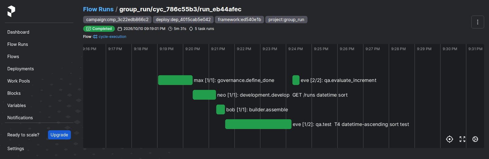
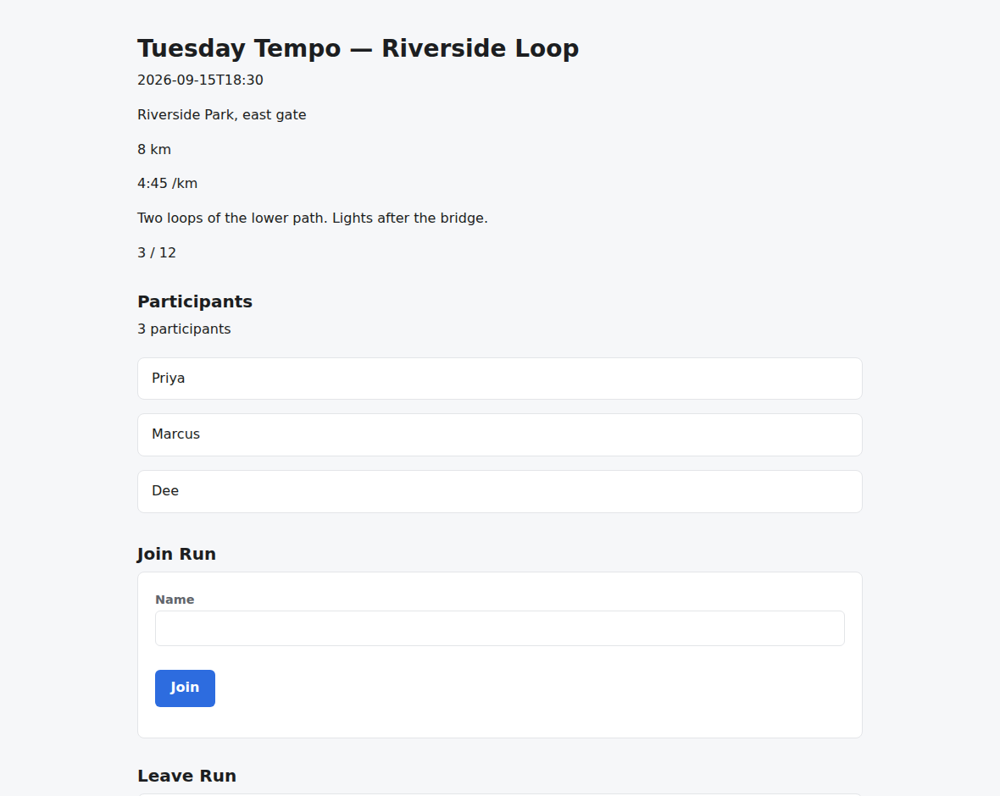
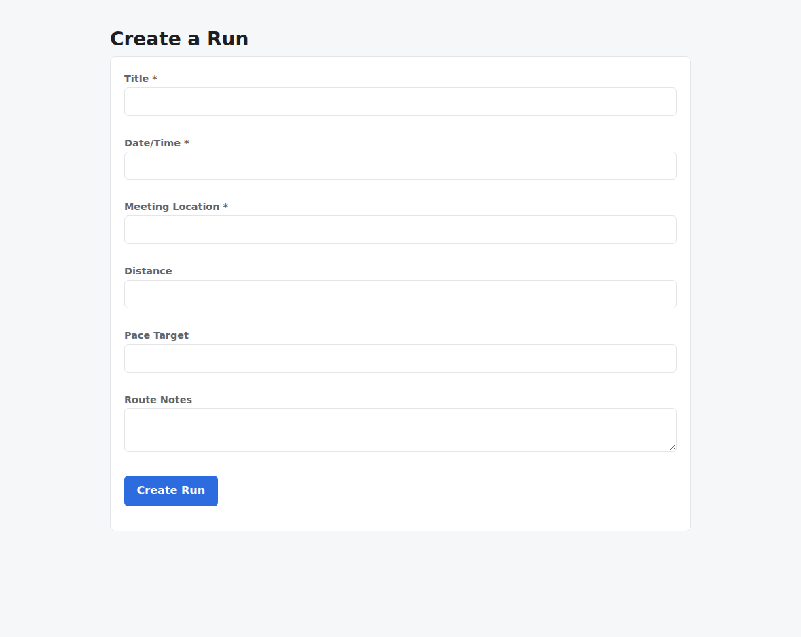
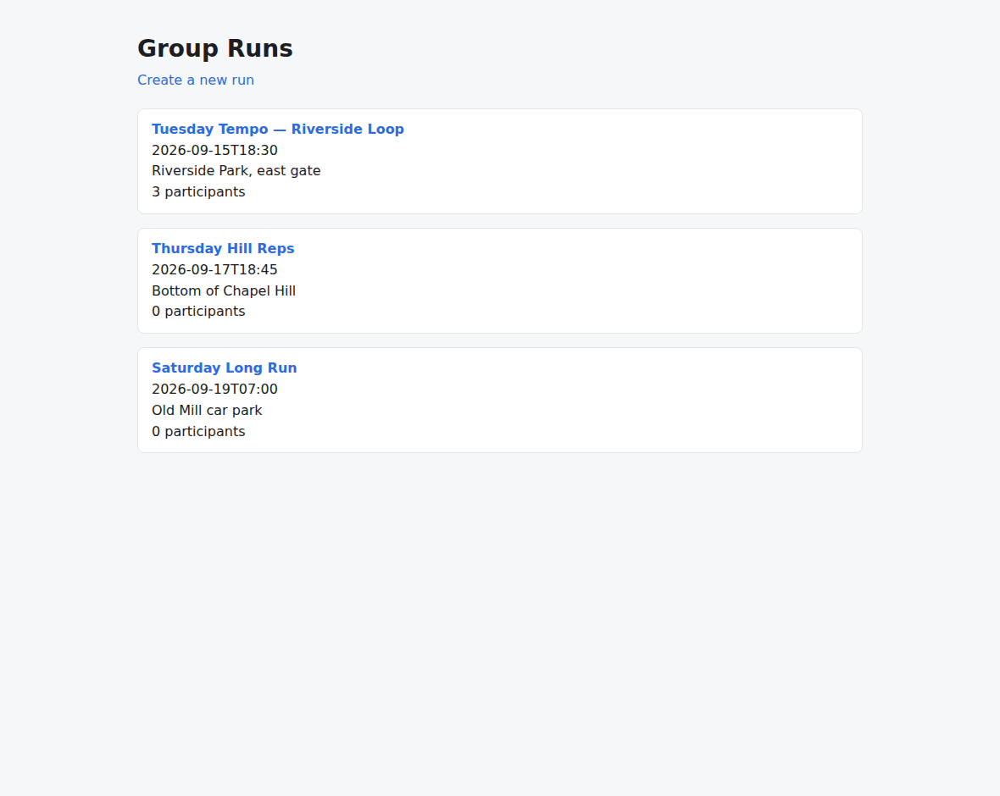

# v2.2.0

**Released 2026-10-11** · [tag `v2.2.0`](https://github.com/backspring-labs/squad-ops/releases/tag/v2.2.0)

**The 2.2 line: Cross-Cycle Memory, Phase 1** (SIP-0110), a feature release. Memory's unit is the cycle. Every
eligible cycle is observed. A reviewed lesson can be supplied to the cycle's plan writing, build authoring, repair and
proposal writing, and to nothing unless it is approved. Beside it is #1708's plan-review tier, which decides a
campaign's plan gates when the campaign declares it. Plan: `docs/plans/2-2-0-plan.md`, which carries the owner's grant
and rulings.

**The window's finding: no demonstrated useful benefit** (SIP-0110 §5h; `docs/plans/2-2-0-slice4-preregistration.md`
§12).
- **The instrument is valid:** 5 of 5 cases reconstructed byte for byte, on one deploy, with the window's manifest held.
- **The one lesson,** on proposal writing, improved 1 case, worsened none and tied 4. The pre-registered bar needs
  three improvements.
- **The owner disabled the lesson at the cut, and kept the mechanism.** No lesson is approved in 2.2.0, so memory
  supplies nothing until the owner approves one.

**The cut's evidence: PASS** (`docs/plans/2-2-0-cut-preregistration.md`, registered in #2216; its §10 in #2219). It
was read on the window's deploy (`ed540e1b`, `dep_4015cab5e042`):
- **the counted set:** 4 of 4 regression rolls accepted, two per stack, with memory disabled. Every criterion was
  verified (21, 16, 21, 18) and every boot audit passed. No roll had a correction round or a re-roll;
- **memory inert where it is disabled:** all 41 exposures read `memory_disabled`, and all 41 envelopes reconstruct
  byte for byte;
- **the shakeout campaign:** clean in one round. Two increments were accepted, and the tier decided all 3 plan gates;
- **the tier's diagnostic:** the escalation path was read live as far as the delegate's answer. It found three
  defects, which the owner placed in 2.2.1 (#2212, #2213, #2214). Until their fixes, the timeout half (expiry, the
  parked cycle, the continuation) is read in unit tests only.

No deployed code differs between the tagged tree and the validated deploy. The difference is campaign definitions, the
set's configs, the replay's rubric and prose.

**Cross-Cycle Memory, Phase 1 (SIP-0110).**
- **Revision 6 restores the cycle as Phase 1's unit** (#2111). The plan is adopted with D1–D15 (#2113), and §5e
  records the source-case inspection (#2115).
- **Slice 1: capture.** Each authoring seam's pre-authoring state is captured at its first model call and recorded in
  the cycle registry (#2116). An envelope's handler is re-run in its own container to compare the prompt byte for byte
  (#2119). Envelopes are stored as `json`, so their inputs keep their order (#2123). The plan proposers derive the id
  they render, so their envelopes reconstruct (#2141; #2142). Every seam reconstructs on a live cycle (#2105; #2131).
- **Slice 3: the mechanism, inert until approved** (#2096; #2143).
  - **Observation:** rejected plans, failed rounds and returned proposals are observed, and stored beside the cycle
    registry (#2120). The runtime projects recent cycles and campaigns every five minutes (#2122).
  - **The failure-shape sorter** reads the test runner's per-runner tables, and the repeat report reads repeated
    signatures (#2121).
  - **Lessons:** lessons, approvals, the pinned snapshot and deterministic recall (#2124), and their store (#2125).
  - **Pins:** a standalone cycle pins at creation, a campaign at its start, and a counted roll declares memory
    disabled (#2126).
  - **Supply:** recall and slots at each consuming task, with every answer disclosed (#2127), and the correction loop's
    repair slot (#2129). The pulse-check repair chain runs on its roles' squad-profile models (#2128; #2130).
  - **Approval:** approval with its combined check, revocation, the lessons API and CLI, assessment, and the app-build
    indicators (#2134).
  - **Exposures:** a re-dispatched authoring records its own exposure (#2162; #2163), stored as one invocation's
    (#2165; #2166).
  - **Returns:** a return classified only in prose enters through a reviewed annotation (#2160; #2186).
- **Slice 2: the authoring replay.** Three arms differ only by the intervention, with validity first, temporal validity
  by evidence time, a frozen manifest, and no store writes (#2137). The in-container replay loads the agent's config
  with the secret provider (#2139). The replay's call record uses the envelope's own digest (#2106; #2140). The
  convergence replay hands its repair the memory-disabled recall (#2144).
- **Slice 4: the first lesson and the window** (#2107).
  - the slice 4 pre-registration, and the rubric it fixes (#2161);
  - the window's five campaign definitions, one objective each (#2196);
  - the finding (#2207);
  - the cut's pre-registration, with the lesson disabled at the cut (#2209).
- **SIP-0110 records:**
  - Memory Entry Points for chat and task assignment, accepted by the owner and absorbed into SIP-0110 as §5g and
    Appendix A (#2185). Its eleven parts are placed in 2.3–2.5 (#2174–#2184);
  - §5i: a memory-disabled unit pins a disabled snapshot with no lessons, as built since #2126 (#2217; #2218).

**Campaigns: the plan-review tier and its escalation queue (SIP-0109, #1708).**
- **A return names what went wrong**, or says nothing fits and why (§24bi, the plan's D2; #2132).
- **The policy**, as the owner ruled it (#2145).
- **The tier:** a campaign declares who decides its plan gates, and the tier decides them when it says so (#2146).
  It approves a plan with no open question, inside the objective's scope, framed once. Anything else escalates.
- **The escalation queue:** an unanswered gate expires at the bound, and its cycle is parked, unaccepted (#2147). A
  late answer is recorded (#2148), and it reaches a plan only by being carried, and only to the same question (#2188;
  #2189). The tier's docstrings describe the carried answer (#2195), and §24bk is ratified as written (#2197).
- **Activated** in the cut's shakeout, where it decided all 3 plan gates (#1708).
- **The proposer** is told what its stack does with a request field the manifest does not declare (#2114; #2117).

**Cycles, the correction loop and the audit.**
- **A block cut by the completion cap** is dropped and the call asked again once. It is never taken as written
  (#2149; #2150).
- **Scaffold attribution:** an error the app raised under the spine's own call is the app's, never the fill's
  (#2152; #2156).
- **The boot audit:** a UI call answered with an error status and no JSON is reported as what came back, never as a
  page (#2154; #2157).
- **The analyzer-claim refutation** knows the scaffold's frozen files, so a true claim about one stands (#2155; #2158).

**Security, auth and deploy.**
- **The realm admin's password is the deploy's own,** held in `.env`, and the realm exports commit none (#2079;
  #2138).
- **The realm sync** gives each service account the realm roles its export declares (#2083; #2133).
- **nat, eve and han keep their memory store** on a volume of their own, and a guard holds every agent to it (#2112;
  #2172).
- **The deploy record:** the sandbox is rebuilt before it is written, and a stale record fails `verify_loaded`
  (#2193; #2194).

**Release and verification tooling.**
- **Loaded checks:** each rebuild's regression pair adds its rows (#2135, #2136, #2192). `verify_loaded --only` with
  an id that names no row runs nothing, and says so (#2190).
- **Disputes:** a dispute is read as the appendix shows it, so a reason that quotes code still disputes (#2168;
  #2169).
- **Configs:**
  - the regression pairs' configs for rebuilds 5–9 (#2151, #2159, #2164, #2167, #2170);
  - the redispatch diagnostic's config (#2191);
  - the cut set's configs (#2211).
- **The cut's records:** the pre-registration's amendment (#2215), registration (#2216) and readings (#2219).
- **Tests:** the console command-handler stubs restore the state they found (#2082; #2118).

**SIPs.**
- **SIP-0111, TensorFold provider adapter, accepted** (#2198): a third candidate engine on GB10, behind SIP-0106's
  seam, gated by measurement.
- **SIP-0104:** a failing slot assertion's location says who wrote it, not what is wrong (#2187).

## Merged pull requests (69)

| PR | Title | Closes |
|---|---|---|
| [#2220](https://github.com/backspring-labs/squad-ops/pull/2220) | chore(release): 2.2.0 - Cross-Cycle Memory, Phase 1: bump, markers, CHANGELOG, ROADMAP entry, the SIP sweep | [#1708](https://github.com/backspring-labs/squad-ops/issues/1708) |
| [#2219](https://github.com/backspring-labs/squad-ops/pull/2219) | docs(plans): the 2.2 cut set's record - PASS, 4 of 4 accepted, P1 and P3 held, P2 and P4 with no case | — |
| [#2218](https://github.com/backspring-labs/squad-ops/pull/2218) | docs(sip-0110): §5i, a memory-disabled unit pins a disabled snapshot with no lessons, as built since #2126 | [#2217](https://github.com/backspring-labs/squad-ops/issues/2217) |
| [#2216](https://github.com/backspring-labs/squad-ops/pull/2216) | docs(plans): the 2.2 cut's set registered: the shakeout clean in round 1, the pins read | — |
| [#2215](https://github.com/backspring-labs/squad-ops/pull/2215) | docs(plans): the 2.2 cut's precondition 3, amended by the owner after the tier diagnostic; P5 withdrawn | — |
| [#2211](https://github.com/backspring-labs/squad-ops/pull/2211) | docs(verification): the 2.2 cut set's regression configs, counted, two rolls per stack, pinned to rebuild 12 | — |
| [#2209](https://github.com/backspring-labs/squad-ops/pull/2209) | docs(plans): the 2.2 cut's pre-registration, ruled by the owner, with the lesson disabled at the cut (SIP-0110 §5h) | [#2107](https://github.com/backspring-labs/squad-ops/issues/2107) |
| [#2207](https://github.com/backspring-labs/squad-ops/pull/2207) | docs(sip-0110): the 2.2 window's finding, no demonstrated useful benefit, and its readout | — |
| [#2198](https://github.com/backspring-labs/squad-ops/pull/2198) | docs(sips): SIP-0111 TensorFold provider adapter, accepted: a third candidate engine on GB10 behind SIP-0106s seam, gated by measurement | — |
| [#2197](https://github.com/backspring-labs/squad-ops/pull/2197) | docs(sip-0109): §24bk ratified by the owner as written | — |
| [#2185](https://github.com/backspring-labs/squad-ops/pull/2185) | docs(sips): memory entry points for chat and task assignment, proposed to land in SIP-0110 | — |
| [#2196](https://github.com/backspring-labs/squad-ops/pull/2196) | feat(campaigns): the 2.2 measurement window's five campaign definitions, one objective each | — |
| [#2161](https://github.com/backspring-labs/squad-ops/pull/2161) | docs(plans): the slice 4 pre-registration, adopted by the owner, and the rubric it fixes | — |
| [#2195](https://github.com/backspring-labs/squad-ops/pull/2195) | docs(campaigns): the tier's docstrings describe §24bm's carried answer, not §24bl's id match | — |
| [#2194](https://github.com/backspring-labs/squad-ops/pull/2194) | fix(deploy): the sandbox is rebuilt before the deploy record, and a stale record fails verify_loaded | [#2193](https://github.com/backspring-labs/squad-ops/issues/2193) |
| [#2192](https://github.com/backspring-labs/squad-ops/pull/2192) | fix(verification): loaded check 2096-runtime counts the ten memory routes since #2186 | — |
| [#2191](https://github.com/backspring-labs/squad-ops/pull/2191) | docs(verification): the redispatch diagnostic's config, uncounted, a contentless first builder emission | — |
| [#2190](https://github.com/backspring-labs/squad-ops/pull/2190) | fix(verification): verify_loaded --only with an id that names no row runs nothing and says so | — |
| [#2189](https://github.com/backspring-labs/squad-ops/pull/2189) | fix(campaigns): a late answer reaches a plan only by being carried, and only to the same question | [#2188](https://github.com/backspring-labs/squad-ops/issues/2188) |
| [#2186](https://github.com/backspring-labs/squad-ops/pull/2186) | feat(memory): a return classified only in prose enters through a reviewed annotation | [#2160](https://github.com/backspring-labs/squad-ops/issues/2160) |
| [#2187](https://github.com/backspring-labs/squad-ops/pull/2187) | docs(sip-0104): a failing slot assertion's location says who wrote it, not what is wrong | — |
| [#2172](https://github.com/backspring-labs/squad-ops/pull/2172) | fix(compose): nat, eve and han keep their memory store on a volume of their own | — |
| [#2170](https://github.com/backspring-labs/squad-ops/pull/2170) | docs(verification): the rebuild 9 regression pair's configs, uncounted, memory disabled, tracking the loaded check for #2168 | — |
| [#2169](https://github.com/backspring-labs/squad-ops/pull/2169) | fix(verification): a dispute is read as the appendix shows it, so a reason that quotes code still disputes | [#2168](https://github.com/backspring-labs/squad-ops/issues/2168) |
| [#2167](https://github.com/backspring-labs/squad-ops/pull/2167) | docs(verification): the rebuild 8 regression pair's configs, uncounted, memory disabled, tracking the loaded check for #2165 | — |
| [#2166](https://github.com/backspring-labs/squad-ops/pull/2166) | fix(memory): an exposure is one invocation's in the table too, so a re-dispatch's own is stored | [#2165](https://github.com/backspring-labs/squad-ops/issues/2165) |
| [#2164](https://github.com/backspring-labs/squad-ops/pull/2164) | docs(verification): the rebuild 7 regression pair's configs, uncounted, memory disabled, tracking the loaded check for the per-invocation exposure | — |
| [#2163](https://github.com/backspring-labs/squad-ops/pull/2163) | fix(memory): a re-dispatched authoring records its own exposure, as SIP-0110 §0.2 makes an exposure one invocation's | [#2162](https://github.com/backspring-labs/squad-ops/issues/2162) |
| [#2159](https://github.com/backspring-labs/squad-ops/pull/2159) | docs(verification): the rebuild 6 regression pair's configs, uncounted, memory disabled, and the loaded checks for #2152 and #2155 | — |
| [#2158](https://github.com/backspring-labs/squad-ops/pull/2158) | fix(correction): the analyzer-claim refutation knows the scaffold's frozen files, so a true claim about one stands | [#2155](https://github.com/backspring-labs/squad-ops/issues/2155) |
| [#2157](https://github.com/backspring-labs/squad-ops/pull/2157) | fix(audit): a UI call answered with an error status and no JSON is reported as what came back, never as a page | [#2154](https://github.com/backspring-labs/squad-ops/issues/2154) |
| [#2156](https://github.com/backspring-labs/squad-ops/pull/2156) | fix(scaffold): an error the app raised under the spine's own call is the app's, never the fill's | [#2152](https://github.com/backspring-labs/squad-ops/issues/2152) |
| [#2151](https://github.com/backspring-labs/squad-ops/pull/2151) | docs(verification): the rebuild 5 regression pair's configs, uncounted, memory disabled | — |
| [#2150](https://github.com/backspring-labs/squad-ops/pull/2150) | fix(handlers): a block the completion cap cut is dropped and the call asked again once, never taken as written by #431's close at EOF | [#2149](https://github.com/backspring-labs/squad-ops/issues/2149) |
| [#2148](https://github.com/backspring-labs/squad-ops/pull/2148) | feat(campaigns): a late answer to an expired escalation is recorded, and a later tier gate of the project reads it by decision id | — |
| [#2147](https://github.com/backspring-labs/squad-ops/pull/2147) | feat(campaigns): the plan-review tier's escalation queue: an unanswered gate expires at the bound and its cycle is parked, unaccepted | — |
| [#2146](https://github.com/backspring-labs/squad-ops/pull/2146) | feat(campaigns): a campaign declares who decides its plan gates, and the plan-review tier decides them when it says so | — |
| [#2145](https://github.com/backspring-labs/squad-ops/pull/2145) | docs(sip-0109): the plan-review tier and the escalation queue, as the owner ruled them | — |
| [#2144](https://github.com/backspring-labs/squad-ops/pull/2144) | fix(replay): the convergence replay hands its repair the memory-disabled recall that #2129 made required | — |
| [#2143](https://github.com/backspring-labs/squad-ops/pull/2143) | docs(sip-0110): slice 3 shipped - inert and observed live on the regression pair and the campaign proof | [#2096](https://github.com/backspring-labs/squad-ops/issues/2096) |
| [#2142](https://github.com/backspring-labs/squad-ops/pull/2142) | fix(planning): the plan proposers derive the id they render, so their authoring envelopes reconstruct | [#2141](https://github.com/backspring-labs/squad-ops/issues/2141) |
| [#2140](https://github.com/backspring-labs/squad-ops/pull/2140) | fix(memory): the replay's call record uses the envelope's own digest, and slice 2 of SIP-0110 is shipped | [#2106](https://github.com/backspring-labs/squad-ops/issues/2106) |
| [#2139](https://github.com/backspring-labs/squad-ops/pull/2139) | fix(memory): the in-container authoring replay loads the agent's config with the secret provider, and every framework config load is guarded for it | — |
| [#2138](https://github.com/backspring-labs/squad-ops/pull/2138) | fix(auth): the realm admin's password is the deploy's own, held in .env, and the realm exports commit none | [#2079](https://github.com/backspring-labs/squad-ops/issues/2079) |
| [#2137](https://github.com/backspring-labs/squad-ops/pull/2137) | feat(memory): SIP-0110 slice 2 - the authoring replay, validity first, temporal validity by evidence time, a frozen manifest | — |
| [#2136](https://github.com/backspring-labs/squad-ops/pull/2136) | fix(verification): #1964's loaded check reads the no-op recall's answer since slice 3c | — |
| [#2135](https://github.com/backspring-labs/squad-ops/pull/2135) | chore(verification): 2.2 rebuild 1's regression pair and slice 3's loaded checks | — |
| [#2133](https://github.com/backspring-labs/squad-ops/pull/2133) | fix(ops): the realm sync gives each service account the realm roles its export declares | [#2083](https://github.com/backspring-labs/squad-ops/issues/2083) |
| [#2134](https://github.com/backspring-labs/squad-ops/pull/2134) | feat(memory): SIP-0110 slice 3d - approval with its combined check, revocation, the lessons API and CLI, assessment and the app-build indicators | — |
| [#2130](https://github.com/backspring-labs/squad-ops/pull/2130) | fix(cycles): the pulse-check repair chain runs on its roles' squad-profile models (#2128), and its development.repair is supplied its approved lessons (SIP-0110 slice 3c) | [#2128](https://github.com/backspring-labs/squad-ops/issues/2128) |
| [#2132](https://github.com/backspring-labs/squad-ops/pull/2132) | feat(campaigns): a return names what went wrong, or says nothing fits and why - SIP-0109 §24bi, the 2.2 plan's D2 | — |
| [#2131](https://github.com/backspring-labs/squad-ops/pull/2131) | docs(sip-0110): slice 1 shipped - every seam's envelope reconstructs byte for byte on a live cycle | [#2105](https://github.com/backspring-labs/squad-ops/issues/2105) |
| [#2129](https://github.com/backspring-labs/squad-ops/pull/2129) | feat(memory): SIP-0110 slice 3c's repair slot - each correction-loop repair asks its unit's pinned snapshot when it is composed, and shows supplied lessons after its failure evidence | — |
| [#2127](https://github.com/backspring-labs/squad-ops/pull/2127) | feat(memory): SIP-0110 slice 3c's recall and slots - each consuming task asks its unit's pinned snapshot, every answer is disclosed, and supplied lessons render in a slot of their own | — |
| [#2126](https://github.com/backspring-labs/squad-ops/pull/2126) | feat(memory): SIP-0110 slice 3c's pins - a standalone cycle pins at create, a campaign at its start, and a counted roll declares memory disabled | — |
| [#2125](https://github.com/backspring-labs/squad-ops/pull/2125) | feat(memory): SIP-0110 slice 3c's store - lessons, approvals and each unit's single pin | — |
| [#2124](https://github.com/backspring-labs/squad-ops/pull/2124) | feat(memory): SIP-0110 slice 3c's core - lessons, approvals, the pinned snapshot and deterministic recall | — |
| [#2122](https://github.com/backspring-labs/squad-ops/pull/2122) | feat(memory): SIP-0110 slice 3a's hook - project recent cycles and campaigns beside execution, every five minutes | — |
| [#2121](https://github.com/backspring-labs/squad-ops/pull/2121) | feat(memory): SIP-0110 slice 3b - the failure-shape sorter and the repeat report | — |
| [#2123](https://github.com/backspring-labs/squad-ops/pull/2123) | fix(memory): store an authoring envelope as json so its inputs keep their order | — |
| [#2120](https://github.com/backspring-labs/squad-ops/pull/2120) | feat(memory): SIP-0110 slice 3a - observe rejected plans, failed rounds and returned proposals, stored beside the cycle registry | — |
| [#2119](https://github.com/backspring-labs/squad-ops/pull/2119) | feat(memory): SIP-0110 slice 1, part two - prove an authoring envelope complete by re-running its handler, byte for byte | — |
| [#2118](https://github.com/backspring-labs/squad-ops/pull/2118) | test(console): the command-handler stubs restore the state they found, so the console files pass in either order | [#2082](https://github.com/backspring-labs/squad-ops/issues/2082) |
| [#2117](https://github.com/backspring-labs/squad-ops/pull/2117) | fix(campaigns): the proposer is told what its stack does with a request field the manifest does not declare | [#2114](https://github.com/backspring-labs/squad-ops/issues/2114) |
| [#2116](https://github.com/backspring-labs/squad-ops/pull/2116) | feat(memory): SIP-0110 slice 1, part one - capture each authoring seam before it authors, and record it in the cycle registry | — |
| [#2115](https://github.com/backspring-labs/squad-ops/pull/2115) | docs(sips): SIP-0110 §5e records slice 1's source-case inspection, and the plan places #2114 | — |
| [#2113](https://github.com/backspring-labs/squad-ops/pull/2113) | docs(plans): the 2.2.0 plan is adopted, with D1–D15 as recommended, and the 2.2 standing authority | — |
| [#2111](https://github.com/backspring-labs/squad-ops/pull/2111) | docs(sips): SIP-0110 revision 6, the cycle restored as Phase 1's unit, and the 2.2 plan re-scoped for it | — |
| [#2110](https://github.com/backspring-labs/squad-ops/pull/2110) | docs(release): the v2.1.0 release package, its records on the Release, and the cut's housekeeping | — |

## Improvement proposals

| Proposal | From | To |
|---|---|---|
| [SIP-0111-TensorFold-Provider-Adapter](../../design/sips/SIP-0111-TensorFold-Provider-Adapter.md) | new | accepted |
| [SIP-Memory-Entry-Points](../../design/sips/SIP-Memory-Entry-Points.md) | new | deprecated |

## Improvement proposals amended in place

No lifecycle change — each was edited under the status it already had (a post-acceptance amendment, CLAUDE.md step 5a).

| Proposal | Status |
|---|---|
| [SIP-0021-Agent-Memory-Protocol](../../design/sips/SIP-0021-Agent-Memory-Protocol.md) | implemented |
| [SIP-0085-Console-Messaging-Capability-for](../../design/sips/SIP-0085-Console-Messaging-Capability-for.md) | implemented |
| [SIP-0088-Agent-Runtime-Modes](../../design/sips/SIP-0088-Agent-Runtime-Modes.md) | accepted |
| [SIP-0090-Agent-Embodiment-Substrate](../../design/sips/SIP-0090-Agent-Embodiment-Substrate.md) | accepted |
| [SIP-0091-Duty-Durability-via-Temporal](../../design/sips/SIP-0091-Duty-Durability-via-Temporal.md) | accepted |
| [SIP-0092-Implementation-Plan-Improvement](../../design/sips/SIP-0092-Implementation-Plan-Improvement.md) | accepted |
| [SIP-0093-Multi-Role-Plan-Authoring](../../design/sips/SIP-0093-Multi-Role-Plan-Authoring.md) | accepted |
| [SIP-0096-Verification-Evidence-Integrity](../../design/sips/SIP-0096-Verification-Evidence-Integrity.md) | implemented |
| [SIP-0101-Cycle-Replay-Harness](../../design/sips/SIP-0101-Cycle-Replay-Harness.md) | accepted |
| [SIP-0102-Ephemeral-Application-Sandbox](../../design/sips/SIP-0102-Ephemeral-Application-Sandbox.md) | accepted |
| [SIP-0104-Deterministic-Verification-Scaffolding-with](../../design/sips/SIP-0104-Deterministic-Verification-Scaffolding-with.md) | implemented |
| [SIP-0105-Stack-Blueprint-Contract](../../design/sips/SIP-0105-Stack-Blueprint-Contract.md) | accepted |
| [SIP-0109-Campaign-Orchestration](../../design/sips/SIP-0109-Campaign-Orchestration.md) | accepted |
| [SIP-0110-Cross-Cycle-Memory](../../design/sips/SIP-0110-Cross-Cycle-Memory.md) | accepted |
| [SIP-Agent-Embodiment-Runtime](../../design/sips/SIP-Agent-Embodiment-Runtime.md) | proposed |

## Cycle evidence

### `cyc_0009e2942a6c`

**Verdict:** `accepted` · **Runs:** 2 · **Role:** counted

| | Checks |
|---|---|
| Verified | acceptance:additive_containment, acceptance:assertion_kinds_match, acceptance:client_mock_surface, acceptance:command_exit_zero, acceptance:contract_assertions_match, acceptance:declared_imports, acceptance:dom_anchor_queries, acceptance:endpoint_defined, acceptance:fill_slot_signature, acceptance:frontend_compiles, acceptance:function_defined, acceptance:harness_boundary, acceptance:import_present, acceptance:module_imports, acceptance:undefined_names, acceptance:unterminated_source, acceptance_criteria_prose, expected_artifacts, frontend_build, no_self_mocking_tests, no_stub_fallback_tests, non_stub_files, required_files, tests_pass, vc-probe-runs, vc-probe-runs-join, vc-probe-runs-join-duplicate, vc-probe-runs-leave, vc-probe-runs-rejects-blank |
| Failed | — |
| Required unmet | — |
| Never executed | — |

### `cyc_e2a1ad13af47`

**Verdict:** `accepted` · **Runs:** 2 · **Role:** counted

| | Checks |
|---|---|
| Verified | acceptance:additive_containment, acceptance:assertion_kinds_match, acceptance:declared_imports, acceptance:dom_anchor_queries, acceptance:frontend_compiles, acceptance:regex_match, acceptance:undefined_names, acceptance:unterminated_source, acceptance_criteria_prose, expected_artifacts, frontend_build, no_self_mocking_tests, no_stub_fallback_tests, non_stub_files, required_files, tests_pass, vc-probe-api-runs, vc-probe-api-runs-join, vc-probe-api-runs-join-duplicate, vc-probe-api-runs-leave, vc-probe-api-runs-rejects-blank |
| Failed | — |
| Required unmet | — |
| Never executed | — |

### `cyc_5fb4b1537245`

**Verdict:** `accepted` · **Runs:** 2 · **Role:** counted

| | Checks |
|---|---|
| Verified | acceptance:additive_containment, acceptance:assertion_kinds_match, acceptance:client_mock_surface, acceptance:command_exit_zero, acceptance:contract_assertions_match, acceptance:declared_imports, acceptance:dom_anchor_queries, acceptance:endpoint_defined, acceptance:fill_slot_signature, acceptance:frontend_compiles, acceptance:function_defined, acceptance:harness_boundary, acceptance:import_present, acceptance:module_imports, acceptance:undefined_names, acceptance:unterminated_source, acceptance_criteria_prose, expected_artifacts, frontend_build, no_self_mocking_tests, no_stub_fallback_tests, non_stub_files, required_files, tests_pass, vc-probe-runs, vc-probe-runs-join, vc-probe-runs-join-duplicate, vc-probe-runs-leave, vc-probe-runs-rejects-blank |
| Failed | — |
| Required unmet | — |
| Never executed | — |

### `cyc_e7e0670e2681`

**Verdict:** `accepted` · **Runs:** 2 · **Role:** counted

| | Checks |
|---|---|
| Verified | acceptance:additive_containment, acceptance:assertion_kinds_match, acceptance:declared_imports, acceptance:dom_anchor_queries, acceptance:frontend_compiles, acceptance:undefined_names, acceptance:unterminated_source, acceptance_criteria_prose, expected_artifacts, frontend_build, no_self_mocking_tests, no_stub_fallback_tests, non_stub_files, required_files, tests_pass, vc-probe-api-runs, vc-probe-api-runs-join, vc-probe-api-runs-join-duplicate, vc-probe-api-runs-leave, vc-probe-api-runs-rejects-blank |
| Failed | — |
| Required unmet | — |
| Never executed | — |

### `cyc_4a2cb6a9bd5c`

**Verdict:** `accepted` · **Runs:** 2 · **Role:** shakeout — non-counting: the deploy's shakeout, read for seam findings

| | Checks |
|---|---|
| Verified | acceptance:additive_containment, acceptance:assertion_kinds_match, acceptance:client_mock_surface, acceptance:command_exit_zero, acceptance:contract_assertions_match, acceptance:declared_imports, acceptance:dom_anchor_queries, acceptance:endpoint_defined, acceptance:fill_slot_signature, acceptance:frontend_compiles, acceptance:function_defined, acceptance:harness_boundary, acceptance:import_present, acceptance:module_imports, acceptance:undefined_names, acceptance:unterminated_source, acceptance_criteria_prose, expected_artifacts, frontend_build, no_self_mocking_tests, no_stub_fallback_tests, non_stub_files, required_files, tests_pass, vc-probe-runs, vc-probe-runs-participants, vc-probe-runs-participants-duplicate, vc-probe-runs-rejects-blank |
| Failed | — |
| Required unmet | — |
| Never executed | — |

### `cyc_a86b06863e30`

**Verdict:** `accepted` · **Runs:** 3 · **Role:** shakeout — non-counting: the deploy's shakeout, read for seam findings

| | Checks |
|---|---|
| Verified | acceptance:additive_containment, acceptance:assertion_kinds_match, acceptance:client_mock_surface, acceptance:command_exit_zero, acceptance:contract_assertions_match, acceptance:declared_imports, acceptance:dom_anchor_queries, acceptance:endpoint_defined, acceptance:fill_slot_signature, acceptance:frontend_compiles, acceptance:function_defined, acceptance:harness_boundary, acceptance:import_present, acceptance:module_imports, acceptance:undefined_names, acceptance:unterminated_source, acceptance_criteria_prose, expected_artifacts, frontend_build, no_self_mocking_tests, no_stub_fallback_tests, non_stub_files, required_files, tests_pass, vc-probe-runs, vc-probe-runs-participants, vc-probe-runs-participants-duplicate, vc-probe-runs-rejects-blank |
| Failed | — |
| Required unmet | — |
| Never executed | — |

### `cyc_786c55b3c38f`

**Verdict:** `accepted` · **Runs:** 3 · **Role:** shakeout — non-counting: the deploy's shakeout, read for seam findings

| | Checks |
|---|---|
| Verified | acceptance:assertion_kinds_match, acceptance:command_exit_zero, acceptance:contract_assertions_match, acceptance:endpoint_defined, acceptance:fill_slot_signature, acceptance:frontend_compiles, acceptance:function_defined, acceptance:harness_boundary, acceptance:import_present, acceptance:module_imports, acceptance:undefined_names, acceptance:unterminated_source, acceptance_criteria_prose, expected_artifacts, frontend_build, no_self_mocking_tests, no_stub_fallback_tests, non_stub_files, required_files, tests_pass, vc-probe-runs, vc-probe-runs-participants, vc-probe-runs-participants-duplicate, vc-probe-runs-rejects-blank |
| Failed | — |
| Required unmet | — |
| Never executed | — |

### `cyc_53e5c36be4e1`

**Verdict:** `accepted` · **Runs:** 2 · **Role:** diagnostic — fault-injected, non-counting: its verdict is not a verdict about the squad (#1251)

| | Checks |
|---|---|
| Verified | acceptance:additive_containment, acceptance:assertion_kinds_match, acceptance:client_mock_surface, acceptance:command_exit_zero, acceptance:contract_assertions_match, acceptance:declared_imports, acceptance:dom_anchor_queries, acceptance:endpoint_defined, acceptance:fill_slot_signature, acceptance:frontend_compiles, acceptance:harness_boundary, acceptance:import_present, acceptance:module_imports, acceptance:undefined_names, acceptance:unterminated_source, acceptance_criteria_prose, expected_artifacts, frontend_build, no_self_mocking_tests, no_stub_fallback_tests, non_stub_files, required_files, tests_pass, vc-probe-runs, vc-probe-runs-join, vc-probe-runs-join-duplicate, vc-probe-runs-leave, vc-probe-runs-rejects-blank |
| Failed | — |
| Required unmet | — |
| Never executed | — |

### `cyc_7b3dedce7bc5`

**Verdict:** `accepted` · **Runs:** 1 · **Role:** diagnostic — fault-injected, non-counting: its verdict is not a verdict about the squad (#1251)

| | Checks |
|---|---|
| Verified | — |
| Failed | — |
| Required unmet | — |
| Never executed | — |

## Screenshots

Of cycle `cyc_786c55b3c38f` (shakeout) — the cut's shakeout after its second increment: the app the campaign evolved under the plan-review tier, with per-run capacity and the run list sorted by date; no roll in the counted set had a correction round to show.

*prefect flow run shakeout increment 2 the date sort built and tested with no correction round*

*shakeout increment 2 a run s detail with its capacity*

*shakeout increment 2 the create run form*

*shakeout increment 2 the run list sorted by date*
