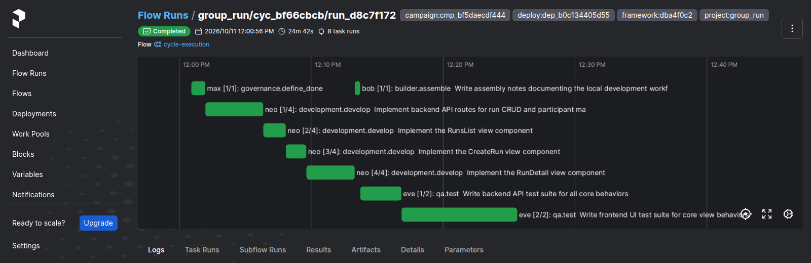

# v2.2.1

**Released 2026-10-11** · [tag `v2.2.1`](https://github.com/backspring-labs/squad-ops/releases/tag/v2.2.1)

**The 2.2 line's first patch: a failed proposal and an abort end with a record, never a wedge** (plan
`docs/plans/2-2-1-plan.md`). It fixes the three defects the 2.2 cut's tier diagnostic found, and a security fix to the
deploy's `.env`.

**The evidence, lean by the owner's ruling** (the plan's §3, D3):
- each fix's wiring test, entered where a live cycle enters, and each checked to fail without its change;
- `rebuild_and_deploy.sh runtime-api` (`dep_b0c134405d55`, `dba4f0c2`), with every loaded check answering (71 of 71);
- one diagnostic campaign, `cmp_bf5daecdf444`, whose rails refuse every proposal, so the refused-proposal path is
  read live. It closed itself at its cycle cap at 13:53 ET. Every proposal run failed without the correction loop,
  and no task exception went unretrieved (the plan's §6, R1–R4).
  - **Its one misprediction is #2231,** placed in 2.3: `max_proposal_run_retries` is never read, so failed proposals are
    retried by new cycles until `max_cycles`.

No regression set: every changed seam is on a campaign's path only. The tier's timeout half, read live, is placed in
2.3 (D2).

**Campaigns (SIP-0109).**
- **A refused increment proposal fails its run.** It never enters the build correction loop, whose repair had written
  product source into a proposal run that then completed `accepted` with no change request. The proposal step joins
  `TaskType.fails_without_correction`, beside D9's definition of done (#2212; #2224).
- **A proposal run completes only with its change request,** and an inter-workload gate that raises ends the cycle
  `gate_failed` through the completion boundary, recorded, with its campaign told. The campaign reads it as
  `proposal_failed` on a proposal, and as a rejected plan on a plan gate. A cycle's execution that raises anything else
  is retrieved and named, never left to asyncio's "Task exception was never retrieved". Migration 1696 adds
  `gate_failed` to `cycle_ends`' CHECK list (#2213; #2225).
- **An abort cancels a cycle waiting between workloads.** It reads "ended" the way the cycle route does, through one
  shared reading, `cycle_status_of` (#2214; #2226).
- The diagnostic's definition, `2-2-1-proposal-failure-diag.yaml` (#2227).

**Plans and SIPs.**
- **The 2.2.1 plan,** adopted, with its record (#2223).
- **The 2.3.0 plan, adopted:**
  - TensorFold first, carried to the owner's G4 decision, with Qwen3.8-Flash-Next as a second candidate;
  - then stabilization on the engine that ships;
  - SIP-0111 §9a ruled with it (#2228; G3 and G4 #2229, Flash-Next #2230);
  - #2231 placed in its R3 (#2232).

**Security.**
- **`.env` is owner-only** (advisory GHSA-wrfh-h7jx-w578, low). Bootstrap had copied it at the umask (`0664` under
  `0002`), and `deploy_credentials.py` wrote every credential into it without changing its mode. `ensure` now makes it
  `0600` on every run, before writing; `rotate` does the same; bootstrap creates it with `install -m 600`; and the
  doctor's credential check fails a `.env` another account can read (#2233).

**Upgrade from 2.2.0:** the runtime applies migration 1696 at startup. The next `deploy_credentials.py ensure`, which
every deploy runs, makes an existing `.env` owner-only; or run `chmod 600 .env` now.

## Merged pull requests (11)

| PR | Title | Closes |
|---|---|---|
| [#2235](https://github.com/backspring-labs/squad-ops/pull/2235) | chore(release): 2.2.1 - a failed proposal and an abort end with a record: bump, markers, CHANGELOG, ROADMAP entry, the record, the SIP sweep | — |
| [#2233](https://github.com/backspring-labs/squad-ops/pull/2233) | fix(deploy): the deploy's .env is owner-only, made so before any credential is written into it | — |
| [#2232](https://github.com/backspring-labs/squad-ops/pull/2232) | docs(plans): the 2.3 plan places the retry-limit finding in Track B's R3, its two questions ruled before it's built | — |
| [#2228](https://github.com/backspring-labs/squad-ops/pull/2228) | docs(plans): the 2.3.0 plan, adopted - TensorFold to a decision on one gate path per candidate, SIP-0111 §9a ruled, then stabilization on the engine that ships | — |
| [#2227](https://github.com/backspring-labs/squad-ops/pull/2227) | feat(campaigns): the 2.2.1 diagnostic's definition - the rails refuse every proposal, so the refusal path is read live | — |
| [#2226](https://github.com/backspring-labs/squad-ops/pull/2226) | fix(campaigns): an abort cancels a cycle waiting between workloads, reading ended as the cycle route does | [#2214](https://github.com/backspring-labs/squad-ops/issues/2214) |
| [#2225](https://github.com/backspring-labs/squad-ops/pull/2225) | fix(campaigns): a proposal run completes only with its change request, and a gate that raises ends the cycle with a record | [#2213](https://github.com/backspring-labs/squad-ops/issues/2213) |
| [#2224](https://github.com/backspring-labs/squad-ops/pull/2224) | fix(campaigns): a refused increment proposal fails its run, never enters the build correction loop | [#2212](https://github.com/backspring-labs/squad-ops/issues/2212) |
| [#2223](https://github.com/backspring-labs/squad-ops/pull/2223) | docs(plans): the 2.2.1 plan, adopted - a failed proposal and an abort end with a record, never a wedge | — |
| [#2222](https://github.com/backspring-labs/squad-ops/pull/2222) | docs(release): the v2.2.0 records on the Release, recorded in the package | — |
| [#2221](https://github.com/backspring-labs/squad-ops/pull/2221) | docs(release): the v2.2.0 release package and the cut's housekeeping | — |

## Improvement proposals amended in place

No lifecycle change — each was edited under the status it already had (a post-acceptance amendment, CLAUDE.md step 5a).

| Proposal | Status |
|---|---|
| [SIP-0111-TensorFold-Provider-Adapter](../../design/sips/SIP-0111-TensorFold-Provider-Adapter.md) | accepted |

## Cycle evidence

### `cyc_bf66cbcb335e`

**Verdict:** `accepted` · **Runs:** 2 · **Role:** diagnostic — fault-injected, non-counting: its verdict is not a verdict about the squad (#1251)

| | Checks |
|---|---|
| Verified | acceptance:additive_containment, acceptance:assertion_kinds_match, acceptance:client_mock_surface, acceptance:command_exit_zero, acceptance:contract_assertions_match, acceptance:declared_imports, acceptance:dom_anchor_queries, acceptance:endpoint_defined, acceptance:fill_slot_signature, acceptance:frontend_compiles, acceptance:harness_boundary, acceptance:import_present, acceptance:module_imports, acceptance:undefined_names, acceptance:unterminated_source, acceptance_criteria_prose, expected_artifacts, frontend_build, no_self_mocking_tests, no_stub_fallback_tests, non_stub_files, required_files, tests_pass, vc-probe-runs, vc-probe-runs-join, vc-probe-runs-join-duplicate, vc-probe-runs-leave, vc-probe-runs-rejects-blank |
| Failed | — |
| Required unmet | — |
| Never executed | — |

### `cyc_785155745e7e`

**Verdict:** `blocked_unverified` · **Runs:** 1 · **Role:** diagnostic — fault-injected, non-counting: its verdict is not a verdict about the squad (#1251)

| | Checks |
|---|---|
| Verified | — |
| Failed | — |
| Required unmet | — |
| Never executed | — |

### `cyc_b659b00469ea`

**Verdict:** `blocked_unverified` · **Runs:** 1 · **Role:** diagnostic — fault-injected, non-counting: its verdict is not a verdict about the squad (#1251)

| | Checks |
|---|---|
| Verified | — |
| Failed | — |
| Required unmet | — |
| Never executed | — |

### `cyc_c00c032b4ab3`

**Verdict:** `blocked_unverified` · **Runs:** 1 · **Role:** diagnostic — fault-injected, non-counting: its verdict is not a verdict about the squad (#1251)

| | Checks |
|---|---|
| Verified | — |
| Failed | — |
| Required unmet | — |
| Never executed | — |

### `cyc_23980bea6492`

**Verdict:** `blocked_unverified` · **Runs:** 1 · **Role:** diagnostic — fault-injected, non-counting: its verdict is not a verdict about the squad (#1251)

| | Checks |
|---|---|
| Verified | — |
| Failed | — |
| Required unmet | — |
| Never executed | — |

## Screenshots

Of cycle `cyc_bf66cbcb335e` (diagnostic) — the 2.2.1 diagnostic's calibration, built and tested on the rebuilt runtime that carries the three fixes; the refused proposal runs' own timelines could not be captured (#2234).

*prefect flow run diagnostic calibration built and tested on the rebuilt runtime*
