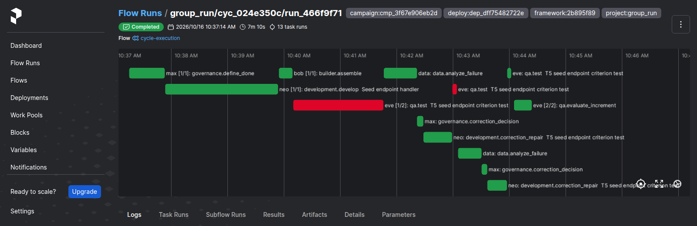
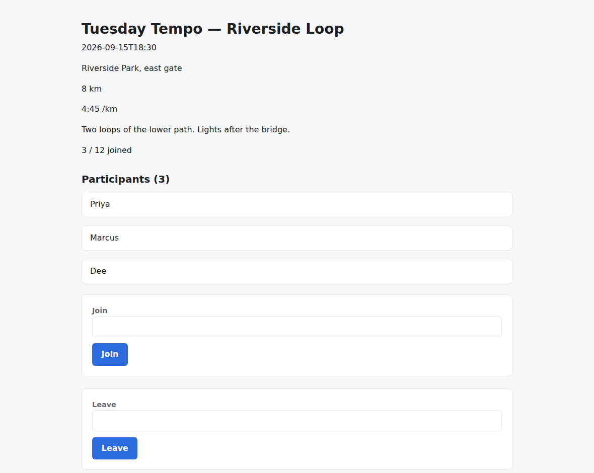
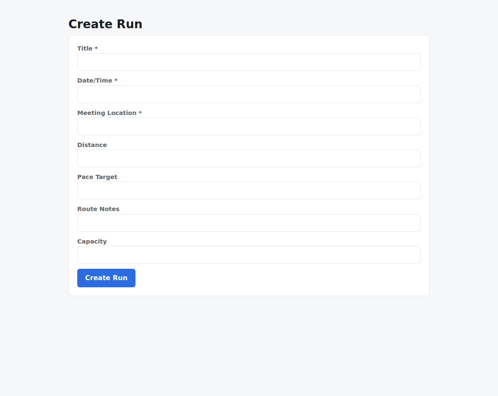
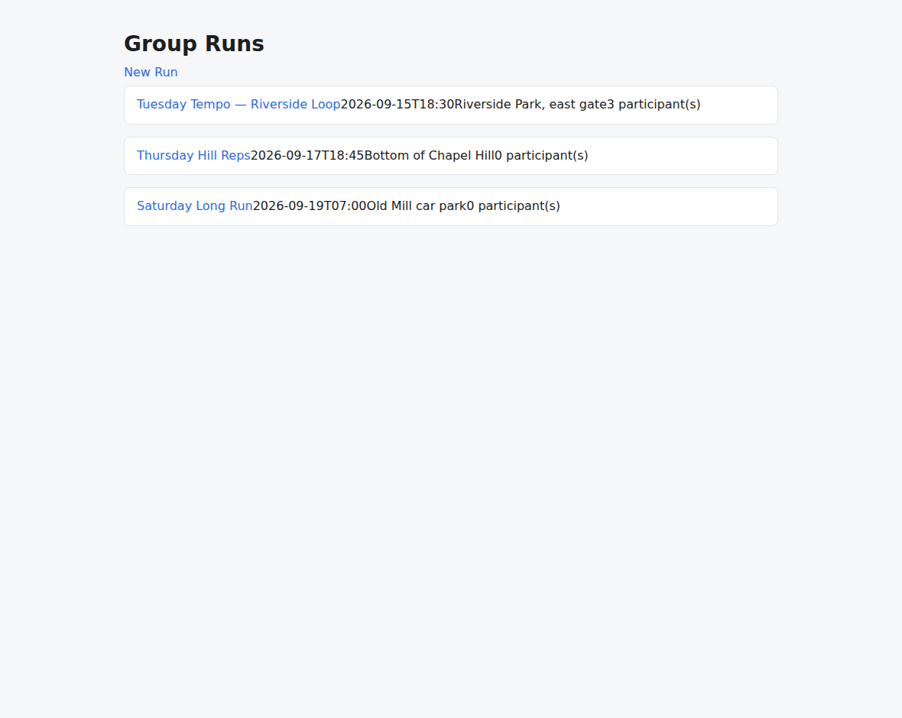

# v2.3.0

**Released 2026-10-16** · [tag `v2.3.0`](https://github.com/backspring-labs/squad-ops/releases/tag/v2.3.0)

**The 2.3 line: a stabilization release, feature-free by rule, that changed the engine first: the owner adopted
TensorFold at G4, the trial's adoption gate, on 2026-10-13, and the line's structural refactors and hardening then ran
on it** (plan `docs/plans/2-3-0-plan.md`). The TensorFold trial (SIP-0111) rode the odd minor under the owner's waiver
of 2026-10-09, dark until its cutover, and every rebuild after the cutover ran its regression pair on TensorFold.

**The engine decision** (SIP-0111 §9e–§9k; G3's pre-registration #2272 and record #2282):
- **throughput (G0):** on 132 held-out authoring prompts, the same 27B model on TensorFold's frozen NVFP4 recipe took
  0.438 of Ollama's median paired wall-clock, against a bar of 0.75;
- **validity (G1):** passed by the owner's ruling, with plan writing one answer under Ollama's (55 of 68 against 56);
- **cycles (G3):** eight measured rolls and two shakeouts, all accepted with their boot audits passing. TensorFold's
  median cycle took 0.45 of Ollama's time on FastAPI+React and 0.61 on Next.js, and decode ran 2.04× (54.7 against
  26.8 tokens a second). Two of seven predictions failed: decode ≥ 1.8× on every task type, and tokens within ±20%;
- **adoption (G4):** the owner adopted it with the seed fix first (#2283). The Spark has served the squad on TensorFold
  since 20:01 ET that day, and the cutover pair was accepted, 20 of 20 and 21 of 21.

**The cut's evidence: PASS, on the second counted set** (`docs/plans/2-3-0-cut-preregistration.md`, registered in
#2377 and #2382, read in §10). It was read on the fix's deploy (`2b895f89`, `dep_dff75482722e`):
- **the counted set:** 4 of 4 regression rolls accepted on TensorFold, two per stack, with memory disabled. Every
  criterion was verified (21, 18, 20, 14), every boot audit passed, and no roll had a correction round;
- **every model call was TensorFold's:** 66 of 66, read from the agents' per-call metrics and matched in their logs;
- **the line's code is what ran:** all 115 tracked loaded checks answered as expected in every roll, the structural
  rounds' among them;
- **memory inert where it is disabled:** every exposure reads `memory_disabled`, and all 38 envelopes reconstruct
  byte for byte;
- **the shakeout campaign, in three rounds:** round 1 found #2318. Round 3, on the fix's deploy, was clean: two
  increments were accepted on their first cycle, and the tier decided all 3 plan gates;
- **the first set failed** on its fourth roll, on #2379, a defect latent since 1.9.0. A kept repair's next round lost
  the developer's name on its file, and storage failed the run. #2380 fixed it, and the set restarted on a new deploy
  after a shakeout, as its pre-registration requires;
- **what it does not cover:** the tagged tree differs from the validated deploy only by the version string, the
  release's documents and the set's configs. Nothing under `src/` or `adapters/` differs.

**The engine (SIP-0111, TensorFold).**
- **The Spark's Ollama runs in a container,** pinned by digest, so the switch can stop it without sudo.
  `SQUADOPS__LLM__URL` is now required: a deploy without it fails at `docker compose`, naming the key (#2249; #2250).
- **The engine switch and the replay harness:** `engine_switch.py` starts a pinned TensorFold recipe, verifies it, and
  restores Ollama on any failure; `engine_replay.py` replays captured authoring prompts on both engines, paired and
  seeded, and scores each answer with its task type's own handler (#2199; #2252, #2254, #2256, #2262).
- **The model port gains declared controls:** a seed and a thinking budget, refused where undeclared and never dropped;
  a normalized termination; and a context overflow that blocks its task instead of entering correction (#2200; #2268).
- **The TensorFold adapter,** its wire read from TensorFold's own source: a stream succeeds only with its finish frame,
  usage and `[DONE]`, and an error frame, a malformed frame or a cut stream raises with what arrived (#2200; #2269).
- **The switch moves the model clients with the engine,** through `docker-compose.tensorfold.yml` and a key in `.env`,
  onto the squad profile `full-38-tf`. Its live check took 27.2 s there and 48.4 s back (#2200; #2270, #2271).
- **The cutover:** a switch records its engine in `.env` and the deploy record, and a rebuild or re-bootstrap keeps it;
  the launch gate reads a busy TensorFold as not quiet; a fresh Spark installs the frozen recipe and serves on it, with
  Ollama stopped beside it as the rollback (#2229, #2284; #2273, #2285).
- **Every TensorFold call carries a seed.** TensorFold derives an unset seed from the prompt, so a repeated prompt had
  repeated its answer. A call with no seed now gets a fresh one, named on its log line (#2281; #2283).
- **The memory watchdog runs as a host service,** restarted always. After it kills TensorFold it restores Ollama and
  moves the clients back, and one engine switch runs at a time (#2288; #2289).
- **The line's engine records go to the Release:** its replay and switch records, with the credential scan covering
  TensorFold's key (#2199; #2267).

**Structure.**
- **The stack registry and its stacks** (19 modules, 7,866 lines) move to `squadops.stacks`, which imports neither
  capabilities nor cycles (#1993; #2325). 389 deferred imports whose reason was gone are hoisted, and each of the 53
  that stay says why (#2062; #2326).
- **The cycle orchestration moves from `adapters/cycles` to `squadops.execution`** (18 modules, 12,535 lines), a
  top-level package by the owner's ruling: it imports what it orchestrates, and nothing imports it (#1992; #2327).
- **The five largest units split into named steps, moved and not changed** (#1994). The owner reviewed each piece's
  step-by-step plan (#2328, #2332, #2347, #2356, #2357), and each move was checked against a recording of the unit's
  behaviour taken before it:
  - the qa handler's `handle`, 481 lines to 104, as eight named steps (#2330, #2331);
  - the handler base class every agent's task code inherits: its acceptance decisions move beside the evaluator, and
    its envelope capture and empty-output marker become their own steps (#2335; #2336–#2339);
  - the executor's per-task method, 313 lines to 107, around a per-task router (#2349–#2351);
  - the correction runner's diagnosis, 180 lines to 119 (#2359, #2360);
  - the task-plan builder: its run facts, acceptance families and each step's envelope inputs became their own
    functions, 272 lines to 193 (#2361, #2362).

**API and comms hardening (#1976, #1977).**
- **Every error body is the standard envelope,** and a server failure gives the request id, never the exception's
  text, which seven 5xx bodies had carried, five on unauthenticated or agent-status routes (#2265).
- **Every route declares its response** (67 of 86 had none usable); creates answer 201, deletes 204 (#2317).
- **The lists page:** the cycle list reads a page's runs in one query, not one per cycle (#2266); the runs, artifacts
  and campaigns lists page as it does, and internal readers no longer stop silently at 50 runs (#2321).
- **A transient database failure is retried inside the cycle registry,** only where running it again is safe (#2320).
- **A publish the broker can't route raises into the retry,** where it had resolved as delivered (#2323).
- **A dispatched task is bounded by its own attempts:** a completed task is never re-run, and past 3 attempts it is
  quarantined and failed (#2324). The record is kept per send, so the runtime's own re-send runs (#2333; #2334).

**Campaigns (SIP-0109).**
- **`max_proposal_run_retries` is read:** failed proposal cycles past it pause the campaign (§24bn; #2231; #2245).
- **The plan-review tier's timeout half, read live: every reading held** (#2279; #2296, #2307). A diagnostic-only fault
  makes an increment's design ask (#2280), at its launch, before a late answer is carried in (#2290; #2293). Two
  campaigns read the expiry, the park, the no-progress stop, and a late answer carried into the next campaign's plan.
  The three defects it found were fixed first: a run of parks stops at the no-progress limit (§24bp; #2294; #2295); a
  run cancelled at its gate ends the cycle as stored, so an expired escalation parks (#2301; #2302); a parked increment
  is never accepted (#2303; #2304).
- **An increment rejected only for criteria the accepted application already meets** goes to a new proposal told
  which, not to a repair that can't change them (§24bq; #2315; #2319).
- **A repair, a retry or the next proposal is told why the increment's own evaluation rejected it:** each frozen
  criterion it broke, each new criterion left unmet, each route that didn't render. Its brief had carried only the
  cycle's checks, so a repair of a build that passed them was told the cycle passed. The cut's shakeout read it live
  (§24br; #2318; #2375).

**Output quality: what a manifest declares, the build is held to.**
- **A list order declared on an endpoint is checked by a derived probe,** not left as prose. Its pre-registered
  before-and-after comparison on TensorFold held every reading it reached (#2202; #2276; #2299, #2312).
- **The Next.js store can delete a row** (`remove(table, id)`), so a declared DELETE over an entity stored as its own
  rows has a correct form. Without it a leave handler could empty a run's list but not the row (#2363; #2367).
- **The proposal rails refuse an undefined manifest key and an unbuildable criterion, and an error's message is declared
  on its code,** rendered word for word and asserted by the probes (SIP-0109 §24bo). Its comparison's after arm held
  every reading (#2205; #2275; #2300, #2316).
- **A failing contract probe fails its `qa.test` result,** so correction engages; since #1223 it had been diagnosed and
  never repaired (#2308; #2309). The boot audit assembles a promoted increment as its accepted tree (#2310; #2311).
- **Rubric `criterion_already_satisfied@3`:** the delivered code decides when the sources are silent or contradict it
  (#2208; #2274). A replay pins a rubric version by its text, and @2's is kept (#2313; #2314).

**Correction loop and evidence.**
- **A contract probe still failing for a new reason is progress,** so a repair that half-fixes it is kept, and the
  retest's line names a failed probe (SIP-0086 §12d; #2340, #2341; #2343).
- **An accepted repair's file names the step that wrote it,** so a dev repair of a qa failure no longer reads as QA
  writing a dev-owned file (#2206; #2243).
- **A kept repair survives the round after it.** The next round starts from the kept round's retest, and its copy of
  the developer's file now keeps the developer's name. Before, storage judged that copy a QA write, dropped the
  developer's fix, and the stored-set guard failed the run. That was latent since 1.9.0, and it failed the cut's first
  counted set (#2379; #2380).

**Memory entry points (SIP-0110).**
- **The legacy agent store is dormant:** every operation is refused visibly, and chat neither recalls nor stores (#2174;
  #2246).
- **A chat session is its owner's,** and each turn carries the session's bounded history to the agent (#2175; #2247).
- **The context-assembly port, inert,** asked by the four authoring seams; what a task is given is unchanged (#2176;
  #2257).
- **A revocation names only running units as work to halt,** and lists the finished ones apart (#2210; #2242).

**Monitoring (#2204).**
- **The agents' metrics reach Prometheus:** the agent image lacked the OpenTelemetry SDK, so every metric call did
  nothing. Each model call records its decode rate, tokens and prefill time (#2203; #2239), by engine (#2260; #2263).
- **The host and GPU are scraped** (#2240, #2244). `GET /health/host` reports them, memory and disk against the box's
  floors and an unreadable value as unknown (#2241), and the console's Host panel colours its states (#2277).
- **Grafana, provisioned from the repo:** Spark health and DCGM dashboards and a board-thermal alert (#2258; #2259),
  and "Squad model calls", counted exactly, since `increase()` misses each series' first value (#2261).
- **The runtime exports its activity:** runs started and finished, campaign transitions and its own start, shown as
  markers on both dashboards and an activity row on Spark health (#2204; #2368). Its image carries the OpenTelemetry
  SDK they need, which it had lacked as the agents' had, and the adapter now says once when it can't start (#2371;
  #2372).

**Removed settings.** Two SIP-0079 limits nothing read, `max_consecutive_failures` (#2348; #2355) and
`max_task_seconds` (#2353; #2358): the owner chose removal, and a profile that sets either is refused at load.

**Tooling, auth and CI.**
- **The login password goes through the environment,** so a refused driver login no longer prints it, and no unit test
  reaches the live CLI: three had, and Keycloak locked the admin user (#2291; #2292).
- **The release capture** seeds a delivered app at the backend's paths and bounds every browser call (#2234; #2264).
  **The deploy-record check** reads the running deploy's compose project from any checkout (#2354; #2365).
- **CI's integration job pulls from Google's Docker Hub mirror,** so the anonymous limit can't fail it (#2201; #2238).

**Plans and SIPs.** 2.3 started after 2.2.1's cut, with the release-capture fix placed (#2237); Flash-Next moved to 2.4
(#2255); the request-profile taxonomy's revision 2, for review (#316; #2278); the v2.2.1 release package (#2236).

**Records of the line's test rounds.** Each rebuild ran one uncounted cycle per stack, with a loaded check per change:
- the benchmark deploy's pairs, before and after Ollama moved into a container (#2248, #2251);
- **accepted on both stacks, on TensorFold:** the memory and campaign fixes (#2298), the API and comms hardening
  (#2329), the orchestration move (#2344), the probe-progress fix (#2345), and the qa handler and base class splits
  (#2346, #2352);
- **the stacks move** (#2342): its first pair found #2333; the owner counted the second as the exit, its Next.js
  rejection (#2340) being outside the round's changes;
- **the executor split** (#2364): React accepted; Next.js rejected, 14 of 15, as its stack's store had no delete
  (#2363);
- **accepted on both stacks, on TensorFold:** the correction runner and task-plan builder splits (#2369, #2370), and
  the fixes round, whose first rebuild found #2371 (#2374).

**Upgrade from 2.2.1:** `.env` must name `SQUADOPS__LLM__URL` (`.env.example` carries the host-Ollama value). On the
Spark, install the watchdog once, with sudo: `./scripts/dev/ops/install_host_unit.sh squadops-memory-watchdog`. No
database migration.

**Not in this release.** The request-profile taxonomy (#316) and Outcome Evaluation's reporting-only instruments were
moved to 2.4 by the owner on 2026-10-15: each needed its SIP accepted first, and neither was (#2366). The second
TensorFold candidate, Qwen3.8-Flash-Next (#2230), is in 2.4 (the owner, 2026-10-12, confirmed 2026-10-15): not
measured in 2.3, which is not a negative finding.

## Merged pull requests (112)

| PR | Title | Closes |
|---|---|---|
| [#2383](https://github.com/backspring-labs/squad-ops/pull/2383) | chore(release): 2.3.0 — TensorFold, the structure moved under it, and the cut's evidence (PASS on the second set) | — |
| [#2382](https://github.com/backspring-labs/squad-ops/pull/2382) | docs(plans): the 2.3 cut's second set registered — set 1's failure, the shakeout's third round and the fix's deploy's pins | — |
| [#2380](https://github.com/backspring-labs/squad-ops/pull/2380) | fix(correction): a kept repair's next round keeps the kept files' producers, so the developer's fix survives the round after it | [#2379](https://github.com/backspring-labs/squad-ops/issues/2379) |
| [#2377](https://github.com/backspring-labs/squad-ops/pull/2377) | docs(plans): the 2.3 cut set registered — the shakeout's exit in round 2, the final deploy's pins and the two counted configs | — |
| [#2376](https://github.com/backspring-labs/squad-ops/pull/2376) | fix(maintainer): the SIP sweep reads a placed row's release from the first one it names | — |
| [#2375](https://github.com/backspring-labs/squad-ops/pull/2375) | fix(campaigns): an increment's repair or abandonment brief carries its evaluation's findings, not only its cycle's checks | [#2318](https://github.com/backspring-labs/squad-ops/issues/2318) |
| [#2374](https://github.com/backspring-labs/squad-ops/pull/2374) | test(2.3): the fixes round's record — three loaded checks and the pair's configs; both cycles accepted on the final deploy | — |
| [#2373](https://github.com/backspring-labs/squad-ops/pull/2373) | docs(plans): the 2.3 cut set's pre-registration and its shakeout campaign, on 2.2's numbers | — |
| [#2372](https://github.com/backspring-labs/squad-ops/pull/2372) | fix(telemetry): the runtime image ships the OpenTelemetry SDK, so its activity metrics reach the collector | [#2371](https://github.com/backspring-labs/squad-ops/issues/2371) |
| [#2370](https://github.com/backspring-labs/squad-ops/pull/2370) | test(2.3): the task-plan builder split's record — its loaded check and the pair's configs; both cycles accepted on TensorFold | [#1994](https://github.com/backspring-labs/squad-ops/issues/1994) |
| [#2368](https://github.com/backspring-labs/squad-ops/pull/2368) | feat(monitoring): the runtime exports its activity, and the dashboards show it with markers | [#2204](https://github.com/backspring-labs/squad-ops/issues/2204) |
| [#2367](https://github.com/backspring-labs/squad-ops/pull/2367) | fix: the Next.js store can delete a row, so a declared DELETE over a stored entity has a correct form | [#2363](https://github.com/backspring-labs/squad-ops/issues/2363) |
| [#2369](https://github.com/backspring-labs/squad-ops/pull/2369) | test(2.3): the correction runner split's record — its loaded check and the pair's configs; both cycles accepted on TensorFold | — |
| [#2362](https://github.com/backspring-labs/squad-ops/pull/2362) | refactor: the task-plan builder's run facts, acceptance families and envelope inputs become their own functions | — |
| [#2361](https://github.com/backspring-labs/squad-ops/pull/2361) | test: the task-plan builder's envelopes, recorded before it is split into named steps | — |
| [#2365](https://github.com/backspring-labs/squad-ops/pull/2365) | fix: the deploy-record check reads the running deploy's compose project from any checkout | [#2354](https://github.com/backspring-labs/squad-ops/issues/2354) |
| [#2366](https://github.com/backspring-labs/squad-ops/pull/2366) | docs: the request-profile taxonomy and Outcome Evaluation's instruments move to 2.4 (the owner, 2026-10-15) | — |
| [#2360](https://github.com/backspring-labs/squad-ops/pull/2360) | refactor: the correction diagnosis's round evidence and one declared step become their own methods | — |
| [#2359](https://github.com/backspring-labs/squad-ops/pull/2359) | test: the correction protocol's diagnosis, recorded before it is split into named steps | — |
| [#2364](https://github.com/backspring-labs/squad-ops/pull/2364) | test(2.3): the executor task breakup's record — its loaded check and the pair's configs; React accepted, Next.js rejected on a store gap (#2363) | — |
| [#2358](https://github.com/backspring-labs/squad-ops/pull/2358) | fix: remove max_task_seconds, a task time limit nothing read | [#2353](https://github.com/backspring-labs/squad-ops/issues/2353) |
| [#2357](https://github.com/backspring-labs/squad-ops/pull/2357) | docs(plans): the step-by-step plan for the task-plan builder, for the owner's review (#1994) | [#1994](https://github.com/backspring-labs/squad-ops/issues/1994) |
| [#2356](https://github.com/backspring-labs/squad-ops/pull/2356) | docs(plans): the step-by-step plan for the correction runner, for the owner's review (#1994) | — |
| [#2355](https://github.com/backspring-labs/squad-ops/pull/2355) | fix: remove max_consecutive_failures, a run limit nothing enforced | [#2348](https://github.com/backspring-labs/squad-ops/issues/2348) |
| [#2351](https://github.com/backspring-labs/squad-ops/pull/2351) | refactor: the executor's per-task success tail and dispatch announcement become their own methods | — |
| [#2350](https://github.com/backspring-labs/squad-ops/pull/2350) | refactor: the executor's per-task routing closures become a per-task router | — |
| [#2352](https://github.com/backspring-labs/squad-ops/pull/2352) | test(2.3): the handler base class split's record — its loaded check and the pair's configs; both cycles accepted on TensorFold | — |
| [#2349](https://github.com/backspring-labs/squad-ops/pull/2349) | test: the executor's per-task method, recorded before it is broken into named steps | — |
| [#2347](https://github.com/backspring-labs/squad-ops/pull/2347) | docs(plans): the step-by-step plan for the executor's per-task method, for the owner's review | — |
| [#2346](https://github.com/backspring-labs/squad-ops/pull/2346) | test(2.3): the qa handler breakup's record — its loaded check and the pair's configs; both cycles accepted on TensorFold | — |
| [#2339](https://github.com/backspring-labs/squad-ops/pull/2339) | refactor: the generic handle builds its failure result and prompt record with the base class's helpers | [#2335](https://github.com/backspring-labs/squad-ops/issues/2335) |
| [#2338](https://github.com/backspring-labs/squad-ops/pull/2338) | refactor: the handler base class's envelope capture and contentless marker become their own steps | — |
| [#2337](https://github.com/backspring-labs/squad-ops/pull/2337) | refactor: the acceptance check's row and blocking matrix move beside the evaluator | — |
| [#2336](https://github.com/backspring-labs/squad-ops/pull/2336) | test: the acceptance-criteria check, recorded before the handler base class is split | — |
| [#2345](https://github.com/backspring-labs/squad-ops/pull/2345) | test(2.3): the record of R6's fixes (#2343) — the pair's configs; both cycles accepted on TensorFold | — |
| [#2331](https://github.com/backspring-labs/squad-ops/pull/2331) | refactor(qa): the qa handler's verdict half becomes four named steps (R7 unit 1, steps 1e–1h) | — |
| [#2330](https://github.com/backspring-labs/squad-ops/pull/2330) | refactor(qa): the qa handler's generation half becomes four named steps (R7 unit 1, steps 1a–1d) | — |
| [#2344](https://github.com/backspring-labs/squad-ops/pull/2344) | test(2.3): R6's record — one loaded check, the pair's configs; both cycles accepted on TensorFold | — |
| [#2343](https://github.com/backspring-labs/squad-ops/pull/2343) | fix(correction): a contract probe still failing for a new reason is progress, and the retest line names a failed probe | [#2340](https://github.com/backspring-labs/squad-ops/issues/2340) [#2341](https://github.com/backspring-labs/squad-ops/issues/2341) |
| [#2327](https://github.com/backspring-labs/squad-ops/pull/2327) | refactor(execution): the cycle orchestration moves from adapters/cycles to squadops.execution | [#1992](https://github.com/backspring-labs/squad-ops/issues/1992) |
| [#2342](https://github.com/backspring-labs/squad-ops/pull/2342) | test(2.3): R5's record — four loaded checks, the pair's configs, both pairs; the owner counted the second as the exit | — |
| [#2332](https://github.com/backspring-labs/squad-ops/pull/2332) | docs(plans): the detailed plan for splitting the handler base class, with the owner's choices (#1994) | — |
| [#2334](https://github.com/backspring-labs/squad-ops/pull/2334) | fix(comms): an agent keeps its delivery record per send, so the runtime's next send of a task runs | [#2333](https://github.com/backspring-labs/squad-ops/issues/2333) |
| [#2328](https://github.com/backspring-labs/squad-ops/pull/2328) | docs(plans): R7's extraction map, for review before the first extraction | — |
| [#2326](https://github.com/backspring-labs/squad-ops/pull/2326) | refactor: hoist the deferred squadops imports whose reason is gone; each one that stays says why | [#2062](https://github.com/backspring-labs/squad-ops/issues/2062) |
| [#2325](https://github.com/backspring-labs/squad-ops/pull/2325) | refactor(stacks): the stack registry and its stacks move to squadops.stacks, which imports neither capabilities nor cycles | [#1993](https://github.com/backspring-labs/squad-ops/issues/1993) |
| [#2329](https://github.com/backspring-labs/squad-ops/pull/2329) | test(2.3): R4's record — seven loaded checks, the pair's configs, row 2101 fixed; both cycles accepted on TensorFold | — |
| [#2324](https://github.com/backspring-labs/squad-ops/pull/2324) | fix(comms): a dispatched task is bounded by its own attempts; a completed one is never re-run; past its attempts it is quarantined and failed | [#1977](https://github.com/backspring-labs/squad-ops/issues/1977) |
| [#2321](https://github.com/backspring-labs/squad-ops/pull/2321) | fix(api): the runs, artifacts and campaigns lists page as the cycles list does; the CLI and console page through them | [#1976](https://github.com/backspring-labs/squad-ops/issues/1976) |
| [#2323](https://github.com/backspring-labs/squad-ops/pull/2323) | fix(comms): a publish the broker cannot route raises into the retry instead of resolving as delivered | — |
| [#2320](https://github.com/backspring-labs/squad-ops/pull/2320) | fix(cycles): a transient database failure is retried inside the cycle registry, where running it again is safe | [#1976](https://github.com/backspring-labs/squad-ops/issues/1976) |
| [#2319](https://github.com/backspring-labs/squad-ops/pull/2319) | fix(campaigns): an increment rejected only for criteria already met goes to a new proposal told which, not to a repair | [#2315](https://github.com/backspring-labs/squad-ops/issues/2315) |
| [#2317](https://github.com/backspring-labs/squad-ops/pull/2317) | fix(api): every route declares its response; creates answer 201 and deletes 204 | — |
| [#2316](https://github.com/backspring-labs/squad-ops/pull/2316) | test(2.3): #2205's comparison, read: every after reading held, and the before arm's proposer asked for no wording | [#2205](https://github.com/backspring-labs/squad-ops/issues/2205) |
| [#2314](https://github.com/backspring-labs/squad-ops/pull/2314) | fix(replay): a rubric's version is pinned by its text, and @2's is kept for the results it scored | [#2313](https://github.com/backspring-labs/squad-ops/issues/2313) |
| [#2312](https://github.com/backspring-labs/squad-ops/pull/2312) | test(2.3): #2202's comparison, read: every reading it reached held | [#2202](https://github.com/backspring-labs/squad-ops/issues/2202) |
| [#2311](https://github.com/backspring-labs/squad-ops/pull/2311) | fix(audit): the boot audit selects a promoted increment's accepted tree, as the capture does | [#2310](https://github.com/backspring-labs/squad-ops/issues/2310) |
| [#2275](https://github.com/backspring-labs/squad-ops/pull/2275) | fix(campaigns,scaffold): an undefined manifest key and an unbuildable criterion are refused, and an error's message is declared on its code | — |
| [#2309](https://github.com/backspring-labs/squad-ops/pull/2309) | fix(qa): a failing contract probe fails the task's result, so correction engages | [#2308](https://github.com/backspring-labs/squad-ops/issues/2308) |
| [#2276](https://github.com/backspring-labs/squad-ops/pull/2276) | feat(scaffold): a list order declared on its endpoint is checked by a derived probe, not left as prose | — |
| [#2307](https://github.com/backspring-labs/squad-ops/pull/2307) | test(2.3): the plan-review tier's timeout half, read live: every reading held | [#2279](https://github.com/backspring-labs/squad-ops/issues/2279) |
| [#2304](https://github.com/backspring-labs/squad-ops/pull/2304) | fix(campaigns): a parked increment is never accepted, and its run is cancelled with the reason | [#2303](https://github.com/backspring-labs/squad-ops/issues/2303) |
| [#2302](https://github.com/backspring-labs/squad-ops/pull/2302) | fix(cycles): a run cancelled at its gate ends the cycle as stored, so an expired escalation parks | [#2301](https://github.com/backspring-labs/squad-ops/issues/2301) |
| [#2300](https://github.com/backspring-labs/squad-ops/pull/2300) | docs(2.3): #2205's before-and-after comparison, pre-registered for review | — |
| [#2299](https://github.com/backspring-labs/squad-ops/pull/2299) | docs(2.3): #2202's before-and-after comparison, pre-registered for review | — |
| [#2296](https://github.com/backspring-labs/squad-ops/pull/2296) | docs(sip-0109): the tier timeout half's pre-registration, two diagnostic campaigns, for review | — |
| [#2293](https://github.com/backspring-labs/squad-ops/pull/2293) | fix(campaigns): the timeout-half fault asks at the increment's launch, before the late-answer carry, and keeps an answer | [#2290](https://github.com/backspring-labs/squad-ops/issues/2290) |
| [#2295](https://github.com/backspring-labs/squad-ops/pull/2295) | fix(campaigns): a park's abandonment counts at its own decision, so a run of parks stops at the no-progress limit (SIP-0109 §24bp) | [#2294](https://github.com/backspring-labs/squad-ops/issues/2294) |
| [#2298](https://github.com/backspring-labs/squad-ops/pull/2298) | test(2.3): R3's regression pair on TensorFold, with a loaded check for each of R3's six changes | — |
| [#2292](https://github.com/backspring-labs/squad-ops/pull/2292) | fix(auth): the login password goes through the environment, and no unit test reaches the live CLI | [#2291](https://github.com/backspring-labs/squad-ops/issues/2291) |
| [#2257](https://github.com/backspring-labs/squad-ops/pull/2257) | feat(memory): the context-assembly port, inert, with the four authoring seams asking it (SIP-0110 A.3.6) | [#2176](https://github.com/backspring-labs/squad-ops/issues/2176) |
| [#2247](https://github.com/backspring-labs/squad-ops/pull/2247) | fix(chat): a session is its owner's, and each turn carries its session's history to the agent | [#2175](https://github.com/backspring-labs/squad-ops/issues/2175) |
| [#2246](https://github.com/backspring-labs/squad-ops/pull/2246) | fix(memory): the legacy agent store is dormant, and no embedder is built at an address nobody set | [#2174](https://github.com/backspring-labs/squad-ops/issues/2174) |
| [#2245](https://github.com/backspring-labs/squad-ops/pull/2245) | fix(campaigns): max_proposal_run_retries bounds failed proposal cycles in a row, and the failure past it pauses for the owner | [#2231](https://github.com/backspring-labs/squad-ops/issues/2231) |
| [#2242](https://github.com/backspring-labs/squad-ops/pull/2242) | fix(memory): a revocation names only running units as work to halt, and the finished units that ran with the lesson apart from them | [#2210](https://github.com/backspring-labs/squad-ops/issues/2210) |
| [#2243](https://github.com/backspring-labs/squad-ops/pull/2243) | fix(cycles): an accepted repair's file names the step that wrote it beside the task it repaired | [#2206](https://github.com/backspring-labs/squad-ops/issues/2206) |
| [#2289](https://github.com/backspring-labs/squad-ops/pull/2289) | feat(tensorfold): the memory watchdog runs as a host service and restores Ollama after a kill (SIP-0111 §9l) | [#2288](https://github.com/backspring-labs/squad-ops/issues/2288) |
| [#2285](https://github.com/backspring-labs/squad-ops/pull/2285) | feat(tensorfold): G4, the Spark serves the squad with TensorFold: its bootstrap profile, the deploy record a switch leaves, and the cutover's evidence (SIP-0111 §9k) | [#2229](https://github.com/backspring-labs/squad-ops/issues/2229) [#2284](https://github.com/backspring-labs/squad-ops/issues/2284) |
| [#2283](https://github.com/backspring-labs/squad-ops/pull/2283) | fix(tensorfold): every call carries a seed, fresh where the call sets none, named on its line (SIP-0111 §9j) | [#2281](https://github.com/backspring-labs/squad-ops/issues/2281) |
| [#2280](https://github.com/backspring-labs/squad-ops/pull/2280) | feat(campaigns): a diagnostic fault that makes an increment's design ask, for the plan-review tier's timeout half read live | — |
| [#2277](https://github.com/backspring-labs/squad-ops/pull/2277) | feat(console): a Host panel in the Systems perspective, coloured by the states GET /health/host decides | — |
| [#2274](https://github.com/backspring-labs/squad-ops/pull/2274) | docs(rubric): criterion_already_satisfied@3, which reading decides when the sources are silent or contradict the code | [#2208](https://github.com/backspring-labs/squad-ops/issues/2208) |
| [#2278](https://github.com/backspring-labs/squad-ops/pull/2278) | docs(sips): the request-profile taxonomy's revision 2, its facts re-read against main, for review | — |
| [#2273](https://github.com/backspring-labs/squad-ops/pull/2273) | feat(tensorfold): the cutover's machinery: the deploy keeps its engine, the launch gate reads TensorFold's load, a fresh box installs the recipe (SIP-0111 G4 readiness) | — |
| [#2282](https://github.com/backspring-labs/squad-ops/pull/2282) | docs(sip-0111): G3's record, the 27B on TensorFold in cycles against Ollama | — |
| [#2272](https://github.com/backspring-labs/squad-ops/pull/2272) | docs(sip-0111): G3's pre-registration, the 27B on TensorFold in cycles against Ollama, for review | — |
| [#2271](https://github.com/backspring-labs/squad-ops/pull/2271) | docs(sip-0111): G2 shipped, its live tier passed on the Spark | [#2200](https://github.com/backspring-labs/squad-ops/issues/2200) |
| [#2270](https://github.com/backspring-labs/squad-ops/pull/2270) | feat(tensorfold): the switch moves the model clients with the engine, through an overlay and the deploy's own key (SIP-0111 G2, part 3) | — |
| [#2267](https://github.com/backspring-labs/squad-ops/pull/2267) | docs(sip-0111): the 27B's gates read with the owner's ruling, and the line's engine records carried to its Release | [#2199](https://github.com/backspring-labs/squad-ops/issues/2199) |
| [#2269](https://github.com/backspring-labs/squad-ops/pull/2269) | feat(llm): the TensorFold adapter, dark, on G0's wire (SIP-0111 G2, part 2) | — |
| [#2268](https://github.com/backspring-labs/squad-ops/pull/2268) | feat(llm): seed and thinking budget as declared port controls, a normalized termination, and a held context overflow (SIP-0111 G2, part 1) | — |
| [#2266](https://github.com/backspring-labs/squad-ops/pull/2266) | perf(cycles): the cycle list reads a page's runs, and a status filter its latest runs, in one query each | — |
| [#2265](https://github.com/backspring-labs/squad-ops/pull/2265) | fix(api): every error body is the standard envelope, and a server failure gives the request id, never the exception | — |
| [#2264](https://github.com/backspring-labs/squad-ops/pull/2264) | fix(release-capture): seed the delivered app at the backend's own paths, and bound every browser call | [#2234](https://github.com/backspring-labs/squad-ops/issues/2234) |
| [#2263](https://github.com/backspring-labs/squad-ops/pull/2263) | feat(telemetry): each model-call histogram on its own scale, an engine label, and a gauge that sets (#2260) | — |
| [#2262](https://github.com/backspring-labs/squad-ops/pull/2262) | fix(tensorfold): read a group whose every pair hit the cache instead of raising (#2199) | — |
| [#2261](https://github.com/backspring-labs/squad-ops/pull/2261) | feat(grafana): a "Squad model calls" dashboard, counted exactly from the agents' per-call metrics | — |
| [#2259](https://github.com/backspring-labs/squad-ops/pull/2259) | feat(grafana): the Spark health and DCGM dashboards and a board-thermal alert, provisioned from the repo | [#2258](https://github.com/backspring-labs/squad-ops/issues/2258) |
| [#2256](https://github.com/backspring-labs/squad-ops/pull/2256) | feat(tensorfold): the 27B's held-out run, planned and read as its pre-registration fixes them (SIP-0111, #2199) | — |
| [#2254](https://github.com/backspring-labs/squad-ops/pull/2254) | feat(tensorfold): score each replayed answer with its task type's own handler (SIP-0111's validity check, #2199) | — |
| [#2255](https://github.com/backspring-labs/squad-ops/pull/2255) | docs(sip-0111): Flash-Next moved to 2.4 by the owner, and the engine switch shipped in the ledger | — |
| [#2252](https://github.com/backspring-labs/squad-ops/pull/2252) | feat(tensorfold): S's engine switch, the envelope-replay harness and the posted split (SIP-0111, #2199) | — |
| [#2251](https://github.com/backspring-labs/squad-ops/pull/2251) | docs(verification-sets): the R1-prime regression pair's configs, pinned to the benchmark deploy after Ollama's move | — |
| [#2250](https://github.com/backspring-labs/squad-ops/pull/2250) | feat(deploy): the Spark's Ollama runs in a container, pinned and recorded, and every LLM client names its URL | — |
| [#2248](https://github.com/backspring-labs/squad-ops/pull/2248) | docs(verification-sets): the 2.3 R1 regression pair's configs, pinned to the benchmark deploy | — |
| [#2244](https://github.com/backspring-labs/squad-ops/pull/2244) | feat(monitoring): the GPU exporter on the Spark, its readings on /health/host, and bootstrap gives containers the GPU | — |
| [#2241](https://github.com/backspring-labs/squad-ops/pull/2241) | feat(health): GET /health/host reads the host against the box's floors, each engine's loaded models, and the box | — |
| [#2240](https://github.com/backspring-labs/squad-ops/pull/2240) | feat(monitoring): the host exporter, and Prometheus scrapes the host and the agents' metrics instead of three dead targets | [#2203](https://github.com/backspring-labs/squad-ops/issues/2203) |
| [#2239](https://github.com/backspring-labs/squad-ops/pull/2239) | fix(telemetry): agents export their metrics to the collector, and every model call's decode rate, tokens and prefill time are metrics | — |
| [#2238](https://github.com/backspring-labs/squad-ops/pull/2238) | ci: the integration job's service images come from Google's Docker Hub mirror, so Docker Hub's anonymous limit can't fail it | [#2201](https://github.com/backspring-labs/squad-ops/issues/2201) |
| [#2237](https://github.com/backspring-labs/squad-ops/pull/2237) | docs(plans): 2.3 started after 2.2.1's cut, and the release-capture fix placed in Track B | — |
| [#2236](https://github.com/backspring-labs/squad-ops/pull/2236) | docs(release): the v2.2.1 release package, its records on the Release, and the cut's housekeeping | — |

## Improvement proposals amended in place

No lifecycle change — each was edited under the status it already had (a post-acceptance amendment, CLAUDE.md step 5a).

| Proposal | Status |
|---|---|
| [SIP-0079-Implementation-Run-Contract-Correction](../../design/sips/SIP-0079-Implementation-Run-Contract-Correction.md) | implemented |
| [SIP-0086-Build-Convergence-Loop-Dynamic](../../design/sips/SIP-0086-Build-Convergence-Loop-Dynamic.md) | implemented |
| [SIP-0088-Agent-Runtime-Modes](../../design/sips/SIP-0088-Agent-Runtime-Modes.md) | accepted |
| [SIP-0090-Agent-Embodiment-Substrate](../../design/sips/SIP-0090-Agent-Embodiment-Substrate.md) | accepted |
| [SIP-0091-Duty-Durability-via-Temporal](../../design/sips/SIP-0091-Duty-Durability-via-Temporal.md) | accepted |
| [SIP-0092-Implementation-Plan-Improvement](../../design/sips/SIP-0092-Implementation-Plan-Improvement.md) | accepted |
| [SIP-0093-Multi-Role-Plan-Authoring](../../design/sips/SIP-0093-Multi-Role-Plan-Authoring.md) | accepted |
| [SIP-0097-Dispatched-Flow-Executor-Decomposition](../../design/sips/SIP-0097-Dispatched-Flow-Executor-Decomposition.md) | implemented |
| [SIP-0098-Verification-Contracts-Contract-Owned-Acceptance](../../design/sips/SIP-0098-Verification-Contracts-Contract-Owned-Acceptance.md) | implemented |
| [SIP-0101-Cycle-Replay-Harness](../../design/sips/SIP-0101-Cycle-Replay-Harness.md) | accepted |
| [SIP-0102-Ephemeral-Application-Sandbox](../../design/sips/SIP-0102-Ephemeral-Application-Sandbox.md) | accepted |
| [SIP-0103-Squad-Authored-Manifest](../../design/sips/SIP-0103-Squad-Authored-Manifest.md) | implemented |
| [SIP-0104-Deterministic-Verification-Scaffolding-with](../../design/sips/SIP-0104-Deterministic-Verification-Scaffolding-with.md) | implemented |
| [SIP-0105-Stack-Blueprint-Contract](../../design/sips/SIP-0105-Stack-Blueprint-Contract.md) | accepted |
| [SIP-0107-Scoped-Code-Revision](../../design/sips/SIP-0107-Scoped-Code-Revision.md) | implemented |
| [SIP-0109-Campaign-Orchestration](../../design/sips/SIP-0109-Campaign-Orchestration.md) | accepted |
| [SIP-0110-Cross-Cycle-Memory](../../design/sips/SIP-0110-Cross-Cycle-Memory.md) | accepted |
| [SIP-0111-TensorFold-Provider-Adapter](../../design/sips/SIP-0111-TensorFold-Provider-Adapter.md) | accepted |
| [SIP-Agent-Comms-Delivery-Guarantees](../../design/sips/SIP-Agent-Comms-Delivery-Guarantees.md) | proposed |
| SIP-Cycle-Request-Profile-Naming-Taxonomy | proposed |
| [SIP-Memory-Entry-Points](../../design/sips/SIP-Memory-Entry-Points.md) | deprecated |
| SIP-Outcome-Evaluation | proposed |

## Cycle evidence

### `cyc_bd0126f57063`

**Verdict:** `accepted` · **Runs:** 2 · **Role:** counted

| | Checks |
|---|---|
| Verified | acceptance:additive_containment, acceptance:assertion_kinds_match, acceptance:client_mock_surface, acceptance:command_exit_zero, acceptance:contract_assertions_match, acceptance:declared_imports, acceptance:dom_anchor_queries, acceptance:endpoint_defined, acceptance:fill_slot_signature, acceptance:frontend_compiles, acceptance:function_defined, acceptance:harness_boundary, acceptance:import_present, acceptance:module_imports, acceptance:undefined_names, acceptance:unterminated_source, acceptance_criteria_prose, expected_artifacts, frontend_build, no_self_mocking_tests, no_stub_fallback_tests, non_stub_files, required_files, tests_pass, vc-probe-runs, vc-probe-runs-join, vc-probe-runs-join-duplicate, vc-probe-runs-leave, vc-probe-runs-rejects-blank |
| Failed | — |
| Required unmet | — |
| Never executed | — |

### `cyc_8227b62a1f0f`

**Verdict:** `accepted` · **Runs:** 2 · **Role:** counted

| | Checks |
|---|---|
| Verified | acceptance:additive_containment, acceptance:assertion_kinds_match, acceptance:declared_imports, acceptance:dom_anchor_queries, acceptance:frontend_compiles, acceptance:undefined_names, acceptance:unterminated_source, acceptance_criteria_prose, expected_artifacts, frontend_build, no_self_mocking_tests, no_stub_fallback_tests, non_stub_files, required_files, tests_pass, vc-probe-api-runs, vc-probe-api-runs-join, vc-probe-api-runs-join-duplicate, vc-probe-api-runs-leave, vc-probe-api-runs-rejects-blank |
| Failed | — |
| Required unmet | — |
| Never executed | — |

### `cyc_e07cffe202e5`

**Verdict:** `accepted` · **Runs:** 2 · **Role:** counted

| | Checks |
|---|---|
| Verified | acceptance:additive_containment, acceptance:assertion_kinds_match, acceptance:client_mock_surface, acceptance:command_exit_zero, acceptance:contract_assertions_match, acceptance:declared_imports, acceptance:dom_anchor_queries, acceptance:endpoint_defined, acceptance:fill_slot_signature, acceptance:frontend_compiles, acceptance:function_defined, acceptance:harness_boundary, acceptance:import_present, acceptance:module_imports, acceptance:regex_match, acceptance:undefined_names, acceptance:unterminated_source, acceptance_criteria_prose, expected_artifacts, frontend_build, no_self_mocking_tests, no_stub_fallback_tests, non_stub_files, required_files, tests_pass, vc-probe-runs, vc-probe-runs-join, vc-probe-runs-join-duplicate, vc-probe-runs-leave, vc-probe-runs-rejects-blank |
| Failed | — |
| Required unmet | — |
| Never executed | — |

### `cyc_b74f6a20c69e`

**Verdict:** `accepted` · **Runs:** 2 · **Role:** counted

| | Checks |
|---|---|
| Verified | acceptance:additive_containment, acceptance:assertion_kinds_match, acceptance:declared_imports, acceptance:dom_anchor_queries, acceptance:frontend_compiles, acceptance:undefined_names, acceptance:unterminated_source, acceptance_criteria_prose, expected_artifacts, frontend_build, no_self_mocking_tests, no_stub_fallback_tests, non_stub_files, required_files, tests_pass, vc-probe-api-runs, vc-probe-api-runs-participants, vc-probe-api-runs-participants-duplicate, vc-probe-api-runs-rejects-blank |
| Failed | — |
| Required unmet | — |
| Never executed | — |

### `cyc_281f3978c9bd`

**Verdict:** `accepted` · **Runs:** 2 · **Role:** counted

| | Checks |
|---|---|
| Verified | acceptance:additive_containment, acceptance:assertion_kinds_match, acceptance:client_mock_surface, acceptance:command_exit_zero, acceptance:contract_assertions_match, acceptance:declared_imports, acceptance:dom_anchor_queries, acceptance:endpoint_defined, acceptance:fill_slot_signature, acceptance:frontend_compiles, acceptance:function_defined, acceptance:harness_boundary, acceptance:import_present, acceptance:module_imports, acceptance:regex_match, acceptance:undefined_names, acceptance:unterminated_source, acceptance_criteria_prose, expected_artifacts, frontend_build, no_self_mocking_tests, no_stub_fallback_tests, non_stub_files, required_files, tests_pass, vc-probe-runs, vc-probe-runs-participants, vc-probe-runs-participants-duplicate, vc-probe-runs-rejects-blank |
| Failed | — |
| Required unmet | — |
| Never executed | — |

### `cyc_ebd551126495`

**Verdict:** `accepted` · **Runs:** 2 · **Role:** counted

| | Checks |
|---|---|
| Verified | acceptance:additive_containment, acceptance:assertion_kinds_match, acceptance:declared_imports, acceptance:dom_anchor_queries, acceptance:frontend_compiles, acceptance:undefined_names, acceptance:unterminated_source, acceptance_criteria_prose, expected_artifacts, frontend_build, no_self_mocking_tests, no_stub_fallback_tests, non_stub_files, required_files, tests_pass, vc-probe-api-runs, vc-probe-api-runs-join, vc-probe-api-runs-join-duplicate, vc-probe-api-runs-leave, vc-probe-api-runs-rejects-blank |
| Failed | — |
| Required unmet | — |
| Never executed | — |

### `cyc_52bec2e6270b`

**Verdict:** `accepted` · **Runs:** 2 · **Role:** counted

| | Checks |
|---|---|
| Verified | acceptance:additive_containment, acceptance:assertion_kinds_match, acceptance:client_mock_surface, acceptance:command_exit_zero, acceptance:contract_assertions_match, acceptance:declared_imports, acceptance:dom_anchor_queries, acceptance:endpoint_defined, acceptance:fill_slot_signature, acceptance:frontend_compiles, acceptance:function_defined, acceptance:harness_boundary, acceptance:import_present, acceptance:module_imports, acceptance:undefined_names, acceptance:unterminated_source, acceptance_criteria_prose, expected_artifacts, frontend_build, no_self_mocking_tests, no_stub_fallback_tests, non_stub_files, required_files, tests_pass, vc-probe-runs, vc-probe-runs-join, vc-probe-runs-join-duplicate, vc-probe-runs-leave, vc-probe-runs-rejects-blank |
| Failed | — |
| Required unmet | — |
| Never executed | — |

### `cyc_ce31b502b82c`

**Verdict:** `accepted` · **Cycle status:** `failed` · **Runs:** 2 · **Role:** counted

!!! warning "The roll-up and the cycle disagree"

    The cycle **failed**, but its verification roll-up reads `accepted`: the
    roll-up keeps a failed run's verdict only when the run left no rows to
    reconcile. Read the failed run's own verdict in this release's records.

| | Checks |
|---|---|
| Verified | acceptance:additive_containment, acceptance:assertion_kinds_match, acceptance:declared_imports, acceptance:dom_anchor_queries, acceptance:frontend_compiles, acceptance:undefined_names, acceptance:unterminated_source, acceptance_criteria_prose, expected_artifacts, frontend_build, no_self_mocking_tests, no_stub_fallback_tests, non_stub_files, required_files, tests_pass, vc-probe-api-runs, vc-probe-api-runs-ordered, vc-probe-api-runs-participants, vc-probe-api-runs-participants-duplicate, vc-probe-api-runs-rejects-blank |
| Failed | — |
| Required unmet | — |
| Never executed | — |

### `cyc_155d4dc7c637`

**Verdict:** `accepted` · **Runs:** 2 · **Role:** shakeout — non-counting: the deploy's shakeout, read for seam findings

| | Checks |
|---|---|
| Verified | acceptance:additive_containment, acceptance:assertion_kinds_match, acceptance:client_mock_surface, acceptance:command_exit_zero, acceptance:contract_assertions_match, acceptance:declared_imports, acceptance:dom_anchor_queries, acceptance:endpoint_defined, acceptance:fill_slot_signature, acceptance:frontend_compiles, acceptance:function_defined, acceptance:harness_boundary, acceptance:import_present, acceptance:module_imports, acceptance:undefined_names, acceptance:unterminated_source, acceptance_criteria_prose, expected_artifacts, frontend_build, no_self_mocking_tests, no_stub_fallback_tests, non_stub_files, required_files, tests_pass, vc-probe-runs, vc-probe-runs-join, vc-probe-runs-join-duplicate, vc-probe-runs-leave, vc-probe-runs-ordered, vc-probe-runs-rejects-blank |
| Failed | — |
| Required unmet | — |
| Never executed | — |

### `cyc_9cb30efbe755`

**Verdict:** `accepted` · **Runs:** 3 · **Role:** shakeout — non-counting: the deploy's shakeout, read for seam findings

| | Checks |
|---|---|
| Verified | acceptance:additive_containment, acceptance:assertion_kinds_match, acceptance:client_mock_surface, acceptance:command_exit_zero, acceptance:contract_assertions_match, acceptance:declared_imports, acceptance:dom_anchor_queries, acceptance:endpoint_defined, acceptance:fill_slot_signature, acceptance:frontend_compiles, acceptance:function_defined, acceptance:harness_boundary, acceptance:import_present, acceptance:module_imports, acceptance:undefined_names, acceptance:unterminated_source, acceptance_criteria_prose, expected_artifacts, frontend_build, no_self_mocking_tests, no_stub_fallback_tests, non_stub_files, required_files, tests_pass, vc-probe-runs, vc-probe-runs-join, vc-probe-runs-join-duplicate, vc-probe-runs-leave, vc-probe-runs-ordered, vc-probe-runs-rejects-blank |
| Failed | — |
| Required unmet | — |
| Never executed | — |

### `cyc_024e350cc844`

**Verdict:** `accepted` · **Runs:** 3 · **Role:** shakeout — non-counting: the deploy's shakeout, read for seam findings

| | Checks |
|---|---|
| Verified | acceptance:assertion_kinds_match, acceptance:command_exit_zero, acceptance:contract_assertions_match, acceptance:endpoint_defined, acceptance:fill_slot_signature, acceptance:function_defined, acceptance:harness_boundary, acceptance:import_present, acceptance:module_imports, acceptance:undefined_names, acceptance:unterminated_source, acceptance_criteria_prose, expected_artifacts, frontend_build, no_self_mocking_tests, no_stub_fallback_tests, non_stub_files, required_files, tests_pass, vc-probe-runs, vc-probe-runs-join, vc-probe-runs-join-duplicate, vc-probe-runs-leave, vc-probe-runs-ordered, vc-probe-runs-rejects-blank, vc-probe-runs-seed |
| Failed | — |
| Required unmet | — |
| Never executed | acceptance:frontend_compiles |

### `cyc_b37255da2b67`

**Verdict:** `accepted` · **Runs:** 2 · **Role:** shakeout — non-counting: the deploy's shakeout, read for seam findings

| | Checks |
|---|---|
| Verified | acceptance:additive_containment, acceptance:assertion_kinds_match, acceptance:client_mock_surface, acceptance:command_exit_zero, acceptance:contract_assertions_match, acceptance:declared_imports, acceptance:dom_anchor_queries, acceptance:endpoint_defined, acceptance:fill_slot_signature, acceptance:frontend_compiles, acceptance:function_defined, acceptance:harness_boundary, acceptance:import_present, acceptance:module_imports, acceptance:undefined_names, acceptance:unterminated_source, acceptance_criteria_prose, expected_artifacts, frontend_build, no_self_mocking_tests, no_stub_fallback_tests, non_stub_files, required_files, tests_pass, vc-probe-runs, vc-probe-runs-join, vc-probe-runs-join-duplicate, vc-probe-runs-leave, vc-probe-runs-ordered, vc-probe-runs-rejects-blank |
| Failed | — |
| Required unmet | — |
| Never executed | — |

### `cyc_27e781d7eea5`

**Verdict:** `accepted` · **Runs:** 3 · **Role:** shakeout — non-counting: the deploy's shakeout, read for seam findings

| | Checks |
|---|---|
| Verified | acceptance:additive_containment, acceptance:assertion_kinds_match, acceptance:client_mock_surface, acceptance:command_exit_zero, acceptance:contract_assertions_match, acceptance:declared_imports, acceptance:dom_anchor_queries, acceptance:endpoint_defined, acceptance:fill_slot_signature, acceptance:frontend_compiles, acceptance:function_defined, acceptance:harness_boundary, acceptance:import_present, acceptance:module_imports, acceptance:undefined_names, acceptance:unterminated_source, acceptance_criteria_prose, expected_artifacts, frontend_build, no_self_mocking_tests, no_stub_fallback_tests, non_stub_files, required_files, tests_pass, vc-probe-runs, vc-probe-runs-join, vc-probe-runs-join-duplicate, vc-probe-runs-leave, vc-probe-runs-ordered, vc-probe-runs-rejects-blank |
| Failed | — |
| Required unmet | — |
| Never executed | — |

### `cyc_25c262f4d95a`

**Verdict:** `accepted` · **Runs:** 3 · **Role:** shakeout — non-counting: the deploy's shakeout, read for seam findings

| | Checks |
|---|---|
| Verified | acceptance:assertion_kinds_match, acceptance:command_exit_zero, acceptance:contract_assertions_match, acceptance:endpoint_defined, acceptance:fill_slot_signature, acceptance:function_defined, acceptance:harness_boundary, acceptance:import_present, acceptance:module_imports, acceptance:undefined_names, acceptance:unterminated_source, acceptance_criteria_prose, expected_artifacts, frontend_build, no_self_mocking_tests, no_stub_fallback_tests, non_stub_files, required_files, tests_pass, vc-probe-dev-seed, vc-probe-runs, vc-probe-runs-join, vc-probe-runs-join-duplicate, vc-probe-runs-leave, vc-probe-runs-ordered, vc-probe-runs-rejects-blank |
| Failed | — |
| Required unmet | — |
| Never executed | acceptance:frontend_compiles |

### `cyc_7d361977d5de`

**Verdict:** `accepted` · **Runs:** 2 · **Role:** shakeout — non-counting: the deploy's shakeout, read for seam findings

| | Checks |
|---|---|
| Verified | acceptance:additive_containment, acceptance:assertion_kinds_match, acceptance:client_mock_surface, acceptance:command_exit_zero, acceptance:contract_assertions_match, acceptance:declared_imports, acceptance:dom_anchor_queries, acceptance:endpoint_defined, acceptance:fill_slot_signature, acceptance:frontend_compiles, acceptance:function_defined, acceptance:harness_boundary, acceptance:import_present, acceptance:module_imports, acceptance:undefined_names, acceptance:unterminated_source, acceptance_criteria_prose, expected_artifacts, frontend_build, no_self_mocking_tests, no_stub_fallback_tests, non_stub_files, required_files, tests_pass, vc-probe-runs, vc-probe-runs-join, vc-probe-runs-join-duplicate, vc-probe-runs-leave, vc-probe-runs-ordered, vc-probe-runs-rejects-blank |
| Failed | — |
| Required unmet | — |
| Never executed | — |

### `cyc_08a36442feee`

**Verdict:** `accepted` · **Runs:** 3 · **Role:** shakeout — non-counting: the deploy's shakeout, read for seam findings

| | Checks |
|---|---|
| Verified | acceptance:additive_containment, acceptance:assertion_kinds_match, acceptance:client_mock_surface, acceptance:command_exit_zero, acceptance:contract_assertions_match, acceptance:declared_imports, acceptance:dom_anchor_queries, acceptance:endpoint_defined, acceptance:fill_slot_signature, acceptance:frontend_compiles, acceptance:function_defined, acceptance:harness_boundary, acceptance:import_present, acceptance:module_imports, acceptance:undefined_names, acceptance:unterminated_source, acceptance_criteria_prose, expected_artifacts, frontend_build, no_self_mocking_tests, no_stub_fallback_tests, non_stub_files, required_files, tests_pass, vc-probe-runs, vc-probe-runs-join, vc-probe-runs-join-duplicate, vc-probe-runs-leave, vc-probe-runs-ordered, vc-probe-runs-rejects-blank |
| Failed | — |
| Required unmet | — |
| Never executed | — |

### `cyc_019ad1db5c02`

**Verdict:** `accepted` · **Runs:** 3 · **Role:** shakeout — non-counting: the deploy's shakeout, read for seam findings

| | Checks |
|---|---|
| Verified | acceptance:assertion_kinds_match, acceptance:command_exit_zero, acceptance:contract_assertions_match, acceptance:endpoint_defined, acceptance:fill_slot_signature, acceptance:frontend_compiles, acceptance:function_defined, acceptance:harness_boundary, acceptance:import_present, acceptance:module_imports, acceptance:undefined_names, acceptance:unterminated_source, acceptance_criteria_prose, expected_artifacts, frontend_build, no_self_mocking_tests, no_stub_fallback_tests, non_stub_files, required_files, tests_pass, vc-probe-runs, vc-probe-runs-join, vc-probe-runs-join-duplicate, vc-probe-runs-leave, vc-probe-runs-ordered, vc-probe-runs-rejects-blank, vc-probe-runs-seed |
| Failed | — |
| Required unmet | — |
| Never executed | — |

### `cyc_cb0461c0a639`

**Verdict:** `accepted` · **Runs:** 1 · **Role:** shakeout — non-counting: the deploy's shakeout, read for seam findings

| | Checks |
|---|---|
| Verified | acceptance:assertion_kinds_match, acceptance:command_exit_zero, acceptance:contract_assertions_match, acceptance:endpoint_defined, acceptance:fill_slot_signature, acceptance:frontend_compiles, acceptance:function_defined, acceptance:harness_boundary, acceptance:import_present, acceptance:module_imports, acceptance:undefined_names, acceptance:unterminated_source, acceptance_criteria_prose, expected_artifacts, frontend_build, no_self_mocking_tests, no_stub_fallback_tests, non_stub_files, required_files, tests_pass, vc-probe-runs, vc-probe-runs-join, vc-probe-runs-join-duplicate, vc-probe-runs-leave, vc-probe-runs-ordered, vc-probe-runs-rejects-blank, vc-probe-runs-seed |
| Failed | — |
| Required unmet | — |
| Never executed | — |

### `cyc_caf74f84d074`

**Verdict:** `accepted` · **Runs:** 3 · **Role:** shakeout — non-counting: the deploy's shakeout, read for seam findings

| | Checks |
|---|---|
| Verified | acceptance:additive_containment, acceptance:assertion_kinds_match, acceptance:client_mock_surface, acceptance:command_exit_zero, acceptance:contract_assertions_match, acceptance:declared_imports, acceptance:dom_anchor_queries, acceptance:endpoint_defined, acceptance:frontend_compiles, acceptance:function_defined, acceptance:harness_boundary, acceptance:import_present, acceptance:module_imports, acceptance:undefined_names, acceptance:unterminated_source, acceptance_criteria_prose, expected_artifacts, frontend_build, no_self_mocking_tests, no_stub_fallback_tests, non_stub_files, required_files, tests_pass, vc-probe-runs, vc-probe-runs-join, vc-probe-runs-join-duplicate, vc-probe-runs-leave, vc-probe-runs-ordered, vc-probe-runs-rejects-blank |
| Failed | — |
| Required unmet | — |
| Never executed | — |

## Screenshots

Of cycle `cyc_024e350cc844` (shakeout) — the cut shakeout's third round after its second increment: the app the campaign evolved on TensorFold, with per-run capacity and a seed endpoint; its build took two correction rounds, the first kept as progress, which the flow-run timeline shows. No roll of the passing counted set had a correction round to show.

*prefect flow run shakeout increment 2 two correction rounds the first kept as progress*

*shakeout increment 2 a run s detail with its capacity*

*shakeout increment 2 the create run form with capacity*

*shakeout increment 2 the run list in date order*
