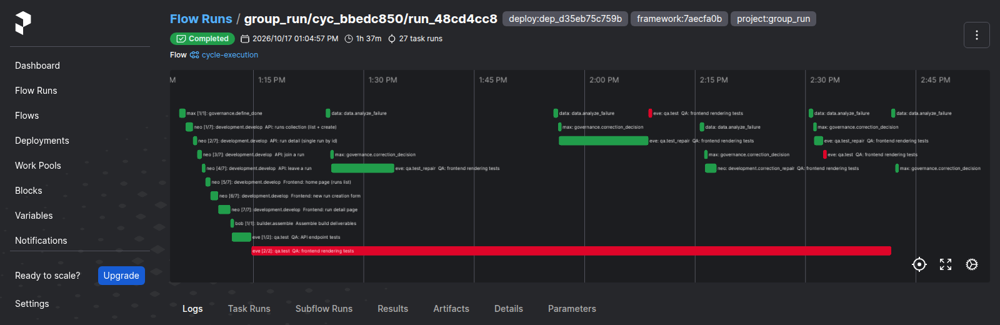
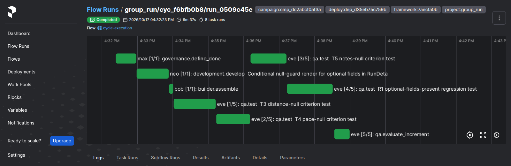
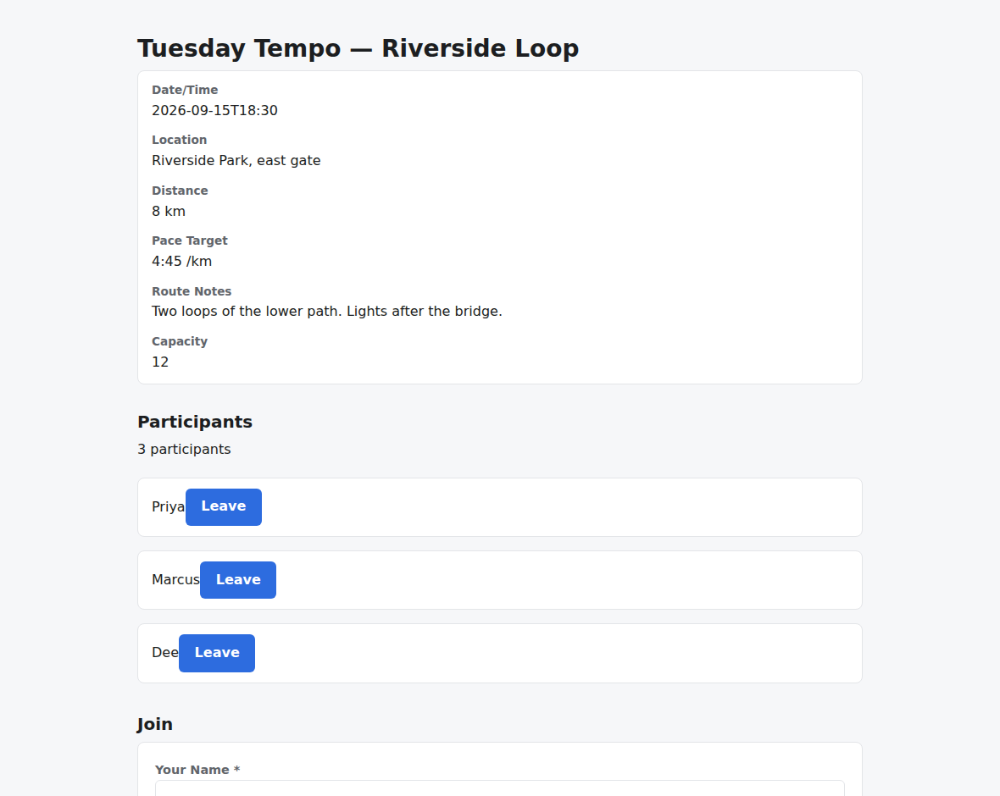
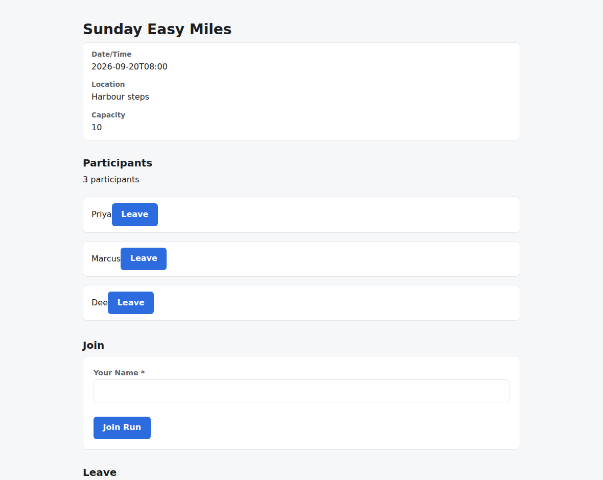
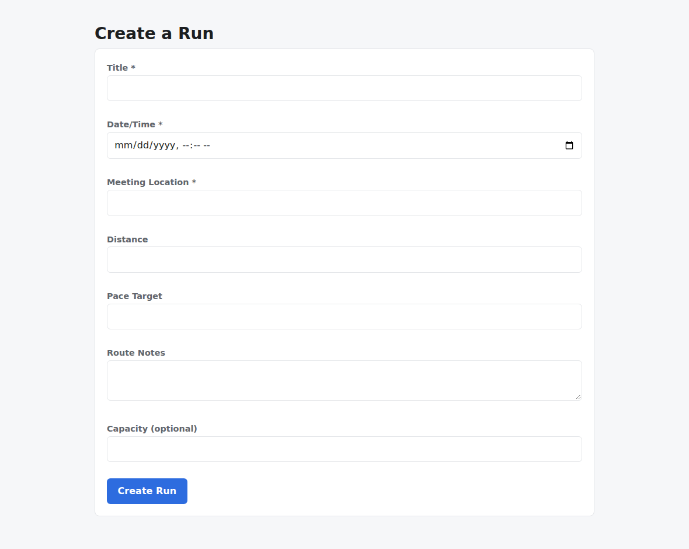
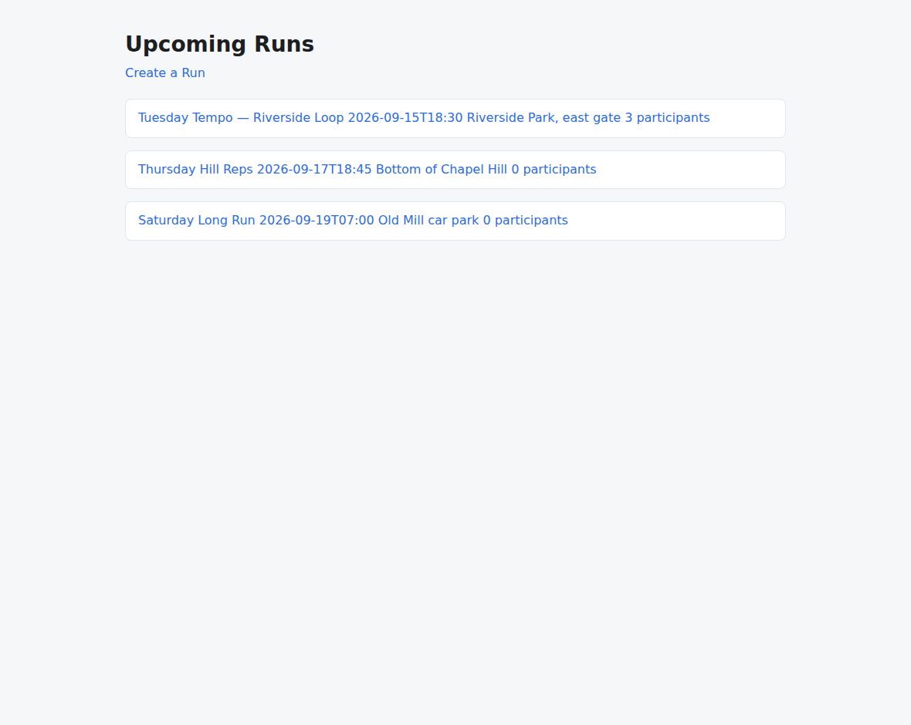

# v2.3.1

**Released 2026-10-17** · [tag `v2.3.1`](https://github.com/backspring-labs/squad-ops/releases/tag/v2.3.1)

**The 2.3 line's first patch: what a campaign's records and checks say is what happened** (plan
`docs/plans/2-3-1-plan.md`). It fixes defects the 2.3 cut found, and two that its own verification found: the
regression pair's first round found #2394, and the first shakeout found #2398. The owner ruled each in (D4, D5). A
patch on the 2.3 line, feature-free.

**The evidence** (the plan's §3, D1). The exit rule is the pair and the shakeout on one deploy, with no new seam finding.
- Each fix's wiring test enters where a live cycle enters, and each is checked to fail without its change.
- **Round 1**, on `dep_4da309b688d4` (69ddf158):
  - FastAPI + React `cyc_ee3b645e51bd` was accepted, 21 of 21.
  - Next.js `cyc_31a49b2cdde6` was rejected on #2394, a scaffold config no role can repair, after two correction
    rounds.
- **Round 2**, on `dep_aad7eb54eacc` (de7a09a7). The pair held:
  - FastAPI + React `cyc_12d8a215d46f`, 20 of 20, and Next.js `cyc_c0245ee52747`, 15 of 15, with no correction round
    in either.
  - The first shakeout, `cmp_dadc7c019ad6`, then escalated on #2398. Its calibration was accepted 20 of 20. Increment
    1's build and repair each met all four criteria, and each was blocked on a detail page that was never read.
- **Round 3**, on `dep_d35eb75c759b` (7aecfa0b), with every one of the 127 loaded checks answering:
  - FastAPI + React `cyc_a627e48d622d` was accepted, 21 of 21, after one correction round.
  - Next.js `cyc_bbedc850e6ff` was rejected, 16 of 17, on #2395, which is placed in 2.4. Its boot audit passed: the app
    installs, builds and boots, answers its 4 contract probes, and renders each of its 3 declared routes. The plan asked
    QA for page tests the stack can't run. One version of the suite needed a DOM library the stack doesn't seed, so it
    was never collected. Another rendered the pages on the server and saw only their loading state. Each repair passed
    patch verification's static rows and was refused at the retest.
  - The owner counted the round for the exit rule, since its only failure was #2395, a finding already placed (D6).
- **The second shakeout**, `cmp_dc2abcf0af3a`, on the same deploy, closed `success` on its objective in 68 minutes:
  - its calibration `cyc_fd8c6216afac` was accepted;
  - both increments were accepted on their first cycle, with no repair or retry cycle and no escalation. The first added a
    leave button beside each participant (`cyc_cbf65f6fb670`, T1–T2). The second hid the detail view's empty optional
    fields (`cyc_f6bfb0b88ebd`, T3–T5), and T1–T2 held;
  - every route held, and each detail page was seeded and read. The supervisor approved each proposal as written, as the
    shakeout's delegate.

**Campaigns (SIP-0109).**
- **A detail page spelled apart from its API collection is read.** To read a detail page, the increment evaluation
  first creates the resource the page shows.
  - It had taken the page's own spelling as the API collection, so `/run/:run_id` over `POST /runs` got no seed. The
    page was never read, and every increment of the campaign was blocked whatever it built.
  - When the spelling names no create, the collection is now the one the API names for the same parameter
    (`GET /runs/{run_id}`). When none does, or two do, the page stays unseeded.
  - A page no seed reaches is logged, and is recorded as `not read, no seed brings its page into being` in the
    evaluation and the boot audit, not as "not rendered".
  - Of the 598 parameterized routes in every stored manifest, 597 are now seeded (#2398; #2399, #2400).
- **A late answer on a closed campaign reaches the stored digest:**
  - the answer route materializes the package again, as a close or an abort does;
  - the answer records who gave it, `human:<principal>` or `agent:<principal>` (`campaigns answer --as-agent`), as a
    gate decision does;
  - its digest line ends its sentence once.

  `answered_by` reads `human:owner` where it read `owner`. The one historical row keeps its bare principal
  (#2305; #2389).

**Verification.**
- **A failed cycle does not read `accepted`.** A failed run's adverse verdict now stands at cycle scope, unless a later
  run of the same workload re-executed its work. The 2.3 cut's set 1 fourth roll had read `verdict: accepted` beside
  `status: failed`, and the 2.3.0 package carried a warning for it (#2384; #2391).
- **Patch verification banks a row it could not execute before the repair's execution of the same criterion,** so the
  execution is the criterion's final state. A backend-only increment's three view compiles had read `missing_tooling`
  after a developer repair executed and passed them. This could understate a record but not reject a correct increment
  (#2381; #2392).

**Scaffold.**
- **The signature check accepts a query parameter added beside the scaffold's,** and still refuses a removed or renamed
  scaffold parameter, or an added body one. A correct handler reading `name: str = Query("")` had been refused, and the
  accepted repair worked around it with a module-level `ContextVar`. The proper fix, an endpoint that declares its
  query parameters, stays with 2.4's output-quality work (#2378, the smaller fix; #2390).
- **The Next.js scaffold's vitest config compiles a page's JSX for the runtime it has** (`esbuild: { jsx: 'automatic'
  }`). A suite that rendered a page had failed "React is not defined" inside the page module, where no repair either
  role may make reaches it (#2394; #2396).

**Runtime.**
- **The runtime API holds no AMQP connection of its own.** Every publish goes through the queue port, and the unused
  connection and channel opened at startup are gone (#2322; #2388).

**Plans and records.**
- The 2.3.1 plan, adopted, with its rulings D1–D6 and each round's record (#2386, #2396, #2399, and this release).
- The regression pair configs for rounds 1–3 and the shakeout campaign's definition (#2393, #2397, #2400).
- The v2.3.0 package: the cut's evidence, screenshots, the records on the Release and housekeeping (#2385).

**Placed in 2.4, not fixed here:**
- #2297: QA's test author was shown the leave endpoint and used it exactly. The planned "empty name" case can't be
  expressed against a name in the path. It is an output-quality finding.
- #2395: a Next.js plan asks QA for page-state tests that the stack's vitest can't run.
- #2378's proper fix.

**What the evidence does not cover:**
- **#2305** needs a closed campaign with a pending escalation, so it is read in its wiring test only.
- **#2378** needs a manifest that chooses a query parameter. No manifest on the line chose one, so it is read in its
  wiring test and its loaded checks only.
- **#2384** needs a run that fails on a framework error. Round 1's Next.js implementation run failed on a plan defect,
  and its cycle read `rejected`. No run failed on a framework error, the case the 2.3 cut's roll hit, so it is read in
  its wiring test and its loaded check.
- **#2394** needs a plan that asks QA to render a page. Round 3's Next.js plan did, and its pages compiled and rendered under the suite. The tests then failed on #2395.
- **#2398** needs a calibration that spells its detail page apart from its API. The second shakeout's calibration
  spelled it as its API does (`/runs/:run_id`), so the fallback did not run live. It is read in its wiring test against
  the first shakeout's stored manifest, in both loaded checks on the deploy, and over the 598 stored routes.
- **The tagged tree against the validated deploy** (`7aecfa0b`, `dep_d35eb75c759b`): nothing under `src/` or
  `adapters/` differs. The differences are the round-3 configs, one loaded check's expected answer (#2400), the version
  and the release's documents.

**Upgrade from 2.3.0:** no migration and no configuration change. Rebuild the runtime API and the agents.

## Merged pull requests (13)

| PR | Title | Closes |
|---|---|---|
| [#2403](https://github.com/backspring-labs/squad-ops/pull/2403) | chore(release): 2.3.1 — what a campaign's records and checks say is what happened: bump, markers, CHANGELOG, ROADMAP entry, the record, the SIP sweep | — |
| [#2400](https://github.com/backspring-labs/squad-ops/pull/2400) | docs(plans): 2.3.1's round-3 regression pair configs, uncounted, on dep_d35eb75c759b from 7aecfa0b; the 2084 loaded row reads the seed helper as it now answers | — |
| [#2399](https://github.com/backspring-labs/squad-ops/pull/2399) | fix(campaigns): a detail page spelled apart from its API collection is seeded by its parameter, and a page no seed reaches is recorded as never read | [#2398](https://github.com/backspring-labs/squad-ops/issues/2398) |
| [#2397](https://github.com/backspring-labs/squad-ops/pull/2397) | docs(plans): 2.3.1's round-2 regression pair configs — uncounted, on dep_aad7eb54eacc from de7a09a7 | — |
| [#2396](https://github.com/backspring-labs/squad-ops/pull/2396) | fix(scaffold): the Next.js vitest config compiles a page's JSX for the runtime it has, so a suite that renders a page reaches its assertions | [#2394](https://github.com/backspring-labs/squad-ops/issues/2394) |
| [#2393](https://github.com/backspring-labs/squad-ops/pull/2393) | docs(plans): 2.3.1's regression pair configs and shakeout campaign — uncounted, on dep_4da309b688d4 from 69ddf158 | — |
| [#2392](https://github.com/backspring-labs/squad-ops/pull/2392) | fix(correction): patch verification banks a row it could not execute before the repair's execution of the same criterion | [#2381](https://github.com/backspring-labs/squad-ops/issues/2381) |
| [#2391](https://github.com/backspring-labs/squad-ops/pull/2391) | fix(verification): a failed run's adverse verdict stands at cycle scope, so a failed cycle does not read accepted | [#2384](https://github.com/backspring-labs/squad-ops/issues/2384) |
| [#2390](https://github.com/backspring-labs/squad-ops/pull/2390) | fix(scaffold): the signature check accepts a query parameter added beside the scaffold's, and still refuses a removed, renamed or added body one | — |
| [#2389](https://github.com/backspring-labs/squad-ops/pull/2389) | fix(campaigns): a late answer on a closed campaign reaches the stored digest, says who gave it, and ends its sentence once | [#2305](https://github.com/backspring-labs/squad-ops/issues/2305) |
| [#2388](https://github.com/backspring-labs/squad-ops/pull/2388) | fix(runtime): the runtime API holds no AMQP connection of its own — every publish goes through the queue port | [#2322](https://github.com/backspring-labs/squad-ops/issues/2322) |
| [#2386](https://github.com/backspring-labs/squad-ops/pull/2386) | docs(plans): the 2.3.1 plan, adopted — the five items the owner placed after the 2.3 cut, and the failed-cycle roll-up | — |
| [#2385](https://github.com/backspring-labs/squad-ops/pull/2385) | docs(release): the v2.3.0 package — the cut's evidence, screenshots, records on the Release, housekeeping | — |

## Improvement proposals amended in place

No lifecycle change — each was edited under the status it already had (a post-acceptance amendment, CLAUDE.md step 5a).

| Proposal | Status |
|---|---|
| [SIP-0088-Agent-Runtime-Modes](../../design/sips/SIP-0088-Agent-Runtime-Modes.md) | accepted |
| [SIP-0090-Agent-Embodiment-Substrate](../../design/sips/SIP-0090-Agent-Embodiment-Substrate.md) | accepted |
| [SIP-0091-Duty-Durability-via-Temporal](../../design/sips/SIP-0091-Duty-Durability-via-Temporal.md) | accepted |
| [SIP-0092-Implementation-Plan-Improvement](../../design/sips/SIP-0092-Implementation-Plan-Improvement.md) | accepted |
| [SIP-0093-Multi-Role-Plan-Authoring](../../design/sips/SIP-0093-Multi-Role-Plan-Authoring.md) | accepted |
| [SIP-0101-Cycle-Replay-Harness](../../design/sips/SIP-0101-Cycle-Replay-Harness.md) | accepted |
| [SIP-0102-Ephemeral-Application-Sandbox](../../design/sips/SIP-0102-Ephemeral-Application-Sandbox.md) | accepted |
| [SIP-0105-Stack-Blueprint-Contract](../../design/sips/SIP-0105-Stack-Blueprint-Contract.md) | accepted |
| [SIP-0109-Campaign-Orchestration](../../design/sips/SIP-0109-Campaign-Orchestration.md) | accepted |
| [SIP-0110-Cross-Cycle-Memory](../../design/sips/SIP-0110-Cross-Cycle-Memory.md) | accepted |
| [SIP-0111-TensorFold-Provider-Adapter](../../design/sips/SIP-0111-TensorFold-Provider-Adapter.md) | accepted |
| [SIP-Agent-Comms-Delivery-Guarantees](../../design/sips/SIP-Agent-Comms-Delivery-Guarantees.md) | proposed |
| SIP-Cycle-Request-Profile-Naming-Taxonomy | proposed |

## Cycle evidence

### `cyc_ee3b645e51bd`

**Verdict:** `accepted` · **Runs:** 2 · **Role:** shakeout — non-counting: the deploy's shakeout, read for seam findings

| | Checks |
|---|---|
| Verified | acceptance:additive_containment, acceptance:assertion_kinds_match, acceptance:client_mock_surface, acceptance:command_exit_zero, acceptance:contract_assertions_match, acceptance:declared_imports, acceptance:dom_anchor_queries, acceptance:endpoint_defined, acceptance:fill_slot_signature, acceptance:frontend_compiles, acceptance:function_defined, acceptance:harness_boundary, acceptance:import_present, acceptance:module_imports, acceptance:regex_match, acceptance:undefined_names, acceptance:unterminated_source, acceptance_criteria_prose, expected_artifacts, frontend_build, no_self_mocking_tests, no_stub_fallback_tests, non_stub_files, required_files, tests_pass, vc-probe-runs, vc-probe-runs-join, vc-probe-runs-join-duplicate, vc-probe-runs-leave, vc-probe-runs-rejects-blank |
| Failed | — |
| Required unmet | — |
| Never executed | — |

### `cyc_31a49b2cdde6`

**Verdict:** `rejected` · **Cycle status:** `failed` · **Runs:** 3 · **Role:** shakeout — non-counting: the deploy's shakeout, read for seam findings

| | Checks |
|---|---|
| Verified | acceptance:additive_containment, acceptance:assertion_kinds_match, acceptance:declared_imports, acceptance:dom_anchor_queries, acceptance:frontend_compiles, acceptance:undefined_names, acceptance:unterminated_source, acceptance_criteria_prose, expected_artifacts, frontend_build, no_self_mocking_tests, no_stub_fallback_tests, non_stub_files, required_files, tests_pass, vc-probe-api-runs, vc-probe-api-runs-join, vc-probe-api-runs-join-duplicate, vc-probe-api-runs-leave, vc-probe-api-runs-rejects-blank |
| Failed | tests_pass |
| Required unmet | — |
| Never executed | — |

### `cyc_12d8a215d46f`

**Verdict:** `accepted` · **Runs:** 2 · **Role:** shakeout — non-counting: the deploy's shakeout, read for seam findings

| | Checks |
|---|---|
| Verified | acceptance:additive_containment, acceptance:assertion_kinds_match, acceptance:client_mock_surface, acceptance:command_exit_zero, acceptance:contract_assertions_match, acceptance:declared_imports, acceptance:dom_anchor_queries, acceptance:endpoint_defined, acceptance:fill_slot_signature, acceptance:frontend_compiles, acceptance:function_defined, acceptance:harness_boundary, acceptance:import_present, acceptance:module_imports, acceptance:undefined_names, acceptance:unterminated_source, acceptance_criteria_prose, expected_artifacts, frontend_build, no_self_mocking_tests, no_stub_fallback_tests, non_stub_files, required_files, tests_pass, vc-probe-runs, vc-probe-runs-join, vc-probe-runs-join-duplicate, vc-probe-runs-rejects-blank |
| Failed | — |
| Required unmet | — |
| Never executed | — |

### `cyc_c0245ee52747`

**Verdict:** `accepted` · **Runs:** 2 · **Role:** shakeout — non-counting: the deploy's shakeout, read for seam findings

| | Checks |
|---|---|
| Verified | acceptance:additive_containment, acceptance:assertion_kinds_match, acceptance:declared_imports, acceptance:dom_anchor_queries, acceptance:frontend_compiles, acceptance:undefined_names, acceptance:unterminated_source, acceptance_criteria_prose, expected_artifacts, frontend_build, no_self_mocking_tests, no_stub_fallback_tests, non_stub_files, required_files, tests_pass, vc-probe-api-runs, vc-probe-api-runs-join, vc-probe-api-runs-join-duplicate, vc-probe-api-runs-leave |
| Failed | — |
| Required unmet | — |
| Never executed | — |

### `cyc_bda7ed244671`

**Verdict:** `accepted` · **Runs:** 2 · **Role:** shakeout — non-counting: the deploy's shakeout, read for seam findings

| | Checks |
|---|---|
| Verified | acceptance:additive_containment, acceptance:assertion_kinds_match, acceptance:client_mock_surface, acceptance:command_exit_zero, acceptance:contract_assertions_match, acceptance:declared_imports, acceptance:dom_anchor_queries, acceptance:endpoint_defined, acceptance:fill_slot_signature, acceptance:frontend_compiles, acceptance:function_defined, acceptance:harness_boundary, acceptance:import_present, acceptance:module_imports, acceptance:undefined_names, acceptance:unterminated_source, acceptance_criteria_prose, expected_artifacts, frontend_build, no_self_mocking_tests, no_stub_fallback_tests, non_stub_files, required_files, tests_pass, vc-probe-runs, vc-probe-runs-participants, vc-probe-runs-participants-duplicate, vc-probe-runs-rejects-blank |
| Failed | — |
| Required unmet | — |
| Never executed | — |

### `cyc_f479d21e05ac`

**Verdict:** `accepted` · **Runs:** 3 · **Role:** shakeout — non-counting: the deploy's shakeout, read for seam findings

| | Checks |
|---|---|
| Verified | acceptance:additive_containment, acceptance:assertion_kinds_match, acceptance:client_mock_surface, acceptance:command_exit_zero, acceptance:contract_assertions_match, acceptance:declared_imports, acceptance:dom_anchor_queries, acceptance:endpoint_defined, acceptance:fill_slot_signature, acceptance:frontend_compiles, acceptance:function_defined, acceptance:harness_boundary, acceptance:import_present, acceptance:module_imports, acceptance:undefined_names, acceptance:unterminated_source, acceptance_criteria_prose, expected_artifacts, frontend_build, no_self_mocking_tests, no_stub_fallback_tests, non_stub_files, required_files, tests_pass, vc-probe-runs, vc-probe-runs-participants, vc-probe-runs-participants-duplicate, vc-probe-runs-rejects-blank |
| Failed | — |
| Required unmet | — |
| Never executed | — |

### `cyc_7c01dc033550`

**Verdict:** `accepted` · **Runs:** 1 · **Role:** shakeout — non-counting: the deploy's shakeout, read for seam findings

| | Checks |
|---|---|
| Verified | acceptance:additive_containment, acceptance:assertion_kinds_match, acceptance:client_mock_surface, acceptance:command_exit_zero, acceptance:contract_assertions_match, acceptance:declared_imports, acceptance:dom_anchor_queries, acceptance:endpoint_defined, acceptance:fill_slot_signature, acceptance:frontend_compiles, acceptance:function_defined, acceptance:harness_boundary, acceptance:import_present, acceptance:module_imports, acceptance:undefined_names, acceptance:unterminated_source, acceptance_criteria_prose, expected_artifacts, frontend_build, no_self_mocking_tests, no_stub_fallback_tests, non_stub_files, required_files, tests_pass, vc-probe-runs, vc-probe-runs-participants, vc-probe-runs-participants-duplicate, vc-probe-runs-rejects-blank |
| Failed | — |
| Required unmet | — |
| Never executed | — |

### `cyc_a627e48d622d`

**Verdict:** `accepted` · **Runs:** 2 · **Role:** shakeout — non-counting: the deploy's shakeout, read for seam findings

| | Checks |
|---|---|
| Verified | acceptance:additive_containment, acceptance:assertion_kinds_match, acceptance:client_mock_surface, acceptance:command_exit_zero, acceptance:contract_assertions_match, acceptance:declared_imports, acceptance:dom_anchor_queries, acceptance:endpoint_defined, acceptance:fill_slot_signature, acceptance:frontend_compiles, acceptance:function_defined, acceptance:harness_boundary, acceptance:import_present, acceptance:module_imports, acceptance:undefined_names, acceptance:unterminated_source, acceptance_criteria_prose, expected_artifacts, frontend_build, no_self_mocking_tests, no_stub_fallback_tests, non_stub_files, required_files, tests_pass, vc-probe-runs, vc-probe-runs-join, vc-probe-runs-join-duplicate, vc-probe-runs-leave, vc-probe-runs-rejects-blank |
| Failed | — |
| Required unmet | — |
| Never executed | — |

### `cyc_bbedc850e6ff`

**Verdict:** `rejected` · **Runs:** 2 · **Role:** shakeout — non-counting: the deploy's shakeout, read for seam findings

| | Checks |
|---|---|
| Verified | acceptance:additive_containment, acceptance:assertion_kinds_match, acceptance:declared_imports, acceptance:dom_anchor_queries, acceptance:frontend_compiles, acceptance:undefined_names, acceptance:unterminated_source, acceptance_criteria_prose, expected_artifacts, frontend_build, no_self_mocking_tests, no_stub_fallback_tests, non_stub_files, required_files, tests_pass, vc-probe-api-runs, vc-probe-api-runs-join, vc-probe-api-runs-join-duplicate, vc-probe-api-runs-leave |
| Failed | tests_pass |
| Required unmet | — |
| Never executed | — |

### `cyc_fd8c6216afac`

**Verdict:** `accepted` · **Runs:** 2 · **Role:** shakeout — non-counting: the deploy's shakeout, read for seam findings

| | Checks |
|---|---|
| Verified | acceptance:additive_containment, acceptance:assertion_kinds_match, acceptance:client_mock_surface, acceptance:command_exit_zero, acceptance:contract_assertions_match, acceptance:declared_imports, acceptance:dom_anchor_queries, acceptance:endpoint_defined, acceptance:fill_slot_signature, acceptance:frontend_compiles, acceptance:function_defined, acceptance:harness_boundary, acceptance:import_present, acceptance:module_imports, acceptance:undefined_names, acceptance:unterminated_source, acceptance_criteria_prose, expected_artifacts, frontend_build, no_self_mocking_tests, no_stub_fallback_tests, non_stub_files, required_files, tests_pass, vc-probe-runs, vc-probe-runs-join, vc-probe-runs-join-duplicate, vc-probe-runs-leave, vc-probe-runs-ordered, vc-probe-runs-rejects-blank, vc-probe-runs-seed |
| Failed | — |
| Required unmet | — |
| Never executed | — |

### `cyc_cbf65f6fb670`

**Verdict:** `accepted` · **Runs:** 3 · **Role:** shakeout — non-counting: the deploy's shakeout, read for seam findings

| | Checks |
|---|---|
| Verified | acceptance:additive_containment, acceptance:assertion_kinds_match, acceptance:client_mock_surface, acceptance:command_exit_zero, acceptance:declared_imports, acceptance:dom_anchor_queries, acceptance:endpoint_defined, acceptance:frontend_compiles, acceptance:import_present, acceptance:module_imports, acceptance:undefined_names, acceptance:unterminated_source, acceptance_criteria_prose, expected_artifacts, frontend_build, no_self_mocking_tests, no_stub_fallback_tests, non_stub_files, required_files, tests_pass, vc-probe-runs, vc-probe-runs-join, vc-probe-runs-join-duplicate, vc-probe-runs-leave, vc-probe-runs-ordered, vc-probe-runs-rejects-blank, vc-probe-runs-seed |
| Failed | — |
| Required unmet | — |
| Never executed | — |

### `cyc_f6bfb0b88ebd`

**Verdict:** `accepted` · **Runs:** 3 · **Role:** shakeout — non-counting: the deploy's shakeout, read for seam findings

| | Checks |
|---|---|
| Verified | acceptance:additive_containment, acceptance:assertion_kinds_match, acceptance:client_mock_surface, acceptance:command_exit_zero, acceptance:declared_imports, acceptance:dom_anchor_queries, acceptance:endpoint_defined, acceptance:frontend_compiles, acceptance:import_present, acceptance:module_imports, acceptance:undefined_names, acceptance:unterminated_source, acceptance_criteria_prose, expected_artifacts, frontend_build, no_self_mocking_tests, no_stub_fallback_tests, non_stub_files, required_files, tests_pass, vc-probe-runs, vc-probe-runs-join, vc-probe-runs-join-duplicate, vc-probe-runs-leave, vc-probe-runs-ordered, vc-probe-runs-rejects-blank, vc-probe-runs-seed |
| Failed | — |
| Required unmet | — |
| Never executed | — |

## Screenshots

Of cycle `cyc_f6bfb0b88ebd` (shakeout) — the second shakeout's last increment on the 2.3.1 deploy: the app the campaign evolved in two increments, a leave button beside each participant and a run's empty optional fields hidden, each built and accepted on its first cycle. The round-3 Next.js roll's timeline is shown beside it because its rejection, on #2395, is the line's one adverse reading.

*prefect flow run round 3 nextjs qa page suite refused at each retest on 2395*

*prefect flow run shakeout increment 2 built and accepted on its first cycle*

*shakeout increment 2 a run s detail with a leave button beside each participant*

*shakeout increment 2 a run without distance pace or notes hides those fields*

*shakeout increment 2 the create run form*

*shakeout increment 2 the run list*
