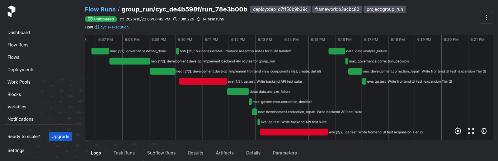
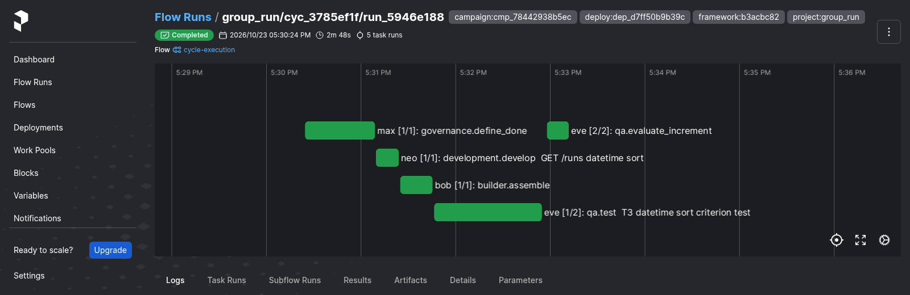
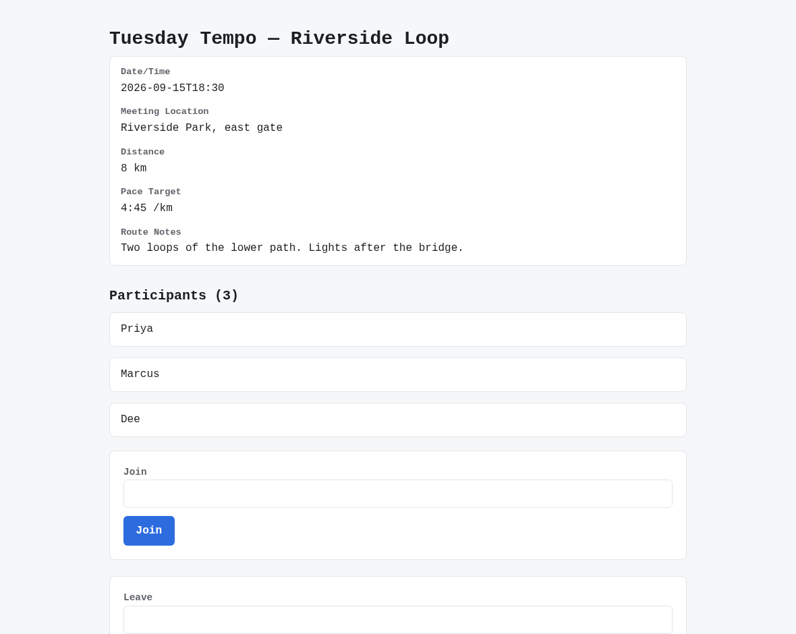
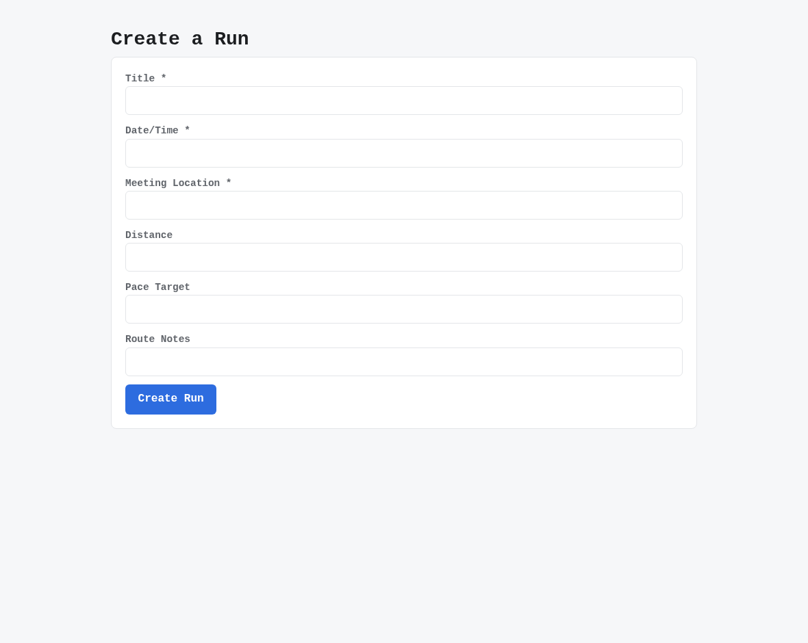
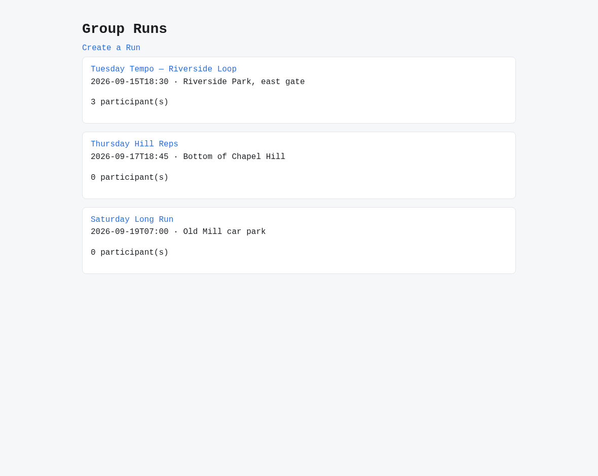

# v2.4.0

**Released 2026-10-23** · [tag `v2.4.0`](https://github.com/backspring-labs/squad-ops/releases/tag/v2.4.0)

**The 2.4 line: an even minor, a feature release with one headline per lane. Project Lifecycle Management (SIP-0112,
the MacBook lane) develops a product SquadOps doesn't own, in that product's repository, by its own checks and through
its own review process, and starts a greenfield product the same way. Outcome Evaluation's phase 1 (SIP-0113, the
Spark lane) is the yardstick, reporting only** (plan `docs/plans/2-4-0-plan.md`). Project Lifecycle Management is the
headline because Outcome Evaluation's feature half didn't ship whole, as the plan ruled it would be then (D14). On the
measurement window's record the owner split that feature half (D4, 2026-10-22): the proposal is now shown its
campaign's outcomes, and the outcome target is held. SIP-0110's memory entry points ship beside both, and QA's half of the
risk-first test instructions (#1966) was adopted on 2026-10-23.

**The cut's evidence: PASS** (`docs/plans/2-4-0-cut-preregistration.md`, registered in #2703, #2707 and #2708, read
in §13). It was read on the final deploy (`b3acbc82`, `dep_d7ff50b9b39c`):
- **the counted set:** 4 of 4 regression rolls accepted on TensorFold, two per stack, with memory disabled. Every
  criterion was verified (22, 17, 21, 19), every boot audit passed, and the rolls took 2, 0, 1 and 1 correction rounds;
- **every model call was TensorFold's:** 80 of 80, read from the agents' per-call metrics and matched in their logs;
- **the line's code is what ran:** all 179 tracked loaded checks answered as expected in every roll, `1966` among them;
- **memory inert where it is disabled:** all 45 exposures read `memory_disabled`, and all 45 captured envelopes
  reconstruct byte for byte;
- **#1966's no-loss checks held, so the owner's revert rule wasn't triggered:** every always-pass held-out scenario
  passed on every roll's tree, and no roll had more than one QA repair whose retest passed. Reported beside them: the
  Next.js rolls passed 9 and 10 of 31 scenarios against their baselines' 11–12, mostly scenarios only one baseline's
  surface reaches. One scenario passed on both like-shaped baselines and failed on both rolls;
- **the shakeout campaign met its exit rule in its second round:** the tier decided every plan gate, no increment
  regressed a scenario, the proposal evidence reached every proposal, and no step value or goal reached a squad role.
  Round 1, a diagnostic on a superseded deploy, found #2706;
- **beside the set, on the same deploy:** IR-1 (a cycle of each of the five seeded projects), IR-2 (a standalone cycle
  and a Campaign's on an external Project reading one source context, each unit with its own snapshot) and IR-8's
  registry half passed. #2183's memory acceptance matrix passed, T1–T17: T12 and T6's campaign half on the Spark's cut
  deploy, the rest on the Mac's deploys of main, with five sub-cases held by unit tests and named on the issue;
- **what it does not cover:** the tagged tree differs from the validated deploy only by documents and the version
  string. Nothing under `src/`, `adapters/`, `agents/`, `config/` or `scripts/` differs, and under `infra/` only the
  evaluator's accepted-advisory list, which the image doesn't copy. Outcome Evaluation
  of an external Project (IR-4 to IR-7, and the evaluation halves of IR-8 and IR-9) is not run, waiting on #2619 in
  2.5. #1966 is read on Next.js greenfield builds only, and the memory matrix's Mac cycles ran on `lite-14b`, so they are
  machinery evidence, not quality.

**Project Lifecycle Management (SIP-0112).**
- **The shared fixture landed first:** a small product with one failing check and one binary file, and each lane's
  recorded outputs, freezing four shared contracts with their tests (#2407, #2414; #2440, #2507).
- **One writable Project registry, cut over from `config/projects.yaml` with a guarded rollback.** A required
  selector, `cycles.project_registry_provider` (`config`, `postgres` or `postgres_read_only`), chooses it. On
  `postgres` each config project is seeded once as `READY`; a rollback that would hide a registered Project stops the
  runtime API; and a Project not ready is refused with 409 `PROJECT_NOT_READY` (#2408; #2444).
- **An existing product is registered** through `POST /api/v1/projects` and `squadops projects import`, idempotent by
  key, behind the locator rules: `https`, `ssh` or the scp form, no credential or option-like segment, and none of the
  deploy's own hosts unless allow-listed (#2408, #2459; #2452).
- **Discovery and the inherited baseline.** `projects validate` mirrors the product into a managed clone no agent tool
  reaches and moves it to `READY` at its base ref's commit; the Development Configuration is versioned and checked
  field by field; and `projects baseline --capture` records each of the product's own checks on the pinned source as
  PASS, FAIL (inherited) or UNVERIFIED with its reason (#2409, #2459; #2468).
- **A source-backed run** pins its source context before dispatch, starts from the product's tree, and verifies its
  change by the product's own checks against the inherited baseline, each attributed `inherited`,
  `introduced/regressed`, `resolved` or unverified. An accepted change is captured as one commit, without the squad's
  test records, and the owner contributes it as a review request or a patch (#2410, #2591; #2484).
- **A sync reads the upstream against the approved baseline** and files each changed path by the evidence it
  invalidates (`instructions`, `command_inputs`, `dependencies`, `toolchain`, `contribution_policy`, `source`). A
  contribution reads `integrated` once its commit or merged review request reaches upstream, and `validate`
  re-validates a `READY` Project at the new commit (#2411; #2565).
- **Greenfield:** `projects initialize` writes a blueprint's layout as the first commit of an empty repository the
  owner made, pushed with the owner's token for that one act, never stored or forced; `validate` and `sync` take the
  same token, so a private product can be reached (amendment H.1; #2412; #2584).
- **What the brownfield demonstration found** (amendment H.2): a sync lists SquadOps's own integrated files apart from
  outside change (`source-drift/v2`), and relevant drift holds new cycles until the Project is reconciled (#2606,
  #2608; #2610). An outside instruction change under a running Campaign (amendment H.3) is tested at the launcher: new
  launches wait for reconciliation, and each later cycle binds the new content at its own commit (#2411; #2616).
- **A check that already fails is compared finding by finding when it declares a reader** (`ruff`, `pytest` or
  `lines`; `no-introduced-regression/v2`): a key whose count grew is `introduced/regressed`. The sandbox reads the
  command's whole output before its tails are cut, and each tail says whether it was cut (amendment H.5; #2609, #2622;
  #2620, #2623, #2630).
- **The managed clones are mounted from `./data/repo_cache`,** so a redeploy keeps a captured change not yet
  contributed (#2588; #2589). A baseline capture waits out each step's own bound, not 30 s (#2586, #2605; #2587,
  #2627).
- **The demonstrations, run and read on the Spark** (`docs/plans/2-4-0-demonstrations-readout.md`). A private copy of
  an existing product went through all six brownfield stages, stage 5 holding once #2610 was deployed; the greenfield
  product's first contribution turned its failing backend check to PASS and was read back as integrated (#2410, #2412;
  #2601, #2604, #2611).

**The sandbox (SIP-0102), built by the Spark lane for both.**
- **A Git checkout's tracked tree round-trips exactly:** a `git_checkout` revision origin (X-1); bytes, line endings
  and the executable bit, with every existing revision ID unchanged (X-2); and a refused seed or patch leaves the live
  tree as it was and answers 400, where it had answered 500 (#2419, #2420; #2441, #2442).
- **A product's declared command runs against a pinned revision in a disposable copy** (X-3a), and a product starts
  there from its own declaration (X-3b) (#2421; #2447, #2450).
- **The runtime API reaches the sandbox service through one client** with its own required selector, URL and token;
  seeding, the pinned read and the workspace release are on the port, and the service's apps run on an internal
  network with no route out (`squadops-sandbox-apps`), by name with no host port (#2451, #2473; #2456, #2458, #2460,
  #2461, #2471, #2527).

**Outcome Evaluation (SIP-0113), phase 1: the instruments, reporting only.** No scenario result reaches a squad role,
a row, a gate or a prompt.
- **The held-out scenario store** (`/api/v1/scenario-suites`, `squadops scenarios`): a scenario is a goal, held-out
  steps and checks, content-addressed, and a campaign pins a suite. `scenarios:read` never shows a step, a
  `squadops-supervisor` user drafts, and only the owner approves; a suite file inside a Git working tree is refused
  (#2413, #2464; #2448, #2465, #2476).
- **The runner and the evaluation service:** a cycle's delivered app is started in a disposable copy in the sandbox
  service and its scenarios run outside every squad container. An `EvaluationRecord` is written whatever happened,
  `blocked_unverified` with its reason where nothing could run, and each campaign cycle is evaluated at its end
  (#2414, #2415; #2449, #2450, #2453, #2472).
- **A scenario reaches each delivery as that delivery built itself:** at the declared `http_base` or the stack's API
  prefix, with fields named by concept and resolved on the delivery's own manifest and entity names, and a `where`
  check that finds a listed element by its fields, not its place (#2421, #2464, #2542; #2466, #2467, #2499, #2543).
- **Quality baselines in the evaluator's image** (`infra/evaluator`): Lighthouse and axe per declared page and #1937's
  lint over the tree, each with its delta from the tree an increment built on and from its campaign's calibration,
  like with like only; ESLint now reads `.jsx`. `remeasure_quality.py` reads each measure's spread on an unchanged
  tree (#2416, #2478; #2455, #2474, #2479, #2480, #2501, #2594).
- **One evaluator tag is one image:** the base pinned by digest, Debian's archive by a dated snapshot, and the
  browser's bound measured at 5 s. A deploy builds the image when its pinned tag is absent and never rebuilds under a
  tag (#2580, #2583; #2581, #2661).
- **The intervention ledger** is a classified projection of the control log, never a second record of it (#2417;
  #2454). **Contribution per increment** (`regressed`, `unverified`, `contributed` or `neutral`), read from two
  evaluation records of one suite. The package and digest carry each cycle's readings, held out of every squad task,
  and a campaign declares its work class, by which Autonomous Outcome Reliability reads four inputs per campaign, one
  of them the 2.0 set's seven safety guarantees (#2418; #2470, #2481, #2485, #2487, #2489).
- **Holding out, checked:** a sweep for the suite's step values across the deploy's databases, the window's vault and
  every squad container, reported by count and hashed id (#2590); a pre-push scan of what a change adds (#2615,
  #2650); a draft-time check for values already public (#2617; #2698); and made-up example values in the code (#2614).
- **The browser runner.** A page scenario's browser steps run in the evaluator, each segment its own container on the
  app network. A control not found by its role and names reads `control_absent`, unverified, never failed, and the
  package counts them. A failed page scenario's evidence is scrubbed and readable by the owner alone, and the cut
  purges it and records the count (#2564; #2646, #2647, #2651–#2653, #2655, #2656).
- **A seeded quality reading:** a second instance of each evaluated tree, seeded through its own API and measured on
  every page. Re-measures are their own records, compared only with their own series (#2562; #2632–#2635).

**Outcome Evaluation's readings,** each pre-registered as a mechanism with its falsifier.
- **The measurement window** (`docs/plans/2-4-0-window-close.md`): four campaigns, two per stack, on one frozen
  deploy. The scenarios discriminated on its pairs, each quality measure spread at most 0.03, the ledger matched the
  control log, no evaluation changed its tree, and memory supplied nothing. Two readings were falsified as written:
  one held-out step value was in every agent image (suite revision 4 retired it), and all six counted accepted
  increments read `contributed` (#2502, #2568, #2596).
- **The seeded reading:** stable, and falsified on seeing the increments. No pair moved a seeded measure on a page it
  changed, because the measures are coarser than the change; a finer reading, #2637, is placed in 2.5 (#2562; #2638).
- **The page scenarios, on suite revision 5,** read with a tool whose fault-injected diagnostic runs the same path:
  each main page scenario discriminates on every pair, the fault-injected tree fails where its source passes, and
  three rounds on two trees agreed. The leak check is falsified as written by a value already public, not by a leak
  (#2564; #2657, #2658, #2660).

**Outcome Evaluation's phase 2, its first half: the proposal is shown its outcomes** (SIP-0113 §4.5, #2677; the
owner's split #2678, its design review #2680).
- **The evidence goes on the proposal task's own inputs through a port, and nowhere else,** never into the cycle's
  resolved config, which the registry stores and a retry copies (#2683).
- **What it shows:** the pinned suite's goals as `passed`, `failed` or `not verified` on the accepted tree, each
  quality measure against the calibration, and the accepted increments' PRD sections. A goal carrying a suite marker
  is held back, and a request that copies a goal's statement is refused (#2687, #2688).
- **A change request may name the goals it means to move** (`moves_goals`), seen only by its proposer and the
  supervisor; an id it wasn't shown is refused. The package reads what became of each named goal, by id (#2686,
  #2689).
- **The live reading** (`cmp_ca24f3776ef8`): the evidence reached and rendered in 4 of 4 proposals; 6 of the 10 named
  goals moved, against 0 of the 40 unnamed; no step value or goal reached a new place. "A proposal shown a failing
  goal aims at one" was falsified as written by a proposal shown none (#2690, #2691, #2696).

**Campaigns (SIP-0109).**
- **A campaign declares its stack,** and every launch carries it; a stack it can't run on is refused at creation with
  422 (#2443; #2446). The FastAPI + React shakeout's definition is the Next.js one's twin (#2516).
- **A repair's or retry's block is built from the increment's own keys and its lineage, never copied from the failed
  cycle's:** a retry of a repair starts from the accepted tree, and no earlier cycle's brief rides along (#2558,
  #2576, #2578; #2574, #2699).
- **An accepted repair freezes its criteria with what they assert,** and the digest names one recorded without; one of
  the window's campaigns had lost its evidence package to it (#2595; #2597). A fresh proposal is shown up to ten
  proposals its campaign never approved, each with its ruling's reason (§24bu; #2593; #2598).
- **A cycle stopped at its plan gate built nothing, so it has no verdict;** a calibration whose plan was rejected had
  been promoted with an empty tree (#2704; #2705). A control operation answers after its own drain, naming a launch
  that drain refused (#2621; #2625).
- **A cycle held on its instruction bindings escalates as its own kind, `binding_hold`,** released by re-supply and
  never parked; an expired hold's run cancel is retried by the next sweep (§24bw; #2178, #2642; #2628, #2643).

**Stacks and scaffold.**
- **What the Next.js shakeout found before the window,** each fixed before the window's deploy froze:
  - a page criterion's test is a file its runner collects, and a footprint reads a dynamic route's brackets literally
    (#2511, #2512; #2514);
  - a route handler states its request fields, its errors and its response entity's fields, so an increment that
    changes them has the route in its footprint (#2522, #2538; #2523, #2539);
  - the runner collects `.test.tsx` under `__tests__/` (#2531; #2532); a page suite runs in jsdom with Testing Library
    (#2395, #2534; #2535); the frozen API client is declared to the suite's author (#2540; #2541); and a suite that
    renders a page or component counts as invoking the application (#2547; #2548).
- **A Next.js criterion's test calls its route through a frozen route caller,** so a route the change adds can
  discriminate (#2577; #2599).
- **An endpoint declares its query inputs,** and the stub, the signature check, QA's contract and the Next.js route
  read them: #2378's proper fix (#2378; #2670). An authored import of the app's entry module is dropped where the
  harness boundary is bound, since no suite can pass both (#2572; #2573).

**Memory entry points (SIP-0110 Appendix A).**
- **The typed memory records:** notes, preferences, and project and task instructions, with permissions by kind,
  provenance and revisions (#2177; #2508).
- **Task instructions reach the tasks they name, and only those:** given at cycle create (`--instruction … --for …`)
  or a campaign's launch, after admission as an intervention refused once its task dispatched (`squadops
  instructions`), at the increment gate, or carried into a repair or retry, with `@current` bound when written. A run
  whose binding can't be read or fitted is held, not failed, until re-supply completes it, and an emergency withdrawal
  halts the work built on it and restarts the run without it (#2178; #2513, #2549, #2554, #2556, #2559, #2636, #2639).
- **Project instructions are pinned in a unit's snapshot at admission** and bind on the tasks they apply to. The
  lessons take the budget they leave; a `memory_context: none` arm withholds both; a counted roll records the set it
  pinned; a withdrawal names the units that pinned it; and a running unit is re-bound forward only (`squadops
  snapshots`) (#2179; #2515, #2526, #2528, #2533, #2544, #2546).
- **References:** a project instruction's `@current` is bound at admission through a resolver port per family, under
  one time bound; one no unit can bind is refused at write; a campaign's are bound per cycle against its snapshot; the
  content is read at each dispatch and shown under its instruction; and a bound revision is re-bound without revising
  its instruction (#2179, #2575; #2555, #2567, #2570, #2579, #2668, #2669).
- **Each task is composed at its own dispatch and measured as its handler renders it.** A unit's dispatches and the
  changes to what they're handed are ordered by its dispatch turn, a pin is settled against a withdrawal that landed
  while it was taken (#2545, #2681, #2684; #2551, #2603, #2693), and the monolithic `qa.test` and
  `development.develop` prompts render the slots their focused paths do (#2509, #2674, #2682; #2510, #2675, #2685).
- **Chat on the memory substrate:** a server-side project binding, each turn's context and exposure, and confirmed
  capture of a project or task instruction, judged by the records API's rules. Chat explains approved lessons and is
  never guided by them, and a conversational claim is a suggestion note. A person deletes their own sessions, and none
  expire (Q29) (#2180, #2181; #2422, #2517, #2518, #2525, #2550).
- **The console's memory record view:** a record's uses apart from its effect, its capture taken live; a long record
  no longer stretches the list (#2182, #2692; #2524, #2695, #2701).
- **A paired comparison's arms are read as one,** and a pair handed different bindings is reported invalid
  (`memory_exposure_report.py --pair`) (#2183; #2702).

**QA: risk-first test design (#1966).**
- **QA plans and writes tests by the faults a change could have:** each acceptance criterion still gets its test, and
  beyond those no further test is a correct answer (three prompt assets). In its pre-registered A/B on four replayed
  window increments, nothing was lost on either arm, QA repairs whose retest passed went from 2 to 1, and QA's own
  tests fell on 2 of 4 against a prediction of 3. The cut's set read it under the owner's revert rule, and both of
  its no-loss checks held (above). The builder half was never measured and is not built (#1966; #2666, #2700).
- **An increment replay runs on the stack its source ran on** (#2667).

**Correction and execution.**
- **A red retest is judged by the tests that fail,** with the row's facts by their direction, so a repair that cleared
  an application error or made a suite load is kept (SIP-0086 §12e). On its pre-registered replay of 18 stored red
  retests it kept four more and lost none main kept. The rest of the converging-repair question was read on every keep
  since #1522 and left as it is (§12f) (#2306; #2662, #2663, #2673).
- **A handler's input refusal fails the run at once,** naming it, with no retry or correction (#2553; #2566); a QA
  re-take that a repair then patched is stored as the patch it verified (#2536; #2537); a plan index that isn't an
  integer is refused with its value (#2488; #2490); a builder squad with no `build_profile` is refused at cycle
  create, not at implementation (#2437; #2438); and an emitted file keeps its final newline (#2607; #2618).
- **Routing a failing slot assertion by defect ownership is not built:** the shell's construction already routes it as
  SIP-0104 §13d asks, and 37 days of runs show no route it would change (§13e; #2153; #2665).

**Request profiles (SIP-0114).**
- **The operator's seven request profiles** (`smoke`, `build`, `validate`, `implement`, `ship`, `wrapup`,
  `benchmark`), each stack's request defaults beneath an operator profile's own keys, and every 2.3.1 profile frozen
  byte for byte and still resolving by name (#316; #2445, #2494, #2500, #2519).
- **The console's cycle create resolves its request on the server** with the builder the CLI uses (`POST
  /api/v1/cycle-request-profiles/{name}/resolve`), so a console cycle carries its profile and the CLI's config hash
  (#2520; #2529). `cycles create --set` reads a list or mapping value as JSON (#2496; #2497).

**Deploy, configuration and telemetry.**
- **Every service mounts exactly the secrets it reads:** the agents hold no database credential, and nothing holds
  Keycloak's admin password (#2457, #2498; #2506).
- **Deploys:** one that runs the sandbox builds its pinned environment image when the tag is absent (#2582; #2585);
  the record declares each agent instance's own model, so a chat turn leaves the box quiet (#2676; #2679); and a
  failed Keycloak realm sync fails the deploy (#2426; #2429). Ollama is asked for the context the registry budgets
  each model at (#2427; #2434), and `lite-14b` is `lite` on qwen2.5:14b, the MacBook's build check (#2435; #2436).
- **Quieter and stricter settings:** the console reads every setting as required (#2431; #2432); a successful
  heartbeat or health probe leaves the access log (#2425; #2428); and the collector stops printing every metrics
  batch, Grafana's usage reporting is off and three images are pinned (#2424; #2430).
- **A generation's full rendered request is kept beside the capped display text,** readable by id
  (`read_full_prompt.py`), and the connection-string redaction no longer crosses lines (#1756; #2463). The generic
  `api-`/`key-` redaction spares the framework's own ids and still redacts a real key (#2462; #2505).
- **Loaded checks for each batch,** one id per check, and every row answers its expect on the source in CI before a
  rebuild, with `docker` shadowed (#2694; #2475, #2477, #2482, #2483, #2492, #2503, #2552, #2600, #2697).

**Dependencies and CI.** certifi 2026.10.19, past GHSA-6q48-6c7w-9gw2 (#2571), and the OpenTelemetry family
1.45.1/0.66b1, past GHSA-xcq7-p3pf-p88h (#2671), in the locks and CI's constraints. Five npm advisories published on
the cut's day, in the evaluator image's lock, are accepted for 2.4.0 by the owner's ruling of 2026-10-23, each with its
reason: `zod`'s belongs to a peer package the image never loads, and `fast-uri`'s four sit inside `ajv`'s resolution
of library schemas. The lock's fix lands with the evaluator's next image (#2712). The dependency audit reads an npm
endpoint error as not run, never as no advisories (#2644; #2645), and runs under macOS's bash (#2648); the scenario
CLI's tests read past Rich's wrapping (#2491; #2504).

**Plans and SIPs.** The 2.4 plan, adopted (#2387); SIP-0112 and SIP-0113 accepted (#2401, #2406); SIP-0111's second
engine candidate redirected to the upgrade to TensorFold 1.x, still unplaced (#2230; #2423); and the Spark thermal
rule's no-data alert placed in 2.5 (#2433; #2439). Outcome Evaluation's design records: the safety guarantees
Autonomous Outcome Reliability reads (#2486), the seeded reading and the browser runner proposed (#2563) and reviewed
(#2631, #2641), the owner's rulings of 2026-10-20 (#2569), the ledgers re-read before the cut (#2629), and a Campaign
on a repository-backed Project designed for 2.5 (#2624, #2626). The integration record
(`docs/plans/2-4-0-integration-record.md`): of the ten cross-lane scenarios, four passed (IR-1, IR-2 and IR-10, each
on the cut deploy too, and IR-3 on three of its four points); two ran in part (IR-8, whose registry half passed on the
cut deploy, and IR-9); and four were not run, each waiting on #2619 (#2640, #2649, #2654). The cut's pre-registration and registration (#2703, #2707, #2708),
and the v2.3.1 package (#2404).

**Not in this release:**
- **A Campaign on a repository-backed Project** (#2619): it calibrates but can't launch an increment. Its design is
  SIP-0112 H.4, SIP-0109 §24bv and SIP-0113 §10l, placed in 2.5 by the owner on 2026-10-21, with the remainders of the
  cycle-end declared start and the evaluation secrets (#2414, #2421).
- **The outcome target and the quality gates** (SIP-0113 §4.7), held until a reading shows contribution separating
  from acceptance; the finer seeded reading (#2637, 2.5); and two browser-driver fixes (#2659, #2706), placed in 2.5
  with suite revision 6, since they move the evaluator's tag.
- **Placed in 2.5 by the owner on 2026-10-23:** widening the check that QA's tests call each endpoint as its contract
  declares it, after QA's backend test guessed an endpoint's method (#2297); a refusal of a slot-scoped QA repair that
  weakens a failing slot assertion (#2664), after the MacBook lane's review; and an increment identity of its own
  (#2578, parts 2–4).
- **The builder half of the risk-first instructions** (#1966), deliberately unplaced; and update history, archive,
  restore and conflict recovery (SIP-0112 E.4.5), placed in 2.6 with the SIP's close (the owner, 2026-10-23).

**Upgrade from 2.3.1:** `.env` must name `SQUADOPS__CYCLES__PROJECT_REGISTRY_PROVIDER`,
`SQUADOPS__SANDBOX_CLIENT__PROVIDER` and `SQUADOPS_SANDBOX_SERVICE_PROVIDER`, and `deploy_credentials.py ensure`
generates `SQUADOPS_SUPERVISOR_PASSWORD`. The runtime API applies migrations 1780–1970 at startup. A deploy's move to
the writable registry is `docs/ops/project_registry_cutover.md`. Rebuild everything.

## Merged pull requests (205)

| PR | Title | Closes |
|---|---|---|
| [#2711](https://github.com/backspring-labs/squad-ops/pull/2711) | chore(release): 2.4.0 — the yardstick, and products SquadOps doesn't own: bump, markers, CHANGELOG, ROADMAP, the cut's reading (PASS), the SIP sweep | [#2183](https://github.com/backspring-labs/squad-ops/issues/2183) [#2412](https://github.com/backspring-labs/squad-ops/issues/2412) |
| [#2708](https://github.com/backspring-labs/squad-ops/pull/2708) | docs(plans): register the 2.4 cut's set on the final deploy dep_d7ff50b9b39c, after shakeout round 2 met the exit rule | — |
| [#2705](https://github.com/backspring-labs/squad-ops/pull/2705) | fix(campaigns): a cycle stopped at its plan gate built nothing, so it has no verdict | [#2704](https://github.com/backspring-labs/squad-ops/issues/2704) |
| [#2707](https://github.com/backspring-labs/squad-ops/pull/2707) | docs(plans): the 2.4 cut's pre-registration after its diagnostic round 1: Q1 reads the HTTP scenarios, and #2705 is named | — |
| [#2703](https://github.com/backspring-labs/squad-ops/pull/2703) | docs(plans): the 2.4 cut's pre-registration, as a draft: 2.3's set, IR-10 on the cut deploy, and #1966's no-loss checks with the owner's revert rule | — |
| [#2702](https://github.com/backspring-labs/squad-ops/pull/2702) | feat(memory): a paired comparison's arms are read as one, and a pair handed different bindings is reported invalid | — |
| [#2700](https://github.com/backspring-labs/squad-ops/pull/2700) | feat(qa): QA plans and writes tests by the faults a change could have, and no further test beyond the criteria is a correct answer (#1966) | [#1966](https://github.com/backspring-labs/squad-ops/issues/1966) |
| [#2701](https://github.com/backspring-labs/squad-ops/pull/2701) | docs(sips): SIP-0110's console record view row is shipped | [#2182](https://github.com/backspring-labs/squad-ops/issues/2182) |
| [#2699](https://github.com/backspring-labs/squad-ops/pull/2699) | fix(campaigns): a repair's or retry's block is built from the increment's own keys and its lineage, never copied from the failed cycle's | — |
| [#2698](https://github.com/backspring-labs/squad-ops/pull/2698) | feat(scenarios): a suite is checked for values already public before it's drafted | [#2617](https://github.com/backspring-labs/squad-ops/issues/2617) |
| [#2697](https://github.com/backspring-labs/squad-ops/pull/2697) | test(deploy): every loaded check answers its expect on the source, before a rebuild | [#2694](https://github.com/backspring-labs/squad-ops/issues/2694) |
| [#2696](https://github.com/backspring-labs/squad-ops/pull/2696) | docs(sips): SIP-0113 §10v, §4.5's live reading recorded, and §4.5's ledger rows shipped | [#2677](https://github.com/backspring-labs/squad-ops/issues/2677) |
| [#2695](https://github.com/backspring-labs/squad-ops/pull/2695) | fix(console): a long record no longer stretches the Memory view's list | [#2692](https://github.com/backspring-labs/squad-ops/issues/2692) |
| [#2693](https://github.com/backspring-labs/squad-ops/pull/2693) | feat(memory): each task is composed at its own dispatch and measured as its handler renders it | [#2681](https://github.com/backspring-labs/squad-ops/issues/2681) [#2684](https://github.com/backspring-labs/squad-ops/issues/2684) |
| [#2691](https://github.com/backspring-labs/squad-ops/pull/2691) | docs(plans): SIP-0113 §4.5's live reading pre-registered, and its campaign (#2677) | — |
| [#2690](https://github.com/backspring-labs/squad-ops/pull/2690) | feat(scenarios): the P2 sweep's --goals mode, and SIP-0113 §10u, §4.5 as built (SIP-0113 §10t step 6) | — |
| [#2689](https://github.com/backspring-labs/squad-ops/pull/2689) | feat(outcomes): the package reads what became of each goal an increment's request named, by id, and the digest lists them (SIP-0113 §10t step 5) | — |
| [#2688](https://github.com/backspring-labs/squad-ops/pull/2688) | feat(prompts): the proposal is shown its campaign's goals, quality moves and accepted PRD, and a request that repeats a goal is refused (SIP-0113 §10t step 4) | — |
| [#2685](https://github.com/backspring-labs/squad-ops/pull/2685) | fix(develop): the monolithic path shows the context slots the focused path does (#2682) | [#2682](https://github.com/backspring-labs/squad-ops/issues/2682) |
| [#2687](https://github.com/backspring-labs/squad-ops/pull/2687) | feat(outcomes): a campaign's proposal is shown its accepted tree's goals, quality moves and accepted PRD, read from the campaign's own records (SIP-0113 §10t step 3) | — |
| [#2686](https://github.com/backspring-labs/squad-ops/pull/2686) | feat(campaigns): a change request may name the goals it means to move, and only its proposer and the supervisor see them (SIP-0113 §10t step 2) | — |
| [#2683](https://github.com/backspring-labs/squad-ops/pull/2683) | feat(outcomes): the proposal's outcome evidence goes on its own task's inputs through a port, and nowhere else (SIP-0113 §10t step 1) | — |
| [#2680](https://github.com/backspring-labs/squad-ops/pull/2680) | docs(sips): SIP-0113 §10t, §4.5's design review: the boundary first, what the proposer is shown, and the channels round it | — |
| [#2679](https://github.com/backspring-labs/squad-ops/pull/2679) | fix(deploy): the record declares its agents' own models, so a chat turn leaves the box quiet | [#2676](https://github.com/backspring-labs/squad-ops/issues/2676) |
| [#2678](https://github.com/backspring-labs/squad-ops/pull/2678) | docs(sips,plans): D4 decided, the split: SIP-0113 §4.5 placed in 2.4, §4.7 held until contribution separates from acceptance | — |
| [#2675](https://github.com/backspring-labs/squad-ops/pull/2675) | fix(qa): a qa.test with no subtask focus shows its task and project instructions, before the lessons | [#2674](https://github.com/backspring-labs/squad-ops/issues/2674) |
| [#2673](https://github.com/backspring-labs/squad-ops/pull/2673) | docs(sips): SIP-0086 §12f, a kept repair's base and the termination rule's two questions read on every keep since #1522 and left as they are | [#2306](https://github.com/backspring-labs/squad-ops/issues/2306) |
| [#2670](https://github.com/backspring-labs/squad-ops/pull/2670) | feat(scaffold): an endpoint declares its query inputs, and the stub, the signature check, QA and the Next.js route read them | [#2378](https://github.com/backspring-labs/squad-ops/issues/2378) |
| [#2671](https://github.com/backspring-labs/squad-ops/pull/2671) | fix(deps): the OpenTelemetry family 1.45.1/0.66b1, past GHSA-xcq7-p3pf-p88h, in the locks and CI's constraints | — |
| [#2669](https://github.com/backspring-labs/squad-ops/pull/2669) | feat(memory): a reference's bound revision is re-bound without revising its instruction (SIP-0110 §5aj) | [#2179](https://github.com/backspring-labs/squad-ops/issues/2179) |
| [#2666](https://github.com/backspring-labs/squad-ops/pull/2666) | docs(plans): #1966's A/B pre-registered: risk-first QA instructions against main, on four replayed window increments | — |
| [#2665](https://github.com/backspring-labs/squad-ops/pull/2665) | docs(sips): SIP-0104 §13e, a failing slot assertion is already routed as §13d asks: the routing build dropped, the weakening guard unplaced | [#2153](https://github.com/backspring-labs/squad-ops/issues/2153) |
| [#2668](https://github.com/backspring-labs/squad-ops/pull/2668) | feat(memory): a bound reference's content is read at each dispatch and shown under its instruction (SIP-0110 §5ai) | — |
| [#2667](https://github.com/backspring-labs/squad-ops/pull/2667) | fix(scripts): an increment replay runs on the stack its source ran on | — |
| [#2663](https://github.com/backspring-labs/squad-ops/pull/2663) | fix(correction): a red retest is judged by the tests that fail, with the row's facts by their direction (SIP-0086 §12e) | — |
| [#2662](https://github.com/backspring-labs/squad-ops/pull/2662) | docs(plans): #2306's retest-progress comparison pre-registered: a replay of 20 stored red retests, and a before-and-after pair on the yardstick | — |
| [#2551](https://github.com/backspring-labs/squad-ops/pull/2551) | fix(memory): a unit's pin is settled against a withdrawal or revocation that landed while it was being taken | [#2545](https://github.com/backspring-labs/squad-ops/issues/2545) |
| [#2661](https://github.com/backspring-labs/squad-ops/pull/2661) | fix(evaluator): one tag is one image: the base pinned by digest and Debian's archive by a dated snapshot, and §10p ruling 5's measured 5 s bound, as `-5` (SIP-0113 §10r) | [#2583](https://github.com/backspring-labs/squad-ops/issues/2583) |
| [#2660](https://github.com/backspring-labs/squad-ops/pull/2660) | docs(sips): B1 to B3 read on revision 5: the page scenarios discriminate and don't flake, and B3 is falsified as written by a value already public (SIP-0113 §10r, #2564) | [#2564](https://github.com/backspring-labs/squad-ops/issues/2564) |
| [#2657](https://github.com/backspring-labs/squad-ops/pull/2657) | feat(scenarios): the reading tool, a fault-injected diagnostic by the same path, and a campaign reads only its own records (SIP-0113 §10p ruling 13, #2564 step 6) | — |
| [#2658](https://github.com/backspring-labs/squad-ops/pull/2658) | docs(plans): the page scenarios' reading pre-registered: the trees, the ground-truth diagnostic, the fault-injected tree, and B1 to B3 (SIP-0113 §10p rulings 12-14, #2564) | — |
| [#2656](https://github.com/backspring-labs/squad-ops/pull/2656) | feat(outcomes): a cycle's package and digest say how many of its page scenarios found no control (SIP-0113 §10p, build step 5) | — |
| [#2655](https://github.com/backspring-labs/squad-ops/pull/2655) | feat(scenarios): the cut purges the line's page evidence and records how much (SIP-0113 §10p, build step 4c) | — |
| [#2654](https://github.com/backspring-labs/squad-ops/pull/2654) | docs(plans): IR-10 run and passed on the Spark, its six predictions held (the 2.4.0 integration record) | — |
| [#2653](https://github.com/backspring-labs/squad-ops/pull/2653) | feat(scenarios): the owner's reader of page evidence, the sweep's page markers, and §10q, §10p as built (SIP-0113 §10p, build step 4b) | — |
| [#2652](https://github.com/backspring-labs/squad-ops/pull/2652) | feat(scenarios): a failed page scenario's evidence, capped and scrubbed in the sandbox and kept held out beside its record (SIP-0113 §10p, build step 4a) | — |
| [#2651](https://github.com/backspring-labs/squad-ops/pull/2651) | feat(sandbox): the runner browses a scenario's browser steps in the evaluator, and the outcome records its runner (SIP-0113 §10p, build step 3) | — |
| [#2650](https://github.com/backspring-labs/squad-ops/pull/2650) | fix(dev): the pre-push scan reads a rebased branch's push for what it adds where it leaves main | — |
| [#2649](https://github.com/backspring-labs/squad-ops/pull/2649) | docs(plans): 2.4.0 IR-10's pre-registration and its counted pair's configs, on dep_1b38de8af6b4 from 23ed15f3 | — |
| [#2648](https://github.com/backspring-labs/squad-ops/pull/2648) | fix(dev): the dependency audit's empty ignore list is guarded for bash before 4.4 (macOS) | — |
| [#2647](https://github.com/backspring-labs/squad-ops/pull/2647) | feat(evaluator): the browser runner's driver, a segment of browser steps behind a page interface (SIP-0113 §10p, build step 2) | — |
| [#2646](https://github.com/backspring-labs/squad-ops/pull/2646) | feat(scenarios): the browser vocabulary, its segments and its draft-time refusals (SIP-0113 §10p, build step 1) | — |
| [#2643](https://github.com/backspring-labs/squad-ops/pull/2643) | fix(campaigns): an expired binding hold's run cancel is retried by the next sweep (SIP-0109 §24bw) | [#2642](https://github.com/backspring-labs/squad-ops/issues/2642) |
| [#2645](https://github.com/backspring-labs/squad-ops/pull/2645) | fix(dev): the dependency audit reads an npm endpoint error as not run, never as no advisories | [#2644](https://github.com/backspring-labs/squad-ops/issues/2644) |
| [#2641](https://github.com/backspring-labs/squad-ops/pull/2641) | docs(sip-0113): §10p, §10k's design review and the rulings it settles before the browser runner is built | — |
| [#2639](https://github.com/backspring-labs/squad-ops/pull/2639) | feat(memory,execution): a task instruction's emergency withdrawal halts the work built on it, and its run restarts without it (SIP-0110 §5ah) | [#2178](https://github.com/backspring-labs/squad-ops/issues/2178) |
| [#2636](https://github.com/backspring-labs/squad-ops/pull/2636) | feat(execution): a run held on its binding sections waits, and starts when re-supply completes them (SIP-0110 §5ag) | — |
| [#2640](https://github.com/backspring-labs/squad-ops/pull/2640) | docs(plans): the 2.4.0 integration record, IR-1 to IR-10 as run or not run (SIP-0112 §8.4) | — |
| [#2638](https://github.com/backspring-labs/squad-ops/pull/2638) | docs(sip-0113): §10o, the seeded reading's series read against S1 and S2; §10j shipped, a finer reading placed in 2.5 | [#2562](https://github.com/backspring-labs/squad-ops/issues/2562) |
| [#2635](https://github.com/backspring-labs/squad-ops/pull/2635) | feat(scenarios): re-measures are their own records, written by remeasure_quality --record and compared only with their own series (SIP-0113 §10n step 5) | — |
| [#2634](https://github.com/backspring-labs/squad-ops/pull/2634) | feat(sandbox): a second instance of each evaluated tree, seeded through its own API and measured on every page (SIP-0113 §10n steps 3 and 4) | — |
| [#2633](https://github.com/backspring-labs/squad-ops/pull/2633) | feat(scenarios): the seeded quality reading's record, its reasons and its deltas (SIP-0113 §10n step 2) | — |
| [#2630](https://github.com/backspring-labs/squad-ops/pull/2630) | feat(projects): a check failing on both sides is compared finding by finding when it declares a reader (no-introduced-regression/v2, SIP-0112 H.5) | [#2609](https://github.com/backspring-labs/squad-ops/issues/2609) |
| [#2632](https://github.com/backspring-labs/squad-ops/pull/2632) | feat(campaigns): the seeded quality reading's planner, a seed written through each delivery's own API (SIP-0113 §10n step 1) | — |
| [#2631](https://github.com/backspring-labs/squad-ops/pull/2631) | docs(sip-0113): §10n, §10j's design review and the rulings it settles before any of it is built | — |
| [#2629](https://github.com/backspring-labs/squad-ops/pull/2629) | docs(sips): Outcome Evaluation's and the sandbox's 2.4 rows re-read before the cut: two shipped, two remainders re-placed to 2.5 | [#2416](https://github.com/backspring-labs/squad-ops/issues/2416) [#2418](https://github.com/backspring-labs/squad-ops/issues/2418) |
| [#2628](https://github.com/backspring-labs/squad-ops/pull/2628) | feat(campaigns): a Campaign cycle held on its instruction bindings escalates as its own kind, released by re-supply and never parked (SIP-0109 §24bw) | — |
| [#2627](https://github.com/backspring-labs/squad-ops/pull/2627) | fix(cli): a baseline capture waits for a long bound, and a timed-out request says it may still complete and how to read its outcome | [#2605](https://github.com/backspring-labs/squad-ops/issues/2605) |
| [#2623](https://github.com/backspring-labs/squad-ops/pull/2623) | feat(sandbox): a declared command reads its findings from the whole output, and each tail says it was cut (X-3a for #2609) | [#2622](https://github.com/backspring-labs/squad-ops/issues/2622) |
| [#2626](https://github.com/backspring-labs/squad-ops/pull/2626) | docs(sips): SIP-0109 §24bv and SIP-0113 §10l, a Campaign on a repository-backed Project (H.4's counterparts, placed in 2.5); §10m discloses W292 in 2.4's lint | — |
| [#2625](https://github.com/backspring-labs/squad-ops/pull/2625) | fix(campaigns): a control operation's answer is read after its own drain, and names a launch that drain refused | [#2621](https://github.com/backspring-labs/squad-ops/issues/2621) |
| [#2618](https://github.com/backspring-labs/squad-ops/pull/2618) | fix(capabilities): an emitted file keeps its final newline, so a contribution leaves the newline of each file it edits | [#2607](https://github.com/backspring-labs/squad-ops/issues/2607) |
| [#2624](https://github.com/backspring-labs/squad-ops/pull/2624) | docs(sip-0112): H.4, a repository-backed Project's development profile derived, its gaps named, and Campaigns run on it; placed in 2.5 | — |
| [#2620](https://github.com/backspring-labs/squad-ops/pull/2620) | feat(sandbox): a check's findings read from its whole output, by a declared reader (#2609, X-3a's readers) | — |
| [#2616](https://github.com/backspring-labs/squad-ops/pull/2616) | test(projects): IR-3, an outside instruction change under a running Campaign, entered at the launcher (SIP-0112 H.3) | [#2411](https://github.com/backspring-labs/squad-ops/issues/2411) |
| [#2615](https://github.com/backspring-labs/squad-ops/pull/2615) | feat(scripts): a pre-push scan for held-out scenario step values in what a change adds | — |
| [#2614](https://github.com/backspring-labs/squad-ops/pull/2614) | test(scenarios): the where example and its tests use made-up run titles | — |
| [#2611](https://github.com/backspring-labs/squad-ops/pull/2611) | docs(plans): 2.4's SIP-0112 demonstrations, read against their pre-registrations | [#2410](https://github.com/backspring-labs/squad-ops/issues/2410) |
| [#2610](https://github.com/backspring-labs/squad-ops/pull/2610) | fix(projects): a sync names what SquadOps's contributions account for apart from outside change, and its drift holds new Cycles until reconciled (SIP-0112 H.2) | [#2606](https://github.com/backspring-labs/squad-ops/issues/2606) [#2608](https://github.com/backspring-labs/squad-ops/issues/2608) |
| [#2603](https://github.com/backspring-labs/squad-ops/pull/2603) | fix(memory): a unit's dispatches and the changes to what they're handed are ordered by its dispatch turn (SIP-0110 §5af) | — |
| [#2604](https://github.com/backspring-labs/squad-ops/pull/2604) | docs(plans): the brownfield demonstration's second feature, set after the outside change and before its cycle | — |
| [#2599](https://github.com/backspring-labs/squad-ops/pull/2599) | fix(stacks): a Next.js criterion's test calls its route through a frozen route caller, so a route the change adds can discriminate | [#2577](https://github.com/backspring-labs/squad-ops/issues/2577) |
| [#2601](https://github.com/backspring-labs/squad-ops/pull/2601) | docs(plans): the brownfield demonstration moves to z_continuum, and its inputs and the greenfield contribution's are fixed before the Spark runs them | — |
| [#2600](https://github.com/backspring-labs/squad-ops/pull/2600) | test(deploy): loaded checks for the repair-criteria and unapproved-proposals fixes, and every loaded check under its own id | — |
| [#2598](https://github.com/backspring-labs/squad-ops/pull/2598) | feat(campaigns): a fresh proposal is shown each proposal its campaign never approved, with the ruling's reason | [#2593](https://github.com/backspring-labs/squad-ops/issues/2593) |
| [#2597](https://github.com/backspring-labs/squad-ops/pull/2597) | fix(campaigns): an accepted repair freezes its criteria with what they assert, and the digest names one recorded without | [#2595](https://github.com/backspring-labs/squad-ops/issues/2595) |
| [#2566](https://github.com/backspring-labs/squad-ops/pull/2566) | fix(execution): a handler's input refusal fails the run at once, naming it, with no retry or correction | — |
| [#2506](https://github.com/backspring-labs/squad-ops/pull/2506) | feat(config): every service mounts exactly the secrets it reads: agents hold no database credential, nothing holds Keycloak's (#2457, #2498) | [#2457](https://github.com/backspring-labs/squad-ops/issues/2457) [#2498](https://github.com/backspring-labs/squad-ops/issues/2498) |
| [#2596](https://github.com/backspring-labs/squad-ops/pull/2596) | docs(plans): the 2.4 measurement window's close: the manifest and the readout of its seven predictions | — |
| [#2594](https://github.com/backspring-labs/squad-ops/pull/2594) | fix(scripts): the quality re-measure opens the deploy's database through config.db, as AppConfig names it | — |
| [#2584](https://github.com/backspring-labs/squad-ops/pull/2584) | feat(projects): a greenfield product starts on its blueprint in an empty repository its owner made (SIP-0112 E.4.6) | — |
| [#2565](https://github.com/backspring-labs/squad-ops/pull/2565) | feat(projects): a product's upstream read against its approved baseline, its contributions' standing, and the repository reference resolver (SIP-0112 E.4.4) | — |
| [#2484](https://github.com/backspring-labs/squad-ops/pull/2484) | feat: a source-backed run, from the product's tree to a verified change contributed through its own process (SIP-0112 E.4.3 slices 1–5) | [#2591](https://github.com/backspring-labs/squad-ops/issues/2591) |
| [#2590](https://github.com/backspring-labs/squad-ops/pull/2590) | feat(scripts): prediction 2's sweep for the 2.4 window: the held-out step values searched in the deploy's databases, the window's vault and every squad container, reported by count and hashed id only | — |
| [#2589](https://github.com/backspring-labs/squad-ops/pull/2589) | fix(deploy): the runtime API's managed clones survive a redeploy, mounted from ./data/repo_cache | [#2588](https://github.com/backspring-labs/squad-ops/issues/2588) |
| [#2587](https://github.com/backspring-labs/squad-ops/pull/2587) | fix(sandbox): a declared run's request waits for every step the service bounds, not 30 s (contract 3) | [#2586](https://github.com/backspring-labs/squad-ops/issues/2586) |
| [#2585](https://github.com/backspring-labs/squad-ops/pull/2585) | fix(deploy): a deploy that runs the sandbox builds the sandbox environment image when its tag is absent; both pinned images build through one helper | [#2582](https://github.com/backspring-labs/squad-ops/issues/2582) |
| [#2581](https://github.com/backspring-labs/squad-ops/pull/2581) | fix(deploy): a deploy that runs the sandbox builds the evaluator image when its pinned tag is absent | [#2580](https://github.com/backspring-labs/squad-ops/issues/2580) |
| [#2579](https://github.com/backspring-labs/squad-ops/pull/2579) | feat(memory): every reference resolver's call is under one time bound, an overrun a fault; a family is registered only through the bound | [#2575](https://github.com/backspring-labs/squad-ops/issues/2575) |
| [#2574](https://github.com/backspring-labs/squad-ops/pull/2574) | fix(campaigns): a retry of a repair starts from the accepted tree; it no longer keeps the repair's repair_of | [#2558](https://github.com/backspring-labs/squad-ops/issues/2558) [#2576](https://github.com/backspring-labs/squad-ops/issues/2576) |
| [#2570](https://github.com/backspring-labs/squad-ops/pull/2570) | feat(memory): a campaign's repository references bound per cycle against its snapshot (SIP-0110 §5ad, the owner's ruling) | — |
| [#2573](https://github.com/backspring-labs/squad-ops/pull/2573) | fix(plans): an authored import_present of the app entry module is dropped where the harness boundary is bound; no suite passes both | [#2572](https://github.com/backspring-labs/squad-ops/issues/2572) |
| [#2571](https://github.com/backspring-labs/squad-ops/pull/2571) | fix(deps): certifi 2026.10.19, past GHSA-6q48-6c7w-9gw2, in the locks and CI's constraints | — |
| [#2569](https://github.com/backspring-labs/squad-ops/pull/2569) | docs(sips): the owner's rulings of 2026-10-20: campaign repository references bound per cycle (SIP-0110 §5ad); §10j and §10k reviews delegated | — |
| [#2568](https://github.com/backspring-labs/squad-ops/pull/2568) | docs(plans): the 2.4 measurement window registered: conditions as read, pins, drift, and what its evidence does not cover | — |
| [#2567](https://github.com/backspring-labs/squad-ops/pull/2567) | feat(memory): a reference no unit of its project can bind is refused at write; the port asks the family why (contract 6) | — |
| [#2563](https://github.com/backspring-labs/squad-ops/pull/2563) | docs(sip-0113): §10j and §10k, proposed: a seeded quality reading and the browser runner, queued for after the window | — |
| [#2559](https://github.com/backspring-labs/squad-ops/pull/2559) | feat(memory): a task instruction's @current reference is bound with its cycle when written (T16, task part) | — |
| [#2556](https://github.com/backspring-labs/squad-ops/pull/2556) | feat(memory): a task instruction carried into a campaign's repair or retry, and given at the increment gate's approval | — |
| [#2555](https://github.com/backspring-labs/squad-ops/pull/2555) | feat(memory): a project instruction's @current reference is bound at its unit's admission through a resolver port per family (T16) | — |
| [#2554](https://github.com/backspring-labs/squad-ops/pull/2554) | feat(cycles): prepare_cycle builds a cycle's admitted task instructions, and a campaign's launch stores them | — |
| [#2552](https://github.com/backspring-labs/squad-ops/pull/2552) | fix(loaded-checks): #2210's row reads the running-cycle states where #2544 moved them | — |
| [#2550](https://github.com/backspring-labs/squad-ops/pull/2550) | feat(chat): a task instruction captured from chat is judged by the records API's rules; one applying a lesson never reaches the lessons-disabled control | [#2180](https://github.com/backspring-labs/squad-ops/issues/2180) |
| [#2549](https://github.com/backspring-labs/squad-ops/pull/2549) | feat(memory): a task instruction added after admission is an intervention, refused once its task dispatched; squadops instructions | — |
| [#2548](https://github.com/backspring-labs/squad-ops/pull/2548) | fix(stacks): a Next.js page suite that renders a real page invokes the application, so a correct page test passes containment | [#2547](https://github.com/backspring-labs/squad-ops/issues/2547) |
| [#2546](https://github.com/backspring-labs/squad-ops/pull/2546) | feat(memory): re-binding a running unit's project instruction, forward only; the restart path is refused and named | — |
| [#2544](https://github.com/backspring-labs/squad-ops/pull/2544) | feat(memory): a project instruction's emergency withdrawal names the units that pinned it, and the exposures that used it are marked | — |
| [#2543](https://github.com/backspring-labs/squad-ops/pull/2543) | fix(scenarios): a scenario's concepts resolve on the entities the delivery names itself (SIP-0113 §10i) | [#2542](https://github.com/backspring-labs/squad-ops/issues/2542) |
| [#2541](https://github.com/backspring-labs/squad-ops/pull/2541) | fix(stacks): Next.js declares its frozen API client, so a page suite's author is shown the paths its pages call | [#2540](https://github.com/backspring-labs/squad-ops/issues/2540) |
| [#2539](https://github.com/backspring-labs/squad-ops/pull/2539) | fix(stacks): a Next.js route handler states its response entity's fields, so an increment adding one has the route in its footprint | [#2538](https://github.com/backspring-labs/squad-ops/issues/2538) |
| [#2537](https://github.com/backspring-labs/squad-ops/pull/2537) | fix(execution): a qa re-take a repair then patched is stored as the patch it verified (SIP-0107 §20) | [#2536](https://github.com/backspring-labs/squad-ops/issues/2536) |
| [#2535](https://github.com/backspring-labs/squad-ops/pull/2535) | fix(stacks): a Next.js page suite runs in a DOM with Testing Library, so a page criterion showing fetched data can pass its own test | [#2395](https://github.com/backspring-labs/squad-ops/issues/2395) [#2534](https://github.com/backspring-labs/squad-ops/issues/2534) |
| [#2533](https://github.com/backspring-labs/squad-ops/pull/2533) | feat(verification-sets): a counted roll records the project instructions it pinned, and a moved set is flagged (SIP-0110 §5t) | — |
| [#2532](https://github.com/backspring-labs/squad-ops/pull/2532) | fix(stacks): Next.js's runner collects .test.tsx under __tests__/ too, so a page suite written with JSX passes plan review | [#2531](https://github.com/backspring-labs/squad-ops/issues/2531) |
| [#2529](https://github.com/backspring-labs/squad-ops/pull/2529) | fix(console): the cycle-create modal asks the runtime API to resolve its request, with the builder the CLI uses (SIP-0114 §11b) | [#2520](https://github.com/backspring-labs/squad-ops/issues/2520) |
| [#2528](https://github.com/backspring-labs/squad-ops/pull/2528) | feat(memory): the memory_context: none arm, recorded and reported apart, and the lesson-text diagnostic (SIP-0110 Appendix A §3.7, T9; #2179 stage 2) | — |
| [#2527](https://github.com/backspring-labs/squad-ops/pull/2527) | feat(sandbox): a seeded workspace is released on the port, and the release keeps the operation journal (SIP-0102 §11j) | [#2473](https://github.com/backspring-labs/squad-ops/issues/2473) |
| [#2526](https://github.com/backspring-labs/squad-ops/pull/2526) | feat(memory): the lessons take what the binding sections leave, each omission naming its limit (SIP-0110 Appendix A, #2179 stage 2, T17) | — |
| [#2525](https://github.com/backspring-labs/squad-ops/pull/2525) | feat(chat): a project instruction captured in chat, its applicability confirmed on the card (SIP-0110 Appendix A, #2180 stage B) | — |
| [#2524](https://github.com/backspring-labs/squad-ops/pull/2524) | feat(memory): the console's memory record view, a record's uses apart from its effect (SIP-0110 Appendix A, #2182) | — |
| [#2523](https://github.com/backspring-labs/squad-ops/pull/2523) | fix(stacks): a Next.js route handler states its request fields and errors, so an increment changing them has the route in its footprint (#2522) | [#2522](https://github.com/backspring-labs/squad-ops/issues/2522) |
| [#2500](https://github.com/backspring-labs/squad-ops/pull/2500) | feat(profiles): the operator's seven request profiles, the stack's request defaults, every released profile frozen (#316) | [#316](https://github.com/backspring-labs/squad-ops/issues/316) |
| [#2518](https://github.com/backspring-labs/squad-ops/pull/2518) | feat(chat): chat inspects approved lessons and is never guided by them; a conversational claim is a suggestion note (SIP-0110 Appendix A, #2181) | [#2181](https://github.com/backspring-labs/squad-ops/issues/2181) |
| [#2517](https://github.com/backspring-labs/squad-ops/pull/2517) | feat(chat): chat on the memory substrate: a server-side binding, each turn's context and exposure, confirmed capture (SIP-0110 Appendix A, #2180 stage A) | — |
| [#2519](https://github.com/backspring-labs/squad-ops/pull/2519) | docs(sips): accept SIP-0114, the cycle request-profile naming taxonomy (#316) | — |
| [#2497](https://github.com/backspring-labs/squad-ops/pull/2497) | fix(cli): cycles create --set reads a list or mapping value as JSON | [#2496](https://github.com/backspring-labs/squad-ops/issues/2496) |
| [#2515](https://github.com/backspring-labs/squad-ops/pull/2515) | feat(memory): project instructions pinned in a unit's snapshot at admission, binding on the tasks they apply to (SIP-0110 Appendix A, #2179 stage 1) | — |
| [#2516](https://github.com/backspring-labs/squad-ops/pull/2516) | feat(campaigns): the 2.4 FastAPI + React shakeout's definition (window pre-registration, condition 4) | — |
| [#2514](https://github.com/backspring-labs/squad-ops/pull/2514) | fix(campaigns): a Next.js page criterion's test is a file its runner collects, and a footprint reads brackets literally (#2511, #2512) | [#2511](https://github.com/backspring-labs/squad-ops/issues/2511) [#2512](https://github.com/backspring-labs/squad-ops/issues/2512) |
| [#2513](https://github.com/backspring-labs/squad-ops/pull/2513) | feat(memory): task instructions reach the tasks they name, and only those (SIP-0110 Appendix A, #2178 stage 1) | — |
| [#2510](https://github.com/backspring-labs/squad-ops/pull/2510) | fix(qa): the test author's monolithic prompt shows the lessons it is handed, as its focused path does (#2509) | [#2509](https://github.com/backspring-labs/squad-ops/issues/2509) |
| [#2508](https://github.com/backspring-labs/squad-ops/pull/2508) | feat(memory): the typed memory records, with permissions by kind, provenance and revisions (SIP-0110 Appendix A, #2177) | [#2177](https://github.com/backspring-labs/squad-ops/issues/2177) |
| [#2507](https://github.com/backspring-labs/squad-ops/pull/2507) | test(scenarios): a start declaration as E.4.2 stores it starts as the shared fixture records it (contract 7, #2414) | — |
| [#2505](https://github.com/backspring-labs/squad-ops/pull/2505) | fix(telemetry): the generic api-/key- redaction spares the framework's own ids, and still redacts a real key (#2462) | [#2462](https://github.com/backspring-labs/squad-ops/issues/2462) |
| [#2504](https://github.com/backspring-labs/squad-ops/pull/2504) | fix(tests): the scenario CLI's assertions read past Rich's wrapping, at any console width (#2491) | [#2491](https://github.com/backspring-labs/squad-ops/issues/2491) |
| [#2502](https://github.com/backspring-labs/squad-ops/pull/2502) | docs(plans): the 2.4 window's pre-registration and its campaign definitions (draft until its conditions hold) | — |
| [#2503](https://github.com/backspring-labs/squad-ops/pull/2503) | test(deploy): loaded checks for where in the sandbox service and the runtime API, and prediction 4's spread (#2464, #2416) | — |
| [#2501](https://github.com/backspring-labs/squad-ops/pull/2501) | feat(outcomes): each quality measure's spread on an unchanged tree, re-measured (SIP-0113 §7 prediction 4, #2416) | — |
| [#2494](https://github.com/backspring-labs/squad-ops/pull/2494) | docs(sips): #316 revision 4, for acceptance: the MacBook lane's review and an open campaign boundary | — |
| [#2499](https://github.com/backspring-labs/squad-ops/pull/2499) | feat(scenarios): a where check, so a scenario finds a listed run by its fields, not its place (#2464) | — |
| [#2468](https://github.com/backspring-labs/squad-ops/pull/2468) | feat(projects): discover a product's own instructions and commands, and capture its inherited baseline (SIP-0112 E.4.2) | [#2409](https://github.com/backspring-labs/squad-ops/issues/2409) [#2459](https://github.com/backspring-labs/squad-ops/issues/2459) |
| [#2490](https://github.com/backspring-labs/squad-ops/pull/2490) | fix(cycles): a plan index that isn't an integer is refused with its value, never a parser crash (#2488) | [#2488](https://github.com/backspring-labs/squad-ops/issues/2488) |
| [#2492](https://github.com/backspring-labs/squad-ops/pull/2492) | test(deploy): a loaded check for the package's safety guarantees and AOR's inputs | — |
| [#2489](https://github.com/backspring-labs/squad-ops/pull/2489) | feat(outcomes): AOR's four inputs per campaign and the work envelope across classes (SIP-0113 §4.6) | — |
| [#2487](https://github.com/backspring-labs/squad-ops/pull/2487) | feat(campaigns): the 2.0 set's seven safety guarantees, read from each campaign's package (SIP-0113 §4.6) | — |
| [#2486](https://github.com/backspring-labs/squad-ops/pull/2486) | docs(sip-0113): §10e, the safety guarantees AOR reads are already named | — |
| [#2485](https://github.com/backspring-labs/squad-ops/pull/2485) | feat(campaigns): a campaign declares its work class in its objective, for AOR and the AWE (SIP-0113 §4.6) | — |
| [#2483](https://github.com/backspring-labs/squad-ops/pull/2483) | fix(deploy): #1937's loaded check reads the package from version 3 on | — |
| [#2482](https://github.com/backspring-labs/squad-ops/pull/2482) | test(deploy): loaded checks for the package's outcome readings, the tree's lint and the .jsx fix | — |
| [#2481](https://github.com/backspring-labs/squad-ops/pull/2481) | feat(campaigns): the evidence package and digest carry each cycle's outcome readings, held out of every squad task (SIP-0113 §4.4) | — |
| [#2480](https://github.com/backspring-labs/squad-ops/pull/2480) | feat(outcomes): each quality measure's delta from the tree an increment built on and from its campaign's baseline (SIP-0113 §4.2) | — |
| [#2479](https://github.com/backspring-labs/squad-ops/pull/2479) | feat(scenarios): #1937's lint over each evaluated tree, in the evaluator's image (SIP-0113 §4.2); ESLint reads .jsx | [#2478](https://github.com/backspring-labs/squad-ops/issues/2478) |
| [#2477](https://github.com/backspring-labs/squad-ops/pull/2477) | fix(deploy): the hook's loaded check loads config as the runtime's root does | — |
| [#2476](https://github.com/backspring-labs/squad-ops/pull/2476) | feat(auth): squadops-supervisor, who drafts a held-out suite and never approves one | — |
| [#2475](https://github.com/backspring-labs/squad-ops/pull/2475) | test(deploy): loaded checks for SIP-0113 phase 1's batch | — |
| [#2474](https://github.com/backspring-labs/squad-ops/pull/2474) | feat(scenarios): Lighthouse and axe on each evaluated instance's declared pages, before any scenario (SIP-0113 §4.2) | — |
| [#2472](https://github.com/backspring-labs/squad-ops/pull/2472) | feat(scenarios): each campaign cycle evaluated at its end against its campaign's pinned suite, reporting-only (SIP-0113 §4.1) | — |
| [#2467](https://github.com/backspring-labs/squad-ops/pull/2467) | feat(scenarios): a scenario names its fields by concept, resolved against each delivery's own manifest (#2464) | — |
| [#2466](https://github.com/backspring-labs/squad-ops/pull/2466) | feat(scenarios): scenarios reach the API at its base, the declared http_base or the stack's prefix (#2421, #2464) | — |
| [#2471](https://github.com/backspring-labs/squad-ops/pull/2471) | feat(sandbox): the scenario runner's app runs on the app network by name, with no route out (#2460 review) | — |
| [#2470](https://github.com/backspring-labs/squad-ops/pull/2470) | feat(outcomes): contribution per increment, read from two evaluation records of one suite (SIP-0113 §4.4) | — |
| [#2453](https://github.com/backspring-labs/squad-ops/pull/2453) | feat(scenarios): the evaluation service: a cycle's delivered app against its pinned suite, the record written (#2414) | — |
| [#2465](https://github.com/backspring-labs/squad-ops/pull/2465) | feat(cli): squadops scenarios, the held-out suites' draft, review and approval (SIP-0113 §4.1, D2) | — |
| [#2455](https://github.com/backspring-labs/squad-ops/pull/2455) | feat(evaluator): SIP-0113's evaluator image, Lighthouse and axe per declared page (A2, #2416; draft, needs the owner's ruling on npm advisories) | — |
| [#2460](https://github.com/backspring-labs/squad-ops/pull/2460) | feat(sandbox): the service's apps on an internal network by container name, with no host port (#2451 part 4) | [#2451](https://github.com/backspring-labs/squad-ops/issues/2451) |
| [#2452](https://github.com/backspring-labs/squad-ops/pull/2452) | feat(projects): register an existing product through the API and the CLI, behind the locator rules and the write gate (SIP-0112 E.4.1) | [#2408](https://github.com/backspring-labs/squad-ops/issues/2408) |
| [#2450](https://github.com/backspring-labs/squad-ops/pull/2450) | feat(sandbox): SIP-0113's scenario runner, and X-3b, a product started from its declaration in a disposable copy (#2414, #2421; contracts 3 and 7) | — |
| [#2449](https://github.com/backspring-labs/squad-ops/pull/2449) | feat(scenarios): an evaluation run's record and its OutcomeEvaluationRef (SIP-0113 phase 1, #2415; contract 5) | [#2415](https://github.com/backspring-labs/squad-ops/issues/2415) |
| [#2448](https://github.com/backspring-labs/squad-ops/pull/2448) | feat(scenarios): the held-out scenario store, its suites, and the campaign's suite pin (SIP-0113 phase 1, #2413; contract 2) | [#2413](https://github.com/backspring-labs/squad-ops/issues/2413) |
| [#2463](https://github.com/backspring-labs/squad-ops/pull/2463) | feat(telemetry): a generation's full rendered request, kept beside the capped display text and readable by id | [#1756](https://github.com/backspring-labs/squad-ops/issues/1756) |
| [#2461](https://github.com/backspring-labs/squad-ops/pull/2461) | feat(sandbox): a pinned revision's content, read through the port from the live tree while it matches its pin (contract 3) | — |
| [#2458](https://github.com/backspring-labs/squad-ops/pull/2458) | feat(sandbox): seeding joins ExecutionSandboxPort, so the runtime API's client seeds through the port (contract 3) | — |
| [#2456](https://github.com/backspring-labs/squad-ops/pull/2456) | feat(sandbox): the runtime API's client of the sandbox service, its own selector, and the service's URL and token (#2451 parts 1–3) | — |
| [#2454](https://github.com/backspring-labs/squad-ops/pull/2454) | feat(outcomes): the intervention ledger, projected from the control log and classified (SIP-0113 §4.3, #2417) | [#2417](https://github.com/backspring-labs/squad-ops/issues/2417) |
| [#2444](https://github.com/backspring-labs/squad-ops/pull/2444) | feat(projects): the writable Project registry, its cutover from config/projects.yaml and its guarded rollback (SIP-0112 E.4.1) | [#2408](https://github.com/backspring-labs/squad-ops/issues/2408) |
| [#2447](https://github.com/backspring-labs/squad-ops/pull/2447) | feat(sandbox): a product's declared command, run against a pinned revision in a disposable copy (X-3a, contract 3) | — |
| [#2445](https://github.com/backspring-labs/squad-ops/pull/2445) | docs(sips): the request-profile taxonomy's revision 3 for the owner's design review, and #2443 placed before the 2.4 window | — |
| [#2446](https://github.com/backspring-labs/squad-ops/pull/2446) | feat(campaigns): a campaign declares its stack, and every cycle it launches carries it (#2443, contract 2) | [#2443](https://github.com/backspring-labs/squad-ops/issues/2443) |
| [#2442](https://github.com/backspring-labs/squad-ops/pull/2442) | feat(sandbox): a Git checkout's tracked tree round-trips exactly: bytes, line endings, tracked derived names, the executable bit (X-2, contract 3) | [#2420](https://github.com/backspring-labs/squad-ops/issues/2420) |
| [#2441](https://github.com/backspring-labs/squad-ops/pull/2441) | feat(sandbox): a revision origin for a Git checkout (X-1, contract 3), and a refused seed or patch leaves the live tree as it was | [#2419](https://github.com/backspring-labs/squad-ops/issues/2419) |
| [#2440](https://github.com/backspring-labs/squad-ops/pull/2440) | test(fixture): the shared fixture product and each lane's recorded outputs, for both 2.4 lanes' contract tests | [#2407](https://github.com/backspring-labs/squad-ops/issues/2407) |
| [#2439](https://github.com/backspring-labs/squad-ops/pull/2439) | docs(plans): place the Spark thermal rule's no-data alert and the unstarted node-exporter in 2.5, by the owner's word | — |
| [#2438](https://github.com/backspring-labs/squad-ops/pull/2438) | fix(preflight): a builder squad with a build step and no build_profile is refused at cycle create, not at implementation | [#2437](https://github.com/backspring-labs/squad-ops/issues/2437) |
| [#2436](https://github.com/backspring-labs/squad-ops/pull/2436) | feat(squads): a lite squad on qwen2.5:14b, the MacBook's build check | [#2435](https://github.com/backspring-labs/squad-ops/issues/2435) |
| [#2432](https://github.com/backspring-labs/squad-ops/pull/2432) | fix(console): every setting is required, as compose gives it, and the realm reaches the console | [#2431](https://github.com/backspring-labs/squad-ops/issues/2431) |
| [#2434](https://github.com/backspring-labs/squad-ops/pull/2434) | fix(llm): Ollama is asked for the context the registry budgets each model at, and the smoke squad's model has an entry | [#2427](https://github.com/backspring-labs/squad-ops/issues/2427) |
| [#2428](https://github.com/backspring-labs/squad-ops/pull/2428) | fix(logs): a successful heartbeat or health probe leaves the access log, and two normal states log at INFO | [#2425](https://github.com/backspring-labs/squad-ops/issues/2425) |
| [#2429](https://github.com/backspring-labs/squad-ops/pull/2429) | fix(deploy): a failed Keycloak realm sync fails the deploy after waiting out a recovering Keycloak, and verify_loaded skips a service the deploy does not run | [#2426](https://github.com/backspring-labs/squad-ops/issues/2426) |
| [#2430](https://github.com/backspring-labs/squad-ops/pull/2430) | chore(infra): the collector stops printing every metrics batch, Grafana's usage reporting is off, and three images are pinned to the Spark's versions | [#2424](https://github.com/backspring-labs/squad-ops/issues/2424) |
| [#2423](https://github.com/backspring-labs/squad-ops/pull/2423) | docs(sips): SIP-0111 §9m — the second TensorFold candidate becomes the upgrade to TensorFold 1.x, measured against 0.6.6, still unplaced | — |
| [#2422](https://github.com/backspring-labs/squad-ops/pull/2422) | docs(sips): Q29 ruled — chat sessions have no automatic expiry, a person deletes their own, and a record confirmed from a deleted session stays | — |
| [#2406](https://github.com/backspring-labs/squad-ops/pull/2406) | docs(sips): accept Outcome Evaluation as SIP-0113, 2.4's Spark-lane feature — revision 2 with A1–A4 ruled, phase 1 placed | — |
| [#2401](https://github.com/backspring-labs/squad-ops/pull/2401) | docs(sips): accept Project Lifecycle Management as SIP-0112, 2.4's MacBook-lane feature, after its design review (revisions 5–8) | — |
| [#2387](https://github.com/backspring-labs/squad-ops/pull/2387) | docs(plans): the 2.4.0 plan, adopted — two lanes: Outcome Evaluation measures first, Project Lifecycle Management develops products SquadOps doesn't own | — |
| [#2404](https://github.com/backspring-labs/squad-ops/pull/2404) | docs(release): the v2.3.1 package — the line's evidence, screenshots, records on the Release, housekeeping | — |

## Improvement proposals

| Proposal | From | To |
|---|---|---|
| [SIP-0112-Project-Lifecycle-Management](../../design/sips/SIP-0112-Project-Lifecycle-Management.md) | new | accepted |
| [SIP-0113-Outcome-Evaluation](../../design/sips/SIP-0113-Outcome-Evaluation.md) | proposed | accepted |
| [SIP-0114-Cycle-Request-Profile-Naming](../../design/sips/SIP-0114-Cycle-Request-Profile-Naming.md) | proposed | implemented |

## Improvement proposals amended in place

No lifecycle change — each was edited under the status it already had (a post-acceptance amendment, CLAUDE.md step 5a).

| Proposal | Status |
|---|---|
| [SIP-0047-Cycle-Data-Layout-Project](../../design/sips/SIP-0047-Cycle-Data-Layout-Project.md) | implemented |
| [SIP-0061-LangFuse-Integration-Foundation](../../design/sips/SIP-0061-LangFuse-Integration-Foundation.md) | implemented |
| [SIP-0063-Keycloak-Production-Hardening](../../design/sips/SIP-0063-Keycloak-Production-Hardening.md) | implemented |
| [SIP-0086-Build-Convergence-Loop-Dynamic](../../design/sips/SIP-0086-Build-Convergence-Loop-Dynamic.md) | implemented |
| [SIP-0088-Agent-Runtime-Modes](../../design/sips/SIP-0088-Agent-Runtime-Modes.md) | accepted |
| [SIP-0090-Agent-Embodiment-Substrate](../../design/sips/SIP-0090-Agent-Embodiment-Substrate.md) | accepted |
| [SIP-0091-Duty-Durability-via-Temporal](../../design/sips/SIP-0091-Duty-Durability-via-Temporal.md) | accepted |
| [SIP-0092-Implementation-Plan-Improvement](../../design/sips/SIP-0092-Implementation-Plan-Improvement.md) | accepted |
| [SIP-0093-Multi-Role-Plan-Authoring](../../design/sips/SIP-0093-Multi-Role-Plan-Authoring.md) | accepted |
| [SIP-0101-Cycle-Replay-Harness](../../design/sips/SIP-0101-Cycle-Replay-Harness.md) | accepted |
| [SIP-0102-Ephemeral-Application-Sandbox](../../design/sips/SIP-0102-Ephemeral-Application-Sandbox.md) | accepted |
| [SIP-0103-Squad-Authored-Manifest](../../design/sips/SIP-0103-Squad-Authored-Manifest.md) | implemented |
| [SIP-0104-Deterministic-Verification-Scaffolding-with](../../design/sips/SIP-0104-Deterministic-Verification-Scaffolding-with.md) | implemented |
| [SIP-0105-Stack-Blueprint-Contract](../../design/sips/SIP-0105-Stack-Blueprint-Contract.md) | accepted |
| [SIP-0109-Campaign-Orchestration](../../design/sips/SIP-0109-Campaign-Orchestration.md) | accepted |
| [SIP-0110-Cross-Cycle-Memory](../../design/sips/SIP-0110-Cross-Cycle-Memory.md) | accepted |
| [SIP-0111-TensorFold-Provider-Adapter](../../design/sips/SIP-0111-TensorFold-Provider-Adapter.md) | accepted |
| [SIP-Agent-Comms-Delivery-Guarantees](../../design/sips/SIP-Agent-Comms-Delivery-Guarantees.md) | proposed |
| [SIP-Post-Retest-Governance-Acceptance-Review](../../design/sips/SIP-Post-Retest-Governance-Acceptance-Review.md) | proposed |
| [SIP-Verification-Yield](../../design/sips/SIP-Verification-Yield.md) | proposed |

## Cycle evidence

### `cyc_de4b598fb1d2`

**Verdict:** `accepted` · **Runs:** 2 · **Role:** counted

| | Checks |
|---|---|
| Verified | acceptance:additive_containment, acceptance:assertion_kinds_match, acceptance:client_mock_surface, acceptance:command_exit_zero, acceptance:contract_assertions_match, acceptance:declared_imports, acceptance:dom_anchor_queries, acceptance:endpoint_defined, acceptance:fill_slot_signature, acceptance:frontend_compiles, acceptance:function_defined, acceptance:harness_boundary, acceptance:import_present, acceptance:module_imports, acceptance:undefined_names, acceptance:unterminated_source, acceptance_criteria_prose, expected_artifacts, frontend_build, no_self_mocking_tests, no_stub_fallback_tests, non_stub_files, required_files, tests_pass, vc-probe-runs, vc-probe-runs-join, vc-probe-runs-join-duplicate, vc-probe-runs-leave, vc-probe-runs-ordered, vc-probe-runs-rejects-blank |
| Failed | — |
| Required unmet | — |
| Never executed | — |

### `cyc_0b6cbf9ab49c`

**Verdict:** `accepted` · **Runs:** 2 · **Role:** counted

| | Checks |
|---|---|
| Verified | acceptance:additive_containment, acceptance:assertion_kinds_match, acceptance:client_mock_surface, acceptance:declared_imports, acceptance:dom_anchor_queries, acceptance:frontend_compiles, acceptance:undefined_names, acceptance:unterminated_source, acceptance_criteria_prose, expected_artifacts, frontend_build, no_self_mocking_tests, no_stub_fallback_tests, non_stub_files, required_files, tests_pass, vc-probe-api-runs, vc-probe-api-runs-join, vc-probe-api-runs-join-duplicate, vc-probe-api-runs-leave, vc-probe-api-runs-rejects-blank |
| Failed | — |
| Required unmet | — |
| Never executed | — |

### `cyc_1aa7a36f28b1`

**Verdict:** `accepted` · **Runs:** 2 · **Role:** counted

| | Checks |
|---|---|
| Verified | acceptance:additive_containment, acceptance:assertion_kinds_match, acceptance:client_mock_surface, acceptance:command_exit_zero, acceptance:contract_assertions_match, acceptance:declared_imports, acceptance:dom_anchor_queries, acceptance:endpoint_defined, acceptance:fill_slot_signature, acceptance:frontend_compiles, acceptance:function_defined, acceptance:harness_boundary, acceptance:import_present, acceptance:module_imports, acceptance:undefined_names, acceptance:unterminated_source, acceptance_criteria_prose, expected_artifacts, frontend_build, no_self_mocking_tests, no_stub_fallback_tests, non_stub_files, required_files, tests_pass, vc-probe-runs, vc-probe-runs-join, vc-probe-runs-join-duplicate, vc-probe-runs-leave, vc-probe-runs-rejects-blank |
| Failed | — |
| Required unmet | — |
| Never executed | — |

### `cyc_007ec7f73c86`

**Verdict:** `accepted` · **Runs:** 2 · **Role:** counted

| | Checks |
|---|---|
| Verified | acceptance:additive_containment, acceptance:assertion_kinds_match, acceptance:client_mock_surface, acceptance:declared_imports, acceptance:dom_anchor_queries, acceptance:frontend_compiles, acceptance:undefined_names, acceptance:unterminated_source, acceptance_criteria_prose, expected_artifacts, frontend_build, no_self_mocking_tests, no_stub_fallback_tests, non_stub_files, required_files, tests_pass, vc-probe-api-runs, vc-probe-api-runs-join, vc-probe-api-runs-join-duplicate, vc-probe-api-runs-leave |
| Failed | — |
| Required unmet | — |
| Never executed | — |

### `cyc_c9879d4bccb5`

**Verdict:** `accepted` · **Runs:** 2 · **Role:** shakeout — non-counting: the deploy's shakeout, read for seam findings

| | Checks |
|---|---|
| Verified | acceptance:additive_containment, acceptance:assertion_kinds_match, acceptance:client_mock_surface, acceptance:command_exit_zero, acceptance:contract_assertions_match, acceptance:declared_imports, acceptance:dom_anchor_queries, acceptance:endpoint_defined, acceptance:fill_slot_signature, acceptance:frontend_compiles, acceptance:function_defined, acceptance:harness_boundary, acceptance:import_present, acceptance:module_imports, acceptance:undefined_names, acceptance:unterminated_source, acceptance_criteria_prose, expected_artifacts, frontend_build, no_self_mocking_tests, no_stub_fallback_tests, non_stub_files, required_files, tests_pass, vc-probe-runs, vc-probe-runs-participants, vc-probe-runs-participants-duplicate, vc-probe-runs-rejects-blank |
| Failed | — |
| Required unmet | — |
| Never executed | — |

### `cyc_ba83158459d9`

**Verdict:** `accepted` · **Runs:** 3 · **Role:** shakeout — non-counting: the deploy's shakeout, read for seam findings

| | Checks |
|---|---|
| Verified | acceptance:assertion_kinds_match, acceptance:command_exit_zero, acceptance:contract_assertions_match, acceptance:endpoint_defined, acceptance:fill_slot_signature, acceptance:frontend_compiles, acceptance:function_defined, acceptance:harness_boundary, acceptance:import_present, acceptance:module_imports, acceptance:undefined_names, acceptance:unterminated_source, acceptance_criteria_prose, expected_artifacts, frontend_build, no_self_mocking_tests, no_stub_fallback_tests, non_stub_files, required_files, tests_pass, vc-probe-runs, vc-probe-runs-participants, vc-probe-runs-participants-duplicate, vc-probe-runs-rejects-blank |
| Failed | — |
| Required unmet | — |
| Never executed | — |

### `cyc_a603999456c8`

**Verdict:** `accepted` · **Runs:** 3 · **Role:** shakeout — non-counting: the deploy's shakeout, read for seam findings

| | Checks |
|---|---|
| Verified | acceptance:additive_containment, acceptance:assertion_kinds_match, acceptance:client_mock_surface, acceptance:command_exit_zero, acceptance:contract_assertions_match, acceptance:declared_imports, acceptance:dom_anchor_queries, acceptance:endpoint_defined, acceptance:fill_slot_signature, acceptance:frontend_compiles, acceptance:function_defined, acceptance:harness_boundary, acceptance:import_present, acceptance:module_imports, acceptance:undefined_names, acceptance:unterminated_source, acceptance_criteria_prose, expected_artifacts, frontend_build, no_self_mocking_tests, no_stub_fallback_tests, non_stub_files, required_files, tests_pass, vc-probe-runs, vc-probe-runs-ordered, vc-probe-runs-participants, vc-probe-runs-participants-duplicate, vc-probe-runs-rejects-blank |
| Failed | — |
| Required unmet | — |
| Never executed | — |

### `cyc_3785ef1f301f`

**Verdict:** `accepted` · **Runs:** 3 · **Role:** shakeout — non-counting: the deploy's shakeout, read for seam findings

| | Checks |
|---|---|
| Verified | acceptance:assertion_kinds_match, acceptance:command_exit_zero, acceptance:contract_assertions_match, acceptance:endpoint_defined, acceptance:fill_slot_signature, acceptance:frontend_compiles, acceptance:function_defined, acceptance:harness_boundary, acceptance:import_present, acceptance:module_imports, acceptance:undefined_names, acceptance:unterminated_source, acceptance_criteria_prose, expected_artifacts, frontend_build, no_self_mocking_tests, no_stub_fallback_tests, non_stub_files, required_files, tests_pass, vc-probe-runs, vc-probe-runs-ordered, vc-probe-runs-participants, vc-probe-runs-participants-duplicate, vc-probe-runs-rejects-blank |
| Failed | — |
| Required unmet | — |
| Never executed | — |

### `cyc_28da0e568e9f`

**Verdict:** `accepted` · **Runs:** 2 · **Role:** shakeout — non-counting: the deploy's shakeout, read for seam findings

| | Checks |
|---|---|
| Verified | acceptance:additive_containment, acceptance:assertion_kinds_match, acceptance:client_mock_surface, acceptance:command_exit_zero, acceptance:contract_assertions_match, acceptance:declared_imports, acceptance:dom_anchor_queries, acceptance:endpoint_defined, acceptance:fill_slot_signature, acceptance:frontend_compiles, acceptance:harness_boundary, acceptance:import_present, acceptance:module_imports, acceptance:undefined_names, acceptance:unterminated_source, acceptance_criteria_prose, expected_artifacts, frontend_build, no_self_mocking_tests, no_stub_fallback_tests, non_stub_files, required_files, tests_pass, vc-probe-runs, vc-probe-runs-join, vc-probe-runs-join-duplicate, vc-probe-runs-leave, vc-probe-runs-ordered, vc-probe-runs-rejects-blank |
| Failed | — |
| Required unmet | — |
| Never executed | — |

### `cyc_d5bd8cd5c8ff`

**Verdict:** `accepted` · **Runs:** 3 · **Role:** shakeout — non-counting: the deploy's shakeout, read for seam findings

| | Checks |
|---|---|
| Verified | acceptance:additive_containment, acceptance:assertion_kinds_match, acceptance:client_mock_surface, acceptance:command_exit_zero, acceptance:contract_assertions_match, acceptance:declared_imports, acceptance:dom_anchor_queries, acceptance:endpoint_defined, acceptance:fill_slot_signature, acceptance:frontend_compiles, acceptance:function_defined, acceptance:harness_boundary, acceptance:import_present, acceptance:module_imports, acceptance:undefined_names, acceptance:unterminated_source, acceptance_criteria_prose, expected_artifacts, frontend_build, no_self_mocking_tests, no_stub_fallback_tests, non_stub_files, required_files, tests_pass, vc-probe-runs, vc-probe-runs-join, vc-probe-runs-join-duplicate, vc-probe-runs-leave, vc-probe-runs-ordered, vc-probe-runs-rejects-blank |
| Failed | — |
| Required unmet | — |
| Never executed | — |

### `cyc_189b357041b2`

**Verdict:** `accepted` · **Runs:** 3 · **Role:** shakeout — non-counting: the deploy's shakeout, read for seam findings

| | Checks |
|---|---|
| Verified | acceptance:assertion_kinds_match, acceptance:command_exit_zero, acceptance:contract_assertions_match, acceptance:endpoint_defined, acceptance:fill_slot_signature, acceptance:frontend_compiles, acceptance:function_defined, acceptance:harness_boundary, acceptance:import_present, acceptance:module_imports, acceptance:undefined_names, acceptance:unterminated_source, acceptance_criteria_prose, expected_artifacts, frontend_build, no_self_mocking_tests, no_stub_fallback_tests, non_stub_files, required_files, tests_pass, vc-probe-runs, vc-probe-runs-join, vc-probe-runs-join-duplicate, vc-probe-runs-leave, vc-probe-runs-ordered, vc-probe-runs-rejects-blank, vc-probe-runs-seed |
| Failed | — |
| Required unmet | — |
| Never executed | — |

## Screenshots

Of cycle `cyc_3785ef1f301f` (shakeout) — the shakeout's last increment on the final deploy: the app its campaign evolved in two increments, each accepted on its first cycle. The first added a run capacity limit in the API, with no UI change, so it isn't on screen; the second ordered the run list soonest first, which the list shows. Beside it, counted FastAPI + React roll 1's timeline, the set's one roll with two correction rounds, each a developer repair whose retest passed.

*prefect flow run counted fastapi react roll 1 with two developer repair rounds*

*prefect flow run shakeout last increment built and accepted on its first cycle*

*shakeout last increment a run s detail with its participants and the join and leave forms*

*shakeout last increment the create run form*

*shakeout last increment the run list soonest first*
