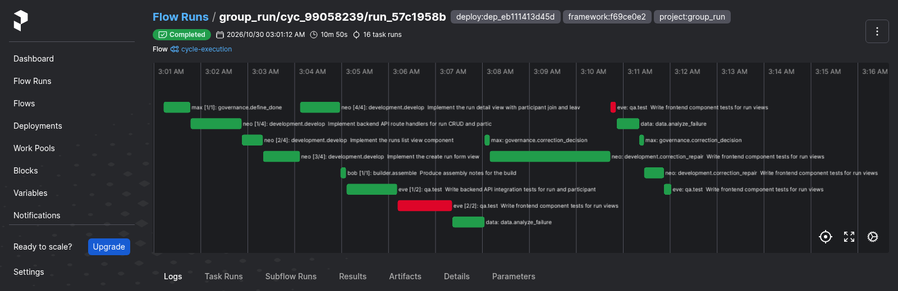
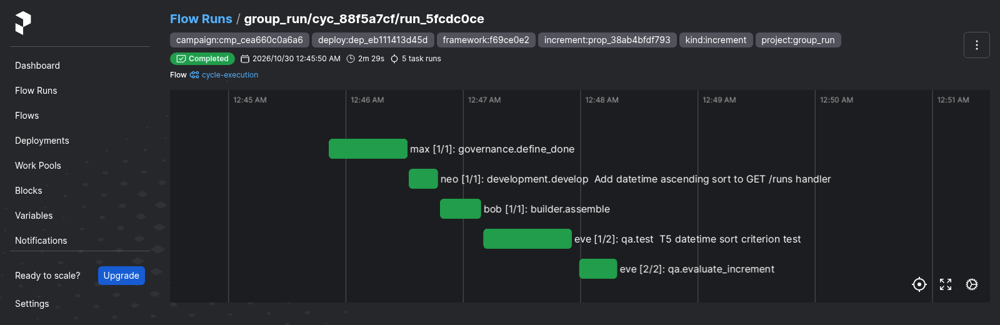
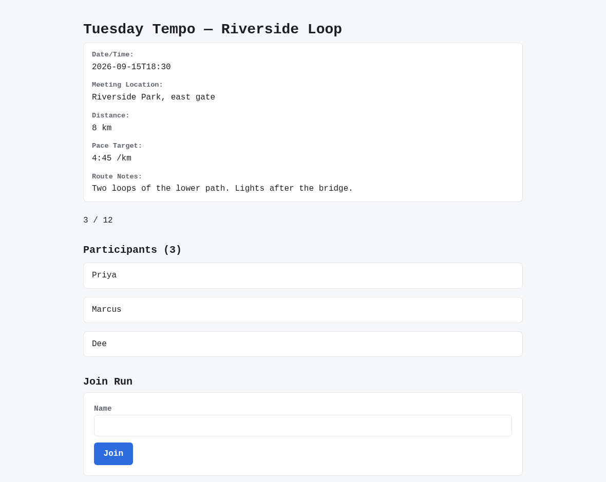
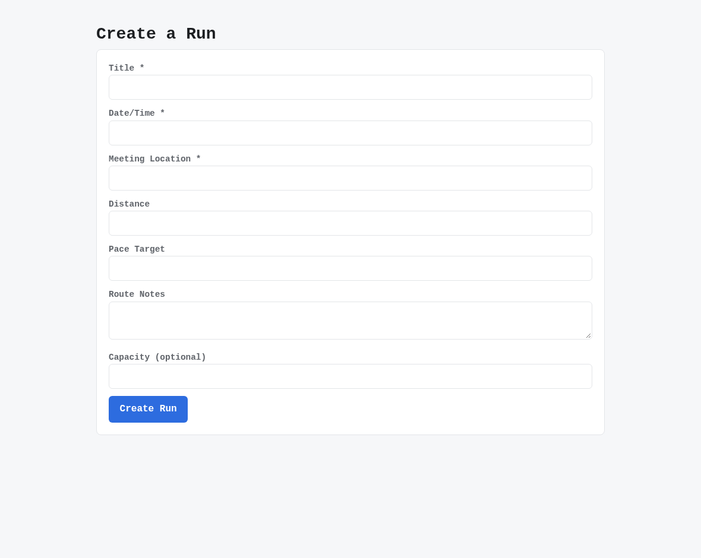
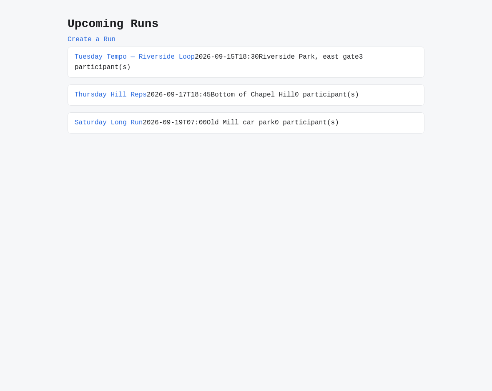

# v2.5.0

**Released 2026-10-30** · [tag `v2.5.0`](https://github.com/backspring-labs/squad-ops/releases/tag/v2.5.0)

**The 2.5 line: an odd minor, a stabilization release, feature-free by rule. It finishes what 2.4 shipped apart: a
Campaign on a repository-backed Project, which 2.4 could calibrate but not launch (#2619). It re-cuts the yardstick
once, and fixes the checks, the correction loop and the operations the 2.4 line found weak** (plan
`docs/plans/2-5-0-plan.md`, adopted 2026-10-24, D1–D12 ruled). Each Track A item completes a shipped feature and adds
none. The MacBook lane built Project Lifecycle Management's half of Track A until 2026-10-28, when the owner moved its
remaining work to the Spark lane. A second review on a shared contract has since gone through the owner (SIP-0112
H.12, #2768).

**The claim is narrowed** (the owner, 2026-10-29: "Narrow the claim, go to cut"). 2.5 claims a Campaign on a
repository-backed Project through its calibration record, proposal, binding, launch, reconciliation and evaluation. It
doesn't claim an accepted increment on a product whose in-cycle tests need the product's own dependencies (#2818). IR-5,
IR-6's increment half and IR-9's increment reading were not exercised, since no increment was accepted on either
demonstration product. Nothing was accepted onto a campaign branch, so the review-request push (#2772) wasn't
exercised either.

**The cut's evidence** (`docs/plans/2-5-0-cut-preregistration.md`, registered in #2822 and #2825, read in its §15), on the final deploy `dep_eb111413d45d` (`f69ce0e2`) on the frozen TensorFold recipe:
- **the counted set:** 4 of 4 regression rolls accepted, two per stack, with memory disabled. Every criterion was verified (21, 21, 21, 18), every boot audit passed, and the rolls took 2, 2, 0 and 0 correction rounds;
- **P1, P2, P3, P5, Q2, Q6 and Q7 held:** every model call was the frozen recipe's, with no other caller's load in any window; all 247 tracked loaded checks answered in every roll; memory stayed inert (45 exposures, 45 envelopes byte-exact); D12's note reached every QA first call and nothing else; no plan asked the list's order (#2557);
- **Q1, the no-loss reading on suite revision 6, was falsified on one tree:** FastAPI + React roll 1 lost two always-pass scenarios. Its own manifest declared `GET /runs` as a wrapper object, and its join form is labelled differently. That is build variance the PRD leaves open, not a 2.5 change. The owner chose "Cut with it recorded", and a stack convention for a collection endpoint's shape is placed in 2.6 (#2826);
- **the shakeout** met its exit rule in round 1 of 3, and **the repeats** on the final deploy held IR-2, IR-3 (a)–(e), IR-4 as a leak test, IR-6's calibration half, IR-7, IR-8 and #2780's anchored page. The `z_continuum` repeat found #2824, placed beside #2818 in 2.5.x or 2.6;
- **beside the set:** IR-1 and IR-8's registry half passed.

**A Campaign on a repository-backed Project (#2619).** Its design is SIP-0112 H.4, SIP-0109 §24bv and SIP-0113 §10l
(all 2026-10-21), and each build is recorded where it diverged.
- **The derived development profile** (contract 8; SIP-0112 H.6, H.7): what the squad's roles depend on in a product,
  read from the pinned tree at every baseline capture. That covers its languages, test runners and their test-id
  readers, lint tools, toolchains and start declaration. Each gap is named `blocking` or `disclosed`, and `projects
  configure` and `projects show` report them (#2716, #2726). A blocking gap refuses the Cycle work it meets, at the
  create path the launcher shares. Plan authors are shown a confined gap's paths first (H.8; #2734). vitest's test-id
  reader is given only where the runner's output is what it reads, and the gap says why where it isn't (H.10; #2769).
- **The recipe:** a product's cycle seeds no skeleton and is shown its own test runners. Its increments take the
  stack-less `campaign-increment-source` profile, and the sample applications' profiles keep their stack (H.11, which
  narrows the plan's row; #2766). A product made from a blueprint runs under that blueprint's development profile,
  shown its conventions without the blueprint's test placement (H.13; #2773).
- **The start is a calibration record, not a cycle:** `campaigns start` on a repository-backed Project records its
  baseline commit, configuration revision, tree identity, inherited checks and disclosed gaps. It is refused with 409
  `CALIBRATION_REFUSED`, writing nothing, when no record can be written (§24bv point 1, §24cc; #2738). A sample
  application's start still launches its calibration cycle.
- **The accepted tree is one campaign branch** in the managed clone. An accepted increment is promoted from its own
  captured commit, and the branch's ref moves only by compare-and-swap (§24bv point 2; #2740).
- **An increment is pinned at the campaign branch's head:** contract 1 gains `pinned_commit`, `pinned_from` and
  `previous_verification_ref` (H.9; #2761). The launcher reads the head at drain, and an intent binds no tree before
  then (§24cd point 1; #2763). The candidate's checks are compared with the verification that made the head
  (§24bv point 3; #2764).
- **The proposal reads the product at its head,** with the objective's requirements source in place of a manifest, and
  each criterion's test is placed under the product's own runners (§24bv point 5, §24cj; #2771). Its scope governs
  the product's files, and the stack's QA test namespace is the framework's (the owner's option 1; #2743; #2748).
- **Acceptance runs on the product's own runner in the sandbox,** in place of `qa.evaluate_increment` (§24cd point 6,
  §24cl; #2774). A vitest test-id reader joins pytest's, and pytest's reader carries each failure's exception class
  (§24ci (a); #2757; #2764).
- **The client routes are rendered on the candidate,** started in the sandbox from the product's declared start
  (§24co; #2777). A `client_route` criterion may name its view's anchor, so a route the request adds can hold (§24cp;
  #2779; #2780). A declared catch-all route is read where no declared route is served (#2754; #2755).
- **The branch follows upstream:** before each launch it is rebased onto the commit the Project reconciled, after the
  create path's own gates pass there. The rebased head is verified by the product's checks. A conflict escalates as
  `CAMPAIGN_BRANCH_CONFLICT`, and a regressed head as `REBASED_HEAD_REGRESSED` (§24bv point 4; #2770).
- **The review request is the supervisor's push** (`squadops campaigns push-review`, `POST
  /api/v1/campaigns/{id}/review-pushes`), with the supervisor's own token. Every push after the first carries a lease
  on the commit last pushed, and a branch someone else moved is refused with 409 `REVIEW_BRANCH_MOVED` (§24ci (b);
  #2772).
- **Outcome Evaluation reads the product:** a campaign cycle is evaluated at its end on the commit its delivery
  captured, started from the Project's own declaration (§10aa; #2414, #2592; #2778). The Campaign's baseline reading is
  the calibration record's commit, evaluated as the record is heard, and a product made from a blueprint is linted by
  its rule set (§10l, §10ac, H.14; #2788).
- **An owner's pause or abort holds across a cycle's hearing.** The campaign is read again before each write, and a
  paused campaign's ending waits for its resume (§24cq; #2789; #2792).
- **What the demonstrations found, each fixed before the cut:** a criterion file both a development task and a QA task
  claim is the QA task's at the merge (SIP-0093 §15b, SIP-0109 §24cr; #2795; #2802); a `qa.test`'s and a correction
  repair's prompt budget counts only what its prompt shows, through the function its handler renders it with (SIP-0110
  §5an, §5ao; #2805, #2810; #2807, #2812); and a product's QA suite runs on the product's tree (H.15; #2815; #2816).
- **The demonstrations, pre-registered and read** (`docs/plans/verification-sets/2-5-0-demonstrations-preregistration.md`;
  #2787, #2820). On private copies of two products, `z_continuum` and `z_shelfnote`: IR-3 held, (a) to (e); IR-4 held
  as a leak test; IR-7 and IR-8 held; IR-6 held on the calibration records only. The products' increments were
  stopped in turn by #2795, #2805, #2810 and #2815, each fixed, then by #2799 and #2818.

**The yardstick, re-cut once** (SIP-0113 §10x, §10y).
- **The evaluator's `-6`:** a control's name is read past a trailing colon (#2706). A click may say `if_enabled`, so a
  build that disables its control reads as one that refuses the click (#2659). The image's npm lock has no advisory
  left: the five accepted for 2.4.0 and the three older ones are retired, and the accepted-advisory list is empty
  (#2712, #2469; #2717).
- **The evaluator's `-7`, the finer quality reading:** axe by node, the failing audits by id, and the sandbox's
  plain-HTTP audits apart (#2637; #2762). The owner approved its design on 2026-10-28 (§10y; #2724). Read on the
  window's 20 trees, S1 and E hold and S2a falls for both new measures, so they stay reporting-only (§10z; #2767).
- **Held-out suite revision 6,** approved on the owner's delegation: #2659's two-form scenario, and the eight step
  values already public replaced. **Its re-read:** the 2.4 cut's eleven trees on revisions 5 and 6, on `-7`. No HTTP
  result of 275 and no page result of 66 moved, and revision 6's always-pass sets are 2.4's, id for id (#2806,
  #2808).
- **A scenario's HTTP checks read the values its steps saved,** and a name nothing saves is refused when drafted
  (§10ab; #2784; #2785). The held-out markers read a step's path segments, never a declared route's words or a
  reference to a saved value (§10ad; #2786; #2794).
- **A failed start's cause is kept:** its detail and the app's last lines are on the evaluation record, its package
  (version 8) and the runtime's log (§10ae; #2793; #2797).
- **The workhorse PRD's core list shows runs in the order they were created,** with date sorting left in Expansion
  Tier 1 (D3; #2557; #2811).

**The checks and the correction loop.**
- **`contract_assertions_match` refuses a status assertion on a request that reaches a declared route only with a
  required path segment empty,** unless the assertion is the router's own answer (#2297; #2728).
- **A slot revision that drops its failing assertion's subject is refused** as `slot_subject_dropped` (SIP-0104
  §13f; #2664; #2746).
- **A repair whose every file write was dropped is spent, not refunded,** and the next round is told which paths and
  whose grant (#2521; #2727).
- **A handler's input refusal ends the run as `input_refused`,** read as `input_contract_failure`. The attribution
  registry is version 2, so failure records before and after it read differently (#2553; #2729).
- **A QA first call is sent the cut-off re-ask's clause,** "keep any reasoning short so that the output fits.", on
  `qa.test` and `qa.test_repair` only (D12; #2253; #2759). Its evidence: on the 46 QA calls the cap had cut, the
  clause finished 39 against 14, and on 80 calls that weren't cut it cost no pass the sample could see (#2747, #2752,
  #2753).
- **A Next.js page criterion's test loads its page through a frozen page loader,** so a page the change adds can
  discriminate (#2602; #2749).

**An increment's own identity (#2578).** A campaign cycle names its increment in an indexed `increment_id`, set by
the launcher from its own binding, and its flow runs carry `increment:` and `kind:` tags for operators (parts 2 and 3;
#2739). The ledger lists each proposal version's cycles, a repair or retry attached by its own launch's binding (part
4, SIP-0109 §24cg; #2741). An uncounted Campaign read the records on every cycle kind, and it ended `success` (#2750,
#2756).

**Operations and hardening.**
- **The legacy per-agent LanceDB store is retired** after a re-inventory found all eight stores empty. `MemoryPort`,
  its adapters and `lancedb` are gone, and the eight `*_memory_data` volumes leave compose on the owner's OK (D4;
  #2184; #2735).
- **Monitoring:** the Spark's thermal alert reads no data as OK. A host exporter that stops is its own alert,
  `host-exporter-down`, and the deploy starts `node-exporter` on Linux and `dcgm-exporter` where the GPU's CDI spec is
  written (#2433; #2730).
- **A service token that expired while the host slept is refreshed,** read on both clocks (#2493; #2718).
- **TensorFold:** a deploy records its served model's weights, the checkpoint its frozen recipe pins, and says which
  named models it doesn't serve (#2561; #2732). The key file keeps other callers' labelled keys, and only the
  `squadops` line is ours. A two-lane candidate recipe sits beside the frozen one, opt-in (the owner's #2742, part of
  #2286). `engine_callers.py` reads the engine's request counter by key label, and its gauges, from inside the deploy
  (#2823).
- **Smaller fixes:** a managed clone's missing directory is named, not read as git missing (#2672; #2719);
  `update_sip_status.py` stamps UTC (#2710; #2720); the release captures name the browser's own load error (#2713;
  #2721); `run_prose_lane.sh` runs under macOS's bash 3.2, with a guard (#2402; #2722); a replay call that fails before
  any answer records its exception's type, never its text, which can quote the bearer key (#2744; #2801); the
  held-out pre-push hook no longer ends silently on git's SIGPIPE (#2800; #2803); the held-out sweep walks each
  cycle's vault under its own project (#2819); and the worktree hygiene sweep judges only the checkout's own
  worktrees (#2751; #2821).
- **Loaded checks** for each batch: 247 tracked rows, 68 more than 2.4's 179 (#2725 and each change's own rows).

**Dependencies and CI.** `lancedb` leaves the agent extra, and the locks are recompiled; the tests' SIP-042 block goes,
and with it 46 pins in CI's constraints (#2735). The evaluator image's npm lock is clear of advisories (#2717). CI's
integration job pulls its services from the mirror with retries and falls back to Docker Hub (#2560; #2731), and a
failed image build in the integration tests reports its stderr's tail (#2790; #2791).

**Plans and SIPs.** The 2.5 plan, adopted (#2715), revised on resuming (#2745), and run as one lane from 2026-10-28
(#2768). SIP-0109 §24cd, §24bv points 2–4 as built (#2733), and the owner's rulings on §24cd point 7: #2757 placed in
2.5 and #2421's remainder moved to 2.6 (#2758). SIP-0113 §10y and §10z (#2724, #2767). The pre-registrations and
readings of Track B's re-read (#2806, #2808), Track D's uncounted Campaign (#2750, #2756) and the demonstrations
(#2787, #2820). The cut's pre-registration and registration (#2822, #2825), and the v2.4.0 package (#2714).

**Not in this release:**
- **An accepted increment on a product whose in-cycle tests need its own dependencies** (#2818), placed first in 2.6 or
  a 2.5.x patch (the owner, 2026-10-29), with the product-path findings the demonstrations filed: #2799 (a vitest
  product's page criteria), #2817, #2796, #2814, #2809, #2813, #2804, #2798 and #2783.
- **A Campaign's repair or retry of an increment whose approved proposal is a revision** (#2824), found in the cut's
  `z_continuum` repeat. The owner chose "Name it, fix after", and it is placed in 2.5.x or 2.6 beside #2818.
- **The cut's Q1 loss on one tree** (#2826), recorded by the owner's ruling.
- **Deferred to 2.6:** held-out suite revision 7 (#2723), by the plan's deferral rule; the box lease (#2287) and the
  scripted squad (#2495), deferrable and unbuilt; #1469 and #2286's remainder (the owner's "Yes to both",
  2026-10-29); an owner-approved evaluation secret resolved at start (#2421's remainder, 2026-10-28); and the TensorFold
  1.x upgrade (#2230, D5).
- **Features, by parity,** each waiting for 2.6's plan: the judgement steps (#557, #949, #950), Test-First's greenfield
  gate (#1978), SIP-0112's lifecycle completeness (E.4.5, #2709), a source-backed change's file deletion (#2612) and
  end-of-plan regression repair (#2613), and Outcome Evaluation's outcome target and quality gates (SIP-0113 §4.7).

**Upgrade from 2.4.0:** no new `.env` setting. The runtime API applies migrations 1697, 1698, 1699, 1808, 1980,
1990, 2000 and 2001 at startup. The runner applies each file by name, so 1697–1699 and 1808 apply on a deploy that already has 1970. Rebuild
everything, together (`rebuild_and_deploy.sh all`), and not while a Campaign's increment framing is in flight (#2802).
An older agent beside the new runtime would read QA's bound suite row as unparseable (#2728), and an older sandbox
gives acceptance no pass count (#2774). A deploy builds the evaluator's `…-eslint10.12-7` image when the tag is absent.
`verify_loaded.py` then reads all 247 tracked rows. Compose no longer declares the eight `*_memory_data` volumes; they
stay on the box, unmounted, until someone removes them. Grafana reads the new alert at its restart. The frozen
TensorFold recipe is `infra/tensorfold/recipes/qwen27b-nvfp4.yaml`, and the cut's set ran on it. The two-lane candidate
is opt-in, through `engine_switch.py`.

## Merged pull requests (77)

| PR | Title | Closes |
|---|---|---|
| [#2828](https://github.com/backspring-labs/squad-ops/pull/2828) | chore(release): 2.5.0 — a Campaign on a product SquadOps doesn't own, and the yardstick re-cut once: bump, markers, CHANGELOG, ROADMAP, the cut's reading (Q1 recorded on the owner's ruling), the SIP sweep | [#2557](https://github.com/backspring-labs/squad-ops/issues/2557) [#2619](https://github.com/backspring-labs/squad-ops/issues/2619) |
| [#2825](https://github.com/backspring-labs/squad-ops/pull/2825) | docs(plans): register the 2.5 cut's set on the final deploy dep_eb111413d45d, after shakeout round 1 met the exit rule and the repeats ran | — |
| [#2823](https://github.com/backspring-labs/squad-ops/pull/2823) | feat(dev): engine_callers.py reads TensorFold's request counter by key label and its gauges, inside the deploy | — |
| [#2822](https://github.com/backspring-labs/squad-ops/pull/2822) | docs(plans): the 2.5 cut's pre-registration, as a draft: 2.4's set on revision 6, D12's and D3's predictions, and the demonstrations' readings under the plan's invalidation rule | — |
| [#2821](https://github.com/backspring-labs/squad-ops/pull/2821) | fix(dev): the worktree hygiene sweep judges only the checkout's own worktrees, and keeps another tool's checkout wherever git lists it | [#2751](https://github.com/backspring-labs/squad-ops/issues/2751) |
| [#2819](https://github.com/backspring-labs/squad-ops/pull/2819) | fix(dev): the held-out sweep walks each window cycle's vault under its own project, never group_run's alone | — |
| [#2820](https://github.com/backspring-labs/squad-ops/pull/2820) | docs(verification-sets): the 2.5 demonstrations, read: IR-3, IR-4 (as a leak test), IR-7 and IR-8 hold; IR-5 and IR-9's increment reading not exercised; the owner narrows the claim | — |
| [#2816](https://github.com/backspring-labs/squad-ops/pull/2816) | fix(qa): a repository-backed product's qa suite runs on the product's tree, and its prompt shows what it showed (SIP-0112 H.15) | [#2815](https://github.com/backspring-labs/squad-ops/issues/2815) |
| [#2812](https://github.com/backspring-labs/squad-ops/pull/2812) | fix(budget): a correction repair's prompt budget counts the part of its tree its prompt shows, and every task a product increment dispatches is guarded to bind (SIP-0110 §5ao) | [#2810](https://github.com/backspring-labs/squad-ops/issues/2810) |
| [#2811](https://github.com/backspring-labs/squad-ops/pull/2811) | docs(prd): the group_run core list shows runs in the order they were created, and date sorting stays Expansion Tier 1 (D3) | — |
| [#2808](https://github.com/backspring-labs/squad-ops/pull/2808) | docs(verification-sets): Track B's re-read, read: R1, R1b and R2 hold, and revision 6's always-pass sets are 2.4's, id for id | — |
| [#2807](https://github.com/backspring-labs/squad-ops/pull/2807) | fix(budget): a qa.test's prompt budget counts the part of artifact_contents its prompt shows, through the one function its handler renders it with (SIP-0110 §5an) | [#2805](https://github.com/backspring-labs/squad-ops/issues/2805) |
| [#2806](https://github.com/backspring-labs/squad-ops/pull/2806) | docs(verification-sets): pre-register Track B's re-read: the 2.4 cut's eleven trees on suite revisions 5 and 6, on the evaluator's -7 | — |
| [#2802](https://github.com/backspring-labs/squad-ops/pull/2802) | fix(planning): an increment's criterion file a development task and a qa task both claim is the qa task's at the merge, and the development proposer is told so (SIP-0093 §15b, SIP-0109 §24cr) | [#2795](https://github.com/backspring-labs/squad-ops/issues/2795) |
| [#2803](https://github.com/backspring-labs/squad-ops/pull/2803) | fix(dev): the held-out pre-push hook reads the whole worktree listing, so git's SIGPIPE no longer ends it silently before its scan | [#2800](https://github.com/backspring-labs/squad-ops/issues/2800) |
| [#2801](https://github.com/backspring-labs/squad-ops/pull/2801) | fix(dev): a replay call that fails before any answer records its exception's type, never its text, which can quote the bearer key | [#2744](https://github.com/backspring-labs/squad-ops/issues/2744) |
| [#2797](https://github.com/backspring-labs/squad-ops/pull/2797) | fix(scenarios): a failed start's detail and the app's last lines are kept on the evaluation record, its package and the runtime's log (SIP-0113 §10ae) | [#2793](https://github.com/backspring-labs/squad-ops/issues/2793) |
| [#2794](https://github.com/backspring-labs/squad-ops/pull/2794) | fix(scenarios): the held-out markers read a step's path segments, never a declared route's words, and never a reference to a saved value (SIP-0113 §10ad) | [#2786](https://github.com/backspring-labs/squad-ops/issues/2786) |
| [#2792](https://github.com/backspring-labs/squad-ops/pull/2792) | fix(campaigns): an owner's pause or abort holds across a campaign cycle's hearing, read again before each write, and a paused campaign's ending waits for its resume (SIP-0109 §24cq) | [#2789](https://github.com/backspring-labs/squad-ops/issues/2789) |
| [#2791](https://github.com/backspring-labs/squad-ops/pull/2791) | test(integration): a failed image build reports its stderr's tail, where BuildKit writes the error | [#2790](https://github.com/backspring-labs/squad-ops/issues/2790) |
| [#2788](https://github.com/backspring-labs/squad-ops/pull/2788) | feat(scenarios): a repository-backed Campaign's baseline reading is its calibration record's commit, evaluated as the record is heard, and a product made from a blueprint is linted by its rule set (SIP-0113 §10l) | — |
| [#2787](https://github.com/backspring-labs/squad-ops/pull/2787) | docs(verification-sets): pre-register 2.5's two demonstrations, IR-3 to IR-9 on z_continuum and z_shelfnote | — |
| [#2785](https://github.com/backspring-labs/squad-ops/pull/2785) | fix(scenarios): a scenario's HTTP checks read the values its steps saved, and a name nothing saves is refused when drafted (SIP-0113 §10ab) | [#2784](https://github.com/backspring-labs/squad-ops/issues/2784) |
| [#2780](https://github.com/backspring-labs/squad-ops/pull/2780) | feat(campaigns): a page criterion on a repository-backed change request names its view's anchor, and a route the request adds is judged by it (SIP-0109 §24cp) | [#2779](https://github.com/backspring-labs/squad-ops/issues/2779) |
| [#2778](https://github.com/backspring-labs/squad-ops/pull/2778) | feat(scenarios): a repository-backed campaign cycle is evaluated at its end on its capture, started from the Project's own declaration (SIP-0113 §10aa) | [#2414](https://github.com/backspring-labs/squad-ops/issues/2414) |
| [#2777](https://github.com/backspring-labs/squad-ops/pull/2777) | feat(campaigns): a repository-backed increment's client routes are rendered on its candidate, started in the sandbox from the product's declared start (SIP-0109 §24co) | — |
| [#2772](https://github.com/backspring-labs/squad-ops/pull/2772) | feat(campaigns): the supervisor pushes a repository-backed Campaign's review request, forced only with a lease on the commit last pushed (SIP-0109 §24ci (b)) | — |
| [#2770](https://github.com/backspring-labs/squad-ops/pull/2770) | feat(campaigns): a repository-backed campaign's branch rebases onto the commit its Project reconciled, before each launch (SIP-0109 §24bv point 4) | — |
| [#2774](https://github.com/backspring-labs/squad-ops/pull/2774) | feat(campaigns): a repository-backed increment is judged at its delivery, on the product's runner in the sandbox, in place of qa.evaluate_increment (SIP-0109 §24cd point 6, §24cl) | — |
| [#2771](https://github.com/backspring-labs/squad-ops/pull/2771) | feat(campaigns): a repository-backed proposal reads the product at its head, and its criteria's tests are placed under the product's runners (SIP-0109 §24bv point 5, §24cj) | — |
| [#2773](https://github.com/backspring-labs/squad-ops/pull/2773) | feat(cycles): a product made from a blueprint runs under its development profile, shown its conventions without its test placement (SIP-0112 H.13) | — |
| [#2769](https://github.com/backspring-labs/squad-ops/pull/2769) | fix(projects): vitest's reader is given only where the product's output is what it reads, and the gap says why (SIP-0112 H.10) | — |
| [#2768](https://github.com/backspring-labs/squad-ops/pull/2768) | docs(plans,sips): 2.5 runs as one lane; SIP-0112 H.12, the second review through the owner; Track D's run stands | — |
| [#2767](https://github.com/backspring-labs/squad-ops/pull/2767) | docs(sips): SIP-0113 §10z, §10y's series read: S1 and E hold, S2a falls, so the finer measures stay reporting-only | [#2637](https://github.com/backspring-labs/squad-ops/issues/2637) |
| [#2766](https://github.com/backspring-labs/squad-ops/pull/2766) | feat(cycles): H.4's recipe: a product's cycle seeds no skeleton, and is shown its own test runners (SIP-0112 H.11) | — |
| [#2764](https://github.com/backspring-labs/squad-ops/pull/2764) | feat(cycles): an increment on a campaign branch's head is compared with the verification that made it, and a vitest test-id reader (SIP-0109 §24bv point 3, §24ci (a)) | [#2757](https://github.com/backspring-labs/squad-ops/issues/2757) |
| [#2763](https://github.com/backspring-labs/squad-ops/pull/2763) | feat(campaigns): the launcher reads the campaign branch's head at drain and pins the increment there (SIP-0109 §24cd point 1) | — |
| [#2762](https://github.com/backspring-labs/squad-ops/pull/2762) | feat(evaluator): -7, SIP-0113 §10y's finer quality reading: axe by node, failing audits by id, the sandbox's plain-HTTP audits apart | — |
| [#2761](https://github.com/backspring-labs/squad-ops/pull/2761) | feat(cycles): contract 1's pin for an increment: a repository-backed Campaign's cycle is pinned at its campaign branch's head (SIP-0112 H.9) | — |
| [#2759](https://github.com/backspring-labs/squad-ops/pull/2759) | feat(qa): a qa first call is sent the cut-off re-ask's clause, keep any reasoning short (D12) | [#2253](https://github.com/backspring-labs/squad-ops/issues/2253) |
| [#2758](https://github.com/backspring-labs/squad-ops/pull/2758) | docs(sips): §24cd point 7 ruled, a test-id reader for discrimination and the supervisor's review-request push; #2757 placed, #2421's remainder to 2.6 | — |
| [#2724](https://github.com/backspring-labs/squad-ops/pull/2724) | docs(sips): SIP-0113 §10y — the finer quality reading's design, for the owner's approval | — |
| [#2753](https://github.com/backspring-labs/squad-ops/pull/2753) | docs(plans): #2253 read, and D12 proposed for the owner: the re-ask's instruction on every QA first call | — |
| [#2756](https://github.com/backspring-labs/squad-ops/pull/2756) | docs(verification-sets): 2.5's phase 3 read: #2578's increment records hold on every cycle kind, and the campaign succeeded | — |
| [#2755](https://github.com/backspring-labs/squad-ops/pull/2755) | fix(campaigns): a declared catch-all client route is read where no declared route is served | [#2754](https://github.com/backspring-labs/squad-ops/issues/2754) |
| [#2752](https://github.com/backspring-labs/squad-ops/pull/2752) | docs(verification-sets): #2253's second check, the first-call instruction on QA calls that were not cut: pre-registered, run and read | — |
| [#2750](https://github.com/backspring-labs/squad-ops/pull/2750) | docs(verification-sets): pre-register 2.5's phase 3, an uncounted campaign that reads #2578's increment records | — |
| [#2749](https://github.com/backspring-labs/squad-ops/pull/2749) | fix(stacks): a Next.js page criterion's test loads its page through a frozen page loader, so a page the change adds discriminates | [#2602](https://github.com/backspring-labs/squad-ops/issues/2602) |
| [#2748](https://github.com/backspring-labs/squad-ops/pull/2748) | fix(campaigns): an increment's scope governs its product files, and the qa test namespace is the framework's | [#2743](https://github.com/backspring-labs/squad-ops/issues/2743) |
| [#2747](https://github.com/backspring-labs/squad-ops/pull/2747) | test(dev): #2253's QA output-budget replay, run and read: the first-call instruction goes to its second check | — |
| [#2746](https://github.com/backspring-labs/squad-ops/pull/2746) | fix(scaffold): a slot revision that drops its failing assertion's subject is refused as slot_subject_dropped (SIP-0104 §13f) | [#2664](https://github.com/backspring-labs/squad-ops/issues/2664) |
| [#2745](https://github.com/backspring-labs/squad-ops/pull/2745) | docs(plans): 2.5 revised on resuming — Track C's run-path fixes before phase 3's Campaign, four items placed | — |
| [#2742](https://github.com/backspring-labs/squad-ops/pull/2742) | Preserve independent TensorFold keys and add an opt-in two-lane candidate | — |
| [#2741](https://github.com/backspring-labs/squad-ops/pull/2741) | feat(campaigns): the ledger lists each version's cycles, a repair or retry attached by its own launch's binding | [#2578](https://github.com/backspring-labs/squad-ops/issues/2578) |
| [#2740](https://github.com/backspring-labs/squad-ops/pull/2740) | feat(campaigns): a repository-backed increment is promoted onto its campaign branch from its own capture, and the branch's ref follows its row (SIP-0109 §24bv point 2) | — |
| [#2738](https://github.com/backspring-labs/squad-ops/pull/2738) | feat(campaigns): a repository-backed Project's start writes a calibration record, not a cycle (SIP-0109 §24bv point 1, §24cc) | — |
| [#2739](https://github.com/backspring-labs/squad-ops/pull/2739) | feat(campaigns): a campaign cycle names its increment, set by the launcher from its own binding, and its flow runs carry increment and kind tags | — |
| [#2731](https://github.com/backspring-labs/squad-ops/pull/2731) | ci(integration): the job's services pull from the mirror with retries and fall back to Docker Hub | [#2560](https://github.com/backspring-labs/squad-ops/issues/2560) |
| [#2733](https://github.com/backspring-labs/squad-ops/pull/2733) | docs(sips): SIP-0109 §24cd — §24bv points 2–4 as they will be built, and two questions for the owner | — |
| [#2735](https://github.com/backspring-labs/squad-ops/pull/2735) | refactor(agents): the legacy per-agent LanceDB store is retired, after a re-inventory found it empty; its eight volumes leave compose on D4 | [#2184](https://github.com/backspring-labs/squad-ops/issues/2184) |
| [#2732](https://github.com/backspring-labs/squad-ops/pull/2732) | fix(deploy): a TensorFold deploy records its served model's weights, the checkpoint its recipe pins, and which named models it doesn't serve | [#2561](https://github.com/backspring-labs/squad-ops/issues/2561) |
| [#2730](https://github.com/backspring-labs/squad-ops/pull/2730) | fix(monitoring): the Spark's thermal alert reads no data as OK, a stopped host exporter is its own alert, and the deploy starts the exporters | [#2433](https://github.com/backspring-labs/squad-ops/issues/2433) |
| [#2729](https://github.com/backspring-labs/squad-ops/pull/2729) | fix(attribution): a handler's input refusal ends the run as input_refused, read as input_contract_failure; the registry is version 2 | [#2553](https://github.com/backspring-labs/squad-ops/issues/2553) |
| [#2734](https://github.com/backspring-labs/squad-ops/pull/2734) | feat(cycles): a blocking gap of the derived profile refuses the Cycle work it meets, and plan authors are shown it first (SIP-0112 H.8) | — |
| [#2728](https://github.com/backspring-labs/squad-ops/pull/2728) | fix(acceptance): contract_assertions_match refuses a declared route requested with a required path segment empty, unless the router's own answer is asserted | [#2297](https://github.com/backspring-labs/squad-ops/issues/2297) |
| [#2727](https://github.com/backspring-labs/squad-ops/pull/2727) | fix(correction): a repair whose every file write authorization dropped is spent, not refunded, and the next round is told which paths and whose grant | [#2521](https://github.com/backspring-labs/squad-ops/issues/2521) |
| [#2722](https://github.com/backspring-labs/squad-ops/pull/2722) | fix(dev): run_prose_lane.sh runs under macOS's bash 3.2, and a guard keeps bash-4 constructs out | — |
| [#2725](https://github.com/backspring-labs/squad-ops/pull/2725) | test(loaded-checks): rows for 2.5's first batch — the if_enabled refusal, the evaluator's -6, the two-clock token, the named missing clone | — |
| [#2721](https://github.com/backspring-labs/squad-ops/pull/2721) | fix(dev): the release captures name the browser's own load error, not snap confinement | [#2713](https://github.com/backspring-labs/squad-ops/issues/2713) |
| [#2726](https://github.com/backspring-labs/squad-ops/pull/2726) | feat(projects): H.4's derived profile, written at every baseline capture and reported with its gaps (SIP-0112 H.7) | — |
| [#2720](https://github.com/backspring-labs/squad-ops/pull/2720) | fix(maintainer): update_sip_status stamps UTC, not the box's local time labelled Z | [#2710](https://github.com/backspring-labs/squad-ops/issues/2710) |
| [#2719](https://github.com/backspring-labs/squad-ops/pull/2719) | fix(tools): a managed clone's missing directory is named, not read as git missing | [#2672](https://github.com/backspring-labs/squad-ops/issues/2672) |
| [#2718](https://github.com/backspring-labs/squad-ops/pull/2718) | fix(auth): a service token that expired while the host slept is refreshed | [#2493](https://github.com/backspring-labs/squad-ops/issues/2493) |
| [#2716](https://github.com/backspring-labs/squad-ops/pull/2716) | feat(projects): contract 8, the derived development profile both 2.5 lanes build H.4 against (SIP-0112 H.6) | — |
| [#2717](https://github.com/backspring-labs/squad-ops/pull/2717) | fix(evaluator): -6 — a control's name read past a trailing colon, a click skipped when its control is disabled, and the lock's advisories fixed | [#2469](https://github.com/backspring-labs/squad-ops/issues/2469) [#2659](https://github.com/backspring-labs/squad-ops/issues/2659) [#2706](https://github.com/backspring-labs/squad-ops/issues/2706) [#2712](https://github.com/backspring-labs/squad-ops/issues/2712) |
| [#2715](https://github.com/backspring-labs/squad-ops/pull/2715) | docs(plans): the 2.5.0 plan, adopted — a Campaign on a product SquadOps doesn't own, the yardstick re-cut once, and the hardening the 2.4 line found | — |
| [#2714](https://github.com/backspring-labs/squad-ops/pull/2714) | docs(release): the v2.4.0 package — the cut's evidence, screenshots, records on the Release, housekeeping | — |

## Improvement proposals amended in place

No lifecycle change — each was edited under the status it already had (a post-acceptance amendment, CLAUDE.md step 5a).

| Proposal | Status |
|---|---|
| [SIP-0021-Agent-Memory-Protocol](../../design/sips/SIP-0021-Agent-Memory-Protocol.md) | implemented |
| [SIP-0085-Console-Messaging-Capability-for](../../design/sips/SIP-0085-Console-Messaging-Capability-for.md) | implemented |
| [SIP-0088-Agent-Runtime-Modes](../../design/sips/SIP-0088-Agent-Runtime-Modes.md) | accepted |
| [SIP-0090-Agent-Embodiment-Substrate](../../design/sips/SIP-0090-Agent-Embodiment-Substrate.md) | accepted |
| [SIP-0091-Duty-Durability-via-Temporal](../../design/sips/SIP-0091-Duty-Durability-via-Temporal.md) | accepted |
| [SIP-0092-Implementation-Plan-Improvement](../../design/sips/SIP-0092-Implementation-Plan-Improvement.md) | accepted |
| [SIP-0093-Multi-Role-Plan-Authoring](../../design/sips/SIP-0093-Multi-Role-Plan-Authoring.md) | accepted |
| [SIP-0101-Cycle-Replay-Harness](../../design/sips/SIP-0101-Cycle-Replay-Harness.md) | accepted |
| [SIP-0102-Ephemeral-Application-Sandbox](../../design/sips/SIP-0102-Ephemeral-Application-Sandbox.md) | accepted |
| [SIP-0104-Deterministic-Verification-Scaffolding-with](../../design/sips/SIP-0104-Deterministic-Verification-Scaffolding-with.md) | implemented |
| [SIP-0105-Stack-Blueprint-Contract](../../design/sips/SIP-0105-Stack-Blueprint-Contract.md) | accepted |
| [SIP-0107-Scoped-Code-Revision](../../design/sips/SIP-0107-Scoped-Code-Revision.md) | implemented |
| [SIP-0108-Cycle-Evaluation-Scorecard](../../design/sips/SIP-0108-Cycle-Evaluation-Scorecard.md) | implemented |
| [SIP-0109-Campaign-Orchestration](../../design/sips/SIP-0109-Campaign-Orchestration.md) | accepted |
| [SIP-0110-Cross-Cycle-Memory](../../design/sips/SIP-0110-Cross-Cycle-Memory.md) | accepted |
| [SIP-0111-TensorFold-Provider-Adapter](../../design/sips/SIP-0111-TensorFold-Provider-Adapter.md) | accepted |
| [SIP-0112-Project-Lifecycle-Management](../../design/sips/SIP-0112-Project-Lifecycle-Management.md) | accepted |
| [SIP-0113-Outcome-Evaluation](../../design/sips/SIP-0113-Outcome-Evaluation.md) | accepted |
| [SIP-Agent-Comms-Delivery-Guarantees](../../design/sips/SIP-Agent-Comms-Delivery-Guarantees.md) | proposed |
| [SIP-Memory-Entry-Points](../../design/sips/SIP-Memory-Entry-Points.md) | deprecated |

## Cycle evidence

### `cyc_99058239d6f9`

**Verdict:** `accepted` · **Runs:** 2 · **Role:** counted

| | Checks |
|---|---|
| Verified | acceptance:additive_containment, acceptance:assertion_kinds_match, acceptance:client_mock_surface, acceptance:command_exit_zero, acceptance:contract_assertions_match, acceptance:declared_imports, acceptance:dom_anchor_queries, acceptance:endpoint_defined, acceptance:fill_slot_signature, acceptance:frontend_compiles, acceptance:function_defined, acceptance:harness_boundary, acceptance:import_present, acceptance:module_imports, acceptance:undefined_names, acceptance:unterminated_source, acceptance_criteria_prose, expected_artifacts, frontend_build, no_self_mocking_tests, no_stub_fallback_tests, non_stub_files, required_files, tests_pass, vc-probe-runs, vc-probe-runs-join, vc-probe-runs-join-duplicate, vc-probe-runs-leave, vc-probe-runs-rejects-blank |
| Failed | — |
| Required unmet | — |
| Never executed | — |

### `cyc_db9bde2b5e4e`

**Verdict:** `accepted` · **Runs:** 2 · **Role:** counted

| | Checks |
|---|---|
| Verified | acceptance:additive_containment, acceptance:assertion_kinds_match, acceptance:client_mock_surface, acceptance:declared_imports, acceptance:dom_anchor_queries, acceptance:frontend_compiles, acceptance:undefined_names, acceptance:unterminated_source, acceptance_criteria_prose, expected_artifacts, frontend_build, no_self_mocking_tests, no_stub_fallback_tests, non_stub_files, required_files, tests_pass, vc-probe-api-runs, vc-probe-api-runs-join, vc-probe-api-runs-join-duplicate, vc-probe-api-runs-leave, vc-probe-api-runs-ordered, vc-probe-api-runs-rejects-blank |
| Failed | — |
| Required unmet | — |
| Never executed | — |

### `cyc_59a296c22625`

**Verdict:** `accepted` · **Runs:** 2 · **Role:** counted

| | Checks |
|---|---|
| Verified | acceptance:additive_containment, acceptance:assertion_kinds_match, acceptance:client_mock_surface, acceptance:command_exit_zero, acceptance:contract_assertions_match, acceptance:declared_imports, acceptance:dom_anchor_queries, acceptance:endpoint_defined, acceptance:fill_slot_signature, acceptance:frontend_compiles, acceptance:function_defined, acceptance:harness_boundary, acceptance:import_present, acceptance:module_imports, acceptance:undefined_names, acceptance:unterminated_source, acceptance_criteria_prose, expected_artifacts, frontend_build, no_self_mocking_tests, no_stub_fallback_tests, non_stub_files, required_files, tests_pass, vc-probe-runs, vc-probe-runs-ordered, vc-probe-runs-participants, vc-probe-runs-participants-duplicate, vc-probe-runs-rejects-blank |
| Failed | — |
| Required unmet | — |
| Never executed | — |

### `cyc_9af63daff982`

**Verdict:** `accepted` · **Runs:** 2 · **Role:** counted

| | Checks |
|---|---|
| Verified | acceptance:additive_containment, acceptance:assertion_kinds_match, acceptance:client_mock_surface, acceptance:declared_imports, acceptance:dom_anchor_queries, acceptance:frontend_compiles, acceptance:regex_match, acceptance:undefined_names, acceptance:unterminated_source, acceptance_criteria_prose, expected_artifacts, frontend_build, no_self_mocking_tests, no_stub_fallback_tests, non_stub_files, required_files, tests_pass, vc-probe-api-runs, vc-probe-api-runs-join, vc-probe-api-runs-join-duplicate, vc-probe-api-runs-leave, vc-probe-api-runs-ordered, vc-probe-api-runs-rejects-blank |
| Failed | — |
| Required unmet | — |
| Never executed | — |

### `cyc_d8ff5104cac8`

**Verdict:** `accepted` · **Runs:** 2 · **Role:** shakeout — non-counting: the deploy's shakeout, read for seam findings

| | Checks |
|---|---|
| Verified | acceptance:additive_containment, acceptance:assertion_kinds_match, acceptance:client_mock_surface, acceptance:command_exit_zero, acceptance:contract_assertions_match, acceptance:declared_imports, acceptance:dom_anchor_queries, acceptance:endpoint_defined, acceptance:fill_slot_signature, acceptance:frontend_compiles, acceptance:function_defined, acceptance:harness_boundary, acceptance:import_present, acceptance:module_imports, acceptance:undefined_names, acceptance:unterminated_source, acceptance_criteria_prose, expected_artifacts, frontend_build, no_self_mocking_tests, no_stub_fallback_tests, non_stub_files, required_files, tests_pass, vc-probe-runs, vc-probe-runs-join, vc-probe-runs-join-duplicate, vc-probe-runs-leave, vc-probe-runs-rejects-blank |
| Failed | — |
| Required unmet | — |
| Never executed | — |

### `cyc_d16225d07876`

**Verdict:** `accepted` · **Runs:** 3 · **Role:** shakeout — non-counting: the deploy's shakeout, read for seam findings

| | Checks |
|---|---|
| Verified | acceptance:additive_containment, acceptance:assertion_kinds_match, acceptance:client_mock_surface, acceptance:command_exit_zero, acceptance:contract_assertions_match, acceptance:declared_imports, acceptance:dom_anchor_queries, acceptance:endpoint_defined, acceptance:fill_slot_signature, acceptance:frontend_compiles, acceptance:function_defined, acceptance:harness_boundary, acceptance:import_present, acceptance:module_imports, acceptance:undefined_names, acceptance:unterminated_source, acceptance_criteria_prose, expected_artifacts, frontend_build, no_self_mocking_tests, no_stub_fallback_tests, non_stub_files, required_files, tests_pass, vc-probe-runs, vc-probe-runs-join, vc-probe-runs-join-duplicate, vc-probe-runs-leave, vc-probe-runs-rejects-blank |
| Failed | — |
| Required unmet | — |
| Never executed | — |

### `cyc_88f5a7cffc9e`

**Verdict:** `accepted` · **Runs:** 3 · **Role:** shakeout — non-counting: the deploy's shakeout, read for seam findings

| | Checks |
|---|---|
| Verified | acceptance:assertion_kinds_match, acceptance:command_exit_zero, acceptance:contract_assertions_match, acceptance:endpoint_defined, acceptance:fill_slot_signature, acceptance:frontend_compiles, acceptance:function_defined, acceptance:harness_boundary, acceptance:import_present, acceptance:module_imports, acceptance:undefined_names, acceptance:unterminated_source, acceptance_criteria_prose, expected_artifacts, frontend_build, no_self_mocking_tests, no_stub_fallback_tests, non_stub_files, required_files, tests_pass, vc-probe-runs, vc-probe-runs-join, vc-probe-runs-join-duplicate, vc-probe-runs-leave, vc-probe-runs-ordered, vc-probe-runs-rejects-blank |
| Failed | — |
| Required unmet | — |
| Never executed | — |

## Screenshots

Of cycle `cyc_88f5a7cffc9e` (shakeout) — the shakeout's last increment, accepted on its first cycle: the list soonest first and a run's fill against its capacity, the two increments the campaign built; the counted rolls' screenshots would show the PRD's MVP alone.

*prefect flow run counted fastapi react roll 1 with two developer repair rounds*

*prefect flow run shakeout last increment built and accepted on its first cycle*

*shakeout last increment a run s detail with its fill against its capacity*

*shakeout last increment the create run form with a capacity*

*shakeout last increment the run list soonest first*
