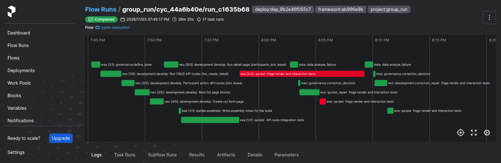
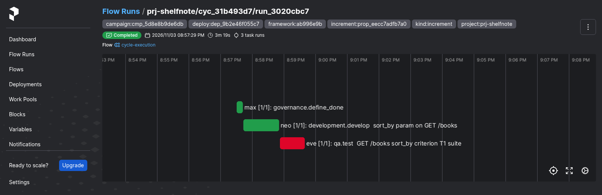
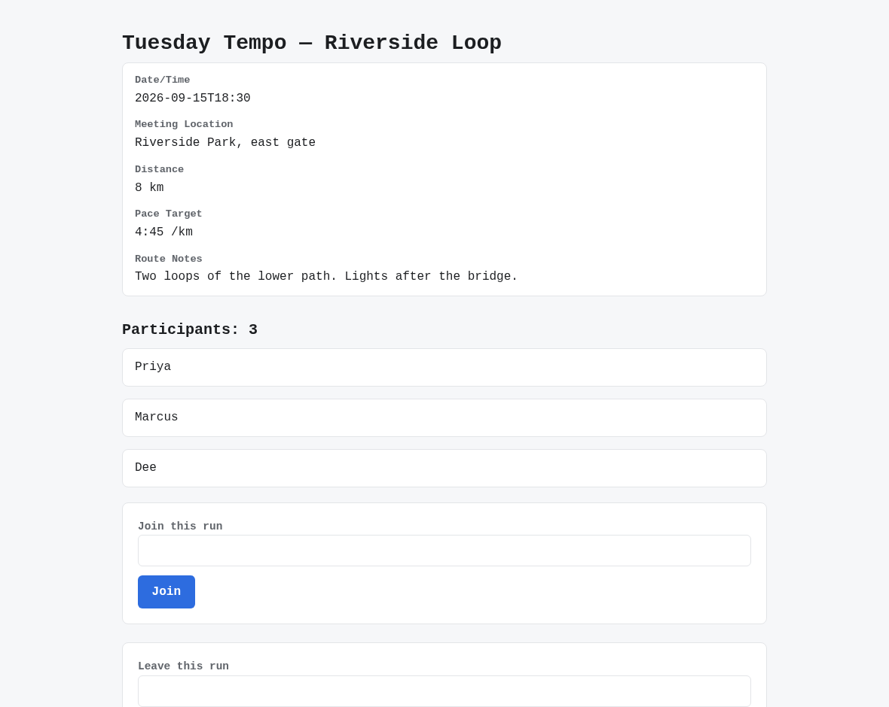
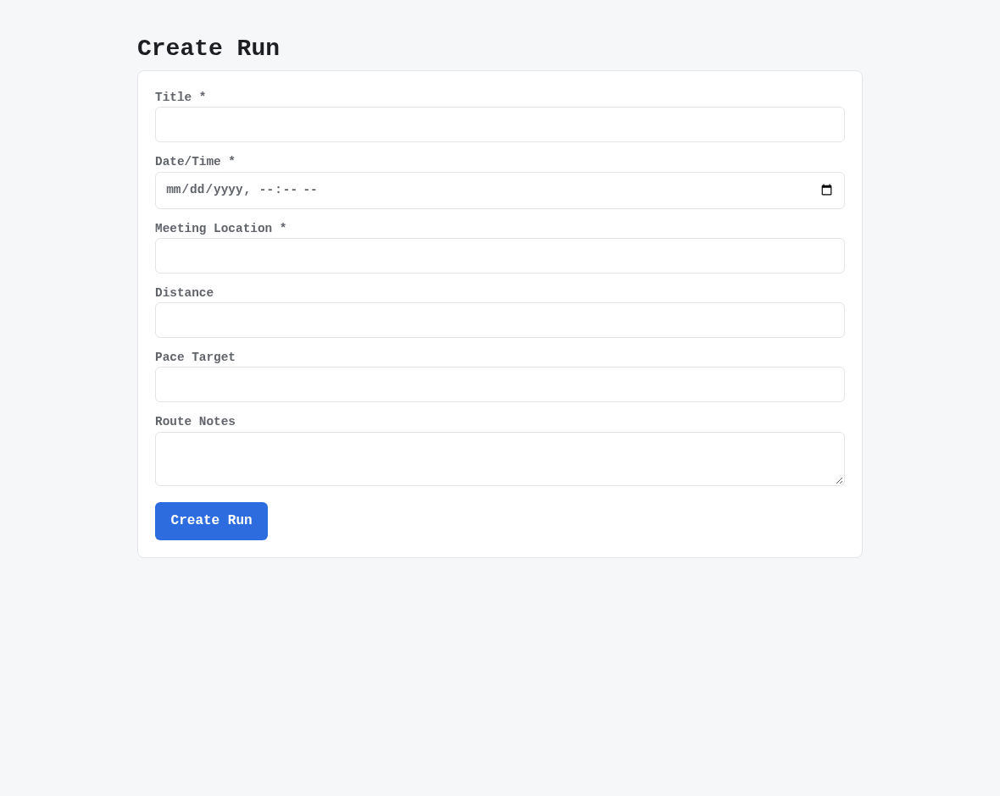
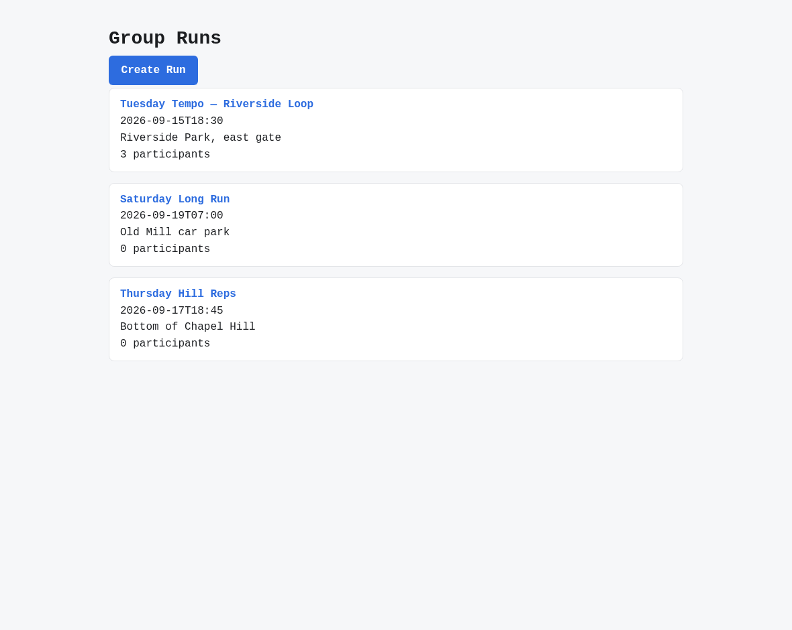

# v2.5.1

**Released 2026-11-03** · [tag `v2.5.1`](https://github.com/backspring-labs/squad-ops/releases/tag/v2.5.1)

**A patch on 2.5, an odd line that is feature-free by rule, carrying one addition by the owner's decision.**
On 2026-11-03 the owner chose to acknowledge the one feature merged to main during the 2.6 plan's spikes. The tag is
cut from the tree those spikes ran on, not from a branch of fixes only. #2854 is recorded as a fix: a ruling's notes
were recorded and then dropped.

### Added

- **A registered product's file at the Project's integrated commit,** `GET /api/v1/projects/{id}/source-file?path=`
  (#2855, #2856). It is read-only, so the crew's Campaign drafting reads the goals a Campaign will actually work from.
  Spike 2 needed it, and it is the one feature this patch carries.

### Fixed

The 2.6 plan's §0 and §0a spikes found the first ten on `prj-shelfnote`. The rest are the 2.5 cut's own open
defects, on a Campaign's path or in the cut's tooling (D11).

- **A product's `qa.test` failing only `tests_pass` in the qa image is judged on the product's own runner** (#2818,
  #2835). A product's suite is re-judged when the qa image fails it beside environment-sensitive checks, and a
  skipped row isn't a failure (#2838, #2840). The suite's workspace id is in the sandbox's alphabet, and a judgement
  that can't run leaves the agent's result (#2845, #2846).
- **A repair or retry binds its proposal's approved version,** not the launch block's first (#2824, #2836).
- **The campaign supervisor answers a Campaign cycle's plan gate,** and only a Campaign cycle's (#2837, #2843).
- **A repository-backed increment's plan gate reads its approved change request as its design** (#2796, #2844;
  SIP-0109 §24cs).
- **An already-met criterion beside discriminating ones is kept as a preservation check,** and row 16's abandonment
  counts toward no unaccepted limit (#2849, #2850; SIP-0109 §24ct).
- **A busy engine serving only declared models is a quiet box,** so the crew's own model call on the shared
  TensorFold engine no longer blocks a Campaign launch or a run start (#2851, #2852; SIP-0109 §24cu, SIP-0111 §9n).
- **The notes on an increment's approval reach its framing** as the reviewer's guidance. Before this, an
  `approved_with_refinements` ruling's notes were recorded but never shown to a model (#2854, #2857; SIP-0109 §24cv).
- **A product's criterion file sits beside its runner's own tests,** and the plan gate refuses a planned file that
  shares a basename with a criterion file or a frozen verifier. A root `test_criterion_T1.py` and a qa test of the
  same name under `tests/` had stopped pytest at collection (#2858, #2859; SIP-0109 §24cw).
- **A criterion file is never placed under a file name the product already holds elsewhere** in its tree, which
  would stop pytest at collection (#2860, #2865; SIP-0109 §24cx).
- **tree-sitter is pinned below 0.26.** 0.26.0 corrupts the tree of a JS/TS file past about 257 lines, or kills
  the parse worker, so a product's long module had no anchored-edit entities. 0.25.2 parses the same inputs
  clean (#2814, #2866).
- **A product's qa run is bounded** (#2817, #2867; SIP-0112 H.16):
  - The qa image's suite runs under the framework's own, empty pytest configuration, never the product's. A
    product's `python_files`, `addopts`, `required_plugins`, `filterwarnings = error` or `strict_config` no longer
    stops or fails it.
  - A product runner's file pattern names a test only under that runner's roots.
- **A develop task's typed check on a criterion file the merge gives to qa is resolved as its evaluator reads it:**
  a command against its `cwd`, a glob against the files. A `frontend_compiles` on it is re-pointed to a file the
  task keeps, not dropped (#2804, #2868; SIP-0093 §15c).
- **`qa.test`'s monolithic prompt chooses its validation plan by one rule, shared by the handler and the budget,**
  and a plan that is also a source file is counted as often as it is shown (#2809, #2869; SIP-0110 §5ap).
- **A correction repair's call, its anchored-edit retry included, is refused by name over its model's window,**
  never sent and never truncated past its output instructions (#2813, #2870; SIP-0110 §5aq).
- **The release records attach scans for held-out step values and goals** as well as credentials, refuses to run
  with no suite named, and leaves a file out only through a withhold list with reasons (#2830, #2871).

### Documentation

- **The 2.6 plan drafted for outside review,** §0's CLI spike adopted, and §0a's second spike, crew-driven from Buzz
  on outcome goals (#2832, #2853).
- **Project Goals and Backlog filed for design review** (#2833), proposed as 2.6's headline.
- **The v2.5.0 release package:** the cut's evidence, screenshots, the records on the Release, housekeeping (#2831).
- **The TensorFold 1.x upgrade deferred to 3.x** by the owner, replacing the 2.5 plan's placement in 2.6 (#2829).

### Security

- **`pyasn1` 0.6.4 → 0.6.5** in the agent image's lock (`CVE-2026-119194` to `CVE-2026-119197`), and in
  `ci-constraints.txt`.
- **The evaluator image's `minimatch` 10.2.6 → 11.0.1** (`GHSA-g3hv-75wg-m249`), pinned by `overrides` under
  eslint 10.12 and typescript-eslint 8.71. The evaluator's tag moves to **`-8`**. The delivered-lint runner's
  output on a fixture tree is byte-identical under both versions, and Lighthouse, axe, the driver and the
  Chromium pin are `-7`'s, so `-8`'s quality series start fresh as every tag's do.

## Merged pull requests (27)

| PR | Title | Closes |
|---|---|---|
| [#2874](https://github.com/backspring-labs/squad-ops/pull/2874) | chore(release): 2.5.1 — the fixes a Campaign on a product needed to accept increments: bump, markers, CHANGELOG, ROADMAP, the SIP sweep | — |
| [#2873](https://github.com/backspring-labs/squad-ops/pull/2873) | docs(changelog): 2.5.1's fixes from #2865–#2871 under [Unreleased] | — |
| [#2870](https://github.com/backspring-labs/squad-ops/pull/2870) | fix(repair): a correction repair's call is guarded against its model's window, its anchored-edit retry included (SIP-0110 §5aq) | [#2813](https://github.com/backspring-labs/squad-ops/issues/2813) |
| [#2871](https://github.com/backspring-labs/squad-ops/pull/2871) | fix(release): the records attach scans for held-out step values and goals, and withholds a file only with a reason | [#2830](https://github.com/backspring-labs/squad-ops/issues/2830) |
| [#2869](https://github.com/backspring-labs/squad-ops/pull/2869) | fix(qa): the monolithic prompt's plan is chosen by one rule for the handler and the budget, and counted as often as it is shown (SIP-0110 §5ap) | [#2809](https://github.com/backspring-labs/squad-ops/issues/2809) |
| [#2868](https://github.com/backspring-labs/squad-ops/pull/2868) | fix(plan): a check's subject is resolved as its evaluator reads it, and a whole-project check on a criterion file is re-pointed (SIP-0093 §15c) | [#2804](https://github.com/backspring-labs/squad-ops/issues/2804) |
| [#2867](https://github.com/backspring-labs/squad-ops/pull/2867) | fix(qa): a product's run tree is bounded: the framework's pytest configuration, and a runner's pattern only under its roots (SIP-0112 H.16) | [#2817](https://github.com/backspring-labs/squad-ops/issues/2817) |
| [#2866](https://github.com/backspring-labs/squad-ops/pull/2866) | fix(deps): tree-sitter pinned below 0.26, whose trees for files past about 257 lines are corrupt | [#2814](https://github.com/backspring-labs/squad-ops/issues/2814) |
| [#2865](https://github.com/backspring-labs/squad-ops/pull/2865) | fix(campaigns): a criterion file is never placed under a file name the product already holds elsewhere (SIP-0109 §24cx) | [#2860](https://github.com/backspring-labs/squad-ops/issues/2860) |
| [#2864](https://github.com/backspring-labs/squad-ops/pull/2864) | docs(changelog): 2.5.1's [Unreleased] catches up with #2855, #2854 and #2858 | — |
| [#2859](https://github.com/backspring-labs/squad-ops/pull/2859) | fix(campaigns): a product's criterion file sits beside its runner's tests, and the plan gate refuses a second file of its name (SIP-0109 §24cw) | [#2858](https://github.com/backspring-labs/squad-ops/issues/2858) |
| [#2857](https://github.com/backspring-labs/squad-ops/pull/2857) | feat(campaigns): the notes on an increment's approval reach its framing (SIP-0109 §24cv) | [#2854](https://github.com/backspring-labs/squad-ops/issues/2854) |
| [#2856](https://github.com/backspring-labs/squad-ops/pull/2856) | feat(api): a registered product's file at the Project's integrated commit, for the crew's Campaign drafting | [#2855](https://github.com/backspring-labs/squad-ops/issues/2855) |
| [#2853](https://github.com/backspring-labs/squad-ops/pull/2853) | docs(plan): 2.6 §0a, the second spike: crew-driven, steered from Buzz, on outcome goals | — |
| [#2852](https://github.com/backspring-labs/squad-ops/pull/2852) | fix(campaigns): a busy engine serving only declared models is a quiet box (SIP-0109 §24cu) | [#2851](https://github.com/backspring-labs/squad-ops/issues/2851) |
| [#2850](https://github.com/backspring-labs/squad-ops/pull/2850) | feat(campaigns): an already-met criterion beside discriminating ones is kept as a preservation check, and row 16's abandonment counts toward no unaccepted limit | [#2849](https://github.com/backspring-labs/squad-ops/issues/2849) |
| [#2846](https://github.com/backspring-labs/squad-ops/pull/2846) | fix(execution): the product suite's workspace id is one the sandbox accepts, and a judgement that can't run leaves the agent's result | [#2845](https://github.com/backspring-labs/squad-ops/issues/2845) |
| [#2844](https://github.com/backspring-labs/squad-ops/pull/2844) | fix(campaigns): a repository-backed increment's plan gate reads its approved change request as its design | [#2796](https://github.com/backspring-labs/squad-ops/issues/2796) |
| [#2843](https://github.com/backspring-labs/squad-ops/pull/2843) | fix(api): the campaign supervisor answers a campaign cycle's plan gate, and only a campaign cycle's | [#2837](https://github.com/backspring-labs/squad-ops/issues/2837) |
| [#2840](https://github.com/backspring-labs/squad-ops/pull/2840) | fix(execution): a product's suite is re-judged when the qa image fails it beside environment-sensitive checks, and a skipped row isn't a failure | [#2838](https://github.com/backspring-labs/squad-ops/issues/2838) |
| [#2842](https://github.com/backspring-labs/squad-ops/pull/2842) | fix(deps): pyasn1 0.6.5 and the evaluator's minimatch 11.0.1 for main's red audit; the evaluator tag to -8 | — |
| [#2835](https://github.com/backspring-labs/squad-ops/pull/2835) | fix(execution): a product's qa.test failing only tests_pass in the qa image is judged on the product's own runner | [#2818](https://github.com/backspring-labs/squad-ops/issues/2818) |
| [#2836](https://github.com/backspring-labs/squad-ops/pull/2836) | fix(campaigns): a repair or retry binds its proposal's approved version, not the launch block's first | [#2824](https://github.com/backspring-labs/squad-ops/issues/2824) |
| [#2832](https://github.com/backspring-labs/squad-ops/pull/2832) | docs(plans): draft the 2.6 plan for outside review — a multi-hour Campaign on the owner's own product | — |
| [#2833](https://github.com/backspring-labs/squad-ops/pull/2833) | docs(sips): file Project Goals and Backlog for design review — a Project's goals as versioned records, decided in SquadOps, discussed in Buzz | — |
| [#2831](https://github.com/backspring-labs/squad-ops/pull/2831) | docs(release): the v2.5.0 package — the cut's evidence, screenshots, records on the Release, housekeeping | — |
| [#2829](https://github.com/backspring-labs/squad-ops/pull/2829) | docs(sips): the TensorFold 1.x upgrade (#2230) deferred to 3.x by the owner | — |

## Improvement proposals

| Proposal | From | To |
|---|---|---|
| [SIP-Project-Goals-Backlog](../../design/sips/SIP-Project-Goals-Backlog.md) | new | proposed |

## Improvement proposals amended in place

No lifecycle change — each was edited under the status it already had (a post-acceptance amendment, CLAUDE.md step 5a).

| Proposal | Status |
|---|---|
| [SIP-0088-Agent-Runtime-Modes](../../design/sips/SIP-0088-Agent-Runtime-Modes.md) | accepted |
| [SIP-0090-Agent-Embodiment-Substrate](../../design/sips/SIP-0090-Agent-Embodiment-Substrate.md) | accepted |
| [SIP-0091-Duty-Durability-via-Temporal](../../design/sips/SIP-0091-Duty-Durability-via-Temporal.md) | accepted |
| [SIP-0092-Implementation-Plan-Improvement](../../design/sips/SIP-0092-Implementation-Plan-Improvement.md) | accepted |
| [SIP-0093-Multi-Role-Plan-Authoring](../../design/sips/SIP-0093-Multi-Role-Plan-Authoring.md) | accepted |
| [SIP-0101-Cycle-Replay-Harness](../../design/sips/SIP-0101-Cycle-Replay-Harness.md) | accepted |
| [SIP-0102-Ephemeral-Application-Sandbox](../../design/sips/SIP-0102-Ephemeral-Application-Sandbox.md) | accepted |
| [SIP-0105-Stack-Blueprint-Contract](../../design/sips/SIP-0105-Stack-Blueprint-Contract.md) | accepted |
| [SIP-0109-Campaign-Orchestration](../../design/sips/SIP-0109-Campaign-Orchestration.md) | accepted |
| [SIP-0110-Cross-Cycle-Memory](../../design/sips/SIP-0110-Cross-Cycle-Memory.md) | accepted |
| [SIP-0111-TensorFold-Provider-Adapter](../../design/sips/SIP-0111-TensorFold-Provider-Adapter.md) | accepted |
| [SIP-0112-Project-Lifecycle-Management](../../design/sips/SIP-0112-Project-Lifecycle-Management.md) | accepted |
| [SIP-0113-Outcome-Evaluation](../../design/sips/SIP-0113-Outcome-Evaluation.md) | accepted |
| [SIP-Agent-Comms-Delivery-Guarantees](../../design/sips/SIP-Agent-Comms-Delivery-Guarantees.md) | proposed |

## Cycle evidence

### `cyc_7b01a012e2ab`

**Verdict:** `accepted` · **Runs:** 2 · **Role:** shakeout — non-counting: the deploy's shakeout, read for seam findings

| | Checks |
|---|---|
| Verified | acceptance:additive_containment, acceptance:assertion_kinds_match, acceptance:client_mock_surface, acceptance:command_exit_zero, acceptance:contract_assertions_match, acceptance:declared_imports, acceptance:dom_anchor_queries, acceptance:endpoint_defined, acceptance:fill_slot_signature, acceptance:frontend_compiles, acceptance:function_defined, acceptance:harness_boundary, acceptance:import_present, acceptance:module_imports, acceptance:undefined_names, acceptance:unterminated_source, acceptance_criteria_prose, expected_artifacts, frontend_build, no_self_mocking_tests, no_stub_fallback_tests, non_stub_files, required_files, tests_pass, vc-probe-runs, vc-probe-runs-join, vc-probe-runs-join-duplicate, vc-probe-runs-leave, vc-probe-runs-rejects-blank |
| Failed | — |
| Required unmet | — |
| Never executed | — |

### `cyc_44a6b40e986e`

**Verdict:** `accepted` · **Runs:** 2 · **Role:** shakeout — non-counting: the deploy's shakeout, read for seam findings

| | Checks |
|---|---|
| Verified | acceptance:additive_containment, acceptance:assertion_kinds_match, acceptance:client_mock_surface, acceptance:declared_imports, acceptance:dom_anchor_queries, acceptance:frontend_compiles, acceptance:undefined_names, acceptance:unterminated_source, acceptance_criteria_prose, expected_artifacts, frontend_build, no_self_mocking_tests, no_stub_fallback_tests, non_stub_files, required_files, tests_pass, vc-probe-api-runs, vc-probe-api-runs-join, vc-probe-api-runs-join-duplicate, vc-probe-api-runs-leave, vc-probe-api-runs-ordered, vc-probe-api-runs-rejects-blank |
| Failed | — |
| Required unmet | — |
| Never executed | — |

### `cyc_a9525f51c54f`

**Verdict:** `rejected` · **Cycle status:** `failed` · **Runs:** 3 · **Role:** shakeout — non-counting: the deploy's shakeout, read for seam findings

| | Checks |
|---|---|
| Verified | acceptance:command_exit_zero, acceptance:import_present, acceptance:undefined_names, acceptance:unterminated_source, acceptance_criteria_prose, expected_artifacts, frontend_build, no_self_mocking_tests, no_stub_fallback_tests, non_stub_files |
| Failed | tests_pass |
| Required unmet | — |
| Never executed | acceptance:function_defined, acceptance:endpoint_defined, acceptance:module_imports |

### `cyc_7e442c433413`

**Verdict:** `rejected` · **Cycle status:** `failed` · **Runs:** 1 · **Role:** shakeout — non-counting: the deploy's shakeout, read for seam findings

| | Checks |
|---|---|
| Verified | acceptance:command_exit_zero, acceptance:import_present, acceptance:undefined_names, acceptance:unterminated_source, acceptance_criteria_prose, expected_artifacts, frontend_build, no_self_mocking_tests, no_stub_fallback_tests, non_stub_files |
| Failed | tests_pass |
| Required unmet | — |
| Never executed | acceptance:function_defined, acceptance:endpoint_defined, acceptance:module_imports |

### `cyc_31b493d704f6`

**Verdict:** `accepted` · **Runs:** 3 · **Role:** shakeout — non-counting: the deploy's shakeout, read for seam findings

| | Checks |
|---|---|
| Verified | acceptance:command_exit_zero, acceptance:import_present, acceptance:undefined_names, acceptance:unterminated_source, acceptance_criteria_prose, expected_artifacts, frontend_build, no_self_mocking_tests, no_stub_fallback_tests, non_stub_files, tests_pass |
| Failed | — |
| Required unmet | — |
| Never executed | acceptance:endpoint_defined, acceptance:module_imports, acceptance:function_defined |

### `cyc_ee944f2b5aaf`

**Verdict:** `rejected` · **Cycle status:** `failed` · **Runs:** 3 · **Role:** shakeout — non-counting: the deploy's shakeout, read for seam findings

| | Checks |
|---|---|
| Verified | acceptance:command_exit_zero, acceptance:module_imports, acceptance:undefined_names, acceptance:unterminated_source, acceptance_criteria_prose, expected_artifacts, frontend_build, no_self_mocking_tests, no_stub_fallback_tests, non_stub_files, tests_pass |
| Failed | tests_pass |
| Required unmet | — |
| Never executed | acceptance:function_defined, acceptance:endpoint_defined |

### `cyc_9d81387c75f6`

**Verdict:** `rejected` · **Cycle status:** `failed` · **Runs:** 1 · **Role:** shakeout — non-counting: the deploy's shakeout, read for seam findings

| | Checks |
|---|---|
| Verified | acceptance:command_exit_zero, acceptance:module_imports, acceptance:undefined_names, acceptance:unterminated_source, acceptance_criteria_prose, expected_artifacts, frontend_build, no_self_mocking_tests, no_stub_fallback_tests, non_stub_files, tests_pass |
| Failed | tests_pass |
| Required unmet | — |
| Never executed | acceptance:function_defined, acceptance:endpoint_defined |

## Screenshots

Of cycle `cyc_7b01a012e2ab` (shakeout) — the FastAPI + React regression shakeout on the final deploy, accepted 21 of 21 with one correction round; 2.5.1 adds no feature to show, so the pictures are of the sample application the regression pair rebuilt.

*prefect flow run regression shakeout next js with two correction rounds*

*prefect flow run validation campaign sorting by title accepted on its first build*

*regression shakeout a run s detail*

*regression shakeout the create run form*

*regression shakeout the run list*
