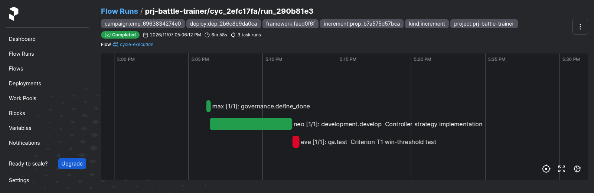

# v2.6.0

**Released 2026-11-07** · [tag `v2.6.0`](https://github.com/backspring-labs/squad-ops/releases/tag/v2.6.0)

### Added
- **The squad is shown its own reading** (SIP-0109 §24dk, #2944, PR #2945): a goal-set Campaign's proposal carries the product's
  reading of the last increment it accepted. It still reports, and decides nothing.
- **A product's declared reading of an accepted increment** (SIP-0109 §24dj, #2938, PR #2942): `technical.commands.readings`
  run on the candidate in the sandbox, and what each one prints is kept on the evaluation and the promotion, and shown in the digest
  and each open gate's evidence. Report-only: a reading never changes a verdict.
- **A repository-backed product runs on its own stack** (SIP-0112 H.26, #2937, PR #2941): its development profile is selected
  from the derived facts at `prepare_cycle`, with its origin and a fingerprint recorded, and a named profile that contradicts
  its runners is refused. `node_vitest` is new, and `product_neutral` with a `stack_unmatched` gap replaces a silent
  `python_cli`. The product's runner now reads every failing `tests_pass`, for Python products too, and `test_report.md` says
  what ran, where and on which runner.
- **A Project's goal set** (SIP-0115 slice 1, #2884, PR #2899): the goal, expected results with where each is
  observed, constraints, out of scope, the ordered backlog and candidates, written as immutable numbered revisions
  with author, reason and `source_ref`. `/api/v1/projects/{id}/goal-set` reads the active revision, `/revisions`
  the history and one by number, and `POST /revisions` writes the next against an expected revision (409 when
  another was written first). Read with `cycles:read`, written with `admin:write` only. `squadops goals
  show|edit|history`; `show` prints YAML that `edit -f` takes back. Migration `2100_project_goal_sets.sql`, the first
  of SIP-0115's range `2100–2199`.
- **A Campaign works through its Project's goal set, one backlog item per increment** (SIP-0115 slice 2, #2885;
  SIP-0109 §24cy, SIP-0115 §10b). A repository-backed Campaign names `objective.goals: {goal_set: <its project>,
  revision: <n> | current}` or `objective.requirements`, never both and never neither; a pinned revision the goal
  set doesn't hold, a Project with no goal set, another Project's goal set, or `stop_when` without goals is refused at
  creation. The proposer is shown the goal, expected results, constraints, out of scope and the backlog with each
  item's status in this Campaign and the next item; its change request names it (`backlog_item`), and the rails
  return one naming none or any other (`not_the_next_backlog_item`) before a cycle is spent. Each item's status
  (`pending`, `proposed`, `in_increment`, `accepted`, `abandoned`, `removed`, and `accepted (removed in rN)` /
  `accepted (results changed in rN)`) is derived from the control log, never stored, and read at
  `GET /api/v1/campaigns/{id}/backlog` and `squadops campaigns backlog <id>`. A proposal is bound to the revision it
  was created under; at its ruling a later revision that moved its item or changed what it serves returns it as
  `goals_revised`, which spends neither a rejection nor a revision. `stop_when: backlog_done` stops a Campaign at
  §10 row 3 when every item of the revision read at the decision is accepted, and the decision's row records which.
- **The console's goals panel** (SIP-0115 slice 4, #2887, PR #2916): a panel of the Projects plugin
  (`squadops-projects-goals`, in the Projects view) that follows the Project selected in the list, or a Campaign
  selected anywhere (`squadops:select-campaign`). It shows the goal, expected results with where each is observed,
  constraints and out of scope; the backlog in the goal set's order with each item's derived status and increment
  (proposal, version, cycle) in a chosen Campaign of the Project, read from `GET /api/v1/campaigns/{id}/backlog`,
  and the revision that Campaign reads; the candidates waiting, read-only; and the revision history. A Project with
  no goal set and a Campaign naming none (`CAMPAIGN_HAS_NO_GOAL_SET`) read as such, not as failures. A viewer
  holding `admin:write` can edit the goal, expected results' statements, constraints, out of scope and the backlog
  (reorder, retitle, change what an item serves, add, remove), and with a reason the edit is written as the next
  revision through the command bus: the new confirm-level `squadops.revise_goal_set`, whose console-app handler
  posts `POST /api/v1/projects/{id}/goal-set/revisions` against the revision the edit began from. A revision
  written first by someone else (409 `STALE_GOAL_SET_REVISION`) is said plainly and the edit kept, never retried
  over. The panel's reads and write are `goals.js`, tested under node (`npm test` in the plugin's `ui/`, run in CI).
- **The console's Campaigns plugin, read-only** (#2834, the 2.6 plan's Track G and D13): a new plugin,
  `squadops.campaigns`, in its own Campaigns view. The list has every Project's Campaigns with state, outcome, start
  and current increment (`#3 · repair`, read from each control log six at a time; a closed Campaign's is read once
  per page). A Campaign's view shows its objective, what it works from, accepted increments against the target, the
  current increment and cycle; its open escalations and the proposals waiting for a ruling; the ledger (ruling,
  verdict, deciding row and each carrying cycle, as `squadops campaigns ledger`); the digest (`campaigns digest`);
  and the control log's latest rows (`campaigns log`). An unknown Campaign (`CAMPAIGN_NOT_FOUND`), and one with no
  ledger, escalations or package yet (`PACKAGE_NOT_FOUND`), read as such rather than as failures, and one unreadable
  part never blanks the rest. It polls every 30 s while open and visible. A Campaign that names a goal set links to
  the goals panel with that Campaign chosen: `squadops:select-campaign` is kept until the panel mounts, and the
  Projects view is opened through the shell's own nav entry (`shared/selection.js`), since the pinned shell gives a
  plugin no way to open another view. The plugin registers no command and writes nothing: launch, rule, pause,
  resume and abort stay with the operator's broker and the CLI. SIP-0069 §14 records this and names what stays off the
  console. The reads are `campaigns.js`, tested under node in CI.
- **The operator's surface** (SIP-0115 slice 5, #2888; §10d; SIP-0109 §24df). The operator's `campaign-supervisor` and
  `campaign-triage` principals read the goal set and its derived backlog, with no scope changed. **A gate's evidence:**
  `GET /api/v1/campaigns/{id}/ledger`, which the operator's reviewer reads, names each goal-set version's `backlog_item` and
  `goals_revision`, and the version an open gate can be on carries `goal_evidence` (the goal, the item and the expected
  results it serves, at the revision it is bound to). A requirements Campaign's rows are unchanged. **Assessments:**
  `POST /api/v1/projects/{id}/goal-set/assessments` records the operator's or the owner's judgement of one expected result in
  a Campaign (`reading`: `met`, `not_met` or `unclear`; `cause` with `not_met`: `app_work`, `framework_defect`,
  `framework_gap` or `needs_owner`; `issue` with a framework cause; `evidence` by id; `log_seq`, the control-log row the
  evidence was read at; `source_ref`, the operator's signed statement). It needs no Campaign grant, a completed Campaign takes one, and it is append-only and decides nothing.
  `GET …/goal-set/assessments` is the history and `GET /api/v1/campaigns/{id}/assessments` how each result stands now
  (`current`, `stale`, `conflicting` or `unassessed`). Migration `2103_goal_set_assessments.sql`. The Campaigns plugin's
  placeholder is replaced by that view, and the goals panel shows it on each expected result, with the Campaign's own
  text where a pinned revision defines the result differently.
- **A source-backed change can remove a file** (#2612, SIP-0112 H.23). A step removes a file with a `delete:<path>` fence
  with nothing inside, shown to the steps that may use it. `development.develop` and its repair may remove any text
  file of the product; `qa.test` and its repair only a test one of the product's runners holds. A path outside the
  product's tree, a binary or generated file, one the same emission writes, or one outside the step's grant is refused
  by name, and the emission with it. A removal is stored in order among the writes, later tasks are shown the tree
  without the file, and delivery patches it out of the candidate: `changed_paths` names it, the product's own checks
  run without it, and the captured commit and its patch lack it. A repair's removal is taken in the end-of-plan round
  (H.20) and refused inside the plan, where the verifier can't hold one. A fence reading `delete:` wrote an empty file
  before. Runs with no pinned source refuse the form.
- **A regression at a source-backed run's end of plan gets one repair round** (#2613, SIP-0112 H.20). When the
  product's own checks read `regressed`, the run no longer fails there: the regression enters the plan's correction
  chain (analyze, decide, repair) through the same budget check and run counter as an in-plan failure, about the
  plan's last source author. The analysis and the repair read each blocking check as the product's runner read it in
  the sandbox: its id, exit code and output tails, never a re-run in an agent's image (#2913). The repair is stored as
  that task's own and the candidate is delivered again; its verification records `repair_of`, and every check that
  regressed must execute and pass. A spent budget, a round that repairs nothing, or a second regression fails the run
  as before, the verification naming the checks. One round only, whatever budget remains. Runs with no pinned source
  are unchanged.
- **A size preflight at a repository-backed Campaign's start** (#2889; SIP-0112 H.21, SIP-0109 §24db). Before its
  calibration record is written, every task type the Campaign's increments dispatch (`dispatched_task_steps`, the
  reading the #2810 guard now shares) is composed on the product's tree at the record's commit and counted by the
  composer's own estimate with its completion reserve, against the window of the model its squad binds the role to.
  A binding that can't fit, measured at the least its prompt can be on that tree, refuses the start (409
  `CALIBRATION_REFUSED`, cause `blocking_gap`, gap `prompt_over_window`), naming each task type, role, model, size,
  reserve and window, and nothing is written. A model with no known window, a squad or proposal profile that can't
  be read, and a tree that can't be read or is past 2.4's limits refuse it as `size_unmeasured`. A product that fits
  starts as before, and a sample application's Campaign is never measured.
- **Unattended resume** (SIP-0109 §24da, #2891; the 2.6 plan's D6 and D7). A Campaign declares
  `policy.unattended_resume`: the escalation classes the operator's `campaign-supervisor` principal may resume on its own,
  `plan_gate` (a plan gate the tier escalated, answered at the gate), `in_cycle_failure` (a `repair` or `retry` after
  the cycle's own failure, within the per-increment limits) and `launch_blocked` (the relaunch). It is fixed at
  creation and part of the creation hash when set; an unknown class, including the never-classes (an upstream
  conflict, a limit's pause, a security finding, the owner's pause), is refused at creation. Anything else the operator
  asks is refused 403 `RESUME_NOT_DELEGATED` with its reason; every delegated resume and every refusal is a
  control-log row naming the principal, the class, the escalation and the definition hash (refusal
  `resume_not_delegated`, migration `2002`), and the digest lists them. The owner's pause revokes the grant until the
  owner resumes. The supervisor seat's refused resume is now recorded rather than refused unwritten.
- **A criterion already met is found as soon as its test exists** (#2890; SIP-0109 §24cz, the 2.6 plan's D9). On a
  repository-backed increment, once the qa task's criterion files are stored on the run, each is run alone on the
  product's own runner in the sandbox against the campaign branch's head, with no development emission on the tree.
  One that passes there is already met: the run ends with `criteria_not_checkable` before anything is delivered or
  judged (a new cycle ending, migration `2003`), and §10's new row 19 returns the increment to a new proposal told
  which criteria the head meets, counted toward neither `max_unaccepted_increments` nor
  `max_rejected_proposals_in_row`. The reading is the run's `criterion_head_check` record. Where the check can't run
  (no sandbox or clone, no profile at the pin, a runner with no test-id reader, a sandbox error) the cycle proceeds
  as before and the skip is logged with its reason; acceptance's own read stays the last line.

- **A Campaign's close records what contribution is due, and the supervisor opens it** (#2861; SIP-0109 §24dc,
  SIP-0112 H.22). The row that closes a repository-backed Campaign (its terminal decision, or the abort) records
  `contribution`: `{due: true, accepted: [cycles]}`, or `{due: false, reason: "no accepted increment: …"}`, derived
  under the Campaign's lock and outside the request's hash. A close pushes nothing and opens nothing, whatever the
  deploy holds: the owner chose to drop the automatic open on 2026-11-04, keeping §24ci (b) as ruled. The supervisor
  opens it: `POST /api/v1/campaigns/{id}/contributions` (`campaigns:manage`, `token` required) or `squadops campaigns
  contribute <id> --token-from-gh`, through E.4.3's contribution path: the branch's head with the criterion files
  its increments froze renamed out of the `criterion_` stem and moved off the root (`test_criterion_T1.py` →
  `tests/test_campaign_<hash>_T1.py`, #2860's interim made the rule), each live one first run on the product's runner
  in the sandbox where it moved, pushed as `squadops/<campaign>`, never forced, the review request opened, and
  recorded `pending` as one of the Project's contributions under the Campaign's id (`campaign_id`, `run_id:
  campaign`), so a sync tracks its merge as any contribution's. Merging stays the owner's. A failed attempt, a moved
  criterion that doesn't hold among them, is a `contribution_failed` row on the closed Campaign (migration `2004`),
  and the supervisor's next request tries again.
- **A read-only signal for accepted Campaign work not yet in a Project's integrated commit** (#2863; SIP-0109 §24dc).
  `GET /api/v1/projects/{id}/unintegrated-increments` (`cycles:read`) lists each accepted increment the Project's
  `integrated_upstream_commit` doesn't carry: `campaign_id`, `campaign_state`, `cycle_id`, `title` (its backlog
  item's, or null), `commit`, `standing` (`not_contributed`, `contribution_pending`, `merged_not_synced` or
  `contribution_closed`) and `review_url`. A run's own contribution counts beside its Campaign's. An empty list means
  every one is integrated; a sample application is refused (409 `NO_SOURCE_REPOSITORY`). A forge merge is read only
  once a sync records it (#2862 isn't built), so until then it stands `contribution_pending`. A request closed
  unmerged keeps blocking: the owner reopens it on the forge, merges it with a merge commit and re-validates, and
  `campaigns contribute` can't do that for them. `squadops projects unintegrated <project>`.
- **Candidates promoted or dropped, and a backlog item split, each a goal-set revision naming its action**
  (SIP-0115 slice 3, #2886; SIP-0115 §10c). `POST /api/v1/projects/{id}/goal-set/candidates` adds a candidate;
  `…/candidates/{id}/promote` moves it into the backlog keeping its id, at a position or the end, serving the results
  named; `…/candidates/{id}/drop` drops it with the reason; `…/backlog/{id}/split` puts two or more new items in its
  place, inheriting what it served unless they say otherwise. Each is written against an expected revision, answers
  201, and the revision carries `change` (`candidate_added | candidate_promoted | candidate_dropped | item_split`,
  with the subject, the position taken, the parts a split produced and the Campaign the operator acted within; migration
  `2101_goal_set_revision_change.sql`). The owner (`admin:write`) may do each; the operator's supervisor seat
  (`campaigns:supervise`) adds freely and promotes, drops or splits only within a Campaign the owner has granted it
  (named in the request; live, on this Project, reading this goal set; `403 NOT_DELEGATED` otherwise), appending a
  promoted candidate and never reordering (Q41). **The grant** is the owner's, on each Campaign the operator should curate,
  whoever created it (the owner's ruling of 2026-11-04): `POST /api/v1/campaigns/{id}/goal-delegation`, `squadops
  campaigns delegate <id> --reason …`, `campaigns:control`, so the supervisor can't grant itself. It is a
  `goal_delegation_granted` control-log row for the Campaign's life, which a completed Campaign refuses (migration
  `2102_campaign_goal_delegation.sql`; SIP-0109 §24dd). A split waits (`409 BACKLOG_ITEM_IN_PROGRESS`) while a live Campaign
  reads the item `proposed` or `in_increment`; the derived backlog reads a split parent as `removed` with
  `split_into`. `squadops goals candidates|promote|drop|split`.

### Fixed
- **SquadOps names no external supervisor** (the owner's ruling of 2026-11-07, SIP-0115 §10e): what drives a Campaign from outside is an
  API client, and the product calls it the operator, in its code, console, messages and the safety guarantee's label. No route,
  scope or field changed, and a guard holds it.
- **A qa suite is shown the code it calls** (#2952): a focused `qa.test` and a qa repair see what the suite imports, and the
  files the task names, from outside its package, counted in the prompt budget. On a product whose suite and helper live apart,
  qa guessed the helper's field names and a real count read 0. `test_report.md` no longer reads a suite left to the product's
  runner as a failure (#2949).
- **A repair cycle keeps the ending its run declared** (SIP-0109 §24cz, #2946): a repair whose test already passed on the head
  recorded `single_workload_ended`, so the Campaign escalated at row 9 instead of proposing anew at row 19.
- **A proposal keeps what the product already does inside the criterion that changes it** (#2935, SIP-0109 §24di). BT-2's
  item was half true on the head, so its proposal wrote the half that held as its own criterion, whose pass on the head
  abandoned the whole increment at row 19. The product proposal's request now shows the case.
- **A repaired test that passes on the head no longer abandons a backlog item** (#2933, SIP-0109 §24dh). A qa repair
  rewrote BT-2's test with a fixture the product filtered out, so its assertions ran over nothing and it passed on the
  head; row 19 then discarded development's correct change as "already met", and the next proposal was told so. The head
  doesn't change between a suite's failure and its repair, so that pass is news about the test. A criterion file a repair
  rewrote is now run on the head before the repair is accepted: passing there refuses the repair, spends the round and
  tells the next one. A later emission that still passes fails the run instead of abandoning it, and neither reading
  writes the record the next proposal is briefed from. A first emission that passes on the head stays row 19.
- **A closed, unmerged Campaign contribution can be dismissed** (#2926, SIP-0109 §24dg; the owner's choice of
  2026-11-05). It kept blocking the operator's integration gate with no way to clear it. The owner's
  `POST /api/v1/campaigns/{id}/contribution-dismissal` (`squadops campaigns dismiss-contribution <id> --reason …`,
  `campaigns:control`) records "this work won't land" as a `contribution_dismissed` control-log row, with who, why and
  the commit and review request, and the row leaves `GET /api/v1/projects/{id}/unintegrated-increments`. Anything but a
  closed, unmerged contribution is `409 CONTRIBUTION_NOT_DISMISSABLE`, a retry with its key replays, and nothing is
  deleted. Re-opening is not built. Migration `2104_campaign_contribution_dismissed.sql`.
- **A suite that fails on the product's runner is read there, not in the qa image** (#2913, SIP-0112 H.24). When the
  runner ran a product's suite and it failed, the agent's result stood, so an image that died on a dependency it lacks
  (Shelfnote's `slugify`, exit 4) stayed the evidence: the analysis called it an environment issue, the repair changed
  nothing, and the real failure (`PATCH /books/{id}` answering 400) reached neither, which ended the Campaign. The
  runner's reading now replaces the image's, which stays beside it; a run that didn't exit leaves the agent's result.
- **The console's API proxies forward the query string** (#2915). `/api/v1/*` and the two chat proxies forwarded the
  path alone, so through the console's own port `?project_id=` reached the runtime API missing (a 422) and `?limit=`/
  `?offset=` read as the default page. Hidden on the Spark, where Caddy sends `/api/v1/*` to the runtime API directly.
- **The backlog says which limit ended a Campaign on an item** (#2911). The ledger's projection of a decision left
  out its `cause`, so an item a Campaign ended on read "the campaign ended at §10 row 4 (None)"; the ledger's
  outcome now carries `cause` and the backlog names it. Seen on the Shelfnote Campaign `cmp_5947cfb57197`.
- **The console's write buttons execute** (#2903, #2904). Every plugin posted `{command_id, params}` to the shell's
  command route, whose body is `{command_id, args, dry_run, confirmed}` (Continuum v1.0.2), so each handler got `{}`
  and the bus's 200 `status: failed` passed as success; and no plugin sent `confirmed`, so a confirm-level command
  (`gate_reject`, `cancel_cycle`, `cancel_run`, `set_active_profile`) was answered `pending` and never ran. The body
  is built once, in `console/continuum-plugins/shared/commands.js`: it posts `args`, reads the answer's `status`
  (`success` only; a `failed`, `timeout` or `denied` answer and a handler's relayed API refusal are shown as the
  failure they are), and on `requires_confirmation` asks the user — the reject and set-active dialogs — and re-posts
  the same body with `confirmed: true`. The create modal also read the handler's `cycle_id` from the answer's top
  level rather than its `result`. Guards: no plugin names the route or a `params` key
  (`tests/unit/console/test_command_bus_bodies.py`), the helper's node tests
  (`console/continuum-plugins/shared`, `npm test`, now a CI step), and the console app's route entered with the
  plugins' bodies. SIP-0074 §5.1 and SIP-0069 are unchanged: the behaviour is theirs, restored.
- **A private Node package that declares a module interface is a package surface,** so a criterion on a product
  like battle-trainer can name its interface (#2875, PR #2879; SIP-0112 H.17).
- **The qa plan proposer's worked example is in its product's runner's terms,** pytest or vitest/jest (#2876,
  PR #2880).
- **A product's suite the qa image couldn't run is read on the product's own runner,** whatever else failed
  (#2877, PR #2878; SIP-0112 H.18).
- **A dev repair's retest is judged on the product's runner:** the failed task's own suite, with the repaired source
  on the tree, where before the repaired source was read as the suite and nothing was judged (#2881, PR #2898).
- **A product's suite on its own runner gets the product's whole tree at the pin,** lockfile included, with the
  run's changes laid over it. Before, an npm product's `npm ci` failed setup on every run (#2900, PR #2902; SIP-0112
  H.19).

### Documentation
- **The 2.6 plan adopted** on the owner's rulings of 2026-11-03: battle-trainer is the proving Project (PR #2883).
- **SIP-0115 Project Goals and Backlog accepted** as 2.6's headline, and the plan's new items filed and placed
  (PR #2897).

## Merged pull requests (43)

| PR | Title | Closes |
|---|---|---|
| [#2956](https://github.com/backspring-labs/squad-ops/pull/2956) | chore(release): 2.6.0 — a Project's goal set drives its Campaigns | — |
| [#2955](https://github.com/backspring-labs/squad-ops/pull/2955) | fix(boundary): SquadOps names no external supervisor | — |
| [#2953](https://github.com/backspring-labs/squad-ops/pull/2953) | fix(qa): a suite is shown the code it calls, and a hand-off reads as one | [#2952](https://github.com/backspring-labs/squad-ops/issues/2952) |
| [#2951](https://github.com/backspring-labs/squad-ops/pull/2951) | docs(plans): place 2.6's last loose ends on the owner's rulings | — |
| [#2950](https://github.com/backspring-labs/squad-ops/pull/2950) | docs(plans): narrow 2.6's claim on the owner's rulings, and pre-register its three-increment run | — |
| [#2948](https://github.com/backspring-labs/squad-ops/pull/2948) | docs(plans): pre-register the sealed play measure for 2.6's release claim | — |
| [#2947](https://github.com/backspring-labs/squad-ops/pull/2947) | fix(campaigns): a repair cycle keeps the ending its run declared | [#2946](https://github.com/backspring-labs/squad-ops/issues/2946) |
| [#2945](https://github.com/backspring-labs/squad-ops/pull/2945) | feat(campaigns): the squad is shown its own reading in its next proposal (SIP-0109 §24dk) | — |
| [#2943](https://github.com/backspring-labs/squad-ops/pull/2943) | docs(projects): a discovered instruction source reaches the task's prompt | — |
| [#2942](https://github.com/backspring-labs/squad-ops/pull/2942) | feat(campaigns): a product's declared reading of an accepted increment, kept as evidence (SIP-0109 §24dj) | — |
| [#2941](https://github.com/backspring-labs/squad-ops/pull/2941) | feat(projects): a repository-backed product runs on its own stack, and its evidence says so (SIP-0112 H.26) | [#2937](https://github.com/backspring-labs/squad-ops/issues/2937) |
| [#2940](https://github.com/backspring-labs/squad-ops/pull/2940) | docs(plans): every repository-backed product runs on its own stack, before the counted Campaign | — |
| [#2939](https://github.com/backspring-labs/squad-ops/pull/2939) | docs(plans): the simulator reads each accepted increment, before the counted Campaign | — |
| [#2936](https://github.com/backspring-labs/squad-ops/pull/2936) | fix(prompts): a product proposal keeps what already holds inside the criterion that changes it | — |
| [#2934](https://github.com/backspring-labs/squad-ops/pull/2934) | fix(execution): a repaired test that passes on the head is refused, not read as already met | — |
| [#2930](https://github.com/backspring-labs/squad-ops/pull/2930) | feat(campaigns): the owner dismisses a closed, unmerged contribution, so it stops blocking the gate (SIP-0109 §24dg) | [#2926](https://github.com/backspring-labs/squad-ops/issues/2926) |
| [#2929](https://github.com/backspring-labs/squad-ops/pull/2929) | ci: compile every console plugin, as the console image does | [#2928](https://github.com/backspring-labs/squad-ops/issues/2928) |
| [#2927](https://github.com/backspring-labs/squad-ops/pull/2927) | feat(projects): the crew's surface — gate evidence on the ledger row, and assessments written by the crew and read back (SIP-0115 slice 5) | [#2888](https://github.com/backspring-labs/squad-ops/issues/2888) |
| [#2908](https://github.com/backspring-labs/squad-ops/pull/2908) | feat(projects): candidates promoted or dropped and a backlog item split, each a goal-set revision, under Q41's rule for the crew (SIP-0115 slice 3) | [#2886](https://github.com/backspring-labs/squad-ops/issues/2886) |
| [#2920](https://github.com/backspring-labs/squad-ops/pull/2920) | feat(campaigns): a Campaign that closes with accepted work opens its contribution, and a read-only signal names accepted work not yet integrated (SIP-0109 §24dc) | [#2861](https://github.com/backspring-labs/squad-ops/issues/2861) [#2863](https://github.com/backspring-labs/squad-ops/issues/2863) |
| [#2925](https://github.com/backspring-labs/squad-ops/pull/2925) | feat(execution): a criterion already met is found as soon as its test exists, on the campaign branch's head (SIP-0109 §24cz) | [#2890](https://github.com/backspring-labs/squad-ops/issues/2890) |
| [#2924](https://github.com/backspring-labs/squad-ops/pull/2924) | fix(execution): a suite that fails on the product's runner is read there, not in the qa image (SIP-0112 H.24) | [#2913](https://github.com/backspring-labs/squad-ops/issues/2913) |
| [#2923](https://github.com/backspring-labs/squad-ops/pull/2923) | feat(execution): a source-backed change can remove a file — the deletion form, judged against the task's view and carried to delivery (SIP-0112 H.23) | [#2612](https://github.com/backspring-labs/squad-ops/issues/2612) |
| [#2914](https://github.com/backspring-labs/squad-ops/pull/2914) | feat(campaigns): unattended resume — the escalation classes a Campaign delegates to the crew's supervisor, enforced at the resume route and audited (SIP-0109 §24da) | [#2891](https://github.com/backspring-labs/squad-ops/issues/2891) |
| [#2902](https://github.com/backspring-labs/squad-ops/pull/2902) | fix(execution): a product's suite on its own runner gets the product's tree at the pin, lockfile included (SIP-0112 H.19) | [#2900](https://github.com/backspring-labs/squad-ops/issues/2900) |
| [#2922](https://github.com/backspring-labs/squad-ops/pull/2922) | feat(console): a read-only Campaigns view — state, increment, ledger, digest, escalations, and a link to the goals panel (2.6 Track G) | — |
| [#2919](https://github.com/backspring-labs/squad-ops/pull/2919) | feat(campaigns): a size preflight at a repository-backed Campaign's start — a task that can't fit its model's window is named before the first cycle (SIP-0112 H.21) | [#2889](https://github.com/backspring-labs/squad-ops/issues/2889) |
| [#2918](https://github.com/backspring-labs/squad-ops/pull/2918) | feat(execution): a regression found at a source-backed run's end of plan gets one repair round from the correction budget (SIP-0112 H.20) | [#2613](https://github.com/backspring-labs/squad-ops/issues/2613) |
| [#2917](https://github.com/backspring-labs/squad-ops/pull/2917) | fix(console): the API proxies forward the query string | [#2915](https://github.com/backspring-labs/squad-ops/issues/2915) |
| [#2916](https://github.com/backspring-labs/squad-ops/pull/2916) | feat(console): the goals panel — goal, backlog per Campaign, candidates, history, and its edit (SIP-0115 slice 4) | [#2887](https://github.com/backspring-labs/squad-ops/issues/2887) |
| [#2912](https://github.com/backspring-labs/squad-ops/pull/2912) | fix(campaigns): the backlog says which limit ended a Campaign on an item — the ledger's decision carries its cause | [#2911](https://github.com/backspring-labs/squad-ops/issues/2911) |
| [#2910](https://github.com/backspring-labs/squad-ops/pull/2910) | fix(console): the plugins post args to the command bus, re-post confirmed when it asks, and read its answer (#2903, #2904) | [#2903](https://github.com/backspring-labs/squad-ops/issues/2903) [#2904](https://github.com/backspring-labs/squad-ops/issues/2904) |
| [#2907](https://github.com/backspring-labs/squad-ops/pull/2907) | docs(plans): the Roblox spike — Luau tests run headless on Linux under Lune, engine APIs don't; the runner gap is #2906 | [#2895](https://github.com/backspring-labs/squad-ops/issues/2895) |
| [#2901](https://github.com/backspring-labs/squad-ops/pull/2901) | feat(campaigns): a Campaign works through its Project's goal set, one backlog item per increment (SIP-0115 slice 2) | [#2885](https://github.com/backspring-labs/squad-ops/issues/2885) |
| [#2905](https://github.com/backspring-labs/squad-ops/pull/2905) | docs(console): the Continuum fit check for 2.6's Track G — every view fits the pinned shell; two console defects found | [#2896](https://github.com/backspring-labs/squad-ops/issues/2896) |
| [#2899](https://github.com/backspring-labs/squad-ops/pull/2899) | feat(projects): a Project's goal set as a versioned record, with its API and CLI (SIP-0115 slice 1) | [#2884](https://github.com/backspring-labs/squad-ops/issues/2884) |
| [#2898](https://github.com/backspring-labs/squad-ops/pull/2898) | fix(execution): a dev repair's retest is judged on the product's runner — the failed task's suite, with the repaired source on the tree | [#2881](https://github.com/backspring-labs/squad-ops/issues/2881) |
| [#2878](https://github.com/backspring-labs/squad-ops/pull/2878) | fix(execution): a product's suite the qa image couldn't run is read on the product's own runner, whatever else failed | [#2877](https://github.com/backspring-labs/squad-ops/issues/2877) |
| [#2880](https://github.com/backspring-labs/squad-ops/pull/2880) | fix(planning): the qa plan proposer's worked example is in its product's runner's terms | [#2876](https://github.com/backspring-labs/squad-ops/issues/2876) |
| [#2897](https://github.com/backspring-labs/squad-ops/pull/2897) | docs(sips): accept SIP-0115 Project Goals and Backlog, and file and place the 2.6 plan's new items | — |
| [#2883](https://github.com/backspring-labs/squad-ops/pull/2883) | docs(plans): adopt the 2.6 plan — battle-trainer is the proving Project, the other decisions as recommended | — |
| [#2879](https://github.com/backspring-labs/squad-ops/pull/2879) | fix(projects): a private package.json that declares a module interface is a package surface | [#2875](https://github.com/backspring-labs/squad-ops/issues/2875) |
| [#2882](https://github.com/backspring-labs/squad-ops/pull/2882) | docs(release): the v2.5.1 package — the cut's evidence, screenshots, the records on the Release, housekeeping | — |

## Improvement proposals

| Proposal | From | To |
|---|---|---|
| [SIP-0115-Project-Goals-Backlog](../../design/sips/SIP-0115-Project-Goals-Backlog.md) | proposed | accepted |

## Improvement proposals amended in place

No lifecycle change — each was edited under the status it already had (a post-acceptance amendment, CLAUDE.md step 5a).

| Proposal | Status |
|---|---|
| [SIP-0069-SquadOps-Console-Control-Plane](../../design/sips/SIP-0069-SquadOps-Console-Control-Plane.md) | implemented |
| [SIP-0088-Agent-Runtime-Modes](../../design/sips/SIP-0088-Agent-Runtime-Modes.md) | accepted |
| [SIP-0090-Agent-Embodiment-Substrate](../../design/sips/SIP-0090-Agent-Embodiment-Substrate.md) | accepted |
| [SIP-0091-Duty-Durability-via-Temporal](../../design/sips/SIP-0091-Duty-Durability-via-Temporal.md) | accepted |
| [SIP-0092-Implementation-Plan-Improvement](../../design/sips/SIP-0092-Implementation-Plan-Improvement.md) | accepted |
| [SIP-0093-Multi-Role-Plan-Authoring](../../design/sips/SIP-0093-Multi-Role-Plan-Authoring.md) | accepted |
| [SIP-0101-Cycle-Replay-Harness](../../design/sips/SIP-0101-Cycle-Replay-Harness.md) | accepted |
| [SIP-0102-Ephemeral-Application-Sandbox](../../design/sips/SIP-0102-Ephemeral-Application-Sandbox.md) | accepted |
| [SIP-0105-Stack-Blueprint-Contract](../../design/sips/SIP-0105-Stack-Blueprint-Contract.md) | accepted |
| [SIP-0109-Campaign-Orchestration](../../design/sips/SIP-0109-Campaign-Orchestration.md) | accepted |
| [SIP-0110-Cross-Cycle-Memory](../../design/sips/SIP-0110-Cross-Cycle-Memory.md) | accepted |
| [SIP-0111-TensorFold-Provider-Adapter](../../design/sips/SIP-0111-TensorFold-Provider-Adapter.md) | accepted |
| [SIP-0112-Project-Lifecycle-Management](../../design/sips/SIP-0112-Project-Lifecycle-Management.md) | accepted |
| [SIP-0113-Outcome-Evaluation](../../design/sips/SIP-0113-Outcome-Evaluation.md) | accepted |
| [SIP-Agent-Comms-Delivery-Guarantees](../../design/sips/SIP-Agent-Comms-Delivery-Guarantees.md) | proposed |

## Cycle evidence

### `cyc_0e295bfa12ce`

**Verdict:** `rejected` · **Cycle status:** `failed` · **Runs:** 3 · **Role:** counted

| | Checks |
|---|---|
| Verified | acceptance:command_exit_zero, acceptance:count_at_least, acceptance:declared_imports, acceptance:undefined_names, acceptance:unterminated_source, acceptance_criteria_prose, expected_artifacts, no_self_mocking_tests, no_stub_fallback_tests, non_stub_files |
| Failed | tests_pass |
| Required unmet | — |
| Never executed | acceptance:additive_containment |

### `cyc_10461009286b`

**Verdict:** `blocked_unverified` · **Cycle status:** `failed` · **Runs:** 1 · **Role:** counted

| | Checks |
|---|---|
| Verified | acceptance:command_exit_zero, acceptance:count_at_least, acceptance:declared_imports, acceptance:undefined_names, acceptance:unterminated_source, acceptance_criteria_prose, expected_artifacts, no_self_mocking_tests, no_stub_fallback_tests, non_stub_files, tests_pass |
| Failed | — |
| Required unmet | — |
| Never executed | acceptance:additive_containment |

### `cyc_d93eae2ab96b`

**Verdict:** `blocked_unverified` · **Cycle status:** `failed` · **Runs:** 3 · **Role:** counted

| | Checks |
|---|---|
| Verified | acceptance:command_exit_zero, acceptance:declared_imports, acceptance:undefined_names, acceptance:unterminated_source, acceptance_criteria_prose, expected_artifacts, no_self_mocking_tests, no_stub_fallback_tests, non_stub_files, tests_pass |
| Failed | — |
| Required unmet | — |
| Never executed | acceptance:additive_containment |

### `cyc_8e691eb2bccf`

**Verdict:** `rejected` · **Cycle status:** `failed` · **Runs:** 3 · **Role:** counted

| | Checks |
|---|---|
| Verified | acceptance:command_exit_zero, acceptance:declared_imports, acceptance:undefined_names, acceptance:unterminated_source, acceptance_criteria_prose, expected_artifacts, no_self_mocking_tests, no_stub_fallback_tests, non_stub_files |
| Failed | tests_pass |
| Required unmet | — |
| Never executed | acceptance:additive_containment |

### `cyc_89192b4e02fd`

**Verdict:** `rejected` · **Cycle status:** `failed` · **Runs:** 1 · **Role:** counted

| | Checks |
|---|---|
| Verified | acceptance:command_exit_zero, acceptance:declared_imports, acceptance:undefined_names, acceptance:unterminated_source, acceptance_criteria_prose, expected_artifacts, no_self_mocking_tests, no_stub_fallback_tests, non_stub_files |
| Failed | tests_pass |
| Required unmet | — |
| Never executed | acceptance:additive_containment |

### `cyc_2efc17faf3e5`

**Verdict:** `accepted` · **Runs:** 3 · **Role:** counted

| | Checks |
|---|---|
| Verified | acceptance:command_exit_zero, acceptance:declared_imports, acceptance:undefined_names, acceptance:unterminated_source, acceptance_criteria_prose, expected_artifacts, no_self_mocking_tests, no_stub_fallback_tests, non_stub_files, tests_pass |
| Failed | — |
| Required unmet | — |
| Never executed | acceptance:additive_containment |

### `cyc_fd7b58f28055`

**Verdict:** `rejected` · **Cycle status:** `failed` · **Runs:** 3 · **Role:** counted

| | Checks |
|---|---|
| Verified | acceptance:command_exit_zero, acceptance:declared_imports, acceptance:undefined_names, acceptance:unterminated_source, acceptance_criteria_prose, expected_artifacts, no_self_mocking_tests, no_stub_fallback_tests, non_stub_files |
| Failed | tests_pass |
| Required unmet | — |
| Never executed | acceptance:additive_containment |

### `cyc_9f849319f6c9`

**Verdict:** `rejected` · **Cycle status:** `failed` · **Runs:** 1 · **Role:** counted

| | Checks |
|---|---|
| Verified | acceptance:command_exit_zero, acceptance:declared_imports, acceptance:undefined_names, acceptance:unterminated_source, acceptance_criteria_prose, expected_artifacts, no_self_mocking_tests, no_stub_fallback_tests, non_stub_files |
| Failed | tests_pass |
| Required unmet | — |
| Never executed | acceptance:additive_containment |

### `cyc_4703814bf73d`

**Verdict:** `blocked_unverified` · **Cycle status:** `failed` · **Runs:** 3 · **Role:** shakeout — non-counting: the deploy's shakeout, read for seam findings

| | Checks |
|---|---|
| Verified | acceptance:command_exit_zero, acceptance:declared_imports, acceptance:undefined_names, acceptance:unterminated_source, acceptance_criteria_prose, expected_artifacts, no_self_mocking_tests, no_stub_fallback_tests, non_stub_files, tests_pass |
| Failed | — |
| Required unmet | — |
| Never executed | acceptance:additive_containment |

### `cyc_17da06e75b68`

**Verdict:** `accepted` · **Runs:** 1 · **Role:** shakeout — non-counting: the deploy's shakeout, read for seam findings

| | Checks |
|---|---|
| Verified | acceptance:command_exit_zero, acceptance:declared_imports, acceptance:undefined_names, acceptance:unterminated_source, acceptance_criteria_prose, expected_artifacts, no_self_mocking_tests, no_stub_fallback_tests, non_stub_files, tests_pass |
| Failed | — |
| Required unmet | — |
| Never executed | acceptance:additive_containment |

## Screenshots

Of cycle `cyc_2efc17faf3e5` (counted) — the one increment the registered run accepted, a clean first cycle; four of its five increments were not accepted, which the cycles above show.

*prefect flow run bt 11 accepted on its first cycle*
