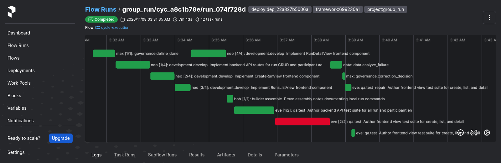
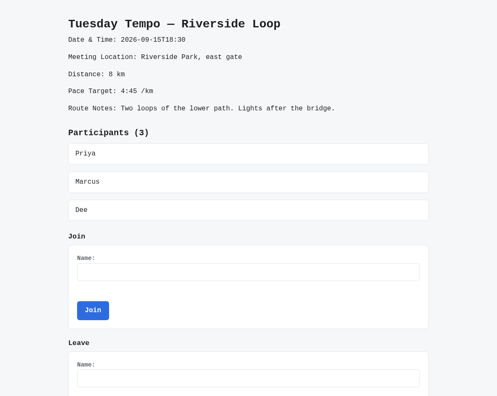
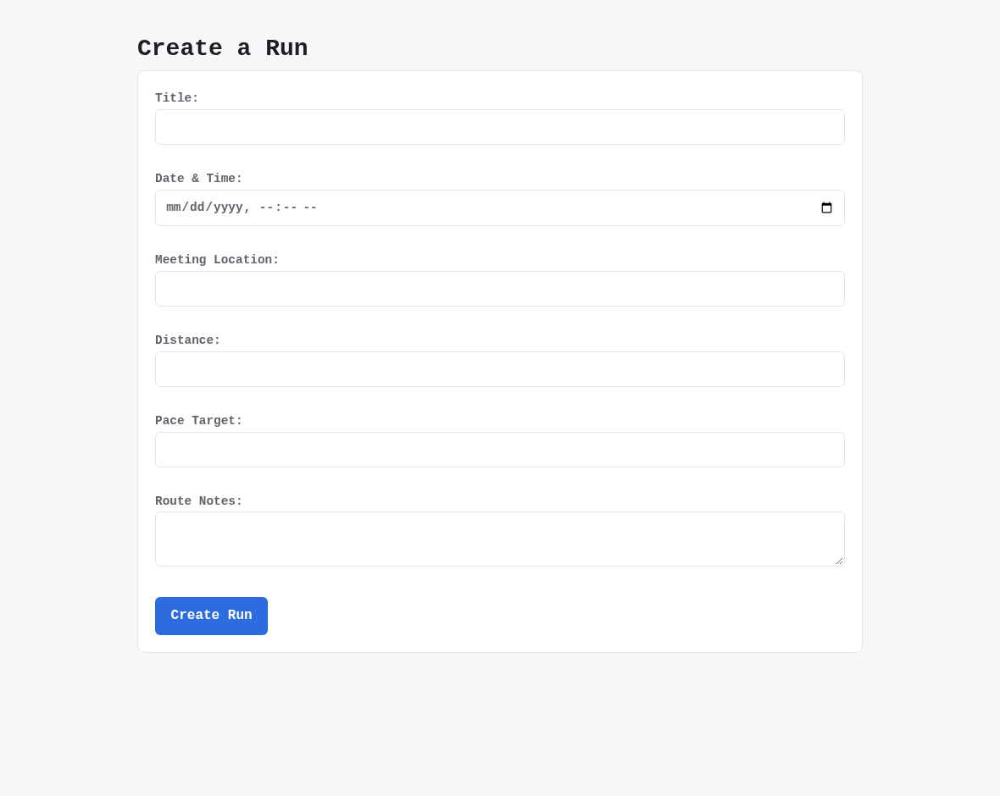
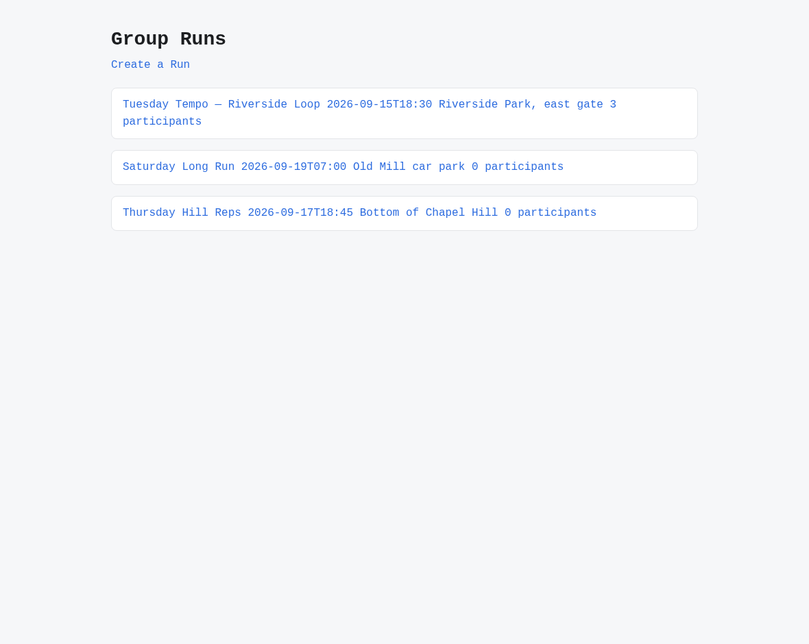

# v2.6.1

**Released 2026-11-07** · [tag `v2.6.1`](https://github.com/backspring-labs/squad-ops/releases/tag/v2.6.1)

The 2.6 line's first patch (`docs/plans/2-6-1-plan.md`): what an operator meets first on 2.6.0, fixed small.

### Fixed
- **A rebuilt console plugin reaches a browser without emptying its cache** (PRs #2958, #2959, backspring-labs/continuum#4):
  Continuum 1.0.3 versions each plugin bundle's URL by its content, caches the current one for good and revalidates the
  rest, and answers 304 for an unchanged file. #2958's Caddy `no-cache` stopgap is removed.
- **The selected model engine comes back after a reboot** (#2932 ask 1, PR #2962): TensorFold runs `--restart
  unless-stopped`. The switch's removal, compose's stop and the watchdog's kill all keep a deselected engine down.
- **A deploy runs the Caddyfile it pulled** (#2960, PR #2963): Caddy mounts the file singly, so a pull never reached it
  and a reload re-read the old one. Every deploy compares the two and restarts Caddy when they differ.
- **Home's Create Cycle opens the Cycles create form** (#2909, PR #2964): it called a window function the console never
  defines. It now hands the request to the Cycles panel, as the Campaigns link to the goals panel does.
- **The qa briefs show a criterion test that asserts on something it made sure is there** (#2933, PR #2965): a non-empty
  check before a loop and the suite's own fixture, on both stacks; a qa repair keeps the suite's fixture.
- **The console's Signal view no longer holds the runtime API for seconds** (#2921, PR #2968): its artifact panels read
  every page of every Project's artifacts, and each page walked all of a Project's metadata on the event loop, so a
  5 ms call on Home could take 9 s. The panels read each Project's newest page, and the vault's walk runs in a worker
  thread, with metadata written whole and renamed into place.

### Moved to 2.7
- A suite handed to the product's runner reading as handed off rather than failed (#2949's remainder).
- D1: a criterion that passes on the head on qa's first emission refused to qa rather than abandoned at row 19 (#2933).

## Merged pull requests (11)

| PR | Title | Closes |
|---|---|---|
| [#2967](https://github.com/backspring-labs/squad-ops/pull/2967) | chore(release): 2.6.1 — what an operator meets first on 2.6.0, fixed small | — |
| [#2968](https://github.com/backspring-labs/squad-ops/pull/2968) | fix(console,vault): the Signal view no longer holds the runtime API for seconds | [#2921](https://github.com/backspring-labs/squad-ops/issues/2921) |
| [#2966](https://github.com/backspring-labs/squad-ops/pull/2966) | docs(plans): 2.6.1 — item 4 and D1 move to 2.7, on the owner's rulings | — |
| [#2965](https://github.com/backspring-labs/squad-ops/pull/2965) | fix(prompts): a criterion test asserts on something it made sure is there | — |
| [#2964](https://github.com/backspring-labs/squad-ops/pull/2964) | fix(console): Home's Create Cycle opens the Cycles create form | [#2909](https://github.com/backspring-labs/squad-ops/issues/2909) |
| [#2963](https://github.com/backspring-labs/squad-ops/pull/2963) | fix(ops): a deploy makes Caddy run the checkout's Caddyfile | [#2960](https://github.com/backspring-labs/squad-ops/issues/2960) |
| [#2962](https://github.com/backspring-labs/squad-ops/pull/2962) | fix(ops): the selected model engine comes back after a reboot | — |
| [#2961](https://github.com/backspring-labs/squad-ops/pull/2961) | docs(plans): the 2.6.1 plan — what an operator meets first on 2.6.0, fixed small | — |
| [#2959](https://github.com/backspring-labs/squad-ops/pull/2959) | chore(console): pin Continuum 1.0.3, whose bundle URLs carry their version | — |
| [#2958](https://github.com/backspring-labs/squad-ops/pull/2958) | fix(console): a plugin bundle is revalidated on each load | — |
| [#2957](https://github.com/backspring-labs/squad-ops/pull/2957) | docs(release): the v2.6.0 package | — |

## Cycle evidence

### `cyc_a8c1b78ef675`

**Verdict:** `accepted` · **Runs:** 2 · **Role:** shakeout — non-counting: the deploy's shakeout, read for seam findings

| | Checks |
|---|---|
| Verified | acceptance:additive_containment, acceptance:assertion_kinds_match, acceptance:client_mock_surface, acceptance:command_exit_zero, acceptance:contract_assertions_match, acceptance:declared_imports, acceptance:dom_anchor_queries, acceptance:endpoint_defined, acceptance:fill_slot_signature, acceptance:frontend_compiles, acceptance:function_defined, acceptance:harness_boundary, acceptance:import_present, acceptance:module_imports, acceptance:regex_match, acceptance:undefined_names, acceptance:unterminated_source, acceptance_criteria_prose, expected_artifacts, frontend_build, no_self_mocking_tests, no_stub_fallback_tests, non_stub_files, required_files, tests_pass, vc-probe-runs, vc-probe-runs-join, vc-probe-runs-join-duplicate, vc-probe-runs-leave, vc-probe-runs-rejects-blank |
| Failed | — |
| Required unmet | — |
| Never executed | — |

### `cyc_e6acda62f855`

**Verdict:** `accepted` · **Runs:** 2 · **Role:** shakeout — non-counting: the deploy's shakeout, read for seam findings

| | Checks |
|---|---|
| Verified | acceptance:additive_containment, acceptance:assertion_kinds_match, acceptance:client_mock_surface, acceptance:command_exit_zero, acceptance:contract_assertions_match, acceptance:declared_imports, acceptance:dom_anchor_queries, acceptance:endpoint_defined, acceptance:fill_slot_signature, acceptance:frontend_compiles, acceptance:function_defined, acceptance:harness_boundary, acceptance:import_present, acceptance:module_imports, acceptance:undefined_names, acceptance:unterminated_source, acceptance_criteria_prose, expected_artifacts, frontend_build, no_self_mocking_tests, no_stub_fallback_tests, non_stub_files, required_files, tests_pass, vc-probe-runs, vc-probe-runs-join, vc-probe-runs-join-duplicate, vc-probe-runs-leave, vc-probe-runs-ordered, vc-probe-runs-rejects-blank |
| Failed | — |
| Required unmet | — |
| Never executed | — |

## Screenshots

Of cycle `cyc_a8c1b78ef675` (shakeout) — the shakeout on the final deploy, accepted 21 of 21 after one qa repair round; 2.6.1 adds no feature to show, so the pictures are of the sample application it built.

*prefect flow run shakeout fastapi react accepted after one qa repair round*

*shakeout a run s detail*

*shakeout the create run form*

*shakeout the run list*
