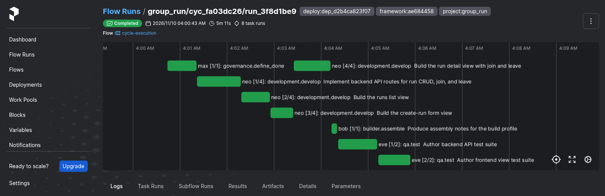
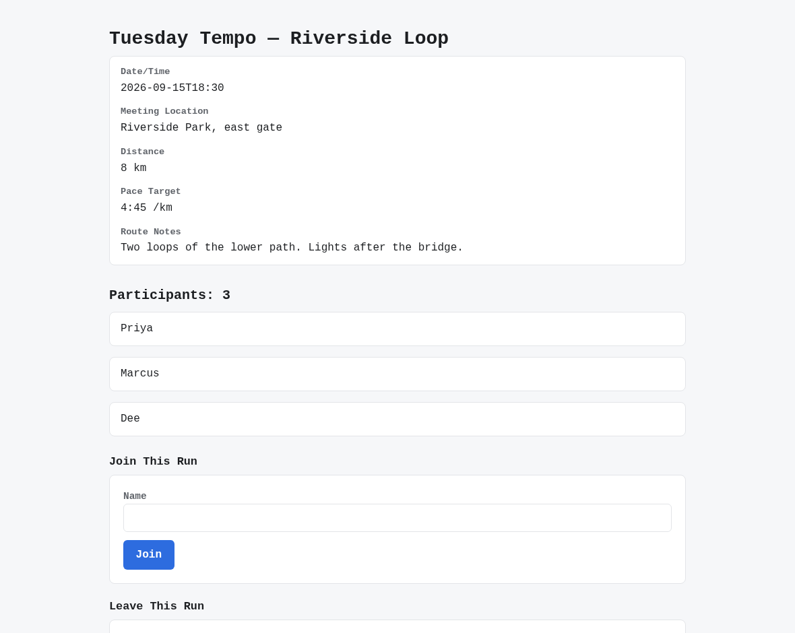
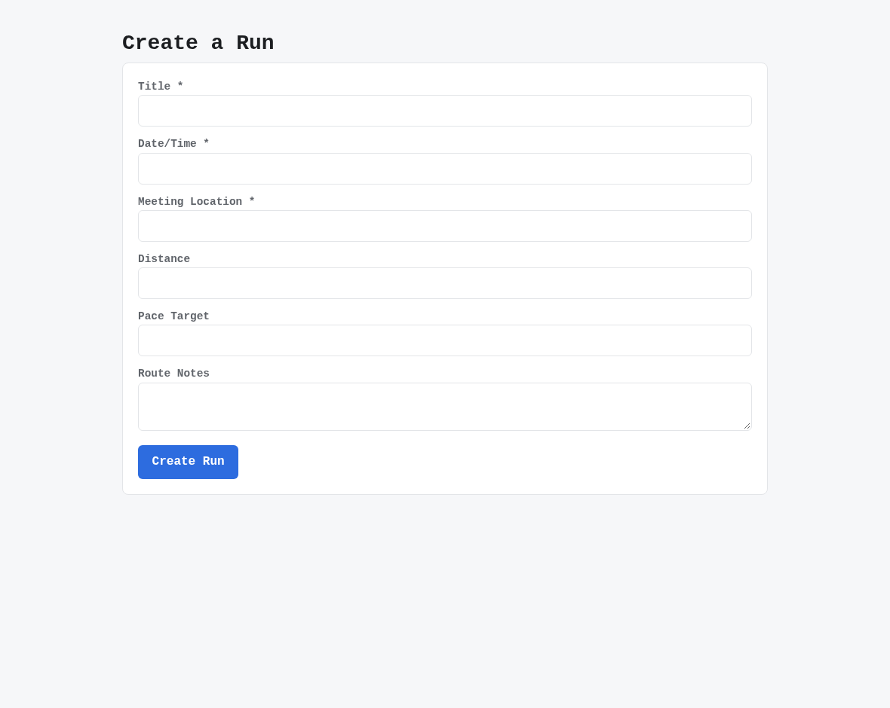
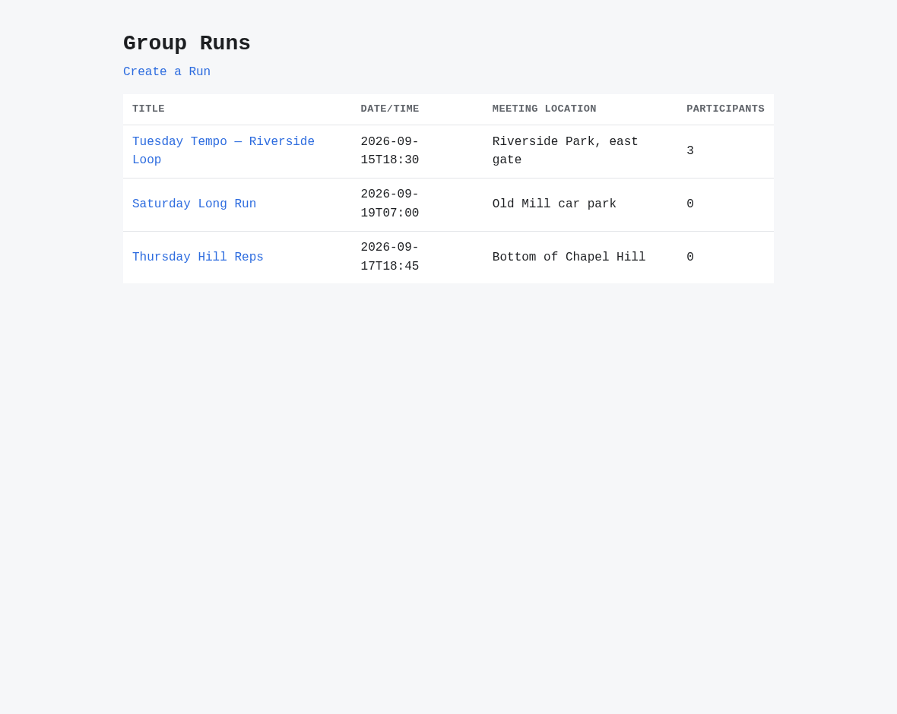

# v2.7.0

**Released 2026-11-10** · [tag `v2.7.0`](https://github.com/backspring-labs/squad-ops/releases/tag/v2.7.0)

Stabilization, feature-free by rule (`docs/plans/2-7-0-plan.md`): the 2.6 line's debts closed. The cut's evidence is
`docs/plans/verification-sets/2-7-0-cut-record.md`; the soak's record is `2-7-0-soak-record.md` beside it.

### Added
- **A scripted squad for machinery cycles** (#2495): the `machinery` squad profile's agents all name the model
  `scripted`, and every call they make is answered from a recorded script
  (`--set llm_script=<name>@<version>`, scripts in `src/squadops/llm/llm_scripts/`), with no model loaded. The
  answers sit behind the existing LLM port, so dispatch, emission, correction and acceptance run their normal
  paths, and every other profile keeps the engine on the same deploy. A missing answer fails the task naming its
  key `(task_type, occurrence, call)`; it never falls back to a model. Cycle create refuses a scripted squad with
  no script, an unpinned or stale version, or a mixed squad, and refuses a script named on a model squad. A
  scripted cycle produces no Cross-Cycle Memory observation, and its calls are charted under the engine
  `scripted`. `scripts/dev/record_llm_script.py` records a script from a run's stored emissions; an answer may
  carry its recorded latency, which the provider waits out when the script sets `replay_latency`.
- **A scripted Campaign answers each cycle from its own script** (refs #2892, SIP-0109 §24dt): a Campaign's
  `policy.llm_scripts` names one pinned script, `<name>@<version>`, per cycle it launches, in launch order, bound at
  the launch from the control log's own count, so a restart doesn't reset it. A Campaign of several scripted
  increments can now make a different change in each. A launch past the last script is refused,
  `LLM_SCRIPT_MISSING`, and the Campaign escalates; it's never answered from another script or by a model.
  Creation refuses a script the deploy doesn't hold at that version. `record_llm_script.py` gains
  `--latency-scale` and `--latency-cap`, written into the script's `recorded_from.latency` with the replayed total:
  a recorded gap includes any gate wait between two stored files, which can outlast the deploy's per-task
  timeout. The soak's pre-registration is `docs/plans/verification-sets/2-7-0-soak-preregistration.md`.
- **The draft's integration check** (#2862, SIP-0112 H.30): `POST /api/v1/projects/{id}/integration-check`
  (`campaigns:manage`), or `squadops projects check-integration <project> [--token-from-gh]`. Before the next
  Campaign is drafted on a repository-backed Project, it syncs where a contribution is pending, reading each
  review request's merge on the forge, re-validates where one merged, and answers what is still not in, each row
  with what it waits on. The forge is only read. One sync is recorded per upstream commit. With no token (the
  request's, else the one the deploy holds for the Project) the merge is answered unread, `no_token`, never "not
  merged". A patch export is read by ancestry with no forge token, and a fetch refused for its credentials is
  `fetch_unauthorized`. Its re-validation is bounded: a READY Project, after its own sync, at that sync's commit. It
  replaces the host-side merge sweep and its timer, which the owner ruled against on 2026-11-08 and which was never
  installed.
- **A validation is fenced on the baseline it read** (#2862, SIP-0112 H.30): one that another validation overtook
  writes nothing, and `POST /api/v1/projects/{id}/validate` answers 409 `BASELINE_MOVED`, so a slow validation can
  no longer move a newer adoption back.

### Changed
- **An outside operator's pull request is held to its branch's boundary by a policy the repository doesn't
  hold** (#2975, PR #2991): `operator branch checks` runs on `pull_request_target` from the default branch,
  never runs the pull request's code, and reads the policy from the `OPERATOR_BRANCH_POLICY` repository
  variable, which only an administrator can change. It fails closed on a missing or malformed policy, an
  undeclared role, an unresolved commit identity or a foreign author, and the check's own files are out of
  bounds to every operator branch. It is now the required check, and the check it replaces is removed
  with its script and its in-repository boundary file.

### Fixed
- **A product's change request can't reuse the anchor of a page an earlier increment added** (#2783, SIP-0109 §24dq):
  the PROMOTE row on a campaign branch records each page the increment added and acceptance held, with every test id
  its page carried. The next launch pins that inventory beside the frozen criteria. The rails judge an accepted page
  as a pinned one and refuse an added page's anchor that one carries. The proposer is shown those pages and their ids.
  Acceptance renders them in the expected set, so a candidate that drops one is rejected, and a page never built
  that reuses one's anchor is blocked, never held. A product with no approved manifest is covered by the same
  inventory. After its outside review (§24dr): an added page's anchor is also held unique against the candidate's
  own rendered pages; each promotion records the inventory's pages again with the ids they carry now; a pinned
  route's inventory ids stay taken at acceptance. A launch or promotion from before the inventory is refused rather
  than read as empty: the proposal and acceptance refuse a block without one, and a Campaign whose log has such a
  promotion escalates before its next proposal, naming the row. Both the runtime-api and nat images have to answer
  their loaded checks (`2783-runtime`, `2783-nat`) before the fix is relied on.
- **A suite handed to the product's own runner is banked as handed off, not failed** (#2949): on a product
  only its own runner runs (SIP-0112 H.26), every `qa.test` banked its emission `emission_status=failed`
  seconds before the runner passed the task. The router now takes the runner's reading before the bank, and an
  emission whose hand-off the runner passed is banked `handed_off`. It stays out of every workspace, delivered
  tree and deliverable, as a failed one does, and the scorecard's `failed_emissions` and the verification-set
  records no longer count it. A runner that fails the suite, a pass refused on the head, and a suite the image
  ran and failed still bank `failed`. Stored rows read as they did. The Prefect task run, the agent's activity
  and `task.failed` still read the hand-off as failed (#3000).
- **A product's repaired suite is read by the product's own runners** (SIP-0112 H.29, #2827 item 2): patch acceptance
  found a repaired suite by the stack's collected-test vocabulary, and `nextjs_ts`'s is the scaffold's `__tests__/`
  rule (#1534). A product made from that blueprint runs under it, so a repair placed where the product's vitest
  collects it was never retested, and one placed by the scaffold's rule was. Now the dispatched task's runners (their
  roots and file pattern) decide, and a sample application, or a product with no runner, keeps the stack's reading.
- **A plan-less product cycle's test author is shown the product** (SIP-0112 H.29, #2827 item 2): the monolithic qa
  prompt (`request.qa_test.test_validate`, version 6) shows the product's repository view, its map, conventions,
  checks and runners, as a plan's task is shown it. The scaffold's harness paragraph is now a sample application's
  block only, and a sample application's prompt renders byte for byte as before. Where the view shows a stack's
  conventions for a product, the profile's test supplement is left out in their favour, as the developer's is.
- **The vault's metadata is readable again by its readers on the host** (a regression from PR #2968): the atomic
  write kept `mkstemp`'s 0600, so every metadata file written after it deployed was unreadable to the release
  capture, the verification-set driver and triage, which read the vault as another user. Files are 0644 again, as
  `write_text` left them.

## Merged pull requests (39)

| PR | Title | Closes |
|---|---|---|
| [#3025](https://github.com/backspring-labs/squad-ops/pull/3025) | chore(release): 2.7.0 — the 2.6 line's debts closed | [#2827](https://github.com/backspring-labs/squad-ops/issues/2827) |
| [#3021](https://github.com/backspring-labs/squad-ops/pull/3021) | docs(release): the 2.7.0 cut evidence — the shakeout pair, the soak's record and the cut record | [#2892](https://github.com/backspring-labs/squad-ops/issues/2892) |
| [#3016](https://github.com/backspring-labs/squad-ops/pull/3016) | docs(plans): the 2.7 plan records SIP-0117 and SIP-0118 accepted during 2.7, and the game-dev-roblox plan's merge | — |
| [#2972](https://github.com/backspring-labs/squad-ops/pull/2972) | docs(plans): the game-dev-roblox plan, revision 4 — onto SIP-0116: the development profile requires, the selected agents supply (the MacBook lane's input to 2.8) | — |
| [#2841](https://github.com/backspring-labs/squad-ops/pull/2841) | docs(sips): accept SIP-0118 Game Development Capability Packs and Squad Composition — the game contracts defined once and the Roblox skillsets, on SIP-0116 | — |
| [#2405](https://github.com/backspring-labs/squad-ops/pull/2405) | docs(sips): accept SIP-0117 Game Development Platform — Roblox as a development profile, skillsets and a provider, on SIP-0116 (Godot, Roblox, Unity; remote tool execution) | — |
| [#3012](https://github.com/backspring-labs/squad-ops/pull/3012) | fix(scripts): a recorded proposal answers with what its proposer authored, and every answer is checked against its handler | — |
| [#3007](https://github.com/backspring-labs/squad-ops/pull/3007) | feat(campaigns): the 2.7 soak's scripts, its Campaign definition and its filled pre-registration | — |
| [#3008](https://github.com/backspring-labs/squad-ops/pull/3008) | docs(plans): the 2.7 plan records SIP-0116's acceptance during 2.7 | — |
| [#3006](https://github.com/backspring-labs/squad-ops/pull/3006) | docs(sips): accept SIP-0116 Agent Skillsets — a skillset coverage check for the selected squad, split from Capability-Backed Agents for 2.x | — |
| [#3004](https://github.com/backspring-labs/squad-ops/pull/3004) | feat(campaigns): a scripted Campaign answers each cycle from its own script, and the 2.7 soak's pre-registration | — |
| [#3002](https://github.com/backspring-labs/squad-ops/pull/3002) | feat(projects): the draft's integration check syncs and re-validates where a merge waits, in place of the merge sweep | [#2862](https://github.com/backspring-labs/squad-ops/issues/2862) |
| [#2998](https://github.com/backspring-labs/squad-ops/pull/2998) | fix(campaigns): the accepted-page inventory — a change request can't reuse the anchor of a page an earlier increment added | [#2783](https://github.com/backspring-labs/squad-ops/issues/2783) |
| [#3003](https://github.com/backspring-labs/squad-ops/pull/3003) | chore(ci): remove the branch check that operator branch checks replaced | [#2975](https://github.com/backspring-labs/squad-ops/issues/2975) |
| [#3001](https://github.com/backspring-labs/squad-ops/pull/3001) | fix(cycles): a suite handed to the product's runner is banked handed off, not failed | [#2949](https://github.com/backspring-labs/squad-ops/issues/2949) |
| [#2999](https://github.com/backspring-labs/squad-ops/pull/2999) | fix(projects): a product's repaired suite is read by its own runners, and a plan-less test author is shown the product (SIP-0112 H.29) | — |
| [#2996](https://github.com/backspring-labs/squad-ops/pull/2996) | fix(campaigns): a vitest product's page criterion loads its view through a page loader the framework places (#2799) | [#2799](https://github.com/backspring-labs/squad-ops/issues/2799) |
| [#2995](https://github.com/backspring-labs/squad-ops/pull/2995) | feat(projects): the merge sweep — a merged contribution syncs its Project and re-validates it | [#2862](https://github.com/backspring-labs/squad-ops/issues/2862) |
| [#2994](https://github.com/backspring-labs/squad-ops/pull/2994) | feat(vault): a listing reads each run's listing summary, not every metadata file | [#2973](https://github.com/backspring-labs/squad-ops/issues/2973) |
| [#2993](https://github.com/backspring-labs/squad-ops/pull/2993) | docs(sips): R3's re-proposal after a row-19 ending is dropped, since D1 left nothing ending at row 19 | [#2935](https://github.com/backspring-labs/squad-ops/issues/2935) |
| [#2992](https://github.com/backspring-labs/squad-ops/pull/2992) | fix(execution): qa's first emission that passes on the head is refused to its author (D1, SIP-0109 §24do) | [#2933](https://github.com/backspring-labs/squad-ops/issues/2933) |
| [#2991](https://github.com/backspring-labs/squad-ops/pull/2991) | feat(ci): operator branch checks, run from the default branch with an administrator-held policy | — |
| [#2990](https://github.com/backspring-labs/squad-ops/pull/2990) | fix(console): the Memory view says what was read and what makes a record when its table is empty | [#2974](https://github.com/backspring-labs/squad-ops/issues/2974) |
| [#2989](https://github.com/backspring-labs/squad-ops/pull/2989) | fix(scripts): shared scripts run on bash 3.2 and BSD userland, and a guard holds them to it | [#2402](https://github.com/backspring-labs/squad-ops/issues/2402) |
| [#2988](https://github.com/backspring-labs/squad-ops/pull/2988) | docs(tests): the integration guide names what exists; the retired design's diagrams go | [#2737](https://github.com/backspring-labs/squad-ops/issues/2737) |
| [#2987](https://github.com/backspring-labs/squad-ops/pull/2987) | chore(memory): remove the embeddings port and its Ollama adapter, which nothing calls | [#2736](https://github.com/backspring-labs/squad-ops/issues/2736) |
| [#2986](https://github.com/backspring-labs/squad-ops/pull/2986) | fix(projects): a vitest config whose effect its own text can't show gets no test-id reader | [#2775](https://github.com/backspring-labs/squad-ops/issues/2775) |
| [#2985](https://github.com/backspring-labs/squad-ops/pull/2985) | fix(qa): the qa role's route rendering counts only the ids a page's elements carry | [#2776](https://github.com/backspring-labs/squad-ops/issues/2776) |
| [#2984](https://github.com/backspring-labs/squad-ops/pull/2984) | feat(llm): a scripted squad for machinery cycles — every task answered from a recorded script, no model | [#2495](https://github.com/backspring-labs/squad-ops/issues/2495) |
| [#2983](https://github.com/backspring-labs/squad-ops/pull/2983) | fix(comms): a reply resolves a waiter only for the send it was registered for | [#2932](https://github.com/backspring-labs/squad-ops/issues/2932) |
| [#2982](https://github.com/backspring-labs/squad-ops/pull/2982) | fix(execution): a cycle whose execution raises outside a run ends run_failed | [#2931](https://github.com/backspring-labs/squad-ops/issues/2931) |
| [#2981](https://github.com/backspring-labs/squad-ops/pull/2981) | fix(vault): an artifact exists only once its content and metadata are durable, and a corrupt record is named | — |
| [#2980](https://github.com/backspring-labs/squad-ops/pull/2980) | docs(ops): operator keys on TensorFold — added, rotated and removed by hand, kept by rotation | [#2286](https://github.com/backspring-labs/squad-ops/issues/2286) |
| [#2979](https://github.com/backspring-labs/squad-ops/pull/2979) | fix(scenarios): a diagnostic's evaluation is never stored as the cycle's | [#2765](https://github.com/backspring-labs/squad-ops/issues/2765) |
| [#2978](https://github.com/backspring-labs/squad-ops/pull/2978) | fix(sandbox): a start that never became ready says what its readiness URL last answered | [#2798](https://github.com/backspring-labs/squad-ops/issues/2798) |
| [#2977](https://github.com/backspring-labs/squad-ops/pull/2977) | docs(plans): adopt the 2.7.0 plan — ledgers re-placed, the portfolio, the ROADMAP row | [#949](https://github.com/backspring-labs/squad-ops/issues/949) [#2230](https://github.com/backspring-labs/squad-ops/issues/2230) [#2893](https://github.com/backspring-labs/squad-ops/issues/2893) [#2938](https://github.com/backspring-labs/squad-ops/issues/2938) [#2944](https://github.com/backspring-labs/squad-ops/issues/2944) |
| [#2971](https://github.com/backspring-labs/squad-ops/pull/2971) | docs(plans): the 2.7.0 plan — the 2.6 line's debts, closed | — |
| [#2969](https://github.com/backspring-labs/squad-ops/pull/2969) | fix(vault): metadata stays readable by the vault's other readers | — |
| [#2970](https://github.com/backspring-labs/squad-ops/pull/2970) | docs(release): the v2.6.1 package — the cut's evidence, screenshots, the records on the Release | — |

## Improvement proposals

| Proposal | From | To |
|---|---|---|
| [SIP-0116-Agent-Skillsets](../../design/sips/SIP-0116-Agent-Skillsets.md) | new | accepted |
| [SIP-0117-Game-Development-Platform](../../design/sips/SIP-0117-Game-Development-Platform.md) | new | accepted |
| [SIP-0118-Game-Development-Capability](../../design/sips/SIP-0118-Game-Development-Capability.md) | new | accepted |

## Improvement proposals amended in place

No lifecycle change — each was edited under the status it already had (a post-acceptance amendment, CLAUDE.md step 5a).

| Proposal | Status |
|---|---|
| [SIP-0088-Agent-Runtime-Modes](../../design/sips/SIP-0088-Agent-Runtime-Modes.md) | accepted |
| [SIP-0090-Agent-Embodiment-Substrate](../../design/sips/SIP-0090-Agent-Embodiment-Substrate.md) | accepted |
| [SIP-0091-Duty-Durability-via-Temporal](../../design/sips/SIP-0091-Duty-Durability-via-Temporal.md) | accepted |
| [SIP-0092-Implementation-Plan-Improvement](../../design/sips/SIP-0092-Implementation-Plan-Improvement.md) | accepted |
| [SIP-0093-Multi-Role-Plan-Authoring](../../design/sips/SIP-0093-Multi-Role-Plan-Authoring.md) | accepted |
| [SIP-0101-Cycle-Replay-Harness](../../design/sips/SIP-0101-Cycle-Replay-Harness.md) | accepted |
| [SIP-0102-Ephemeral-Application-Sandbox](../../design/sips/SIP-0102-Ephemeral-Application-Sandbox.md) | accepted |
| [SIP-0104-Deterministic-Verification-Scaffolding-with](../../design/sips/SIP-0104-Deterministic-Verification-Scaffolding-with.md) | implemented |
| [SIP-0105-Stack-Blueprint-Contract](../../design/sips/SIP-0105-Stack-Blueprint-Contract.md) | accepted |
| [SIP-0107-Scoped-Code-Revision](../../design/sips/SIP-0107-Scoped-Code-Revision.md) | implemented |
| [SIP-0109-Campaign-Orchestration](../../design/sips/SIP-0109-Campaign-Orchestration.md) | accepted |
| [SIP-0110-Cross-Cycle-Memory](../../design/sips/SIP-0110-Cross-Cycle-Memory.md) | accepted |
| [SIP-0111-TensorFold-Provider-Adapter](../../design/sips/SIP-0111-TensorFold-Provider-Adapter.md) | accepted |
| [SIP-0112-Project-Lifecycle-Management](../../design/sips/SIP-0112-Project-Lifecycle-Management.md) | accepted |
| [SIP-0113-Outcome-Evaluation](../../design/sips/SIP-0113-Outcome-Evaluation.md) | accepted |
| [SIP-0114-Cycle-Request-Profile-Naming](../../design/sips/SIP-0114-Cycle-Request-Profile-Naming.md) | implemented |
| [SIP-0115-Project-Goals-Backlog](../../design/sips/SIP-0115-Project-Goals-Backlog.md) | accepted |
| [SIP-Agent-Comms-Delivery-Guarantees](../../design/sips/SIP-Agent-Comms-Delivery-Guarantees.md) | proposed |
| [SIP-Capability-Backed-Agents](../../design/sips/SIP-Capability-Backed-Agents.md) | proposed |
| [SIP-Memory-Entry-Points](../../design/sips/SIP-Memory-Entry-Points.md) | deprecated |

## Cycle evidence

### `cyc_fa03dc263093`

**Verdict:** `accepted` · **Runs:** 2 · **Role:** shakeout — non-counting: the deploy's shakeout, read for seam findings

| | Checks |
|---|---|
| Verified | acceptance:additive_containment, acceptance:assertion_kinds_match, acceptance:client_mock_surface, acceptance:command_exit_zero, acceptance:contract_assertions_match, acceptance:declared_imports, acceptance:dom_anchor_queries, acceptance:endpoint_defined, acceptance:fill_slot_signature, acceptance:frontend_compiles, acceptance:function_defined, acceptance:harness_boundary, acceptance:import_present, acceptance:module_imports, acceptance:undefined_names, acceptance:unterminated_source, acceptance_criteria_prose, expected_artifacts, frontend_build, no_self_mocking_tests, no_stub_fallback_tests, non_stub_files, required_files, tests_pass, vc-probe-runs, vc-probe-runs-join, vc-probe-runs-join-duplicate, vc-probe-runs-leave, vc-probe-runs-rejects-blank |
| Failed | — |
| Required unmet | — |
| Never executed | — |

### `cyc_f058965a33b0`

**Verdict:** `rejected` · **Cycle status:** `failed` · **Runs:** 2 · **Role:** shakeout — non-counting: the deploy's shakeout, read for seam findings

| | Checks |
|---|---|
| Verified | acceptance:additive_containment, acceptance:assertion_kinds_match, acceptance:client_mock_surface, acceptance:declared_imports, acceptance:dom_anchor_queries, acceptance:frontend_compiles, acceptance:undefined_names, acceptance:unterminated_source, acceptance_criteria_prose, expected_artifacts, frontend_build, no_self_mocking_tests, no_stub_fallback_tests, non_stub_files, required_files, tests_pass, vc-probe-api-runs, vc-probe-api-runs-join, vc-probe-api-runs-join-duplicate, vc-probe-api-runs-leave, vc-probe-api-runs-ordered, vc-probe-api-runs-rejects-blank |
| Failed | tests_pass |
| Required unmet | — |
| Never executed | — |

### `cyc_3654c547f70c`

**Verdict:** `accepted` · **Runs:** 3 · **Role:** counted

| | Checks |
|---|---|
| Verified | acceptance:command_exit_zero, acceptance:import_present, acceptance:undefined_names, acceptance:unterminated_source, acceptance_criteria_prose, expected_artifacts, no_self_mocking_tests, no_stub_fallback_tests, non_stub_files, tests_pass |
| Failed | — |
| Required unmet | — |
| Never executed | acceptance:endpoint_defined, acceptance:function_defined |

## Screenshots

Of cycle `cyc_fa03dc263093` (shakeout) — the FastAPI + React shakeout on the final deploy, accepted 21 of 21 with no correction round; 2.7 is a stabilization release with no feature to show, so the pictures are of the sample application it built.

*prefect flow run shakeout fastapi react accepted with no correction round*

*shakeout a run s detail*

*shakeout the create run form*

*shakeout the run list*
