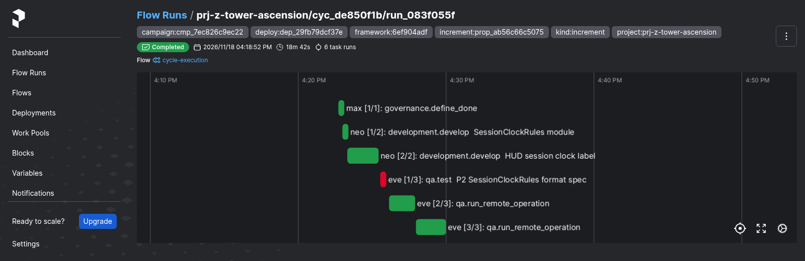
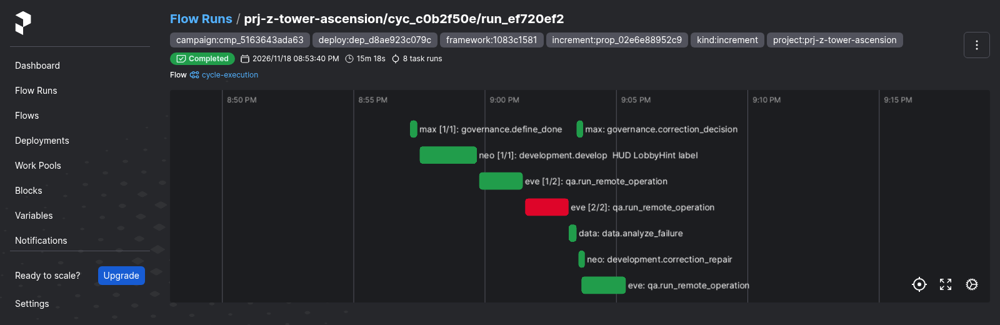

# v2.8.0

**Released 2026-11-18** · [tag `v2.8.0`](https://github.com/backspring-labs/squad-ops/releases/tag/v2.8.0)

A feature release (`docs/plans/2-8-0-plan.md`): a squad builds and plays an existing Roblox game. On the counted
run's first attempt it took two consecutive increments of a private copy of Tower Ascension from design to accepted
source, each proved in a real play session in Roblox Studio (SIP-0117, SIP-0118); agents carry replay-tested
skillsets (SIP-0116, implemented). The cut's evidence is `docs/plans/verification-sets/2-8-0-cut-record.md`; the
demonstration's record is `2-8-0-demonstration-record.md` beside it.

### Added
- **A product declares its package roots where its tree names none** (#3134; SIP-0112 H.33): the Development
  Configuration's optional `technical.package_roots` lists repository directories. The derived profile reads each
  as a `package` surface named by its folder, so a Luau product under Script Sync (`src/Shared`, `src/Server`,
  `src/Client` on z_tower-ascension) offers surfaces a criterion can name. A root that isn't a directory at the
  baseline commit is refused as submitted, and one a later tree lacks is disclosed as `package_root_missing`.
  Before this a Luau product offered no surface, and a Campaign refused every criterion but a scenario.
- **A Campaign cycle a skill stopped is abandoned for a proposal shown the skill's line** (#3041; SIP-0109 §24dz):
  a cycle that ends `skill_stopped`, a proposal run's included, is its own ending. Row 20 abandons the increment,
  counted toward no unaccepted limit, as rows 16 and 19 are. The next proposal is shown the skill's line, from the
  run's terminal decision, under its own heading. Before this a stopped proposal read as `proposal_failed` and was
  proposed again unexplained, and a stopped increment was repaired into the same stop.
- **A fault for the repair diagnostic on a played product** (#3170; SIP-0118 R5.6): `luau_player_text_drops_a_word`
  cuts the last word of the first player-facing text a client script sets, on a developer's first attempt, so
  an increment's play scenario fails on the candidate and the repair route is exercised. A Campaign declares it
  through the `campaign-increment-source-wrong-text` request profile.
- **The repair diagnostic's fault cuts a text the change adds** (#3208; SIP-0118 R5.7): on an existing client
  script `luau_player_text_drops_a_word` cut the file's first text, an element the product already held, so the
  increment's scenario passed and no repair was asked for (read live on 2026-11-18). It now cuts the first
  player-facing text on a line the product doesn't hold, read from the develop task's own inputs, reads DID NOT
  BITE where the emission adds none, names the changed line in its log, and holds that one line through a
  self-evaluation pass.
- **A product's owner reserves paths from a cycle's change** (#3155; SIP-0112 H.35): a Development Configuration
  may declare `technical.reserved_paths` (files, folders, globs). A proposal whose footprint reaches one, a plan
  whose task names one and a run that changes one are each refused by path, whatever a model argued, and the
  authors are shown the entries first. A product that declares none is unchanged, to the byte of its prompts.
- **A goal set's result can be observed on a `scenario` surface** (#3042; SIP-0115 §10h): a result seen only while
  the product is played, such as a game's HUD in a play session. The other kinds each named something a Roblox
  game doesn't have, and `none` showed the proposal "not observed".
- **The `game_dev_roblox` development profile** (#3041; SIP-0118 R5.2, SIP-0116 §17q): the first profile whose work
  requires something of the squad. It declares the platform and, for strategy, development and QA, the Roblox
  skillset each needs. An operator names it for a Campaign on a Roblox game, and a cycle on a squad that lacks a
  skillset is refused at creation. It is `product_neutral` in everything a task reads, so the stack's advice comes
  from the skills alone.
  All three skillsets passed the skills replay on the Spark's models first, the last on `roblox-skills-v3` (§17t).
  One development answer of three wrote a saved-field rename its skill stops, which #3155 tracks.
  The first cycle under it was read on the Spark through creation preflight and the plan gate (SIP-0118 R5.5):
  its proposal wrote a `scenario` criterion on the HUD's lives label, and plan expansion appended the play step.
- **The skills replay: a skillset's skills tested on the deploy's models before a profile requires them** (#3041;
  SIP-0116 §17p): the authoring replay gains a `skills` arm. A captured task is authored as it stands and again
  handed what a cycle requiring the skillset would hand it, built from the image's own packaged skillsets. A case
  may swap named inputs to put another task in front of the same seam. Each skills-arm answer is judged by its
  case: the declared stop read, the handler's acceptance, the files emitted, a scenario criterion accepted, and
  the emitted specs passing on the product's own runner. `run_authoring_replay.py --skill-cases roblox-skills@1`
  runs the nine Roblox cases; records go to `var/replays/<experiment>/`.
- **A skill's stop is read, and it ends the run** (#3041; SIP-0116 §17o): a skill declares the opening words of
  the line it tells the model to refuse a task with (`stops:` in its `SKILL.md` front matter). Every authoring
  answer is read against the stops its task's skills declare. A task answered with one is not asked again or
  repaired: the run ends `skill_stopped`, and its terminal decision carries the skill and the line. Before this a
  stopped proposal was asked to revise and failed on its revision budget, and a stopped dev or QA task read as an
  empty emission. The three Roblox skills declare theirs, and `luau-gameplay`'s stop gains the fixed opening
  `saved data:` (the owner's approval, 2026-11-16). Migration `2202` adds the ending to `cycle_ends`.
- **The Roblox squad profile, `game-dev-roblox`** (#3041; SIP-0118 R4.3, R5.4): `full-38-tf`'s roster with no
  builder, with `roblox-increment-design` on Nat, `roblox-luau-dev` on Neo and `roblox-studio-qa` on Eve. Its skills
  load only on a cycle whose development profile requires them, and no profile does yet. It is the one Roblox
  squad: every cycle of the game line runs on the Spark.
- **A provider's authority is shown the product a cycle runs on, and Roblox Studio's checks its eligibility**
  (#3042; SIP-0116 §17n, SIP-0118 R5.3): at creation, an authority's `broken_rules` gets a `ProductView`: the
  seeded tree at the pinned commit and the ruled change request's footprint. An unreadable product refuses creation,
  naming why. The `roblox-studio` authority refuses a product whose files break the Script Sync layout, or a change
  whose footprint names anything but scripts and specs. It is found by `create_tool_authorities` in its own package.
- **Campaign acceptance credits a criterion's test by its id among the candidate's passes** (#3089; SIP-0109
  §24dy): each test-id reader keeps its passing ids (pytest's `-rfEp` rows, vitest's verbose `✓` lines, the Luau
  contract's `PASS` lines), and acceptance's runs are given those flags. A baseline failure the candidate collected
  under another id (a test generated from the product's data, renamed by the change) reads `not_run`, never
  discriminating.
- **An operator lease beside a roll is an intervention** (#2287, part 2; SIP-0109 §24dx): the verification-set
  driver reads the operator lease's log over each cycle's window, records each applied acquire on the roll, and says
  the roll isn't counted.
- **The operator can take the box between campaigns** (#2287, part 1; SIP-0109 §24dw):
  - `squadops box lease acquire|release|show`, over `/api/v1/box/lease`, under the new `box:operate` scope.
  - It holds the box for at most an hour. It is refused while the supervisor holds the box, a run is running or
    queued, or a campaign is live.
  - While it's held, a cycle create is refused with `operator_holds_the_box`. A campaign's launch waits without
    spending attempts, and a run start waits out the lease.
  - Every change is a row of the lease's own log and goes to the security audit. `engine_switch.py` won't move an
    engine under a held lease.
- **The operator's assessments reach the digest and the next proposal** (#2954; SIP-0115 §10g): a goal-set
  Campaign's evidence package (version 9) and its digest carry each expected result's latest assessment with its
  standing, and name the results nobody has assessed. The next proposal is given the same lines. A stale assessment
  reads as stale, and an assessment still decides nothing.
- **A repository-backed cycle recalls lessons under its development profile, and a skill can supersede a
  lesson** (#3038, part 1; SIP-0116 §17i): a cycle with no `build_profile` recalls under the development
  profile it pinned, and every exposure records which identity recall used. A cycle with a `build_profile`
  recalls exactly as before. A skill's `supersedes: [pat_…]` keeps those lessons from a task that loads it,
  each omitted as `superseded_by_skill`.
- **An operation task's tool is read available again at dispatch** (#3036, part 2; SIP-0116 §17h): a worker
  that went offline after the cycle was created ends the run `infrastructure_failed`, classified
  `worker_unavailable` and naming the tool. It doesn't run to an unverified verdict. `create_flow_executor`
  requires the worker registry.
- **A cycle's tools are checked at creation** (#3036, part 1; SIP-0116 §17h): every tool a required skillset
  requests is refused as `skillset_authorization` when no authority governs it, or its provider's rule refuses
  it. It is refused as `skillset_availability` when no provider can run it now: no online worker, no
  registry, or no sandbox client. The availability refusal says the squad still carries the skillset. No
  provider registers an authority yet, so a worker tool is refused until one does. A cycle whose work
  requires no tool is unchanged.
- **Whoever rules on an increment sees what each scenario observes** (#3044; SIP-0117 R5.9): a proposal that
  names scenarios also emits `scenario_review.md`. For each scenario it shows the claim, the setup and steps,
  and each assertion's observation and expectation, with the named one marked. The stored change request and
  its hash are unchanged.
- **A scenario must fail on the accepted baseline before development starts** (#3044, part 2b; SIP-0117
  R5.9): an increment's implementation run plays each of its scenarios on the baseline that acceptance
  judges, through the runtime's own port, and keeps the reading before dispatching anything. A scenario
  that already passes, or whose world isn't the baseline's, ends the run `criteria_not_checkable`, and the
  Campaign asks for a new proposal. One not read ends it `infrastructure_failed`, to be retried.
- **Each scenario criterion is run by an operation step the framework appends** (#3044, part 2; SIP-0117
  R5.9): plan expansion appends one `qa.run_remote_operation` per scenario criterion after the plan's body,
  under the operation the cycle's record offers a scenario. It carries the criterion's frozen scenario. At
  dispatch, its workspace has the declaration laid in as frozen, over any copy the squad wrote there.
- **A scenario criterion's declaration is the framework's file** (#3044, part 2; SIP-0117 R5.9): it is
  derived from the approved change request, and delivery lays it over the squad's change, so the delivered
  candidate holds it as frozen. No qa task is held to write it, the head check never runs it as a test, a
  planner is never offered it to claim, and the plan gate refuses a task that names it
  (`validate_increment_scenario_files`).
- **One resolver names the operation a frozen scenario runs under** (#3044, part 2):
  `capabilities.operation_supply.scenario_operation(record, catalog)`. It reads the one operation contract the
  cycle's skillset record offers in `play` mode, with its supplier, and that supplier's one tool from the
  deployment's catalog, checked against the recorded digest. It refuses none, more than one, or a changed
  skillset by name. The operation handler's tool lookup moved beside it (`tool_request`). Plan expansion, the
  baseline step and Campaign delivery will call it.
- **A Campaign increment's criterion can be a frozen scenario** (#3044, part 2; SIP-0117 R5.9): a criterion with
  `surface_kind: scenario` declares its scenario. On a repository-backed Project it is checked against the
  vocabulary the cycle's operation supplier keeps, which the runtime now puts on the proposal's input. It is
  refused as unverifiable with no vocabulary, and as outside the vocabulary when its reader can't run it. It is
  placed by the framework at `.squadops/scenarios/criterion_<id>.json`. No skillset ships a vocabulary yet, so
  no proposal can carry one until the rest of part 2 lands.
- **A skill may hold its provider's scenario vocabulary** (#3044, part 2; SIP-0116 §17g): `scenario_vocabulary.json`
  at a skill's root is read as the vocabulary of the scenario reader its capability's provider executes. The
  skillset loader refuses one it can't read, and a capability whose skills hold two. The vocabulary is kept and
  digested with the cycle like any skill file, and is read from the kept copy
  (`skillset_content.scenario_vocabulary_for`). No skillset ships one yet.
- **A frozen scenario is a declaration, read strictly and digested** (#3044, part 1; SIP-0117 R5.8): a scenario
  declares its reader, setup, steps, assertions and the one assertion its criterion names. It is refused when it
  steps outside its reader's vocabulary, and frozen as the `sha256` of its canonical text. A remote operation's
  request now carries the declaration's text and named assertion, and the provider refuses one whose text isn't
  the frozen one, as `not_executed`. The request's revision is that of exactly the files it stages. Every
  reading is written in one shape, with its side and the paths it didn't stage. The baseline rule
  (`baseline_verdict`) lives in one place. The fixture provider's operation is now `fixture/declared_scenario`.
  Nothing in a live cycle supplies a scenario yet; part 2 does.
- **An agent's remote operation reaches a worker** (#3023; SIP-0117 phase 2b, part 3, R5.6): the handler of
  `qa.run_remote_operation` now has an adapter behind its port. It queues the operation at the runtime API, under
  the agent's service identity and a new scope the agent role alone holds (`operations:request`), through three
  routes under `/api/v1/remote-operations` (create, read, cancel). It returns the worker's result. With no worker
  being heard from nothing is queued and the operation reads `not_executed` with the reason. An operation with no
  result in 900 seconds is cancelled and reads `interrupted`. A runtime that refuses the agent fails the task
  with the reason. **Each call is scoped to the send of its task** (the 2.8 plan's decision 2): the request names
  the task and the dispatch id the runtime minted for this send, and every route answers only while the runtime
  is waiting on that send. One operation is queued per send (migration 2301), so a create whose answer was lost
  is sent again and returns the operation it queued. A newer send of the task stops the older sends'
  operations.
  **Every deploy's `.env` needs one new line: `SQUADOPS__REMOTE_EXECUTION__PROVIDER=none`** (or `runtime_api`
  where a worker runs). Compose reads it onto the runtime API and every agent, and stops with the key named when
  it is absent. `.env.example` ships `none`.
- **A task is handed its skills and shows them in its prompt** (#3028; SIP-0116 phase 3, part 2): at each
  dispatch, re-dispatch and repair, the runtime puts the task's skills on its envelope from its cycle's kept copy.
  A repair is handed the skills of the step whose output it revises. They render in a section of their own
  (`request.skills_section`), after the project's instructions and before the lessons, in every request template
  that has the instruction slots, and the prompt budget counts them before lessons are given space. A step that
  runs an operation is handed none. No profile requires a skillset yet, so every prompt renders as before.
- **A cycle keeps a copy of the skills its work requires** (#3028; SIP-0116 phase 3, part 1): when a cycle is
  created on a development profile that requires skillsets, the skills its agents were assigned to supply are
  copied into the vault with it (`skillset_content`), and the cycle's skillset record names each skill and file
  by digest. The copy is checked against the record before anything is loaded from it, so a redeploy that edits a
  skill doesn't reach a cycle already created. A skill's files are UTF-8 text. No profile requires a skillset
  yet, so every cycle keeps nothing and runs as before; a task is handed its skills in part 2.
- **The remote-execution worker** (#3023; SIP-0117 phase 2b, part 2): `python -m squadops.remote_execution.worker_main`,
  run on the machine that hosts a tool. It connects outward to the runtime API and listens on nothing. It reads
  its own settings, `SQUADOPS__WORKER__*` (its id, the runtime's address, the token endpoint, its client's id and
  secret, and `provider`), each required. It claims one operation, runs it, renews its lease and submits the
  result; a cancel stops the tool and settles the operation `interrupted`. A wrong secret or an address that
  isn't the runtime stops the worker with the reason. `provider: fixture` checks the files a request stages and
  drives no tool. No deploy changes: the settings live on the worker's machine.
- **The runtime's side of remote execution** (#3023; SIP-0117 phase 2b, part 1): a worker on another machine
  registers a session, claims one queued operation under a lease, renews it and submits the result, through four
  routes under `/api/v1/workers` (`workers:serve`, held by the new `worker` role alone). A result is accepted only
  under the current operation, attempt, session and lease ids; one whose ids aren't current is refused with its
  reason and recorded. The registry's rows are in Postgres (migration 2300), so a lease outlives a runtime
  restart. **A deploy gains** the Keycloak client `squadops-worker` and one generated credential,
  `SQUADOPS_WORKER_CLIENT_SECRET`. Nothing queues an operation yet, so every cycle runs as before.
- **`qa.run_remote_operation` and the game capability contracts** (#3017, #3018; SIP-0117 and SIP-0118 phase 2a): a new task type that runs a provider's operation for a capability contract in a verification mode,
  behind `squadops.ports.remote_execution`. It is plannable and in no base set, so a cycle plans it only where its
  requirements name a contract over it. The handler writes one evidence row per assertion the frozen scenario
  declares: `passed` and `failed` are executed, and a missing record, a setup that didn't establish, an
  unsupported input, a wrong context, an operation that didn't run or was interrupted, and a result that doesn't
  answer its request each leave the run `blocked_unverified`. Four engine-neutral contracts are declared
  (`game.increment_design`, `game.gameplay_implementation`, `game.unit_tests`, `game.scenario_verification`). No
  provider, skillset or profile ships. **Its correction route** (part 2): a failed assertion is repaired in the
  application by the dev repair, aimed at the plan's implementation and never at the operation's evidence, and the
  repair is accepted only when the operation, re-run on the repaired tree, executes every assertion and passes it.
  Any other failure of the type (an operation that didn't run, a supplier the deployment can't vouch for) ends the
  run rather than becoming a developer's edit. An accepted repair's source is part of the delivered change.
- **Skillset coverage at cycle creation and at the plan gate** (#3014, SIP-0116 phase 2): where a development
  profile requires skillsets, cycle create checks the agent each responsibility routes to and refuses with what is
  missing ("Squad skillset requirements not met. Selected squad: … Missing: … for … (agent …)"), or with what is
  declared wrongly: an unknown skillset, one the agent's role doesn't allow, two supplying one capability, or a
  requirement its skillset can't meet for the contract, mode or platform. The cycle's skillset record names which
  agent supplied which skillset and the contracts offered. `TaskType` gains `plannable`; a plan task may name a
  `contract` and `mode`, and the plan gate refuses one the record doesn't offer (`validate_against_offered`, on both
  seams). A role's proposed task carries its contract and mode through the merge. A record with a part missing is
  refused at the gate as unreadable. No profile requires anything yet, so every existing cycle is created, planned
  and gated as before.
- **Skillset declarations and each cycle's skillset record, inert** (#3011, SIP-0116 phase 1): an agent in a squad
  profile may declare the `skillsets` it carries, and a development profile may declare its `platform` and what its
  work `requires`. Nothing is required or shipped yet, so every cycle runs as before, and every existing squad
  snapshot ref and development-profile fingerprint is unchanged. A skillset is a directory under
  `src/squadops/prompts/skillsets/<id>/` (`skillset.yaml` and its skills), validated and digested by
  `squadops.capabilities.skillsets` against the capability contracts and the six verification modes in
  `squadops.capabilities.capability_contracts`. The base set is explicit, `base@1`. Each cycle is created with a
  skillset record (`squadops.skillset-record/v1`: the base set, the squad, the development profile and its
  requirements, with a digest), stored in `cycle_registry.skillset_record` (migration 2200) and returned by the
  cycle read route.
  **One change in behaviour:** cycle create now refuses a `development_profile` this deployment doesn't hold,
  naming it and the known profiles. Such a cycle used to be accepted and fail at its first develop or test task.

### Fixed
- **A product with no start declaration says which scenarios that stops** (#3152): the gap `no_start_declaration`
  read "Outcome Evaluation reads every scenario blocked_unverified", and a proposal on a Roblox product read
  "every scenario" as its play-scenario criteria too, and wrote a headless check for what a player sees. The
  sentence now says it stops only the scenarios that start the application, never a play scenario the worker
  plays. It still ends with the words the strategy skill quotes, so the replay-tested skill is unchanged. A
  product's stored profile carries the new sentence from its next baseline capture.
- **A play the worker refuses for its own tool is retried, not repaired** (#3192; SIP-0117 R5.28): a worker that
  took a scenario and couldn't run it for a reason of its own environment (another app in front of Studio, Studio
  not the proved version, a place it couldn't restore) returned `not_executed`, and the Campaign read the gap as the
  candidate's and sent the increment to repair, rebuilding work nothing had faulted. The worker now flags such a
  result `tool_unready`, and the Campaign reads it as it reads a scenario no worker took: a retry, then escalation.
  A refusal the request or the candidate could have caused keeps the work's routing.
- **A Studio reset says when Studio updated itself** (#3184; SIP-0117 R5.27): the reset reopens Studio, Studio
  updates itself at a launch, and an updated Studio comes back holding no place. The reset reported only "the
  running Studio holds no place", and the worker's status file still read ready. The reset now names both
  versions and the re-qualification to run, refuses before touching anything when Studio isn't the version the
  worker was proved on, and every reset's outcome goes on the worker's status.
- **A worker keeps its lease while its tool is busy** (#3185; SIP-0117 R5.26): a worker renewed its lease only
  after asking its tool for its health, and Roblox Studio answered one such probe a minute late while a play was
  ending. The lease ran out, the finished play's result was dropped, and the worker reset Studio. A renewal now
  carries the health read before the claim, the tool is probed only between claims, and an operation that ends
  while a renewal is out has its result submitted and its tool left as it is.
- **A large product's source paths stay on its map** (#3178; SIP-0112 H.36): past 400 files the map of a product
  showed its top-level folders with counts, so a squad on a game with hundreds of art files saw no source path and
  named a file the game doesn't have. Binary and generated files now fold by folder first, and every other path
  stays listed. A task that names a file the product doesn't hold is told the file is new.
- **A scenario-only increment runs no suite step** (#3179; SIP-0109 §24eg): an increment whose checks are all play
  scenarios has no test file to write, and the framework's default QA step was shown every source file of the
  product. An increment now runs the QA tasks its plan names, and its plays.
- **The Studio reader reads a screen's visibility** (#3176; SIP-0117 R5.25): a scenario that waits for a whole
  screen (a `ScreenGui`) to be `visible` stopped at its setup, since the reader read GUI objects alone. A screen now
  reads as visible when it is enabled. The provider's version is 2, so the worker is requalified before it plays.
- **A retry or repair of an increment with a play scenario is no longer refused at creation** (#3173; SIP-0116
  §17x, SIP-0109 §24ef): the provider's footprint rule was asked about the scenario declaration the framework
  itself places. A provider is now asked about the squad's footprint alone, and the plan's authors are told
  those files are the framework's, so they raise no brief conflict over them.
- **The plan-review tier doesn't approve past a brief conflict the merge escalated** (#3164; SIP-0109 §24ee): under
  `plan_gate: tier` a proposer's blocking disagreement with the brief was escalated to the operator by the merge
  and approved by the tier unseen. The tier now reads the framing's merge decisions as a fourth condition.
- **A brief conflict a proposer raises in the wrong shape reaches the operator** (#3163; SIP-0093 §15d): it was
  dropped at the parse, so `merge_decisions.yaml` recorded nothing. It is now an escalated disposition holding what
  was written, and both task proposers' prompts show one worked entry in place of a bare `brief_conflicts: []`.
- **A cycle that needs a worker's tool is refused on a runtime that binds no remote execution** (#3159; SIP-0116
  §17w): creation's check read the worker registry alone, so a deploy with `remote_execution.provider none` and a
  worker online accepted a cycle whose every scenario then read not executed.
- **A run cancelled while it was preparing asks no scenario to be played** (#3160): the baseline step ran before
  the task loop's own read of the run's status, so a cancelled cycle's scenario could be sent to the worker.
- **A Campaign can name a development profile** (#3157; SIP-0109 §24ed): `policy.stack` carries only a scaffold
  stack, so no Campaign could run under `game_dev_roblox`. A policy now declares `development_profile` beside it,
  each launch carries that key alone, and a squad lacking the skillsets the profile requires is refused at the
  Campaign's creation.
- **A skill's stop is read from the model's own line** (#3154; SIP-0116 §17u): an answer that quoted its skill's
  template before stopping was recorded as stopped by the template, placeholders and all, and one that quoted it
  and then did its work would have ended its run. A line the skill itself shows is now passed over.
- **The Roblox strategy skill says which scenarios a disclosed gap means** (#3041; SIP-0116 §17s): the second
  skills replay admitted the development and QA skillsets and failed the strategy one on a HUD-text case. A
  proposal read the product's `no_start_declaration` gap ("Outcome Evaluation reads every scenario
  blocked_unverified") as covering its play scenarios, and proved a formatter where a player's HUD was asked for.
  The skill now quotes the gap and says a play scenario is played whatever it says. The gap's own wording is #3152.
- **The skills replay judges a suite left to the product's runner by that runner** (#3150; SIP-0116 §17r): on a
  product whose suite only its own runner runs, `qa.test` comes back unsuccessful by design. The replay read that
  as a refusal and never ran the emitted specs, so every QA case of `roblox-skills-v1` read `not_met`.
- **The three Roblox skills' stops, revised after the first replay** (#3041; SIP-0116 §17r): every ordinary case
  passed and each skillset failed on its stop case. The strategy skill now says a `package` criterion is no way
  round an effect a scenario can't observe. The development skill says its saved-data stop holds when the task
  itself asks for the change. The QA skill's stop, which asked for a state no cycle reaches, is replaced by "the
  product's own specs come first". The cases are `roblox-skills@2`; version 1's file is kept as it ran.
- **A `qa.test` prompt shows the module under test when the plan names it by its bare name** (#3146): the second
  #3041 capture's plan wrote "the ShopDiscount module" and nothing longer, so the module-path rule (#3139) had
  nothing to match. A file among the plan's own sources (`implementation_artifacts`) whose name the task's text
  holds as a whole word is now code under test. The plan's other sources stay scoped out, and so does every other
  file of the tree.
- **A replay's validity-only pass freezes no manifest** (#3148): it authors nothing, and its generations and seed
  refused the run it was the check for.
- **A Luau product's `qa.test` prompt shows the module under test, in Luau fences** (#3136, #3139): a file the
  prompt shows, and the fence it asks for the suite in, names the file's own language from one table by extension
  (`fenced_parser.fence_language`), with `text` for one it doesn't hold. Every file that wasn't JavaScript or
  TypeScript was fenced as Python. And a task's text names code under test by its dotted module path as well as
  by its file path, so `require(Shared.Modules.SalePricing)` shows `src/Shared/Modules/SalePricing.luau`. A first
  spec on a Roblox product was shown the tests beside it and never the module. Found by the #3041 capture.
- **On a Luau product, a criterion for a module the change adds can be proven** (#3143; SIP-0109 §24ec): the #3041
  capture's increment was refused though its build was right, because its spec required the new module at the top
  of the file and the accepted product has none (`only_setup_failures`). Every author of such a spec or of its plan
  is now told, through `request.increment_added_module_test_luau_appendix`: the framing stages, the brief, the qa
  proposer, the plan's sole author, and the suite's author and its repair. The spec looks the module up inside each
  test, checks that it is there, and then requires it, so its absence is the test's own failure. The Roblox QA skill
  shows the idiom, and the skills replay's captured `qa.test` case gains `discriminates`, judged by the Campaign's
  own rule.
- **A failed repair step is named, and spent only when a retry would repeat it** (#3020): a correction
  round whose repair step's task failed was read as "the repair emitted no content" and refunded. It now
  names the step and its error in the log and in the next round's carry. A failure that says a retry
  repeats it (`semantic_failure`, which a missing scripted answer now carries) spends the round. Any other
  is refunded as before, since a correction step is dispatched once and the refund is its only retry.
- **A rewind or an abort says what ended the run** (#3020): its failure reason names the round, the attempts
  left unspent, the classification, the first sentence of the decision's rationale and the plan delta that
  records it, after the words it carried before (`Rewinding to checkpoint after … failure`).
- **A scripted cycle's answers survive an agent restart** (#3005): the scripted squad keys each answer by the task's
  type, its occurrence among the cycle's tasks of that type, and its call. Those counts lived in the agent's
  process, so an agent that restarted mid-cycle counted from the first task again and answered a later task from
  an earlier task's entry. They now live in the stack's Redis, per cycle, with the script each cycle named, and a
  restarted agent goes on from its cycle's place. No deploy change: Redis is the one every agent already reaches.
- **A cancelled remote operation whose worker goes silent is settled** (#3023; SIP-0117 R5.6): its lease runs
  out and it settles `interrupted`. It was queued again while it had an attempt left, still marked cancelled, so
  no worker could claim it and nothing ended it.
- **A stopped remote operation whose earlier attempt had begun reads `interrupted`** (#3023; SIP-0117 R5.6):
  queued again after that attempt's lease ran out, then cancelled, it read `not_executed`, "cancelled before a
  worker claimed it", though the attempt had begun in the tool.
- **A task instruction for a remote operation stays with the operation** (#3030): `repairs_revising` read the
  repair-routing entry that phase 2a added for `qa.run_remote_operation` as lineage, so an instruction selecting
  that type also reached the dev repair its failure is routed to. A step that runs an operation authors nothing,
  so no repair revises its output. Where its failure is routed is unchanged.
- **An approved gate's next run always receives the approved run's artifacts** (#3034): an approval writes its
  decision and then promotes the run's artifacts, and the executor reads the run for the decision every two
  seconds. A read that landed between the two forwarded the next workload nothing, and an implementation run
  refused with "implementation plan required but absent" while the plan sat in the framing run's artifacts. The
  gate now promotes the approved run's artifacts itself before it builds the next workload's forwarding.

## Merged pull requests (126)

| PR | Title | Closes |
|---|---|---|
| [#3216](https://github.com/backspring-labs/squad-ops/pull/3216) | chore(release): 2.8.0 — a squad builds and plays an existing Roblox game | [#3042](https://github.com/backspring-labs/squad-ops/issues/3042) [#3043](https://github.com/backspring-labs/squad-ops/issues/3043) |
| [#3215](https://github.com/backspring-labs/squad-ops/pull/3215) | docs(plans): the 2.8.0 cut record | — |
| [#3214](https://github.com/backspring-labs/squad-ops/pull/3214) | docs(plans): the 2.8.0 cut's shakeout pair set configs | — |
| [#3213](https://github.com/backspring-labs/squad-ops/pull/3213) | docs(plans): the 2.8 record's repair diagnostic, attempt 2 (pass) | — |
| [#3212](https://github.com/backspring-labs/squad-ops/pull/3212) | fix(projects): the no_start_declaration gap says which scenarios it stops | [#3152](https://github.com/backspring-labs/squad-ops/issues/3152) |
| [#3211](https://github.com/backspring-labs/squad-ops/pull/3211) | docs(plans): amendment 12g to the 2.8 demonstration's pre-registration | — |
| [#3210](https://github.com/backspring-labs/squad-ops/pull/3210) | fix(diagnostics): the wrong-text fault cuts a text the change adds, never one the product holds (SIP-0118 R5.7) | [#3208](https://github.com/backspring-labs/squad-ops/issues/3208) |
| [#3209](https://github.com/backspring-labs/squad-ops/pull/3209) | docs(plans): the 2.8 record's repair diagnostic, attempt 1 | — |
| [#3207](https://github.com/backspring-labs/squad-ops/pull/3207) | docs(plans): amendment 12f to the 2.8 demonstration's pre-registration | — |
| [#3203](https://github.com/backspring-labs/squad-ops/pull/3203) | feat(memory): the replay rubric for z_tower's scenario-check lessons | — |
| [#3204](https://github.com/backspring-labs/squad-ops/pull/3204) | chore(evaluator): retire the picomatch acceptance, the advisory having been withdrawn | [#3190](https://github.com/backspring-labs/squad-ops/issues/3190) |
| [#3171](https://github.com/backspring-labs/squad-ops/pull/3171) | feat(diagnostics): a fault for the repair diagnostic on a played product, and its Campaign profile (SIP-0118 R5.6) | [#3170](https://github.com/backspring-labs/squad-ops/issues/3170) |
| [#3202](https://github.com/backspring-labs/squad-ops/pull/3202) | docs(plans): the 2.8 demonstration's record | — |
| [#3198](https://github.com/backspring-labs/squad-ops/pull/3198) | docs(plans): amendment 12e to the 2.8 demonstration's pre-registration | — |
| [#3197](https://github.com/backspring-labs/squad-ops/pull/3197) | docs(plans): amendment 12d to the 2.8 demonstration's pre-registration (#3043) | — |
| [#3196](https://github.com/backspring-labs/squad-ops/pull/3196) | test(remote-execution): the worker harness and the path's waits no longer depend on the machine's speed | [#3194](https://github.com/backspring-labs/squad-ops/issues/3194) |
| [#3195](https://github.com/backspring-labs/squad-ops/pull/3195) | fix(remote-execution): a play the worker refuses for its own tool is retried, not repaired (SIP-0117 R5.28) | [#3192](https://github.com/backspring-labs/squad-ops/issues/3192) |
| [#3189](https://github.com/backspring-labs/squad-ops/pull/3189) | docs(plans): amendment 12c to the 2.8 demonstration's pre-registration (#3043) | — |
| [#3191](https://github.com/backspring-labs/squad-ops/pull/3191) | chore(evaluator): accept the picomatch advisory on the owner's ruling | [#3187](https://github.com/backspring-labs/squad-ops/issues/3187) |
| [#3188](https://github.com/backspring-labs/squad-ops/pull/3188) | fix(studio): the reset names a Studio update, and every reset goes on the worker's status (SIP-0117 R5.27) | [#3184](https://github.com/backspring-labs/squad-ops/issues/3184) |
| [#3186](https://github.com/backspring-labs/squad-ops/pull/3186) | fix(remote-execution): a worker's renewal doesn't wait on its tool, and a result that ended behind one is submitted (SIP-0117 R5.26) | [#3185](https://github.com/backspring-labs/squad-ops/issues/3185) |
| [#3183](https://github.com/backspring-labs/squad-ops/pull/3183) | docs(plans): amendment 12b to the 2.8 demonstration's pre-registration (#3043) | — |
| [#3180](https://github.com/backspring-labs/squad-ops/pull/3180) | fix(projects): a large product's map lists every path a task can change, and a scenario-only increment runs no suite step (SIP-0112 H.36, SIP-0109 §24eg) | [#3178](https://github.com/backspring-labs/squad-ops/issues/3178) [#3179](https://github.com/backspring-labs/squad-ops/issues/3179) |
| [#3177](https://github.com/backspring-labs/squad-ops/pull/3177) | docs(plans): amendment 12a to the 2.8 demonstration's pre-registration (#3043) | — |
| [#3175](https://github.com/backspring-labs/squad-ops/pull/3175) | fix(skillsets): a scenario increment's retry is created, its plan authors are told the framework's files, and the Studio reader reads a screen's visibility (SIP-0116 §17x, SIP-0109 §24ef, SIP-0117 R5.25) | [#3173](https://github.com/backspring-labs/squad-ops/issues/3173) [#3176](https://github.com/backspring-labs/squad-ops/issues/3176) |
| [#3172](https://github.com/backspring-labs/squad-ops/pull/3172) | docs(plans): the 2.8 demonstration's pre-registration and its Campaign files (#3043) | — |
| [#3168](https://github.com/backspring-labs/squad-ops/pull/3168) | feat(projects): a product's owner reserves paths from a cycle's change, refused by path at the proposal, the plan gates and delivery (SIP-0112 H.35) | [#3155](https://github.com/backspring-labs/squad-ops/issues/3155) |
| [#3167](https://github.com/backspring-labs/squad-ops/pull/3167) | fix(campaigns): the plan-review tier doesn't approve past a brief conflict the merge escalated (SIP-0109 §24ee) | [#3164](https://github.com/backspring-labs/squad-ops/issues/3164) |
| [#3166](https://github.com/backspring-labs/squad-ops/pull/3166) | feat(goals): a goal set's result can be observed on a scenario surface (SIP-0115 §10h) | — |
| [#3140](https://github.com/backspring-labs/squad-ops/pull/3140) | docs(sips): contribution through a service identity the product's owner approves, ruled and not yet built (SIP-0112 H.34, SIP-0109 §24ea) | — |
| [#3165](https://github.com/backspring-labs/squad-ops/pull/3165) | fix(planning): a brief conflict that can't be read is escalated with what was written, and the task proposers are shown the entry's shape (SIP-0093 §15d) | [#3163](https://github.com/backspring-labs/squad-ops/issues/3163) |
| [#3162](https://github.com/backspring-labs/squad-ops/pull/3162) | fix(skillsets): a worker's tool needs a runtime that binds remote execution, and a cancelled run asks no scenario to be played (SIP-0116 §17w) | [#3159](https://github.com/backspring-labs/squad-ops/issues/3159) [#3160](https://github.com/backspring-labs/squad-ops/issues/3160) |
| [#3161](https://github.com/backspring-labs/squad-ops/pull/3161) | docs(sips): phase 2f's done-when read on the first cycle under game_dev_roblox (SIP-0118 R5.5; SIP-0116 §17v) | [#3041](https://github.com/backspring-labs/squad-ops/issues/3041) |
| [#3158](https://github.com/backspring-labs/squad-ops/pull/3158) | fix(campaigns): a campaign's policy names the development profile its product is developed under (SIP-0109 §24ed) | [#3157](https://github.com/backspring-labs/squad-ops/issues/3157) |
| [#3156](https://github.com/backspring-labs/squad-ops/pull/3156) | fix(skillsets): a skill's stop is read from the model's own line, and the skill's quoted template is passed over (SIP-0116 §17u) | [#3154](https://github.com/backspring-labs/squad-ops/issues/3154) |
| [#3145](https://github.com/backspring-labs/squad-ops/pull/3145) | feat(stacks): the game_dev_roblox development profile, the first whose work requires skillsets of the squad (SIP-0118 R5.2, SIP-0116 §17q) | — |
| [#3153](https://github.com/backspring-labs/squad-ops/pull/3153) | feat(skillsets): the second skills replay read, and the strategy skill told which scenarios a disclosed gap means (SIP-0116 §17s) | — |
| [#3151](https://github.com/backspring-labs/squad-ops/pull/3151) | feat(skillsets): the first skills replay read, its hand-off misjudgement fixed, and the three Roblox skills' stops revised (SIP-0116 §17r) | [#3150](https://github.com/backspring-labs/squad-ops/issues/3150) |
| [#3149](https://github.com/backspring-labs/squad-ops/pull/3149) | fix(qa): a qa.test prompt shows a plan source its task names by its bare name, and a validity pass freezes no manifest | [#3146](https://github.com/backspring-labs/squad-ops/issues/3146) [#3148](https://github.com/backspring-labs/squad-ops/issues/3148) |
| [#3144](https://github.com/backspring-labs/squad-ops/pull/3144) | fix(campaigns): on a Luau product, a criterion's test for a module the change adds reaches an assertion (SIP-0109 §24ec) | [#3143](https://github.com/backspring-labs/squad-ops/issues/3143) |
| [#3142](https://github.com/backspring-labs/squad-ops/pull/3142) | fix(qa): a qa.test prompt names each file's own language, and shows a module the task names by its module path | [#3136](https://github.com/backspring-labs/squad-ops/issues/3136) [#3139](https://github.com/backspring-labs/squad-ops/issues/3139) |
| [#3141](https://github.com/backspring-labs/squad-ops/pull/3141) | feat(replay): the skills replay, a skills arm on the authoring replay with the nine Roblox cases (SIP-0116 §17p) | — |
| [#3135](https://github.com/backspring-labs/squad-ops/pull/3135) | feat(projects): a product declares its package roots where its tree names none, read as package surfaces (SIP-0112 H.33) | [#3134](https://github.com/backspring-labs/squad-ops/issues/3134) |
| [#3133](https://github.com/backspring-labs/squad-ops/pull/3133) | feat(campaigns): a cycle a skill stopped is abandoned at row 20 for a proposal shown the skill's line, uncounted (SIP-0109 §24dz) | — |
| [#3132](https://github.com/backspring-labs/squad-ops/pull/3132) | feat(execution): a skill declares its stops, and a task answered with one ends its run naming the skill and the line (SIP-0116 §17o) | — |
| [#3131](https://github.com/backspring-labs/squad-ops/pull/3131) | feat(squads): the Roblox squad profile, game-dev-roblox, with the three Roblox skillsets on the agents that carry them (SIP-0118 phase 2f) | — |
| [#3130](https://github.com/backspring-labs/squad-ops/pull/3130) | docs: the worker's restart check read and ruled, the Studio gate read as go, and every remaining 2.8 cycle on the Spark | [#3046](https://github.com/backspring-labs/squad-ops/issues/3046) |
| [#3129](https://github.com/backspring-labs/squad-ops/pull/3129) | fix(execution): a file the vault can't return ends the run by name, never dropped from a task's tree | [#3120](https://github.com/backspring-labs/squad-ops/issues/3120) |
| [#3105](https://github.com/backspring-labs/squad-ops/pull/3105) | feat(skillsets): draft the Roblox skillsets for the owner's review: strategy's scenarios, dev's gameplay, QA's tests and scenario play (SIP-0118 phase 2f) | — |
| [#3126](https://github.com/backspring-labs/squad-ops/pull/3126) | docs: the owner's rulings on the worker's restart check and the vault retrieval's placement in 2.8 | — |
| [#3125](https://github.com/backspring-labs/squad-ops/pull/3125) | docs(verification-sets): the 2.8 early-read shakeout pair on #3121's deploy, both stacks accepted | — |
| [#3124](https://github.com/backspring-labs/squad-ops/pull/3124) | fix(remote-execution): reinstalling the worker service waits for launchd to let go of the old agent (#3046) | — |
| [#3123](https://github.com/backspring-labs/squad-ops/pull/3123) | feat(remote-execution): the worker as a service on the MacBook, with doctor's checks and an optional bootstrap step (SIP-0117 R5.23) | [#3122](https://github.com/backspring-labs/squad-ops/issues/3122) |
| [#3121](https://github.com/backspring-labs/squad-ops/pull/3121) | feat(execution): a product the size of z_tower-ascension is carried whole, and a tree past a limit is refused by name (SIP-0112 H.32, SIP-0117 R5.22) | [#3049](https://github.com/backspring-labs/squad-ops/issues/3049) [#3118](https://github.com/backspring-labs/squad-ops/issues/3118) |
| [#3119](https://github.com/backspring-labs/squad-ops/pull/3119) | feat(remote-execution): after a Studio update, a recorded re-qualification moves the worker's pin (SIP-0117 R5.21) | [#3048](https://github.com/backspring-labs/squad-ops/issues/3048) |
| [#3117](https://github.com/backspring-labs/squad-ops/pull/3117) | feat(remote-execution): play_scenario proved on the worker's own loop, across a Studio restart (SIP-0117 R5.20) | [#3039](https://github.com/backspring-labs/squad-ops/issues/3039) |
| [#3116](https://github.com/backspring-labs/squad-ops/pull/3116) | feat(remote-execution): the worker serves roblox-studio from its own settings, held to the Studio it was proved on (SIP-0117 R5.19) | — |
| [#3115](https://github.com/backspring-labs/squad-ops/pull/3115) | feat(remote-execution): the Studio adapter plays a frozen scenario and records each assertion (SIP-0117 R5.18) | [#3040](https://github.com/backspring-labs/squad-ops/issues/3040) |
| [#3114](https://github.com/backspring-labs/squad-ops/pull/3114) | docs(plans): z_tower-ascension registered, configured and baselined, with its comparison | — |
| [#3113](https://github.com/backspring-labs/squad-ops/pull/3113) | feat(remote-execution): the Studio adapter resets the place from its pinned baseline file and reopens Studio with no person involved (SIP-0117 R5.17) | — |
| [#3112](https://github.com/backspring-labs/squad-ops/pull/3112) | feat(remote-execution): the Studio adapter holds the place's state through play (SIP-0117 R5.16) | — |
| [#3111](https://github.com/backspring-labs/squad-ops/pull/3111) | feat(remote-execution): a provider's authority is shown the product, and roblox-studio checks z_tower-ascension's eligibility (SIP-0116 §17n, SIP-0118 R5.3) | — |
| [#3109](https://github.com/backspring-labs/squad-ops/pull/3109) | fix(campaigns): acceptance credits a criterion's test by its id among the candidate's passes (SIP-0109 §24dy) | [#3089](https://github.com/backspring-labs/squad-ops/issues/3089) |
| [#3108](https://github.com/backspring-labs/squad-ops/pull/3108) | docs(plans): the owner places #3089 in 2.8's Spark lane and #3101 in 2.9 | — |
| [#3094](https://github.com/backspring-labs/squad-ops/pull/3094) | deps: refresh ci-constraints.txt and the locks (2026-11-15, on demand after #3092) | — |
| [#3107](https://github.com/backspring-labs/squad-ops/pull/3107) | feat(remote-execution): the Studio adapter's own sync through the harness's fixed programs, read back whole (SIP-0117 R5.15) | — |
| [#3106](https://github.com/backspring-labs/squad-ops/pull/3106) | fix(deps): pin ruff to the evaluator image's 0.16.6 | — |
| [#3104](https://github.com/backspring-labs/squad-ops/pull/3104) | feat(campaigns): the size preflight counts the skills each task is handed, under the profile the first launch pins (SIP-0116 §17m) | [#3037](https://github.com/backspring-labs/squad-ops/issues/3037) |
| [#3103](https://github.com/backspring-labs/squad-ops/pull/3103) | docs(sips): #2421's evaluation secret moves to the next feature line | — |
| [#3102](https://github.com/backspring-labs/squad-ops/pull/3102) | fix(deps): cap the three packages that broke the 2026-11-15 refresh | — |
| [#3100](https://github.com/backspring-labs/squad-ops/pull/3100) | feat(scripts): an operator lease beside a roll is an intervention, and the roll isn't counted (#2287, part 2; SIP-0109 §24dx) | [#2287](https://github.com/backspring-labs/squad-ops/issues/2287) |
| [#3099](https://github.com/backspring-labs/squad-ops/pull/3099) | feat(campaigns): the operator's lease on the box, outside every campaign (#2287, part 1; SIP-0109 §24dw) | — |
| [#3098](https://github.com/backspring-labs/squad-ops/pull/3098) | feat(campaigns): the operator's assessments reach the digest and the next proposal (SIP-0115 §10g) | [#2954](https://github.com/backspring-labs/squad-ops/issues/2954) |
| [#3097](https://github.com/backspring-labs/squad-ops/pull/3097) | test(remote-execution): remote_path's wait is bounded by the clock, not by event-loop turns | [#3096](https://github.com/backspring-labs/squad-ops/issues/3096) |
| [#3095](https://github.com/backspring-labs/squad-ops/pull/3095) | feat(campaigns): a Campaign pins its equipment at its first launch, a changed one stops the next launch, and the owner's transition accepts it (SIP-0116 phase 5, part 1) | — |
| [#3093](https://github.com/backspring-labs/squad-ops/pull/3093) | feat(cycles): the plan gate refuses a planner-written operation; the offered-contracts fragment waits for the first contract a planner names | — |
| [#3092](https://github.com/backspring-labs/squad-ops/pull/3092) | fix(deps): CI's requirements carry the caps the locks' sources carry, and a guard says so (refresh: #3010) | [#3010](https://github.com/backspring-labs/squad-ops/issues/3010) |
| [#3091](https://github.com/backspring-labs/squad-ops/pull/3091) | feat(capabilities): the emission parser reads the two broken formats S6 saw on a three-file Luau change (SIP-0118 phase 2f) | — |
| [#3090](https://github.com/backspring-labs/squad-ops/pull/3090) | feat(projects): a luau runner, the Luau runner contract's reader, and a Luau worked example (#2906; SIP-0117 phase 2c, R5.13) | [#2906](https://github.com/backspring-labs/squad-ops/issues/2906) |
| [#3088](https://github.com/backspring-labs/squad-ops/pull/3088) | feat(remote_execution): the Studio adapter's read side, on the real place, and the isolation test (the first slice; SIP-0117 R5.11) | — |
| [#3087](https://github.com/backspring-labs/squad-ops/pull/3087) | feat(campaigns): a launch refused only for want of a worker waits in launch_blocked, counted on the launch (#3045, part B; SIP-0117 R5.12) | [#3045](https://github.com/backspring-labs/squad-ops/issues/3045) |
| [#3086](https://github.com/backspring-labs/squad-ops/pull/3086) | feat(campaigns): an increment blocked only for want of a worker is retried, never repaired (#3045, part A; SIP-0117 R5.10) | — |
| [#3085](https://github.com/backspring-labs/squad-ops/pull/3085) | fix(campaigns): an increment's scenario criteria are left to their scenarios, not to its tests | [#3081](https://github.com/backspring-labs/squad-ops/issues/3081) |
| [#3084](https://github.com/backspring-labs/squad-ops/pull/3084) | test(campaigns): a scripted two-increment Campaign through a worker — a candidate that breaks an earlier scenario is refused, and its repair accepted (#3050, slice 2 part 2) | [#3050](https://github.com/backspring-labs/squad-ops/issues/3050) |
| [#3083](https://github.com/backspring-labs/squad-ops/pull/3083) | feat(memory): a lesson learned under an earlier version of a loaded skill is flagged, and a promoted skill carries its review (SIP-0116 §17j) | [#3038](https://github.com/backspring-labs/squad-ops/issues/3038) |
| [#3080](https://github.com/backspring-labs/squad-ops/pull/3080) | test(campaigns): a scripted squad's increment through a worker, from its run's start to its judged delivery (#3050, slice 2 part 1) | — |
| [#3082](https://github.com/backspring-labs/squad-ops/pull/3082) | fix(deps): OpenTelemetry 1.45.2 / 0.66b2, for CVE-2026-126360 in opentelemetry-api 1.45.1 | — |
| [#3079](https://github.com/backspring-labs/squad-ops/pull/3079) | feat(memory): a repository-backed cycle recalls under its development profile, and a skill can supersede a lesson (#3038, part 1) | — |
| [#3078](https://github.com/backspring-labs/squad-ops/pull/3078) | feat(execution): an operation task's tool is read available again at dispatch — SIP-0116 phase 4, part 2 | [#3036](https://github.com/backspring-labs/squad-ops/issues/3036) |
| [#3077](https://github.com/backspring-labs/squad-ops/pull/3077) | feat(skillsets): a cycle's tools are checked at creation — authorization and availability (#3036, part 1) | — |
| [#3075](https://github.com/backspring-labs/squad-ops/pull/3075) | feat(campaigns): whoever rules on an increment sees what each scenario observes — the frozen scenario's last part | [#3044](https://github.com/backspring-labs/squad-ops/issues/3044) |
| [#3076](https://github.com/backspring-labs/squad-ops/pull/3076) | feat(campaigns): delivery credits the baseline step's stored scenario reading | [#3053](https://github.com/backspring-labs/squad-ops/issues/3053) |
| [#3074](https://github.com/backspring-labs/squad-ops/pull/3074) | test(remote-execution): the path from the squad's side to the worker's, end to end, with its faults read by name | — |
| [#3073](https://github.com/backspring-labs/squad-ops/pull/3073) | feat(execution): a scenario must fail on the accepted baseline before development starts — #3044, part 2b | — |
| [#3072](https://github.com/backspring-labs/squad-ops/pull/3072) | feat(campaigns): one baseline overlay for a scenario criterion, built for the baseline step and delivery alike | — |
| [#3070](https://github.com/backspring-labs/squad-ops/pull/3070) | feat(cycles): each scenario criterion is run by an operation step the framework appends — #3044, part 2 | — |
| [#3071](https://github.com/backspring-labs/squad-ops/pull/3071) | test(campaigns): an earlier increment's scenario is replayed at delivery through the runtime's own port | — |
| [#3068](https://github.com/backspring-labs/squad-ops/pull/3068) | feat(campaigns): a scenario criterion's declaration is the framework's file — #3044, part 2 | — |
| [#3069](https://github.com/backspring-labs/squad-ops/pull/3069) | feat(campaigns): a scenario criterion is played at an increment's delivery, through the runtime's own remote execution | — |
| [#3067](https://github.com/backspring-labs/squad-ops/pull/3067) | feat(capabilities): one resolver names the operation a frozen scenario runs under — #3044, part 2 | — |
| [#3066](https://github.com/backspring-labs/squad-ops/pull/3066) | feat(campaigns): a Campaign increment's criterion can be a frozen scenario — #3044, part 2, the criterion | — |
| [#3065](https://github.com/backspring-labs/squad-ops/pull/3065) | refactor(remote-execution): acceptance_task_id lives in core, so the executor and acceptance name a reading's task one way | — |
| [#3063](https://github.com/backspring-labs/squad-ops/pull/3063) | feat(skillsets): a skill may hold its provider's scenario vocabulary — #3044, part 2, the vocabulary's source | — |
| [#3064](https://github.com/backspring-labs/squad-ops/pull/3064) | feat(runtime): the runtime composes its own way to a worker, straight into the registry the worker routes serve | — |
| [#3061](https://github.com/backspring-labs/squad-ops/pull/3061) | feat(remote-execution): one wait loop for every requester, and a port adapter straight into the registry for Campaign acceptance | — |
| [#3059](https://github.com/backspring-labs/squad-ops/pull/3059) | feat(remote-execution): an operator reads the worker registry — GET /api/v1/workers and squadops workers list/show | [#3047](https://github.com/backspring-labs/squad-ops/issues/3047) |
| [#3060](https://github.com/backspring-labs/squad-ops/pull/3060) | refactor(campaigns): scenario acceptance reads with #3044's baseline rule, ReadingSide and Scenario | — |
| [#3058](https://github.com/backspring-labs/squad-ops/pull/3058) | feat(remote-execution): a frozen scenario is a declaration, read strictly, digested and carried on the request — #3044, part 1 | — |
| [#3057](https://github.com/backspring-labs/squad-ops/pull/3057) | feat(campaigns): a scenario criterion's discrimination and holding, read from its assertion records | — |
| [#3033](https://github.com/backspring-labs/squad-ops/pull/3033) | feat(skillsets): SIP-0116 phase 3, part 2 — a task is handed its skills at dispatch and shows them in its prompt | [#3028](https://github.com/backspring-labs/squad-ops/issues/3028) |
| [#3032](https://github.com/backspring-labs/squad-ops/pull/3032) | feat(skillsets): SIP-0116 phase 3, part 1 — a cycle keeps a copy of its skills, named by digest in its record | — |
| [#3035](https://github.com/backspring-labs/squad-ops/pull/3035) | fix(cycles): the gate promotes an approved run's artifacts before it forwards them | [#3034](https://github.com/backspring-labs/squad-ops/issues/3034) |
| [#3056](https://github.com/backspring-labs/squad-ops/pull/3056) | fix(execution): a failed repair step is named and spent only when a retry repeats it, and a rewind says what ended the run | [#3020](https://github.com/backspring-labs/squad-ops/issues/3020) |
| [#3055](https://github.com/backspring-labs/squad-ops/pull/3055) | fix(llm): a scripted cycle's answer positions survive an agent restart | [#3005](https://github.com/backspring-labs/squad-ops/issues/3005) |
| [#3054](https://github.com/backspring-labs/squad-ops/pull/3054) | docs(plans): adopt the 2.8.0 plan — ledgers placed, SIP-0117 R5.7 and SIP-0118 R5.1, the portfolio, the ROADMAP row | — |
| [#3052](https://github.com/backspring-labs/squad-ops/pull/3052) | feat(remote-execution): an agent's operation reaches a worker — SIP-0117 phase 2b, part 3 | [#3023](https://github.com/backspring-labs/squad-ops/issues/3023) |
| [#3051](https://github.com/backspring-labs/squad-ops/pull/3051) | docs(plans): the 2.8 plan draft — a squad develops and tests a Roblox game, for an outside review | — |
| [#3031](https://github.com/backspring-labs/squad-ops/pull/3031) | fix(cycles): a task instruction for a remote operation stays with the operation | [#3030](https://github.com/backspring-labs/squad-ops/issues/3030) |
| [#3027](https://github.com/backspring-labs/squad-ops/pull/3027) | feat(remote-execution): the worker — SIP-0117 phase 2b, part 2 | — |
| [#3024](https://github.com/backspring-labs/squad-ops/pull/3024) | feat(remote-execution): SIP-0117 phase 2b, part 1 — the worker registry, the claim, lease and fence rules, /api/v1/workers and the worker's identity | — |
| [#3019](https://github.com/backspring-labs/squad-ops/pull/3019) | feat(remote-operations): SIP-0117 and SIP-0118 phase 2a — qa.run_remote_operation with a fixture provider and its correction route, and the game contracts (draft until 2.8; stacked on the SIP-0116 phase 2 PR) | [#3017](https://github.com/backspring-labs/squad-ops/issues/3017) [#3018](https://github.com/backspring-labs/squad-ops/issues/3018) |
| [#3015](https://github.com/backspring-labs/squad-ops/pull/3015) | feat(skillsets): SIP-0116 phase 2 — coverage on the routed agent at cycle creation and at the plan gate (draft until 2.8 opens; stacked on the phase 1 PR) | [#3014](https://github.com/backspring-labs/squad-ops/issues/3014) |
| [#3013](https://github.com/backspring-labs/squad-ops/pull/3013) | feat(skillsets): SIP-0116 phase 1 — skillset declarations and each cycle's skillset record, inert (draft until 2.8 opens) | [#3011](https://github.com/backspring-labs/squad-ops/issues/3011) |
| [#3029](https://github.com/backspring-labs/squad-ops/pull/3029) | docs(release): v2.7.0's records on the Release, and the cut's housekeeping | — |
| [#3026](https://github.com/backspring-labs/squad-ops/pull/3026) | docs(release): the v2.7.0 package — the cut's evidence, screenshots, the line's Campaigns in provenance | — |
| [#3022](https://github.com/backspring-labs/squad-ops/pull/3022) | test: the 36 unit tests that failed on a MacBook run there, each on a known platform reading | [#2976](https://github.com/backspring-labs/squad-ops/issues/2976) |

## Improvement proposals

| Proposal | From | To |
|---|---|---|
| [SIP-0116-Agent-Skillsets](../../design/sips/SIP-0116-Agent-Skillsets.md) | accepted | implemented |

## Improvement proposals amended in place

No lifecycle change — each was edited under the status it already had (a post-acceptance amendment, CLAUDE.md step 5a).

| Proposal | Status |
|---|---|
| [SIP-0072-Stack-Aware-Development-Capabilities](../../design/sips/SIP-0072-Stack-Aware-Development-Capabilities.md) | implemented |
| [SIP-0075-Squad-Configuration-Perspective](../../design/sips/SIP-0075-Squad-Configuration-Perspective.md) | implemented |
| [SIP-0088-Agent-Runtime-Modes](../../design/sips/SIP-0088-Agent-Runtime-Modes.md) | accepted |
| [SIP-0090-Agent-Embodiment-Substrate](../../design/sips/SIP-0090-Agent-Embodiment-Substrate.md) | accepted |
| [SIP-0091-Duty-Durability-via-Temporal](../../design/sips/SIP-0091-Duty-Durability-via-Temporal.md) | accepted |
| [SIP-0092-Implementation-Plan-Improvement](../../design/sips/SIP-0092-Implementation-Plan-Improvement.md) | accepted |
| [SIP-0093-Multi-Role-Plan-Authoring](../../design/sips/SIP-0093-Multi-Role-Plan-Authoring.md) | accepted |
| [SIP-0101-Cycle-Replay-Harness](../../design/sips/SIP-0101-Cycle-Replay-Harness.md) | accepted |
| [SIP-0102-Ephemeral-Application-Sandbox](../../design/sips/SIP-0102-Ephemeral-Application-Sandbox.md) | accepted |
| [SIP-0105-Stack-Blueprint-Contract](../../design/sips/SIP-0105-Stack-Blueprint-Contract.md) | accepted |
| [SIP-0109-Campaign-Orchestration](../../design/sips/SIP-0109-Campaign-Orchestration.md) | accepted |
| [SIP-0110-Cross-Cycle-Memory](../../design/sips/SIP-0110-Cross-Cycle-Memory.md) | accepted |
| [SIP-0111-TensorFold-Provider-Adapter](../../design/sips/SIP-0111-TensorFold-Provider-Adapter.md) | accepted |
| [SIP-0112-Project-Lifecycle-Management](../../design/sips/SIP-0112-Project-Lifecycle-Management.md) | accepted |
| [SIP-0113-Outcome-Evaluation](../../design/sips/SIP-0113-Outcome-Evaluation.md) | accepted |
| [SIP-0115-Project-Goals-Backlog](../../design/sips/SIP-0115-Project-Goals-Backlog.md) | accepted |
| [SIP-0117-Game-Development-Platform](../../design/sips/SIP-0117-Game-Development-Platform.md) | accepted |
| [SIP-0118-Game-Development-Capability](../../design/sips/SIP-0118-Game-Development-Capability.md) | accepted |
| [SIP-Agent-Comms-Delivery-Guarantees](../../design/sips/SIP-Agent-Comms-Delivery-Guarantees.md) | proposed |

## Cycle evidence

### `cyc_e26c45c7747c`

**Verdict:** `accepted` · **Runs:** 3 · **Role:** counted

| | Checks |
|---|---|
| Verified | acceptance:count_at_least, acceptance_criteria_prose, expected_artifacts, no_self_mocking_tests, no_stub_fallback_tests, non_stub_files, scenario:S1:hint-text, scenario:S1:hud-enabled, scenario:S2:hint-visible, scenario:S2:hud-enabled, tests_pass |
| Failed | — |
| Required unmet | — |
| Never executed | — |

### `cyc_de850f1b65a6`

**Verdict:** `accepted` · **Runs:** 4 · **Role:** counted

| | Checks |
|---|---|
| Verified | acceptance:count_at_least, acceptance_criteria_prose, expected_artifacts, no_self_mocking_tests, no_stub_fallback_tests, non_stub_files, scenario:S3:clock-visible, scenario:S3:hud-visible, scenario:S3:lobby-hint-visible, scenario:S4:clock-advanced, scenario:S4:hud-visible, scenario:S4:lobby-hint-visible, tests_pass |
| Failed | — |
| Required unmet | — |
| Never executed | — |

### `cyc_c0b2f50e8299`

**Verdict:** `accepted` · **Runs:** 3 · **Role:** diagnostic — fault-injected, non-counting: its verdict is not a verdict about the squad (#1251)

| | Checks |
|---|---|
| Verified | acceptance_criteria_prose, expected_artifacts, non_stub_files, scenario:S1:hud-enabled, scenario:S1:lobby-hint-visible, scenario:S2:hud-enabled, scenario:S2:lobby-hint-text |
| Failed | — |
| Required unmet | — |
| Never executed | — |

### `cyc_8e5dfbde4abb`

**Verdict:** `blocked_unverified` · **Cycle status:** `cancelled` · **Runs:** 3 · **Role:** void — void: the roll was stopped and the set restarted (the record's §0)

| | Checks |
|---|---|
| Verified | acceptance:count_at_least, acceptance_criteria_prose, expected_artifacts, non_stub_files |
| Failed | — |
| Required unmet | — |
| Never executed | — |

## Screenshots

Of cycle `cyc_de850f1b65a6` (counted) — the counted run's second increment, whose acceptance met the 2.8 headline; the other picture is the repair diagnostic's run (cyc_c0b2f50e8299), labelled apart, the one timeline that shows a scenario failing, a repair and the scenario passing.

*prefect flow run counted b 2 the session clock accepted*

*prefect flow run repair diagnostic the scenario fails a repair runs the scenario passes*
