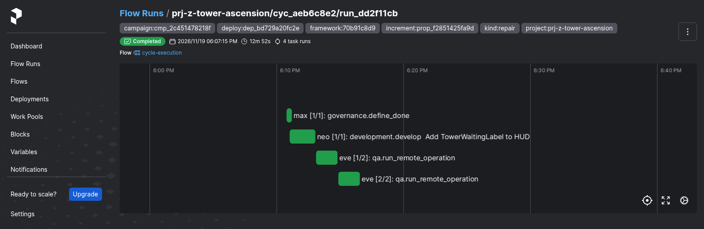

# v2.8.1

**Released 2026-11-20** · [tag `v2.8.1`](https://github.com/backspring-labs/squad-ops/releases/tag/v2.8.1)

The 2.8 line's first patch (`docs/plans/2-8-1-plan.md`; the cut record is `docs/plans/verification-sets/2-8-1-cut-record.md`): what the 2.8 windows met, fixed.

### Added
- **The skills replay reads the gate's rules** (#3199; SIP-0116 §17y; the 2.8.1 plan's item 4): the cases
  version `roblox-skills@3` adds the 2.8 window's two items. A new expectation, `scenario_rules`, reads the
  accepted change request against facts its case states before the run:
  - the revised skill's fixed words;
  - each of the item's sentences read by a criterion;
  - no wait on a state no action reaches, or on an attribute nothing sets;
  - a named check that rejects what the broken builds show, accepts a correct reading, and reads a changing
    value as a stated band.

  Read against every B-1 and B-2 proposal on record, it flags all 8 returned versions, each for the reviewer's
  reason, and meets all 7 approved ones.
- **A fault whose client stops at start, for the Campaign-level repair diagnostic** (#3222, the 2.8.1 plan's item 5):
  `luau_client_throws_at_start` adds a throw to the candidate's first client script that fires only where Roblox
  loads it (`typeof(game) == "Instance"`), so the product's headless specs pass and every play reads `setup_failed`.
  The cycle reads `blocked_unverified` and the Campaign routes §10 row 8. A fault can now stay out of a Campaign's
  repair and retry cycles (`bound_cycles`), so the repair builds without it. The request profile
  `campaign-increment-source-client-stops` declares it, with `max_correction_attempts: 0`.
- **The runtime names what holds its event loop, and its slow requests** (#3218's instruments, the 2.8.1 plan's
  item 6): a loop held for over a second is logged with the loop thread's stack (`event_loop_stalled`), and how
  long it was held when it clears. A request or a database connection slower than a second is logged too
  (`slow_request`, `slow_pool_acquire`). The watchdog stops with a start-up that fails, and doesn't read a loop
  that has stopped running as a held one.

### Changed
- **The artifact vault no longer holds the runtime's event loop** (#3218, the 2.8.1 plan's item 6): the
  artifact-id index (92,000 entries, 8 MB on the Spark) is kept in memory, so a lookup reads no file, and every
  vault operation's file IO runs in a worker thread. Concurrent stores share one index write, and each store
  still returns only once the index file holds its entry. Before this, each store, promote and retrieve parsed the
  index on the loop, and each store rewrote it. A run's checkout seeding and a gate's promotion held the API for
  18 to 41 s.
- **A Luau product's suite author is told its own runner's rules** (#3147; SIP-0112 H.37): the `qa.test` system
  prompt named pytest and vitest, with FastAPI, Next.js and JSX examples, on every product. A product that tests
  only with Luau runners is now sent a fragment written for its runner, with the rules that hold on every stack.
  Every other run's `qa.test` system prompt is byte for byte what it was.
- **The Roblox scenario-writing skill carries the rules the increment gate applies** (#3199; SIP-0118 R5.8):
  `play-scenario-authoring` gains six rules, each with a worked example: coverage, reachability, the broken build,
  timing, preservation and the kind of evidence. It ends with a self-review answered in each criterion's
  `observable` (`Played.` or `Headless.`, `Reads:`, `Fails on:`, `Band:`, `Not played:`). Coverage is worked from
  the objective's own sentences, each quoted by the criterion that reads it and kept in the `prd_delta`. A value
  that changes is read as the first band a stuck value can't show, inside one wait with at least 10 s to spare. A
  state no action reaches is played as far as a scenario goes and proved headless for the rest, with the gap
  declared.

### Fixed
- **A cycle's recorded ending decides its status** (#3201): a cycle a Campaign ended at the gate kept its later
  workloads pending, so the cycle route read it `active`, and rehearsal 3's abort cancelled it 40 minutes after it
  ended. The latest `cycle_ends` row now maps onto the status, and the cycle's response names it
  (`recorded_ending`). A run still live from before the ending, or a cancel after it, is named as a
  `status_conflict` and never hides the other record. The abort, the cycle list and detail, the memory routes and the
  binding fill read it the same way; the list reads every cycle's ending in one query.
- **A person's decision on an escalated plan gate ends its escalation** (#3174; SIP-0109 §24eh): an approval left
  the escalation reading `pending` when the run ended before the next sweep, since only the sweep wrote the ending
  and only for a building campaign.
  - The gate route writes the ending as soon as the decision is stored, once, with who decided and when. The
    sweep writes it for a stored decision whose ending is missing, in any state the campaign has reached.
  - `resolved` is a decision made before the ruling bound, by the decision's own time. One made after it reads
    `expired` and names the decision, which stands on the run.
- **A Studio that moved release channel runs nothing until it is re-qualified** (#3206; SIP-0117 R5.29): Roblox's
  updater moves an install between channels at one version number, and the worker's proof held only the version
  and the tool list. The proof is now the version, the channel and the tool list.
  - The channel is read from the startup log the running Studio holds open, at every claim and on both sides of
    every reset. One that differs or can't be read reads `not_executed`, flagged as the worker's own (R5.28).
  - The qualification record (schema `/2`) names the channel. A record from before it is still read, and as the
    newest passing record it runs nothing: **a worker upgraded from the 2.8 line's first release is re-qualified once**
    (`scripts/dev/studio_requalify.py`).
  - Each result's `ran_with` carries the proof's Studio (`qualified.*`) and the one the play ran on (`played.*`).
  - `squadops doctor`'s `qualified` check and the worker's registration name the channel.

## Merged pull requests (20)

| PR | Title | Closes |
|---|---|---|
| [#3246](https://github.com/backspring-labs/squad-ops/pull/3246) | chore(release): 2.8.1 — what the 2.8 windows met, fixed | — |
| [#3245](https://github.com/backspring-labs/squad-ops/pull/3245) | docs(verification-sets): the 2.8.1 cut record, each item's done-when read | — |
| [#3242](https://github.com/backspring-labs/squad-ops/pull/3242) | docs(verification-sets): the 2.8.1 closing window record, #3218's threshold and the Luau QA capture | [#3218](https://github.com/backspring-labs/squad-ops/issues/3218) |
| [#3241](https://github.com/backspring-labs/squad-ops/pull/3241) | docs(plans): amendment 12j, the 2.8.1 closing window on the production-channel Studio pin | — |
| [#3228](https://github.com/backspring-labs/squad-ops/pull/3228) | feat(skills): the Roblox scenario-writing skill carries the rules the increment gate applies (SIP-0118 R5.8) | — |
| [#3239](https://github.com/backspring-labs/squad-ops/pull/3239) | docs(verification-sets): the 2.8.1 cut's shakeout pair, its exit rule stated before the first launch | — |
| [#3238](https://github.com/backspring-labs/squad-ops/pull/3238) | fix(vault): the artifact index lives in memory and the vault's file IO runs off the event loop | — |
| [#3237](https://github.com/backspring-labs/squad-ops/pull/3237) | docs(verification-sets): the 2.8.1 row-8 diagnostic record, D1–D4 on the second attempt | [#3222](https://github.com/backspring-labs/squad-ops/issues/3222) |
| [#3234](https://github.com/backspring-labs/squad-ops/pull/3234) | feat(replay): the skills replay reads the gate's rules by rule, roblox-skills@3 | — |
| [#3231](https://github.com/backspring-labs/squad-ops/pull/3231) | docs(plans): amendment 12i, the Studio pin moves before the row-8 diagnostic | — |
| [#3233](https://github.com/backspring-labs/squad-ops/pull/3233) | fix(api): the loop watchdog stops with a start-up that fails, and a stopped loop isn't a held one | [#3232](https://github.com/backspring-labs/squad-ops/issues/3232) |
| [#3220](https://github.com/backspring-labs/squad-ops/pull/3220) | fix(studio): the worker's proof names Studio's release channel, and a Studio on another runs nothing (SIP-0117 R5.29) | [#3206](https://github.com/backspring-labs/squad-ops/issues/3206) |
| [#3225](https://github.com/backspring-labs/squad-ops/pull/3225) | feat(faults): a client that stops at start, kept out of a Campaign's repair | — |
| [#3229](https://github.com/backspring-labs/squad-ops/pull/3229) | fix(prompts): a Luau product's suite author is sent a qa.test fragment written for its runner (SIP-0112 H.37) | — |
| [#3227](https://github.com/backspring-labs/squad-ops/pull/3227) | fix(campaigns): a person's gate decision ends its escalation where it is recorded (SIP-0109 §24eh) | [#3174](https://github.com/backspring-labs/squad-ops/issues/3174) |
| [#3226](https://github.com/backspring-labs/squad-ops/pull/3226) | docs(plans): amendment 12h, the 2.8.1 row-8 diagnostic, pre-registered before it runs | — |
| [#3223](https://github.com/backspring-labs/squad-ops/pull/3223) | fix(cycles): a cycle's recorded ending decides its status, and the abort leaves an ended cycle | [#3201](https://github.com/backspring-labs/squad-ops/issues/3201) |
| [#3221](https://github.com/backspring-labs/squad-ops/pull/3221) | feat(runtime): name what holds the event loop, and slow requests and pool acquires | — |
| [#3219](https://github.com/backspring-labs/squad-ops/pull/3219) | docs(plans): the 2.8.1 plan, revision 2, and the 2.9 and 2.10 plans' draft starts | — |
| [#3217](https://github.com/backspring-labs/squad-ops/pull/3217) | docs(release): the v2.8.0 package | — |

## Improvement proposals amended in place

No lifecycle change — each was edited under the status it already had (a post-acceptance amendment, CLAUDE.md step 5a).

| Proposal | Status |
|---|---|
| [SIP-0088-Agent-Runtime-Modes](../../design/sips/SIP-0088-Agent-Runtime-Modes.md) | accepted |
| [SIP-0090-Agent-Embodiment-Substrate](../../design/sips/SIP-0090-Agent-Embodiment-Substrate.md) | accepted |
| [SIP-0091-Duty-Durability-via-Temporal](../../design/sips/SIP-0091-Duty-Durability-via-Temporal.md) | accepted |
| [SIP-0092-Implementation-Plan-Improvement](../../design/sips/SIP-0092-Implementation-Plan-Improvement.md) | accepted |
| [SIP-0093-Multi-Role-Plan-Authoring](../../design/sips/SIP-0093-Multi-Role-Plan-Authoring.md) | accepted |
| [SIP-0101-Cycle-Replay-Harness](../../design/sips/SIP-0101-Cycle-Replay-Harness.md) | accepted |
| [SIP-0102-Ephemeral-Application-Sandbox](../../design/sips/SIP-0102-Ephemeral-Application-Sandbox.md) | accepted |
| [SIP-0105-Stack-Blueprint-Contract](../../design/sips/SIP-0105-Stack-Blueprint-Contract.md) | accepted |
| [SIP-0109-Campaign-Orchestration](../../design/sips/SIP-0109-Campaign-Orchestration.md) | accepted |
| [SIP-0110-Cross-Cycle-Memory](../../design/sips/SIP-0110-Cross-Cycle-Memory.md) | accepted |
| [SIP-0111-TensorFold-Provider-Adapter](../../design/sips/SIP-0111-TensorFold-Provider-Adapter.md) | accepted |
| [SIP-0112-Project-Lifecycle-Management](../../design/sips/SIP-0112-Project-Lifecycle-Management.md) | accepted |
| [SIP-0113-Outcome-Evaluation](../../design/sips/SIP-0113-Outcome-Evaluation.md) | accepted |
| [SIP-0115-Project-Goals-Backlog](../../design/sips/SIP-0115-Project-Goals-Backlog.md) | accepted |
| [SIP-0116-Agent-Skillsets](../../design/sips/SIP-0116-Agent-Skillsets.md) | implemented |
| [SIP-0117-Game-Development-Platform](../../design/sips/SIP-0117-Game-Development-Platform.md) | accepted |
| [SIP-0118-Game-Development-Capability](../../design/sips/SIP-0118-Game-Development-Capability.md) | accepted |
| [SIP-Agent-Comms-Delivery-Guarantees](../../design/sips/SIP-Agent-Comms-Delivery-Guarantees.md) | proposed |

## Cycle evidence

### `cyc_e8260793f781`

**Verdict:** `blocked_unverified` · **Runs:** 3 · **Role:** diagnostic — fault-injected, non-counting: its verdict is not a verdict about the squad (#1251)

| | Checks |
|---|---|
| Verified | acceptance_criteria_prose, expected_artifacts, non_stub_files |
| Failed | — |
| Required unmet | scenario:S1:hud-visible, scenario:S1:tower-waiting-text, scenario:S2:hud-visible, scenario:S2:tower-waiting-shown |
| Never executed | scenario:S1:hud-visible, scenario:S1:tower-waiting-text, scenario:S2:hud-visible, scenario:S2:tower-waiting-shown |

### `cyc_aeb6c8e22b64`

**Verdict:** `accepted` · **Runs:** 1 · **Role:** diagnostic — fault-injected, non-counting: its verdict is not a verdict about the squad (#1251)

| | Checks |
|---|---|
| Verified | acceptance_criteria_prose, expected_artifacts, non_stub_files, scenario:S1:hud-visible, scenario:S1:tower-waiting-text, scenario:S2:hud-visible, scenario:S2:tower-waiting-shown |
| Failed | — |
| Required unmet | — |
| Never executed | — |

### `cyc_15ba8b7b7589`

**Verdict:** `blocked_unverified` · **Runs:** 3 · **Role:** void — void: the roll was stopped and the set restarted (the record's §0)

| | Checks |
|---|---|
| Verified | acceptance_criteria_prose, expected_artifacts, non_stub_files |
| Failed | — |
| Required unmet | scenario:S1:hud-visible, scenario:S1:lobby-hint-text |
| Never executed | scenario:S1:hud-visible, scenario:S1:lobby-hint-text |

### `cyc_bd5078b22c8e`

**Verdict:** `blocked_unverified` · **Cycle status:** `cancelled` · **Runs:** 1 · **Role:** void — void: the roll was stopped and the set restarted (the record's §0)

| | Checks |
|---|---|
| Verified | — |
| Failed | — |
| Required unmet | — |
| Never executed | — |

## Screenshots

Of cycle `cyc_aeb6c8e22b64` (diagnostic) — the 2.8.1 line's new proof is the Campaign-level repair of a blocked candidate on a played product (SIP-0109 §10 row 8): this is the repair cycle, launched without the fault, whose candidate passed the same frozen scenarios by digest and was accepted.

*prefect flow run row 8 repair cycle its candidate plays and is accepted*
